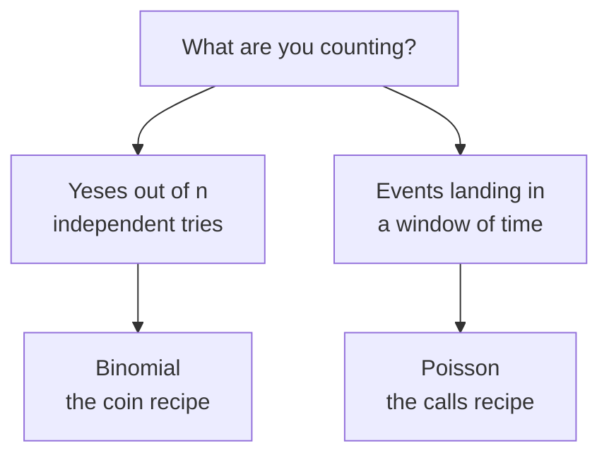

# Coins and Calls: Binomial and Poisson as Recipes

> **Part 10 of 15.** Part of the [Probability & Statistics](/fields/data-science/probability-statistics/README.md) series. It continues from [What to Expect](/fields/data-science/probability-statistics/what-to-expect.md), where a long-run average (E[X]) and a spread became two numbers you can compute from a table of chances. Here we build two such tables from a question. The scenario numbers are invented, and every figure was recomputed with Python.

## Table of Contents

- [Prologue: ten customers, one smoky blend](#prologue-ten-customers-one-smoky-blend)
- [A distribution is a recipe](#a-distribution-is-a-recipe)
- [Binomial: count the ways, weigh each way](#binomial-count-the-ways-weigh-each-way)
- [The shorthand, and what to expect](#the-shorthand-and-what-to-expect)
- [Poisson: many tiny chances](#poisson-many-tiny-chances)
- [When the recipe lies](#when-the-recipe-lies)
- [Check yourself](#check-yourself)
- [Back to the story](#back-to-the-story)
- [Cheat sheet](#cheat-sheet)
- [Answers](#answers)
- [References](#references)

* * *

## Prologue: ten customers, one smoky blend

Mira has ordered a crate of her smoky blend, and she wants to know how many cups to brew ahead. "About three in ten customers pick it," she says. (Invented: 30%.) "Ten customers are in the queue. How many smoky orders?"

Tala answers instantly: "Three."

"Exactly three? How often?"

Tala opens her mouth, shuts it, and reaches for a pencil. Three is the *average*. It is not the *answer*. The answer is a whole table of chances, and today we build it from scratch.

* * *

## A distribution is a recipe

A **distribution** is a table that says how much probability each possible value gets. You met one in part 9. The trick of this page: you almost never write such a table by hand. You recognise the *shape of the question* and pick a recipe.



*Two questions, two recipes. The rest of the page is how each recipe is cooked and when it burns.*

* * *

## Binomial: count the ways, weigh each way

Start small: **4** customers, each smoky with probability 0.3, independently. Write every possible queue as a string of yes (smoky) and no. There are `2^4 = 16` strings. Each string with `k` yeses has the same probability, `0.3^k × 0.7^(4-k)`, so group them by `k` (the counting from [Counting the Ways](/fields/data-science/probability-statistics/counting-the-ways.md)):

| Smoky orders `k` | Ways (strings) | Chance of each way | P(X = k) |
|---|---|---|---|
| 0 | 1 | 0.7^4 | 0.2401 |
| 1 | 4 | 0.3 × 0.7^3 | 0.4116 |
| 2 | 6 | 0.3^2 × 0.7^2 | 0.2646 |
| 3 | 4 | 0.3^3 × 0.7 | 0.0756 |
| 4 | 1 | 0.3^4 | 0.0081 |

The whole recipe is one sentence: **probability of `k` = (number of ways to place `k` yeses) × (probability of one such way).** The ways column is a row of Pascal's triangle, 1, 4, 6, 4, 1.

> ☕ **Try it before you scroll.** For 10 customers, the table above grows to 11 rows. Before reading on: is "exactly 3 smoky" more likely than 50%, or much less? *Hint: the rows must add to 1, and there are 11 of them.*

* * *

## The shorthand, and what to expect

For 10 customers there are 1024 strings, and the pencil gives up. A computer does not: it listed all 1024 and added up each string's probability (using exact fractions). Then it computed the shorthand `comb(10, k) × 0.3^k × 0.7^(10-k)`. **Both tables were identical.** The formula is only the counting, written short:

```python
import math
from fractions import Fraction

p = Fraction(3, 10)                      # exact 0.3, so no rounding noise
n = 10
pmf = {k: math.comb(n, k) * p**k * (1 - p)**(n - k) for k in range(n + 1)}
print(sum(pmf.values()))                 # 1  (the rows add to exactly 1)
```

| `k` | 0 | 1 | 2 | 3 | 4 | 5 | 6 | 7 | 8 |
|---|---|---|---|---|---|---|---|---|---|
| Ways | 1 | 10 | 45 | 120 | 210 | 252 | 210 | 120 | 45 |
| P(X = k) | 0.0282 | 0.1211 | 0.2335 | 0.2668 | 0.2001 | 0.1029 | 0.0368 | 0.0090 | 0.0014 |

(`k` = 9 and 10 are 0.0001 and below.) So "exactly 3" happens only **26.7%** of the time. Tala's "three" is the single most likely count, and it is still wrong nearly three times in four.

Now part 9's two tools, applied to this table. Computing `E[X] = sum of k × P(k)` and the variance `sum of (k − mean)^2 × P(k)` exactly gives:

```text
mean     = 3      = n × p
variance = 21/10  = n × p × (1 − p) = 10 × 0.3 × 0.7 = 2.1   (SD about 1.45)
```

Why `np`? Each customer is worth 0.3 of a smoky order on average, and averages add over ten customers. Why `p(1 − p)`? One customer's spread is biggest at p = 0.5 and shrinks to zero when the answer is nearly certain, and spreads of independent tries add. NIST's handbook states both results (mean `np`, standard deviation `sqrt(np(1 − p))`) and its one catch: **`p` is fixed for all trials.**

The naive trap: "10 customers, 30% each, so the chance of at least one smoky is 10 × 0.3 = 300%." Adding chances that overlap overshoots. The honest route is the complement: `1 − 0.7^10 = 0.9718`.

What did we assume? Two yes/no outcomes, the same `p` every time, and customers who do not influence one another. Remember that list. Next: what if there is no "n tries" to count?

* * *

## Poisson: many tiny chances

Customers walk in at an average of **4 per 10 minutes** (invented). How many in the next 10 minutes? There is no "n customers each saying yes". But we can build one: cut the 10 minutes into `n` equal slices so thin that at most one person fits in each, with chance `4/n` per slice. Now it is a binomial with `p = 4/n`, and `np = 4` stays fixed. Make the slices thinner and watch the table settle:

| `k` | n = 10 | n = 100 | n = 1000 | Poisson, rate 4 |
|---|---|---|---|---|
| 0 | 0.0060 | 0.0169 | 0.0182 | 0.0183 |
| 1 | 0.0403 | 0.0703 | 0.0730 | 0.0733 |
| 2 | 0.1209 | 0.1450 | 0.1464 | 0.1465 |
| 3 | 0.2150 | 0.1973 | 0.1956 | 0.1954 |
| 4 | 0.2508 | 0.1994 | 0.1958 | 0.1954 |
| 5 | 0.2007 | 0.1595 | 0.1566 | 0.1563 |
| 6 | 0.1115 | 0.1052 | 0.1043 | 0.1042 |

The last column is the **Poisson** recipe, with rate `λ` (lambda, the average count per window):

```text
P(X = k) = e^(−λ) × λ^k / k!        mean = λ,  variance = λ
```

computed with `math.exp`. NIST gives this formula and its mean and variance. The "many tiny chances" link is shown here by the numbers (NIST's page does not discuss it), not proved.

So Poisson is a binomial with the `n` thrown away: all you need is the average rate. Its signature is **variance equals mean**. A shop at rate 4 sees an empty 10 minutes `e^(−4) =` 1.8% of the time, and ten or more customers 0.8% of the time.

* * *

## When the recipe lies

The Poisson recipe assumes a **constant rate** and **independent arrivals**. Ravi, who counts everything, has tallied arrivals in 12 ten-minute windows (invented): 8 quiet mid-morning windows, `1, 2, 2, 3, 1, 2, 1, 3`, and 4 lunchtime windows, `7, 8, 6, 9`.

```text
mean over 12 windows        = 3.75
variance over 12 windows    = 7.85      (a true Poisson would give about 3.75)
windows with 7 or more      : observed 3, Poisson(3.75) predicts 12 × 0.0863 = 1.04
```

Variance twice the mean is the alarm. The rate was not constant, it was two rates (about 1.9 and 7.5) averaged into a number nobody lived at, like the two-clump scores in part 5. The fix is not a cleverer formula: use one Poisson per period.

The binomial can break the same way through dependence. Suppose customers arrive as 5 couples who always order the same. The mean is still 3, but the variance jumps from 2.1 to 4.2, and "exactly 3 smoky" becomes **impossible**, because counts now come in twos. The recipe's formula would still print 26.7%.

> [!NOTE]
> The formula never checks its own assumptions. A distribution fits the world exactly as far as the story fits: independent, same `p`, same rate.

* * *

## Check yourself

1. Which recipe fits: (a) defective bulbs in a box of 12, (b) emails per hour, (c) heads in 8 flips?
2. For 4 customers at p = 0.3, why is the number of ways for `k` = 2 equal to 6?
3. What are the mean and variance for 20 customers at p = 0.1?
4. A counter's counts have mean 5 and variance 14. Does Poisson fit?
5. Why is "P(at least one) = n × p" wrong?

* * *

## Back to the story

Mira brews three cups of smoky and hovers. Tala has the table now: "Five or more is 15%, so if we want to be safe 85% of the time, brew five." Ravi tallies the lunch rush and mutters that a single average hides two shops.

"So that is two recipes for counting," says Tala. "Do the tables always look this lumpy?"

Look back at the 10-customer row: it rises, peaks, falls. Make `n` huge and the lumps smooth into a curve that shows up everywhere. Next cup: [The Bell Curve](/fields/data-science/probability-statistics/the-bell-curve.md).

**Takeaway:** a distribution is a recipe matched to a question. Binomial counts yeses in `n` independent tries (ways times chance of each way). Poisson counts events in a window (many tiny chances). Check the assumptions before you trust the table.

**Challenge:** ten customers at p = 0.3 give a table that is lopsided. Using `np` and `np(1 − p)`, guess what happens to its shape when `n` is 1000.

* * *

## Cheat sheet

```text
BINOMIAL  n tries, same p, independent, yes/no
  P(k) = comb(n, k) * p^k * (1-p)^(n-k)     mean = n p    variance = n p (1-p)
POISSON   events in a window, constant rate, independent
  P(k) = e^(-lam) * lam^k / k!              mean = lam    variance = lam
Poisson ~ binomial with large n, small p, n p = lam.
ALARM: variance far from mean (Poisson), or tries that are not independent.
NEVER add overlapping chances: use 1 - P(none).
```

* * *

## Answers

1. (a) Binomial (12 tries, defective or not), (b) Poisson (events in a window), (c) binomial (8 flips).
2. There are 6 places to put 2 yeses among 4 positions: `comb(4, 2) = 4!/(2!2!) = 6`.
3. Mean `20 × 0.1 = 2`; variance `20 × 0.1 × 0.9 = 1.8`.
4. No. Poisson needs variance close to the mean (5), and 14 is nearly three times that: look for mixed rates or clumped arrivals.
5. Chances overlap, and the sum can pass 1 (here 3.0). Use `1 − (1 − p)^n`, which is 0.9718 for n = 10.

* * *

## References

- NIST/SEMATECH e-Handbook of Statistical Methods, *Binomial Distribution* (pmf, mean `np`, standard deviation `sqrt(np(1 − p))`, `p` fixed across trials). <https://www.itl.nist.gov/div898/handbook/eda/section3/eda366i.htm>
- NIST/SEMATECH e-Handbook, *Poisson Distribution* (pmf, mean and variance `λ`). <https://www.itl.nist.gov/div898/handbook/eda/section3/eda366j.htm>
- Python `math` module: `comb(n, k)`, `exp(x)`. <https://docs.python.org/3/library/math.html>
- Every number on this page was recomputed with Python 3.14.4 (`math`, `fractions`, brute-force enumeration of all 16 and 1024 strings). No simulation was used.
