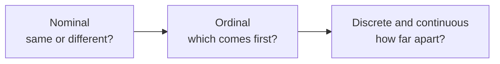

# Mira's Notebook: What Kind of Data Is This, and How Do You Count It?

> **Part 2 of 15.** Part of the [Probability & Statistics](/fields/data-science/probability-statistics/README.md) series. It continues from [Stir the Pot First](/fields/data-science/probability-statistics/stir-the-pot-population-and-sampling.md): Mira has a properly drawn sample and a notebook full of answers. By the end you will know what you are allowed to ask of any column before you compute, and how to count it without losing its shape. All people and numbers are invented, and every table can be checked by hand.

## The idea in one minute

- **The kind of data decides which questions make sense.** Can two values be told apart (nominal), ordered (ordinal) or measured apart (numbers)? Each step allows more arithmetic.
- **A frequency table is counting without losing the shape.** Tally how often each value appears, and the crowd's outline stays visible.
- **A grouped table is drawers for values.** When values are too many, sort them into equal drawers. The drawers must touch, because measured values have no gaps between them. That one fact explains class boundaries.

## Table of Contents

- [The idea in one minute](#the-idea-in-one-minute)
- [Prologue: the average blend](#prologue-the-average-blend)
- [What can you do with two of them?](#what-can-you-do-with-two-of-them)
- [Counting without losing the shape](#counting-without-losing-the-shape)
- [Drawers for values: the grouped table](#drawers-for-values-the-grouped-table)
- [Why the drawers must touch](#why-the-drawers-must-touch)
- [The recipe, short](#the-recipe-short)
- [Check yourself](#check-yourself)
- [Back to the story](#back-to-the-story)
- [Cheat sheet](#cheat-sheet)
- [Answers](#answers)
- [References](#references)

* * *

## Prologue: the average blend

Mira's sample is in. She types her notebook into a spreadsheet, five columns for each of 20 customers:

| Customer ID | Favorite blend | Strength preference | Cups per week | Brewing temperature (°C) |
|---|---|---|---|---|
| 1041 | Green | Mild | 3 | 79.5 |
| 2208 | Black | Strong | 9 | 96.0 |
| 0377 | Herbal | Medium | 2 | 88.2 |
| ... | ... | ... | ... | ... |

A helpful assistant clicks **Average** on every column. The spreadsheet obliges: the average customer ID is 1,208.7 and the average favorite blend is #2.4.

Both answers are computed perfectly and mean nothing. Why? Not because of a rule, but because of something much simpler. Hold that thought.

* * *

## What can you do with two of them?

Pick any two values from a column and ask what you can *do* with them. The answer sorts every column into four kinds.



| Kind | The one thing you can do with two values | Mira's column |
|---|---|---|
| **Nominal** | Say **same or different** | Favorite blend (Green, Black, Herbal) |
| **Ordinal** | Also say **which comes first** (but not by how much) | Strength preference (Mild < Medium < Strong) |
| **Discrete** | Also say **how far apart**: values you *count*, so whole numbers | Cups per week (0, 1, 2, ...) |
| **Continuous** | Also say how far apart: values you *measure*, so any value in a range | Brewing temperature |

Each row keeps everything the row above allowed. That also tells you which summaries are honest:

- **Same or different** allows counting and percentages, and "the most common one".
- **Which comes first** adds sorting, the middle value and rankings.
- **How far apart** adds adding, subtracting and averaging, because a gap now means something.

Averaging favorite blends needs "how far apart is Green from Oolong?", which nobody can answer. The spreadsheet did not know. You do.

**Labels in disguise.** Customer ID 2208 is not "more" than 1041, and adding two IDs produces nothing. It is a nominal column written with digits, like postal codes, phone numbers and jersey numbers. The test is the same question: if "how far apart" is meaningless, it is a label, whatever it looks like.

> ☕ **Try it before you scroll.** Cups ordered per visit, a satisfaction rating of poor, fair or good, and a loyalty-card number: which question can you ask of each, *same or different*, *which first*, or *how far apart*?

* * *

## Counting without losing the shape

A **frequency table** counts how many times each value appears. It is the cheapest way to keep a crowd's outline: nothing is thrown away except the order in which people walked in.

For categories it is the simplest table there is. Mira's 20 customers named a favorite blend:

| Blend | Frequency `f` | Percentage |
|---|---|---|
| Black | 5 | 25% |
| Green | 6 | 30% |
| Herbal | 4 | 20% |
| Oolong | 5 | 25% |
| **Total** | **20** | **100%** |

The percentage is `f / n × 100`. One check, every time: the frequencies add up to the sample size (`Σf = n`). If not, a customer went missing or was counted twice.

Now a number column. Mira has her 20 tasters rate the new blend on a 0 to 120 quality scale. The scores, in order of arrival:

```text
62  55  62  94  89
71  55  62  58  104
71  58  94  95  93
52  58  89  89  93
```

Sort them and count each distinct value, and you have an **ungrouped frequency table**, one row per individual value:

| Score | Frequency `f` | Relative frequency `f/n` | Percentage | Cumulative frequency `CF` |
|---|---|---|---|---|
| 52 | 1 | 0.05 | 5% | 1 |
| 55 | 2 | 0.10 | 10% | 3 |
| 58 | 3 | 0.15 | 15% | 6 |
| 62 | 3 | 0.15 | 15% | 9 |
| 71 | 2 | 0.10 | 10% | 11 |
| 89 | 3 | 0.15 | 15% | 14 |
| 93 | 2 | 0.10 | 10% | 16 |
| 94 | 2 | 0.10 | 10% | 18 |
| 95 | 1 | 0.05 | 5% | 19 |
| 104 | 1 | 0.05 | 5% | 20 |
| **Total** | **20** | **1.00** | **100%** | |

The extra columns are three questions about the same count: how many (`f`), what fraction (`f/n`), and how many **this or lower** (`CF`, a running total). Read the row for 71: `CF = 11`, so 11 of 20 tasters scored 71 or less, which is 55%. "What share sits at or below this value" will return as the percentile. The last `CF` must equal `n`.

Now look at the shape, which is why we counted. The scores come in two clumps, 52 to 62 and 89 to 95, with nothing between 71 and 89. The average of all 20 is 75.2, right in the empty gap, describing nobody. The table shows that. A single number hides it.

**Stem and leaf** is the same count with the raw values kept. Split each number into a **stem** (leading digits) and **leaves** (last digit):

```text
Stem | Leaf
  5  | 2 5 5 8 8 8
  6  | 2 2 2
  7  | 1 1
  8  | 9 9 9
  9  | 3 3 4 4 5
 10  | 4
```

Turn your head 90 degrees and it is a bar chart made of the actual numbers (stem 5, leaf 2 is 52). With hundreds of values it becomes a wall. What if 500 readings are almost all different?

* * *

## Drawers for values: the grouped table

Five hundred nearly distinct readings give an ungrouped table of 500 rows of `f = 1`: the raw data in a table costume. The fix is a **grouped frequency table**. Think of **drawers**. Each drawer takes a stretch of values, and you count what ends up in each drawer.

Using the 20 scores and 5 drawers of width 11:

| Class limits | Frequency `f` | Relative frequency | `CF` |
|---|---|---|---|
| 52 to 62 | 9 | 0.45 | 9 |
| 63 to 73 | 2 | 0.10 | 11 |
| 74 to 84 | 0 | 0.00 | 11 |
| 85 to 95 | 8 | 0.40 | 19 |
| 96 to 106 | 1 | 0.05 | 20 |
| **Total** | **20** | **1.00** | |

The counts come straight from the ungrouped table: the first drawer holds 52 (1) + 55 (2) + 58 (3) + 62 (3) = 9, and the fourth holds 89 (3) + 93 (2) + 94 (2) + 95 (1) = 8. The empty drawer, 74 to 84, still shows the gap.

**The price.** You can no longer tell whether the 9 scores in the first drawer were all 55 or spread from 52 to 62. Grouping trades detail for readability, and you cannot undo it. Draw stem and leaf first when `n` is small.

Good drawers hold every value exactly once and have the **same width**, so counts compare fairly. The surprising part is the next one.

* * *

## Why the drawers must touch

The first drawer says "52 to 62". Subtract: ten wide. Yet the width we used was **eleven**. Which is it?

Here is the idea. A score of 62 on a quality scale is not truly "exactly 62". Quality, like temperature or time, is **measured** and then **written rounded**. A true 62.4 is written 62, and a true 62.6 is written 63. So the drawer holding "62" really holds everything from 61.5 up to 62.5.

```text
 written:    ...  61  |   62   |  63  ...
 real value:      61.5      62.5     63.5
                      \_ the "62" drawer _/
```

Every written value wears a **half-unit halo**. Stack the halos side by side and they touch with no gap: the first drawer really runs from 51.5 to 62.5, the next from 62.5 to 73.5, and so on. These cut-off points are the **class boundaries**. The drawer's true width is boundary to boundary: 62.5 − 51.5 = **11**. The **limits** (52 and 62) are only the smallest and largest values you can write in it.

| Class limits | Class boundaries | Width (upper − lower boundary) |
|---|---|---|
| 52 to 62 | 51.5 to 62.5 | 11 |
| 63 to 73 | 62.5 to 73.5 | 11 |
| 74 to 84 | 73.5 to 84.5 | 11 |
| 85 to 95 | 84.5 to 95.5 | 11 |
| 96 to 106 | 95.5 to 106.5 | 11 |

The halo is **half of one measuring unit**: 0.5 for whole numbers, 0.05 for one decimal place, 0.005 for two. Boundary = limit ± half a unit.

> ☕ **Try it before you scroll.** Data recorded to one decimal place has a class running 12.4 to 18.4. What are its boundaries, and why is the width 6.1 and not 6.0?

* * *

## The recipe, short

With the idea in hand, the recipe is five lines, each with its reason:

1. **Range** = largest − smallest. Here `104 − 52 = 52`. *How much line must the drawers cover?*
2. **Number of drawers `k`**: a handful. Too few hides the shape, too many reproduces the noise. A rule of thumb, Sturges' rule `k ≈ 1 + 3.322 × log10(n)`, gives 5.3 for `n = 20`, so use 5.
3. **Width** `h = Range / k = 52 / 5 = 10.4`, then **round up** to 11. *Why up?* Rounded down to 10, five drawers starting at 52 end at 101 and the score of 104 has nowhere to live.
4. **Limits**: start at the smallest value and add `h` for each next drawer (52 to 62, 63 to 73, and so on).
5. **Count** each drawer, and check that `Σf = n`.

**Takeaway:** the kind of data tells you which questions are meaningful, a frequency table counts without losing the shape, and class boundaries are not a rule but the halo that lets drawers touch.

* * *

## Check yourself

1. Which question (same or different, which first, how far apart) fits each, and so what kind is it? (a) cups ordered per visit, (b) taste rating of poor, fair or good, (c) brewing temperature in °C, (d) blend name, (e) loyalty-card number.
2. In the ungrouped table above, how many tasters scored **89 or less**, and what percentage is that?
3. A data set is recorded to **one decimal place**, with a minimum of 12.4 and a maximum of 48.9. You want 6 classes. Find `h`, write the class limits, and give the first class's boundaries.
4. A friend says, "The class 85 to 95 is ten wide, so the five classes should have width 10, not 11." What is the mistake?
5. A table of 40 customers shows frequencies of 12, 9, 11 and 7. What is wrong?

* * *

## Back to the story

Mira deletes the two "Average" cells and rebuilds the sheet column by column, asking of each: what can I do with two of these?

| Column | Kind | What she does with it |
|---|---|---|
| Customer ID | Nominal (a label written with digits) | Nothing. It identifies a customer, and that is all it does |
| Favorite blend | Nominal | A category table, and the most common blend |
| Strength preference | Ordinal | A category table in order, and later a middle value |
| Cups per week | Discrete | An ungrouped table, and an average that means something |
| Brewing temperature | Continuous | A grouped table with proper boundaries, and an average |

When the helpful assistant offers to click "Average" again, she knows what to ask first.

**Challenge.** An average of cups per week is now allowed, but the tasting scores' average, 75.2, described nobody. When can one number stand in for a column? The next cup is about that.

* * *

## Cheat sheet

```text
Two values: same or different -> nominal   which first -> ordinal
            how far apart     -> discrete (counted) or continuous (measured)
Labels written as digits (IDs, postal codes) are nominal.

Checks:  sum of f = n     sum of f/n = 1     last CF = n
Grouped: Range = max - min     h = Range / k, ROUND UP
         boundaries = limits -/+ half the measuring unit (0.5, 0.05, ...)
         class width = upper boundary - lower boundary = h
```

* * *

## Answers

1. (a) **Discrete**: counted, so how far apart works. (b) **Ordinal**: which first, but gaps are not measured. (c) **Continuous**. (d) **Nominal**: same or different only. (e) **Nominal**: the number is a label, however many digits it has.
2. The cumulative frequency at 89 is **14**, so 14 tasters, which is `14 / 20 = 70%`.
3. `Range = 48.9 − 12.4 = 36.5`, and `h = 36.5 / 6 = 6.08...`, so round **up** to one decimal place: `h = 6.1`. The limits are 12.4 to 18.4, 18.5 to 24.5, 24.6 to 30.6, 30.7 to 36.7, 36.8 to 42.8 and 42.9 to 48.9. With one decimal place the halo is 0.05, so the first class's boundaries are **12.35 to 18.45**, a width of 6.1. (Limits 12.4 to 18.4 differ by only 6.0.)
4. Ten is the difference between the **limits** (95 − 85). The width is the distance between the **boundaries** (95.5 − 84.5 = 11), because each written value carries a half-unit halo and the drawers must touch.
5. The frequencies add up to `12 + 9 + 11 + 7 = 39`, not 40. A customer is missing, or one count is off by one.

* * *

## References

- NIST/SEMATECH e-Handbook of Statistical Methods, *Histogram*: a histogram divides the range of the data into equal-width bins (classes) and counts the observations in each. <https://www.itl.nist.gov/div898/handbook/eda/section3/histogra.htm>
- Stevens, S. S. (1946), *On the Theory of Scales of Measurement*, Science 103(2684). Cited as the origin of the nominal, ordinal, interval and ratio scale levels; the paper was not retrieved here, so it is not quoted.
- Sturges, H. A. (1926), *The Choice of a Class Interval*, Journal of the American Statistical Association 21(153). Cited as the origin of the class-count rule of thumb; not retrieved here, so it is not quoted.
- Every number on this page was recomputed with Python 3.14.4.
