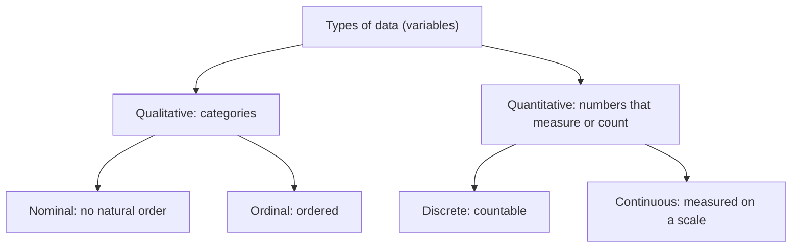

# Mira's Notebook: What Kind of Data Is This, and How Do You Count It?

> **Part of the [Probability & Statistics](https://github.com/AhmedYousriSobhi/aCupOfTea/blob/main/fields/data-science/probability-statistics/README.md) series.** It continues from [Stir the Pot First](https://github.com/AhmedYousriSobhi/aCupOfTea/blob/main/fields/data-science/probability-statistics/stir-the-pot-population-and-sampling.md): Mira now has a properly drawn sample, and a notebook full of answers. All people and numbers are invented, and every table can be checked by hand.

## Table of Contents

- [Mira's Notebook: What Kind of Data Is This, and How Do You Count It?](#miras-notebook-what-kind-of-data-is-this-and-how-do-you-count-it)
  - [Table of Contents](#table-of-contents)
  - [Prologue: the average blend](#prologue-the-average-blend)
  - [Four kinds of data](#four-kinds-of-data)
  - [Numbers that are really labels](#numbers-that-are-really-labels)
  - [Counting words: the category table](#counting-words-the-category-table)
  - [Counting numbers: the ungrouped table](#counting-numbers-the-ungrouped-table)
  - [The table you can read sideways: stem and leaf](#the-table-you-can-read-sideways-stem-and-leaf)
  - [Too many different values: the grouped table](#too-many-different-values-the-grouped-table)
  - [Why 52 to 62 is eleven wide](#why-52-to-62-is-eleven-wide)
  - [Choosing the right table](#choosing-the-right-table)
  - [Check yourself](#check-yourself)
  - [Cheat sheet](#cheat-sheet)
  - [Answers](#answers)
  - [Back to the story](#back-to-the-story)

* * *

## Prologue: the average blend

Mira's sample is in. She types her notebook into a spreadsheet, five columns for each of 20 customers:

| Customer ID | Favorite blend | Strength preference | Cups per week | Brewing temperature (°C) |
|---|---|---|---|---|
| 1041 | Green | Mild | 3 | 79.5 |
| 2208 | Black | Strong | 9 | 96.0 |
| 0377 | Herbal | Medium | 2 | 88.2 |
| ... | ... | ... | ... | ... |

A helpful assistant clicks **Average** on every column. The spreadsheet obliges. It tells her that the average customer ID is 1,208.7 and the average favorite blend is #2.4.

Those answers are computed perfectly and mean nothing. The point of this page is to know, **before** you compute, what a column is allowed to be asked.

* * *

## Four kinds of data

Every column (a **variable**) falls into one of two families, and each family has two members.



| Type | The test | Mira's column | Others |
|---|---|---|---|
| **Nominal** | Can the values be ordered? **No** | Favorite blend (Green, Black, Herbal) | Gender, eye color, country |
| **Ordinal** | Ordered, but the gaps are not measured | Strength preference (Mild < Medium < Strong) | Grades (A > B > C), satisfaction ratings |
| **Discrete** | Values you **count**, so they are whole numbers | Cups per week (0, 1, 2, ...) | Number of children, number of defects |
| **Continuous** | Values you **measure**, so any value in a range is possible | Brewing temperature, brewing time | Height, weight, time |

A short way to remember the quantitative pair: discrete is the kind you can count on your fingers (integers), and continuous is the kind that needs a ruler (real numbers).

Two subtleties that trip people up:

- **Ordinal does not mean equally spaced.** Is the gap between Mild and Medium the same as between Medium and Strong? Nothing says so. That is why you can sort ordinal data but should not treat its labels as measurements.
- **Continuous values are recorded rounded.** A temperature of 79.5 °C is really "somewhere around 79.5". You write what the thermometer shows, to a chosen number of decimals. This detail returns later, in the grouped table.

Why does the type matter? Because it decides which summaries make sense:

| Type | Sensible to compute |
|---|---|
| Nominal | Counts, percentages, the most common value |
| Ordinal | All of the above, plus ordering, medians and percentiles |
| Discrete and continuous | All of the above, plus averages and measures of spread |

Averaging favorite blends is the kind of mistake the table above prevents.

* * *

## Numbers that are really labels

The customer ID column looks quantitative. It is full of digits. But 2208 is not "more" than 1041 in any sense that matters, and adding two IDs together produces nothing. It is a **nominal** variable that happens to be written with digits.

The same goes for postal codes, phone numbers, jersey numbers and room numbers. A useful test is to ask: **does it make sense to add them, or to say one is twice the other?** If not, it is a label, whatever it looks like.

* * *

## Counting words: the category table

Mira's 20 customers named a favorite blend. Raw, the data looks like a pile:

```
Green, Black, Herbal, Oolong, Black, Green, ... (20 answers)
```

A **frequency table** counts how many times each value appears. For categories, it is the simplest table there is:

| Blend | Frequency `f` | Percentage |
|---|---|---|
| Black | 5 | 25% |
| Green | 6 | 30% |
| Herbal | 4 | 20% |
| Oolong | 5 | 25% |
| **Total** | **20** | **100%** |

The percentage is `f / n × 100`. Two checks to run every time:

- The frequencies add up to the sample size: `Σf = n` (here 20).
- The percentages add up to 100%.

If either check fails, a customer went missing or was counted twice, and the table is wrong, however neat it looks.

* * *

## Counting numbers: the ungrouped table

Now a quantitative column. Mira has her 20 tasters rate the new blend on a 0 to 120 quality scale. Here are the 20 scores, in the order they arrived:

```
62  55  62  94  89
71  55  62  58  104
71  58  94  95  93
52  58  89  89  93
```

Unsorted, nothing leaps out. Sort them and count each distinct value, and you have an **ungrouped frequency table**, ungrouped because each row is one **individual value**:

| Score | Frequency `f` | Relative frequency `f/n` | Percentage | Cumulative frequency `CF` |
|---|---|---|---|---|
| 52 | 1 | 0.05 | 5% | 1 |
| 55 | 2 | 0.10 | 10% | 3 |
| 58 | 3 | 0.15 | 15% | 6 |
| 62 | 3 | 0.15 | 15% | 9 |
| 71 | 2 | 0.10 | 10% | 11 |
| 89 | 3 | 0.15 | 15% | 14 |
| 93 | 2 | 0.10 | 10% | 16 |
| 94 | 2 | 0.10 | 10% | 18 |
| 95 | 1 | 0.05 | 5% | 19 |
| 104 | 1 | 0.05 | 5% | 20 |
| **Total** | **20** | **1.00** | **100%** | |

Three columns beyond the count, and each answers a different question:

| Column | Formula | Question it answers |
|---|---|---|
| Frequency `f` | count | How many scored exactly this? |
| Relative frequency `RF` | `f_i / n` | What **fraction** of the sample is this? |
| Cumulative frequency `CF` | `CF_k = f_1 + f_2 + ... + f_k` | How many scored **this or lower**? |

The cumulative column is the one with the future. Read the row for 71: `CF = 11`, so 11 of 20 tasters scored **71 or less**, which is 55% of them. That idea, "what share of the data sits at or below this value", is exactly what a **percentile rank** measures, and it will return in a later page. The last cumulative value must equal `n`, which makes it a free error check.

Notice something else in the table before moving on. The scores come in two clumps, 52 to 62 and 89 to 95, with almost nothing between. The average of all 20 scores would land in the empty gap and describe nobody. A table shows you that. A single number would hide it.

* * *

## The table you can read sideways: stem and leaf

A frequency table is tidy, but it tells you how many, not which values. A **stem-and-leaf diagram** keeps every data point while showing the shape. Split each number into a **stem** (the leading digits) and a **leaf** (the last digit), and list the leaves beside their stem in order:

```
Stem | Leaf
  5  | 2 5 5 8 8 8
  6  | 2 2 2
  7  | 1 1
  8  | 9 9 9
  9  | 3 3 4 4 5
 10  | 4
```

Turn your head 90 degrees to the left and it is a bar chart, with every bar made of the actual numbers. You can read the original data back out of it: stem 5 with leaf 2 is 52.

For decimals, the stem is the whole part and the leaf is the first decimal digit. The values 23.3, 52.0 and 72.0 become:

```
 23 | 3
 52 | 0
 72 | 0
```

Stem-and-leaf works for small data sets. With a few hundred values, the diagram becomes a wall, and you need a table that groups.

* * *

## Too many different values: the grouped table

Imagine 500 temperature readings, almost all different. An ungrouped table would have almost 500 rows of `f = 1`, which is the raw data wearing a table costume. The fix is a **grouped frequency table**: divide the range of values into **classes** and count how many values fall in each.

A recipe, using Mira's 20 scores:

1. **Find the range.** `Range = largest − smallest = 104 − 52 = 52`.
2. **Choose the number of classes `k`.** Too few hides the shape, too many reproduces the noise. A common rule of thumb (Sturges' rule, `k ≈ 1 + 3.322 × log10(n)`) suggests about 5 classes for `n = 20`. Use 5.
3. **Compute the class width.** `h = Range / k = 52 / 5 = 10.4`. **Round up** to the next whole number: `h = 11`.
4. **Build the classes**, starting at the smallest value.
5. **Count** the values in each class.

| Class limits | Frequency `f` | Relative frequency | `CF` |
|---|---|---|---|
| 52 to 62 | 9 | 0.45 | 9 |
| 63 to 73 | 2 | 0.10 | 11 |
| 74 to 84 | 0 | 0.00 | 11 |
| 85 to 95 | 8 | 0.40 | 19 |
| 96 to 106 | 1 | 0.05 | 20 |
| **Total** | **20** | **1.00** | |

The counts come straight from the ungrouped table: the 52 to 62 class holds 52 (1) + 55 (2) + 58 (3) + 62 (3) = 9, and the 85 to 95 class holds 89 (3) + 93 (2) + 94 (2) + 95 (1) = 8.

**Why round up?** Suppose you rounded 10.4 down to 10. Five classes of width 10 starting at 52 would end at 101, and the highest score of 104 would have nowhere to live. Rounding up guarantees that `k` classes of width `h` cover the whole range.

**The price of grouping.** The empty class (74 to 84) still shows the gap, but you can no longer tell whether the 9 scores in the first class were all 55 or spread from 52 to 62. Grouping trades detail for readability, and you cannot undo it. That is why the stem-and-leaf diagram, which keeps the raw values, is worth drawing first when `n` is small.

Rules for good classes:

- **Mutually exclusive:** every value belongs to exactly one class.
- **Exhaustive:** every value belongs to some class.
- **Equal widths** (usually), so heights compare fairly.
- **No gaps** between consecutive classes (the next section is about this one).

* * *

## Why 52 to 62 is eleven wide

Here is the question that costs more marks than any formula. The class "52 to 62" runs from 52 to 62. Doesn't that make it **ten** wide, not eleven?

It does, if you subtract the limits. But the class width `h = 11` that you computed and used to build the table is the distance between **class boundaries**, not class limits.

- **Class limits** are the smallest and largest values you can actually **record** in the class: 52 and 62.
- **Class boundaries** are the cut-off points halfway between neighboring classes, so the classes touch with no gap.

The scores are whole numbers, so the unit of measurement is 1, and the boundaries sit **half a unit** beyond the limits:

| Class limits | Class boundaries | Width (upper − lower boundary) |
|---|---|---|
| 52 to 62 | 51.5 to 62.5 | 11 |
| 63 to 73 | 62.5 to 73.5 | 11 |
| 74 to 84 | 73.5 to 84.5 | 11 |
| 85 to 95 | 84.5 to 95.5 | 11 |
| 96 to 106 | 95.5 to 106.5 | 11 |

There is a reason for the boundaries. Remember that continuous values are recorded rounded. A true score of 62.4 would be written 62 and belong to the first class. A true score of 62.6 would be written 63 and belong to the second. Without the 62.5 boundary there would be a gap between 62 and 63, and some real measurements would fit nowhere.

The same logic applies to the same range split another way. With a range of 67 and 10 classes, `h = 6.7`, rounded up to 7. The classes run 52 to 58, 59 to 65, 66 to 72, and so on. The first class has limits 52 to 58 (a difference of 6) but boundaries 51.5 to 58.5, which is a width of **7**, exactly the `h` you computed.

**The half-unit rule:** boundary = limit ± (half of the measurement unit).

| Data recorded to | Measurement unit | Subtract and add |
|---|---|---|
| Whole numbers | 1 | 0.5 |
| One decimal place | 0.1 | 0.05 |
| Two decimal places | 0.01 | 0.005 |

* * *

## Choosing the right table

| You have | Use | Because |
|---|---|---|
| Categories (nominal or ordinal) | **Category** table | One row per category |
| Numbers with few distinct values | **Ungrouped** table (or stem and leaf) | Each value gets its own row, and nothing is lost |
| Numbers with many distinct values, or continuous measurements | **Grouped** table | Rows would otherwise be nearly all `f = 1` |

And the traps, collected in one place:

| Trap | The fix |
|---|---|
| Averaging a nominal column, or a column of labels written as digits | Ask what the column **means** before computing |
| Frequencies that do not add to `n` | Recount. A value was lost or double-counted |
| Computing class width from the limits | Use the **boundaries** |
| Rounding the class width down | Round **up**, so the top value fits |
| Treating the ordinal scale as evenly spaced | Sort and count, but be careful about averaging |

* * *

## Check yourself

1. Classify each variable as nominal, ordinal, discrete or continuous: (a) cups ordered per visit, (b) taste rating of poor, fair or good, (c) brewing temperature in °C, (d) blend name, (e) loyalty-card number.
2. In the ungrouped table above, how many tasters scored **89 or less**, and what percentage is that?
3. A data set is recorded to **one decimal place**, with a minimum of 12.4 and a maximum of 48.9. You want 6 classes. Find `h`, write the class limits, and give the first class's boundaries.
4. A friend says, "The class 85 to 95 is ten wide, so the five classes should have width 10, not 11." What is the mistake?
5. A table of 40 customers shows frequencies of 12, 9, 11 and 7. What is wrong?

* * *

## Cheat sheet

```
Qualitative:  nominal (no order)   |  ordinal (ordered, gaps not measured)
Quantitative: discrete (counted)   |  continuous (measured, recorded rounded)
Labels written as digits (IDs, postal codes) are NOT quantitative.

Frequency table checks:  sum of f = n     sum of RF = 1     last CF = n
  RF = f / n         percentage = RF * 100         CF_k = f_1 + ... + f_k

Grouped table:
  Range = largest - smallest
  h = Range / k        ROUND UP     (k from a rule of thumb, e.g. Sturges: 1 + 3.322*log10(n))
  Boundaries = limits -/+ half the measurement unit (0.5, 0.05, 0.005, ...)
  Class width = upper boundary - lower boundary = h
```

A table is a small act of honesty: it makes you say exactly what you counted, and it keeps the shape of the data visible before any single number tries to stand in for it.

* * *

## Answers

1. (a) **Discrete**, since cups are counted. (b) **Ordinal**, since poor < fair < good. (c) **Continuous**. (d) **Nominal**. (e) **Nominal**, because the loyalty-card number is a label, however many digits it has.
2. The cumulative frequency at 89 is **14**, so 14 tasters, which is `14 / 20 = 70%`.
3. `Range = 48.9 − 12.4 = 36.5`, and `h = 36.5 / 6 = 6.08...`, so round **up** to one decimal place: `h = 6.1`. The class limits are 12.4 to 18.4, 18.5 to 24.5, 24.6 to 30.6, 30.7 to 36.7, 36.8 to 42.8 and 42.9 to 48.9. Because the data has one decimal place, the boundaries are the limits ± 0.05, so the first class's boundaries are **12.35 to 18.45**, a width of 6.1.
4. Ten is the difference between the **limits** (95 − 85). The class width is the difference between the **boundaries** (95.5 − 84.5 = 11), and it is the one that makes five classes of equal width cover the range.
5. The frequencies add up to `12 + 9 + 11 + 7 = 39`, not 40. A customer is missing from the table, or one count is off by one.

* * *

## Back to the story

Mira deletes the two "Average" cells her spreadsheet produced, the average customer ID of 1,208.7 and the average favorite blend of 2.4, and rebuilds the sheet column by column, asking of each one what kind of data it is.

| Column | Kind of data | What she does with it |
|---|---|---|
| Customer ID | Nominal (a label written with digits) | Nothing. It identifies a customer, and that is all it does |
| Favorite blend | Nominal | A category table, and the most common blend |
| Strength preference | Ordinal | A category table in order, and later a median |
| Cups per week | Discrete | An ungrouped table, and an average that means something |
| Brewing temperature | Continuous | A grouped table with proper boundaries, and an average |

The favorite-blend table says that Green leads with 6 of 20 customers, which is 30%. The cups-per-week column has an average she can trust. And when the helpful assistant offers to click "Average" again, she knows what to ask first.

That average of cups per week is the next question. One number can stand in for a whole column, but it can also describe nobody at all. The next cup is about when to trust it.