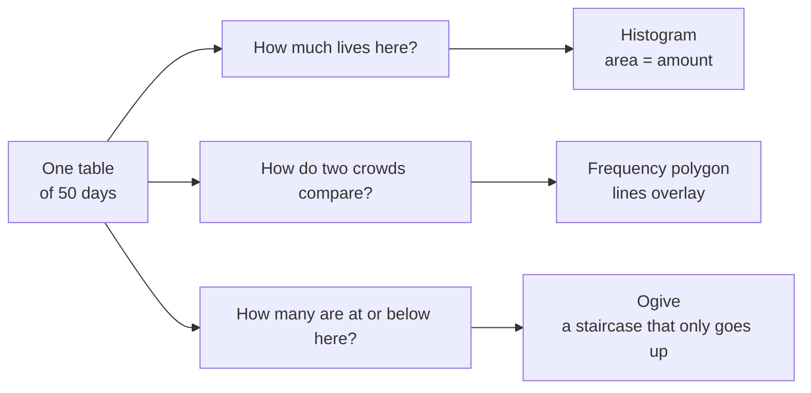
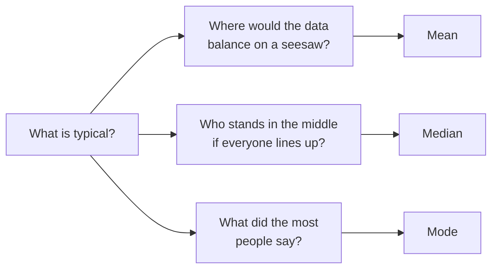

# Pictures and the Middle: Histogram, Polygon, Ogive, and What "Typical" Means

> **Parts 3 and 4 of 15.** Part of the [Probability & Statistics](/fields/data-science/probability-statistics/README.md) series, after [Samples, Data Types and Tables](/fields/data-science/probability-statistics/describing-data/samples-data-types-and-tables.md). The shop, the people and the counts are invented, and every figure was recomputed with Python 3.14.4.

At 16:50 Mira will send "Typical taster score: 75" to the label printer. Nobody gave that score. The arithmetic is right, the question is wrong, and a table that a business partner could not read was the first sign.

**By the end of this page you will be able to:**

- Choose among histogram, frequency polygon and ogive by the question you are asking of one table.
- Read a median or a count-up-to-here off an ogive, and compute the median of a grouped table.
- Compute mean, median and mode (including from grouped tables) and say what each answers.
- Recognise when no single "typical" value exists.

* * *

## "So... is that a lot?"

Mira counted the customers on each of the last 50 days and grouped them. She slides the table to her partner Ravi, who is deciding how many baristas to schedule:

| Customers per day | Days |
|---|---|
| 100 to 104 | 2 |
| 105 to 109 | 8 |
| 110 to 114 | 18 |
| 115 to 119 | 13 |
| 120 to 124 | 7 |
| 125 to 129 | 1 |
| 130 to 134 | 1 |

Ravi reads it twice and looks up. "So... is that a lot?"

Later that week the labels for the new smoky blend need a line: **"Typical taster score: __."** Mira has the 20 tasting scores (0 to 120): 52, 55, 55, 58, 58, 58, 62, 62, 62, 71, 71, 89, 89, 89, 93, 93, 94, 94, 95, 104. The sum is 1,504, and 1,504 / 20 is **75.2**.

* * *

## Three ways to get it wrong

1. **Read the table harder.** It is correct and useless: it makes Ravi see the shape himself.
2. **Print the average.** 75 goes to the printer. Then Mira remembers the scores from 74 to 84 had a frequency of zero: not one taster gave anything close to 75.
3. **Print the median, 71, instead.** It is close to the mean and misleads for the same reason.

Mira calls the printer before the labels go out and asks Ravi the better question: "What do you actually want to know?"

* * *

## Three pictures, three middles

### One table, three questions

The counts are whole numbers, so the class boundaries sit half a unit beyond the limits: the first class runs 99.5 to 104.5.

| Class boundaries | `f` | Midpoint `M` | Cumulative `CF` |
|---|---|---|---|
| 99.5 to 104.5 | 2 | 102 | 2 |
| 104.5 to 109.5 | 8 | 107 | 10 |
| 109.5 to 114.5 | 18 | 112 | 28 |
| 114.5 to 119.5 | 13 | 117 | 41 |
| 119.5 to 124.5 | 7 | 122 | 48 |
| 124.5 to 129.5 | 1 | 127 | 49 |
| 129.5 to 134.5 | 1 | 132 | 50 |

`M = (lower + upper) / 2`, so `(99.5 + 104.5) / 2 = 102`; the last `CF` must equal `n = 50`.



### Histogram: how much lives here?

```text
 99.5 - 104.5 | ██ 2
104.5 - 109.5 | ████████ 8
109.5 - 114.5 | ██████████████████ 18
114.5 - 119.5 | █████████████ 13
119.5 - 124.5 | ███████ 7
124.5 - 129.5 | █ 1
129.5 - 134.5 | █ 1
```

- **The bars touch because the ruler has no holes.** A gap claims a stretch of values that cannot occur. Favourite blends are separate categories, not a ruler, so their bars have gaps.
- **The axis shows boundaries, not limits.** Limits (100 to 104, 105 to 109) invent a hole between 104 and 105.
- **Area is the amount; height is a shortcut.** Merge the last three classes into one from 119.5 to 134.5 holding 9 days: drawn at height 9 it towers over the 8-day class and looks like a second peak, though the 9 days spread over 15 units. The honest height is **frequency density**, `f / width`: `9 / 15 = 0.6` days per unit, against `8 / 5 = 1.6` for a neighbouring-sized class. Now area = height × width = count.

### Polygon: how do two crowds compare?

Put a dot above each **midpoint** at the height of its frequency and join them: (102, 2), (107, 8), (112, 18), (117, 13), (122, 7), (127, 1), (132, 1). Close the shape to zero at both ends, with an empty class each side (midpoints 97 and 137) or at the outer boundaries (99.5 and 134.5); say which. Same information as the histogram, but **lines overlay and bars do not**: two outlines show at a glance whether this summer's peak sits left, right or higher.

### Ogive: how many are at or below here?

The ogive plots the running total, so each point answers "how many days **up to here**?".

- **It only goes up:** it starts at 0, never goes down and ends at `n = 50`. Its steepest stretch is where the crowd is thickest.
- **It sits on the upper boundary:** the count "up to 114.5" is only true once the whole 109.5 to 114.5 class is counted. At the midpoint or lower edge the curve claims days that have not happened.

| Boundary (x) | 99.5 | 104.5 | 109.5 | 114.5 | 119.5 | 124.5 | 129.5 | 134.5 |
|---|---|---|---|---|---|---|---|---|
| Days up to x (y) | 0 | 2 | 10 | 28 | 41 | 48 | 49 | 50 |

- **x to y:** "114 or fewer" reaches the boundary 114.5 and reads **28 days**, `28 / 50 = 56%`.
- **y to x:** half of 50 is 25, on the stretch between (109.5, 10) and (114.5, 28): `x = 109.5 + (25 − 10) / 18 × 5 = 109.5 + 0.833 × 5 =` about **113.7**. Half the days had about 113.7 customers or fewer: the **median**, found by ruler. Other heights give **percentiles** (the next page). Straight lines assume values are spread evenly inside each class, so the curve is exact at the boundaries and an estimate between them.

| Trap | Idea it breaks | Fix |
|---|---|---|
| Gaps between histogram bars | The ruler has no holes | Let bars touch, use boundaries |
| Unequal widths, plain frequency as height | Area is the amount | Plot frequency density |
| Ogive at midpoints or lower boundaries | A count up to here needs the class finished | Plot at upper boundaries |

### "Typical" is three questions



None is wrong; each is wrong only when it answers a question you did not mean. Two habits: say which question you mean, and draw the picture first.

### Mean: where the seesaw balances

```text
x̄ = Σx / n
```

Eight scores 70, 65, 69, 85, 94, 62, 79, 100 sum to 624, so `x̄ = 624 / 8 = 78`. The **deviations** `x − 78` are −8, −13, −9, +7, +16, −16, +1, +22 and **add to zero**: the pull from below equals the pull from above. That is why one far value drags the mean: a heavy weight on a long arm.

**Grouped mean:** each class casts `f` votes for its midpoint `M`: `x̄ = Σ(f × M) / Σf`. Fifty visits grouped by minutes:

| Class boundaries | `f` | `M` | `f × M` |
|---|---|---|---|
| 9.5 to 12.5 | 4 | 11 | 44 |
| 12.5 to 15.5 | 12 | 14 | 168 |
| 15.5 to 18.5 | 20 | 17 | 340 |
| 18.5 to 21.5 | 14 | 20 | 280 |
| **Total** | **50** | | **832** |

`x̄ = 832 / 50 = 16.64` minutes: an **estimate**, because midpoints stand in for unknown values.

### Median: the one in the middle of the line

Sort first. `n` odd: the value at position `(n + 1) / 2`. `n` even: the average of positions `n/2` and `n/2 + 1`.

- {3, 2, 6, 2, 7} sorted is 2, 2, 3, 6, 7: position `(5 + 1) / 2 = 3`, median **3**. Add an 8: 2, 2, 3, 6, 7, 8, average the 3rd and 4th, `(3 + 6) / 2 =` **4.5**; with even `n` the median need not be a data value.
- The eight scores sorted: 62, 65, 69, 70, 79, 85, 94, 100; the 4th and 5th give `(70 + 79) / 2 = 74.5`.

**The typo experiment:** change the 100 into a 1,000.

| | Original | With the typo |
|---|---|---|
| Mean | 78 | `1,524 / 8 =` **190.5** |
| Median | 74.5 | **74.5** |

One wrong entry moved the mean by over 110 points and the median by none: the median uses only **order**, so it is **resistant** to outliers.

**Grouped median** (the ogive read with a ruler, assuming values spread evenly inside a class), with `L` the lower boundary of the class holding the middle position, `cf` the count before it, `f` its count, `h` its width:

```text
median = L + ((N/2 − cf) / f) × h
```

Quality scores of 21 batches: boundaries 50.5 to 55.5 (`f` 2, `CF` 2), 55.5 to 60.5 (7, 9), 60.5 to 65.5 (8, 17), 65.5 to 70.5 (4, 21). The middle position is `N/2 = 10.5`; the first class with `CF` reaching it is 60.5 to 65.5 with `cf = 9`, `f = 8`, `h = 5`:

```text
median = 60.5 + ((10.5 − 9) / 8) × 5 = 60.5 + 0.9375 = 61.4375
```

Nine values lie below the class and we need the 10.5th, so 1.5 more; 1.5 of 8 is 18.75% across the width of 5, which is 0.9375. For the 50 days (`N/2 = 25`, class 109.5 to 114.5, `cf = 10`, `f = 18`): `109.5 + (15 / 18) × 5 ≈ 113.7`, the ogive reading.

### Mode: the most popular

The mode works for any kind of data (among 20 customers' favourite blends Green was chosen by 6, more than any other), **may not exist** (the eight scores all appear once) and **may not be unique**: in 2, 2, 2, 3, 3, 3, 4, 7, 7, 8, 10 both 2 and 3 appear three times (**bimodal**); the 20 tasting scores tie at three for 58, 62 and 89. For a grouped table use the **modal class**: for the 50 days, 109.5 to 114.5 with 18 days.

### When the answers disagree

| Data | Mean | Median | Mode |
|---|---|---|---|
| 2, 2, 2, 3, 3, 3, 4, 7, 7, 8, 10 | 4.64 | 3 | 2 and 3 |
| 50 days of customers (grouped) | 114.2 | 113.7 | modal class 109.5 to 114.5 |
| The 20 tasting scores | 75.2 | 71 | 58, 62 and 89 |

(The mean of the 50 days is `5,710 / 50 = 114.2`.) In the first two rows `mean > median` and both have a **right tail**: the seesaw is dragged toward a long tail while the median only counts positions. As a rule of thumb (not a law), `mean > median` hints at a right tail and `mean < median` at a left tail. The third row is the tin: mean 75.2 and median 71 are close and **both mislead**, because there are **two clumps**: nine tasters scored 62 or less, nine scored 89 or more and two sit between. No single answer rescues a data set with two centres; only the picture shows it.

### What grouping costs you

The 20 scores grouped: boundaries 51.5 to 62.5 (`f` 9, `M` 57, `f × M` 513), 62.5 to 73.5 (2, 68, 136), 73.5 to 84.5 (0, 79, 0), 84.5 to 95.5 (8, 90, 720), 95.5 to 106.5 (1, 101, 101); `CF` 9, 11, 11, 19, 20.

- **Grouped mean:** `1,470 / 20 = 73.5`, against the true 75.2.
- **Grouped median:** `N/2 = 10` falls in the second class: `62.5 + ((10 − 9) / 2) × 11 = 68.0`, against the true 71.

That error is the price of having only the table; with the raw data, use it.

### Choosing

| Your data | Best choice | Reason |
|---|---|---|
| Nominal (blend names) | **Mode** | No order and no arithmetic |
| Ordinal (mild, medium, strong) | **Median** (and mode) | Order exists, distances do not |
| Quantitative, roughly symmetric | **Mean** | Uses every value, the natural balance point |
| Quantitative, skewed or with outliers | **Median** | It does not chase the extremes |
| Two or more clumps | **None alone.** Describe the clumps | A single centre hides the structure |

* * *

## Divides opinion

Mira rewrites the label: **"Divides opinion: about half of our tasters loved it, about half did not."** In small print, for customers who like a number, she adds the median, 71.

Ravi has the napkin picture now. "The tallest bar is the 110s, that's my normal day." Eighteen of fifty. "And 114 or fewer on 28 days. How many were really busy, over 119?" Mira reads the staircase: 41 days at or below 119, so **9 days**, a bit under one in five. "Two baristas on ordinary days, a third on call."

Why these three questions and not a fourth? One question hides underneath all three, and once you see it, the scores running from 52 to 104 deserve a second number beside the first. Next cup: [Spread and Position](/fields/data-science/probability-statistics/describing-data/spread-and-position.md).

* * *

## Never again

| Mistake | Symptom | Fix |
|---|---|---|
| Summarising before drawing | "Typical: 75" in a gap nobody occupies | Histogram first |
| Plain frequency as height on unequal classes | A fake second peak | Plot `f / width` |
| Ogive on midpoints | A count of days that have not happened | Upper boundaries |
| Mean on a skewed or outlier-laden column | One typo moves it by 110 points | Median, and say so |
| One "typical" for two clumps | Mean and median both in the gap | Describe both clumps |
| Treating grouped formulas as exact | 73.5 vs 75.2 | Say "estimate"; use raw data if you have it |

* * *

## Check yourself

1. On how many days were there 119 customers or fewer, and what share? Which two numbers make the first ogive point after (99.5, 0)?
2. Compare this summer's days with last summer's on one chart: which picture, and why? Why does a bar chart of favourite blends have gaps but this histogram does not?
3. Estimate the value below which the lowest 25% of days fall.
4. Find the mean and median of 4, 8, 6, 5, 3, 200. Which answers "typical"?
5. Grouped table of 20 visits: boundaries 0.5 to 5.5 (3), 5.5 to 10.5 (9), 10.5 to 15.5 (6), 15.5 to 20.5 (2). Estimate the mean and median, name the modal class.
6. Modes, median and mean of 5, 5, 7, 9, 9, 12? True or false: a grouped mean is exact? A café reports average order 12.40 and median 8.10: what does the gap say?

<details>
<summary>Answers</summary>

1. `CF` at 119.5 is **41**, so `41 / 50 = 82%`; the upper boundary **104.5** and its cumulative frequency **2**.
2. The **frequency polygon**: outlines share one set of axes, and two sets of bars would cover each other. Blends are separate **categories**; daily customers lie on a continuous scale where classes share boundaries.
3. 25% of 50 is 12.5, between (109.5, 10) and (114.5, 28): `x = 109.5 + (12.5 − 10) / 18 × 5 = 109.5 + 0.694 =` about **110.2**.
4. The sum is 226, mean `226 / 6 ≈ 37.7`; sorted 3, 4, 5, 6, 8, 200, median `(5 + 6) / 2 =` **5.5**. The median answers it: the 200 dominates the mean and five of six values are below 9.
5. Midpoints 3, 8, 13, 18: `Σ f×M = 9 + 72 + 78 + 36 = 195`, **mean ≈ 195 / 20 = 9.75**. `N/2 = 10`; cumulative 3, 12, 18, 20, so the median class is 5.5 to 10.5 with `cf = 3`, `f = 9`, `h = 5`: `5.5 + ((10 − 3) / 9) × 5 ≈` **9.39**. Modal class 5.5 to 10.5 (frequency 9).
6. Modes **5 and 9**; `n = 6`, median `(7 + 9) / 2 =` **8**; sum 47, mean `47 / 6 ≈ 7.83`. **False**: each value in a class is replaced by its midpoint. The mean is far above the median: a **right tail**, a few very large orders; the median describes the typical order better.

</details>

* * *

## 📜 The Scroll (keep this)

```text
Pictures   : histogram = how much (touching bars, area = count, f/width if unequal);
             polygon = compare (dots at midpoints, closed, overlaid);
             ogive = up to here (upper boundary, CF, 0 to n)
Ogive read : x -> y counts at or below; y -> x gives a percentile (median at n/2)
Mean       : sum x / n (balance point); grouped: sum(f M) / sum f (estimate)
Median     : sort; position (n+1)/2; grouped: L + ((N/2 - cf)/f) h
Mode       : most often; may be absent or several; modal class when grouped
Disagree   : mean > median -> right tail; two clumps -> describe both
Choose     : nominal mode; ordinal median; symmetric mean; skewed median
Do not     : summarise before drawing; trust a single centre on two clumps
```

* * *

## References

- Every number on this page was recomputed with Python 3.14.4 (`statistics.mean`, `median`, `multimode`, plus the grouped formulas written out by hand): the cumulative column, 41 and 9 days, 56% and 82%, the interpolations 113.7 and 110.2, the densities 0.6 and 1.6, the typo experiment and both grouped tables. The merged-class example is an invented illustration. No external source was fetched for this page.
