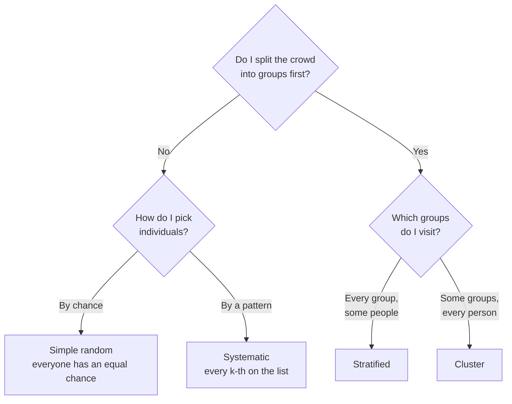
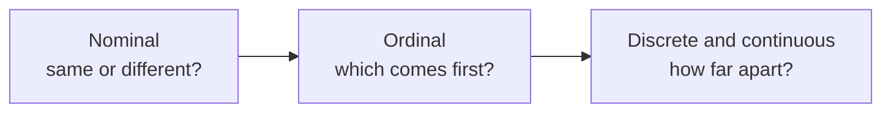

# Samples, Data Types and Tables: Who You Asked, What Kind of Column, How to Count It

> **Parts 1 and 2 of 15.** Part of the [Probability & Statistics](/fields/data-science/probability-statistics/README.md) series. The tea shop and its customers are invented; every table can be checked by hand. The 1936 poll in the middle is real, and its sources are at the end.

By March, most of Mira's smoky blend will still be on the shelf. Her arithmetic will be flawless, and her spreadsheet will have helpfully computed an average favourite blend of "#2.4". Both mistakes happen before any calculation.

**By the end of this page you will be able to:**

- Name the population, sample, frame, parameter and statistic, and say why bias does not shrink with more data.
- Choose among simple random, systematic, stratified and cluster sampling from two questions.
- Tell nominal, ordinal, discrete and continuous columns apart by what you can do with two values.
- Build a frequency table (ungrouped and grouped), with correct class limits, boundaries and width.

* * *

## Twenty-seven out of thirty

Mira runs Leaf & Kettle, a tea shop with 4,000 customers on its loyalty list. She has a new smoky blend, and before she orders 500 kilos she asks the first 30 people through the door on Saturday morning to try a cup. Twenty-seven say they love it: 90%. She places the big order.

Then she types her notebook into a spreadsheet: five columns for each of 20 customers (ID, favourite blend, strength preference, cups per week, brewing temperature). A helpful assistant clicks **Average** on every column. The average customer ID is 1,208.7 and the average favourite blend is #2.4.

Both answers are computed perfectly and mean nothing.

* * *

## Three ways to feel sure

1. **"Ask 3,000 next time, not 30."** The 3,000 would be early-Saturday visitors again, 3,000 times as sure about the wrong crowd.
2. **"Average every column."** The spreadsheet obliges, and so a number exists for each column, whatever it means.
3. **"Tabulate the 500 readings, one row each."** The table is the raw data in a table costume.

Each trusts a procedure over a question. The questions are *who did I ask*, *what can I do with two of these values*, and *what is a fair drawer*. Take them in turn.

* * *

## Who you asked, what it is, how to count it

### Population, sample, frame

| Word | Meaning | In Mira's story |
|---|---|---|
| **Population** | The complete group you want to know about | All 4,000 loyalty-card customers |
| **Sample** | The part you actually observe | The 30 people she asked |
| **Parameter** | The true number for the population | The real share among all 4,000 |
| **Statistic** | A number from a sample | 90% of her 30 |
| **Sampling frame** | The actual list you draw from | "Whoever walks in on Saturday morning" |

The sample can only speak for the frame. A census (ask everyone) is often impossible: too costly, it destroys the thing (you cannot taste the whole pot), or answers change before you finish.

### Bias does not shrink

**Bad luck** shrinks as `n` grows. **Bias** (the method leans one way every time, like "only early Saturday visitors") does not shrink at all: more people only make the wrong answer more convincing. A sample is fair only if every part of the pot had a fair chance of reaching the spoon. Stirring is what randomness does.

### Four methods from two questions

Mira wants `n = 40` from `N = 4,000`.



*One worry, "is this fair?", answered four ways.*

- **Simple random.** Number the customers 1 to 4,000 and let a random number generator pick 40. Every customer, and every possible group of 40, has the same chance. It needs a full list.
- **Systematic.** Step `k = N / n = 4,000 / 40 = 100`, random start (say 37), then every 100th: 37, 137, 237, up to 3,937. That is 40 customers. The trap is a rhythm in the list: if rows alternate between two shops and `k` is even, every pick lands on the same shop (all 40 picks starting at 37 are odd rows).
- **Stratified: every group, some people.** Split into groups that *differ* in ways that matter, then draw at random inside each, in proportion (`n_h = n × N_h / N`): 1,600 students, 1,400 office workers and 1,000 retirees give 16, 14 and 10. It guarantees every kind of person a seat.
- **Cluster: some groups, every person.** Groups that each look like a mini-crowd (neighbourhoods of about 100 people): pick 4 neighbourhoods at random and survey all 400. Cheap when no full list exists; neighbours resemble each other, so 400 from 4 neighbourhoods tell you less than 400 from everywhere.

Stratified groups **differ** (done for precision); cluster groups **resemble** each other (done for cost).

### The poll that asked 2.4 million people

In 1936 the magazine *Literary Digest* mailed about **10 million** questionnaires to automobile and telephone owners and about **2.4 million** came back (sources give 2.27 to 2.38 million). It had called every winner from 1920 to 1932, and predicted that Alf Landon would beat Franklin Roosevelt by about 57% to 43%. Roosevelt won with about **61%**.

- **The frame did not match the population:** in the Depression, owning a car or a telephone leaned toward the better off, who leaned toward Landon.
- **Who answered was not random either:** only about a quarter came back. A study cited in the arXiv paper below (Squire, 1988) found the two together produced the error.

George Gallup polled about **50,000** people with a "scientific sample" including the right proportion from each economic group (in the spirit of stratification) and predicted Roosevelt's win. **A huge biased sample is a more confident way of being wrong.**

**Two jobs.** *Descriptive* statistics summarises the numbers you have. *Inferential* statistics speaks about the people you did not ask, so it carries uncertainty (a confidence interval, a hypothesis test) and is honest only if the sample was drawn fairly.

### What can you do with two values?

Pick any two values from a column and ask what you can *do* with them:



| Kind | The one thing you can do with two values | Mira's column |
|---|---|---|
| **Nominal** | Say **same or different** | Favourite blend (Green, Black, Herbal) |
| **Ordinal** | Also say **which comes first** (not by how much) | Strength preference (Mild < Medium < Strong) |
| **Discrete** | Also say **how far apart**: values you *count*, whole numbers | Cups per week (0, 1, 2, ...) |
| **Continuous** | Also how far apart: values you *measure*, any value in a range | Brewing temperature |

Each row keeps what the row above allowed: counting, percentages and "the most common" for nominal; sorting, the middle value and rankings for ordinal; adding, subtracting and averaging once a gap means something. Averaging blends needs "how far apart is Green from Oolong?". **Labels in disguise:** customer ID 2208 is not "more" than 1041; IDs, postal codes and jersey numbers are nominal columns written with digits.

### Counting without losing the shape

A **frequency table** counts how often each value appears. For categories:

| Blend | Frequency `f` | Percentage |
|---|---|---|
| Black | 5 | 25% |
| Green | 6 | 30% |
| Herbal | 4 | 20% |
| Oolong | 5 | 25% |
| **Total** | **20** | **100%** |

The percentage is `f / n × 100`, and `Σf = n` every time. For numbers, 20 tasters rate the blend 0 to 120, in order of arrival:

```text
62  55  62  94  89
71  55  62  58  104
71  58  94  95  93
52  58  89  89  93
```

| Score | `f` | `f/n` | % | Cumulative `CF` |
|---|---|---|---|---|
| 52 | 1 | 0.05 | 5% | 1 |
| 55 | 2 | 0.10 | 10% | 3 |
| 58 | 3 | 0.15 | 15% | 6 |
| 62 | 3 | 0.15 | 15% | 9 |
| 71 | 2 | 0.10 | 10% | 11 |
| 89 | 3 | 0.15 | 15% | 14 |
| 93 | 2 | 0.10 | 10% | 16 |
| 94 | 2 | 0.10 | 10% | 18 |
| 95 | 1 | 0.05 | 5% | 19 |
| 104 | 1 | 0.05 | 5% | 20 |
| **Total** | **20** | **1.00** | **100%** | |

Three questions about one count: how many (`f`), what fraction (`f/n`), how many **this or lower** (`CF`, a running total; the last must equal `n`). Row 71: `CF = 11`, so 11 of 20 scored 71 or less, 55%. The shape matters: two clumps, 52 to 62 and 89 to 95, nothing between 71 and 89, and the average of all 20, **75.2**, sits in the empty gap describing nobody.

**Stem and leaf** keeps the raw values (stem 5, leaf 2 is 52):

```text
Stem | Leaf
  5  | 2 5 5 8 8 8
  6  | 2 2 2
  7  | 1 1
  8  | 9 9 9
  9  | 3 3 4 4 5
 10  | 4
```

### Drawers for values: the grouped table

With 500 nearly distinct readings an ungrouped table has 500 rows of `f = 1`. Use drawers of equal width: the 20 scores in 5 drawers of width 11:

| Class limits | `f` | Relative frequency | `CF` |
|---|---|---|---|
| 52 to 62 | 9 | 0.45 | 9 |
| 63 to 73 | 2 | 0.10 | 11 |
| 74 to 84 | 0 | 0.00 | 11 |
| 85 to 95 | 8 | 0.40 | 19 |
| 96 to 106 | 1 | 0.05 | 20 |
| **Total** | **20** | **1.00** | |

First drawer: 52 (1) + 55 (2) + 58 (3) + 62 (3) = 9; fourth: 89 (3) + 93 (2) + 94 (2) + 95 (1) = 8. The empty drawer still shows the gap. **The price:** you can no longer tell whether the 9 were all 55 or spread over 52 to 62, and you cannot undo it; draw stem and leaf first when `n` is small.

### Why the drawers must touch

"52 to 62" looks ten wide, yet the width used was eleven. A score of 62 is **measured and then written rounded**: a true 62.4 is written 62, a true 62.6 is 63. So the "62" drawer holds everything from 61.5 to 62.5:

```text
 written:    ...  61  |   62   |  63  ...
 real value:      61.5      62.5     63.5
                      \_ the "62" drawer _/
```

Each written value wears a **half-unit halo**; stacked, the halos touch. These cut-offs are the **class boundaries**; the width is boundary to boundary: 62.5 − 51.5 = **11**. The **limits** (52 and 62) are the smallest and largest values you can write in it. Boundary = limit ± half a unit (0.5 for whole numbers, 0.05 for one decimal, 0.005 for two).

| Class limits | Class boundaries | Width |
|---|---|---|
| 52 to 62 | 51.5 to 62.5 | 11 |
| 63 to 73 | 62.5 to 73.5 | 11 |
| 74 to 84 | 73.5 to 84.5 | 11 |
| 85 to 95 | 84.5 to 95.5 | 11 |
| 96 to 106 | 95.5 to 106.5 | 11 |

### The grouping recipe

1. **Range** = largest − smallest: `104 − 52 = 52`.
2. **Number of drawers `k`:** a handful. Sturges' rule `k ≈ 1 + 3.322 × log10(n)` gives 5.3 for `n = 20`, so use 5.
3. **Width** `h = Range / k = 52 / 5 = 10.4`, then **round up** to 11: rounded down to 10, five drawers from 52 end at 101 and the 104 has nowhere to live.
4. **Limits:** start at the smallest value and add `h` per drawer (52 to 62, 63 to 73, ...).
5. **Count** each drawer and check `Σf = n`.

* * *

## Stirred, then counted

Mira deletes the two "Average" cells and rebuilds the sheet column by column, asking of each: what can I do with two of these? The ID is a label and gets nothing. The blend gets a category table. Cups per week and brewing temperature are the only two columns where an average now means something.

Then she draws a **stratified** sample of 40 from the loyalty list: 16 students, 14 office workers, 10 retirees, each at random from its own list. Twenty-two say they would buy the smoky blend: **55%**, far below the 90% from the doorway and closer to how the blend actually sold. She orders 100 kilos instead of 500. The 55% is a statistic; the true share is a parameter she will never see.

Is "smoky: yes or no" the same kind of thing as a score out of 100? It is not, and the kind decides which tools are allowed. But when can one number stand in for a whole column? Next cup: [Pictures and the Middle](/fields/data-science/probability-statistics/describing-data/pictures-and-the-middle.md).

* * *

## Never again

| Mistake | Symptom | Fix |
|---|---|---|
| Fixing bias with more people | 3,000 volunteers, same wrong answer | Fix **how** you chose, not how many |
| A frame that is not the population | 1936: car and phone owners | Check the list against the crowd |
| Systematic sampling with a rhythm | Every pick from the same shop | Make sure the list has no pattern matching `k` |
| Equal samples from unequal groups | Small groups over-represented | Draw in proportion, or reweight |
| Averaging a label | Average ID 1,208.7 | Ask "how far apart?" first |
| Rounding the class width down | The maximum has no drawer | Round `h` **up** |
| Class width from limits | Ten instead of eleven | Width is boundary to boundary |
| Totals that do not add up | 12 + 9 + 11 + 7 = 39 of 40 | Check `Σf = n`, `Σf/n = 1`, last `CF = n` |

* * *

## Check yourself

1. A school has 900 students in 30 classes of 30. The principal picks 3 classes at random and surveys **every** student in them. Which method?
2. A list of 1,200 employees; you pick a random number between 1 and 40, then every 40th after it. Which method, and how large is the sample?
3. 600 men and 400 women; a sample of 50 that mirrors the mix: how many of each?
4. Which would you trust for all voters: 10,000 online volunteers or 400 people drawn at random from the voter list?
5. (a) cups per visit, (b) poor/fair/good, (c) temperature in °C, (d) blend name, (e) loyalty-card number: which kind is each?
6. In the ungrouped table, how many tasters scored **89 or less**, and what percentage?
7. Data to one decimal place, minimum 12.4, maximum 48.9, 6 classes: find `h`, the limits and the first class's boundaries. And why is "85 to 95 is ten wide, so width 10" wrong?

<details>
<summary>Answers</summary>

1. **Cluster**: the classes are the clusters.
2. **Systematic**, `1,200 / 40 = 30` employees.
3. **Stratified, proportional:** 60% of 50 is **30 men**, 40% is **20 women**.
4. **The 400 random people.** Volunteers choose themselves and size does not fix that (1936 again); the 400 have a wider but honest margin of error that shrinks with size. Schools but no child list: **cluster**. Mira's 10 per age group is stratified, but equal samples from unequal groups over-represent the small ones unless reweighted.
5. (a) **Discrete**, (b) **ordinal**, (c) **continuous**, (d) **nominal**, (e) **nominal**: the number is a label.
6. `CF` at 89 is **14**, so `14 / 20 = 70%`.
7. `Range = 48.9 − 12.4 = 36.5`, `h = 36.5 / 6 = 6.08...`, rounded **up** to `6.1`. Limits: 12.4 to 18.4, 18.5 to 24.5, 24.6 to 30.6, 30.7 to 36.7, 36.8 to 42.8, 42.9 to 48.9. The halo is 0.05, so the first class's boundaries are **12.35 to 18.45**, width 6.1 (the limits differ by only 6.0). Ten is the difference between the **limits** (95 − 85); the width is between the **boundaries** (95.5 − 84.5 = 11).

</details>

* * *

## 📜 The Scroll (keep this)

```text
Sample      : a promise about a crowd; HOW you chose keeps it, not how many
Words       : population / sample / parameter / statistic / sampling frame
Methods     : simple random; systematic (k = N/n, beware rhythm);
              stratified (every group, n_h = n N_h / N); cluster (some groups, everyone)
Bias        : does not shrink with n; bad luck does
Kinds       : same/different = nominal; which first = ordinal; how far = discrete / continuous
Checks      : sum f = n; sum f/n = 1; last CF = n
Grouped     : h = Range / k, ROUND UP; boundaries = limits -/+ half a unit; width = boundary to boundary
Do not      : average a label; fix bias with more data; trust a frame that is not the population
```

* * *

## References

- [Why do polls fail? (arXiv 2107.14166)](https://arxiv.org/pdf/2107.14166): the mailing to automobile and telephone owners, 2,376,523 returns of 10 million, the roughly 25% return rate, Gallup's 50,000, Squire (1988). Fetched and read.
- [The poll that changed polling: selection bias and the 1936 US election (Pivotal Research)](https://www.pivotalresearch.ca/2024/07/03/the-poll-that-changed-polling-selection-bias-and-the-1936-us-election/): the 57% to 43% prediction and over 2.27 million returns. It gives Roosevelt 62% and a subscriber-list source, which differ from the others; this page uses "about 61%" and the arXiv list description. Fetched and read.
- [Roosevelt's smashing of Landon in the 1936 presidential election (Brewminate)](https://brewminate.com/roosevelts-smashing-of-landon-in-the-1936-presidential-election/): Roosevelt's 60.8%, the Digest's 57.1% for Landon. Fetched and read.
- NIST/SEMATECH e-Handbook of Statistical Methods, *Histogram*: a histogram divides the range of the data into equal-width bins (classes) and counts the observations in each. <https://www.itl.nist.gov/div898/handbook/eda/section3/histogra.htm>
- Stevens, S. S. (1946), *On the Theory of Scales of Measurement*, Science 103(2684), and Sturges, H. A. (1926), *The Choice of a Class Interval*, JASA 21(153). Cited as the origins of the scale levels and the class-count rule; not retrieved here, so not quoted.
- The numbers (16, 14, 10; the 40 systematic picks from 37 to 3,937; 30; 30 and 20; 55%; every table) were recomputed with Python 3.14.4. The customers and shop are invented.
