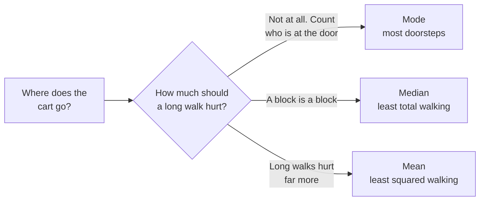
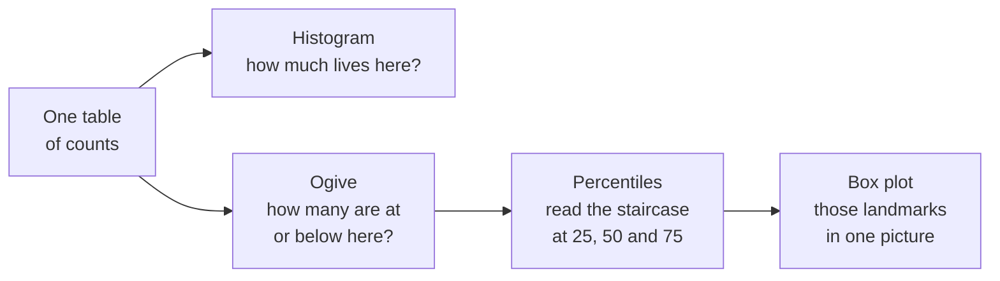

<!-- related-block -->
<nav class="crumbs" aria-label="Breadcrumb"><a href="#/fields/">Fields</a> / <a href="#/fields/data-science/">Data Science</a> / <a href="#/fields/data-science/probability-statistics/">Probability &amp; Statistics, One Sip at a Time</a> / <a href="#/fields/data-science/probability-statistics/describing-data/">Describing Data</a></nav>

# Spread and Position: Variance, n − 1, Percentiles, Z-Scores and the Box Plot

<!-- related-block -->
<div class="reading-time">Beginner · Concept · 14 min read · Updated 25 Nov 2026</div>
<!-- related-block -->
<div class="tag-chips"><a class="chip" href="#/.docs/generated/explore/tags/statistics">statistics</a></div>
<!-- related-block -->
<div class="lab-line">Interactive lab: <a href="#/fields/data-science/probability-statistics/describing-data/spread-and-position?id=try-it-one-crowd-many-summaries">One crowd, many summaries</a></div>
<!-- related-block -->
<div class="related-strip">

**Read first:** [Pictures and the Middle: Histogram, Polygon, Ogive, and What 'Typical' Means](/fields/data-science/probability-statistics/describing-data/pictures-and-the-middle.md)  ·  **Read next:** [Counting and Conditioning: Why a 99% Accurate Test Is Usually Wrong](/fields/data-science/probability-statistics/probability/counting-and-conditioning.md)

</div>


> **Parts 5 and 6 of 15.** Part of the [Probability & Statistics](/fields/data-science/probability-statistics/README.md) series, after [Pictures and the Middle](/fields/data-science/probability-statistics/describing-data/pictures-and-the-middle.md). The scenario is invented, and every figure was recomputed with Python 3.14.4 (including a scan of every cart position and the enumeration of all nine samples of two).

At 15:10 Tala will tape her brewing result to the till as her strong subject. It is the lower of her two results. She will be comparing numbers that were never measured on the same ruler.

**By the end of this page you will be able to:**

- Say why mean, median and mode are three rules for one question, and which spread belongs with which middle.
- Apply the one-house test to choose mean and SD or median and IQR.
- Explain why a sample's variance divides by `n − 1`, and show it by enumeration.
- Place a value in its crowd with a percentile rank or a z-score, and read a box plot, including what it cannot see.

* * *

## 84 versus 61

Tala has taken two apprentice exams this month. **Brewing:** 84. **Cupping:** 61. She tapes both to the till. "Brewing is my strong subject."

Mira asks the only question that matters: "Better than what?"

The brewing exam was easy: the class averaged **70** and scores typically landed about **7** away. The cupping exam was brutal: class average **50**, typical distance **4** (invented numbers).

* * *

## Three comparisons that fail

1. **Compare the raw scores.** 84 > 61, so brewing. The exams had different crowds.
2. **Subtract each class average.** 14 above against 11 above: brewing again. It ignores how far scores usually stray: 11 is nearly three steps of 4, 14 only two of 7.
3. **Divide by the class average.** 84 / 70 = 1.20 against 61 / 50 = 1.22: cupping edges ahead, for the wrong reason. Nothing in a ratio knows how far scores usually stray, so a different spread could flip it.

Mira's hint: every "better" needs a middle and a size of step. A street problem has both.

Build the ruler, with the cart.

* * *

## One question behind every summary

### The cart on Kettle Street

Seven houses on blocks 1, 2, 2, 3, 5, 9 and 20. The cart stands in exactly one place, so every "middle" is a rule for choosing it, and each rule answers one question: **how much should a long walk hurt?**



| Cart at | Name | Total walk (blocks) | Total of squared walks | People at the door |
|---|---|---|---|---|
| block 2 | mode | 30 | 384 | **2** |
| block 3 | median | **29** | 335 | 1 |
| block 6 | mean | 34 | **272** | 0 |

Each spot wins one column. A scan of every position from block 0 to block 20 in steps of 0.01 found nothing better than block 3 for total walking and nothing better than block 6 for squared walking.

- **Mode:** distance does not matter, only "right here".
- **Median:** distance matters in proportion; ten blocks is ten times one block.
- **Mean:** distance matters more than in proportion; one ten-block walk hurts as much as a hundred one-block walks. That is why it chases tails: block 20 is one person but owes 196 of the 272 in squared walking, 72% of the bill.

Slide the cart one block right. **Total walking** changes by *(people on the left) − (people on the right)*, so slide toward the side with more people and stop when the sides are equal: the **median** (with an even count any spot between the two middle houses ties). **Squared walking** stops improving when the pulls cancel, when the deviations add to zero: **the balance point minimises squared walking.** The seesaw was never a separate idea.

### What is left over: spread

Spread is the walking that remains after the best spot. Each middle has a natural partner:

| Middle | Leftover rule | Name | On Kettle Street |
|---|---|---|---|
| Mean (block 6) | Average squared walk | **Variance** `σ²` | 272 / 7 = 38.9 blocks² |
| Mean | The same, square-rooted | **Standard deviation** `σ` | 6.23 blocks |
| Median (block 3) | Average plain walk | **Mean absolute deviation** | 29 / 7 = 4.1 blocks |
| Median | Width of the middle half | **IQR** (Q3 − Q1) | 7 − 2 = 5 blocks |
| none | Farthest minus nearest | **Range** | 20 − 1 = 19 blocks |

The square root brings blocks² back to blocks, which is the whole reason SD exists beside variance. Q1 and Q3 are the values a quarter and three quarters of the data sit below. **Mean goes with SD, median goes with IQR.**

### The one-house test

*If one value were wrong, how much would my number move?* House 20 typed as **200**:

| | Real data | With the typo |
|---|---|---|
| Mean | 6 | **31.7** |
| Standard deviation | 6.23 | **68.75** |
| Median | 3 | 3 |
| IQR | 5 | 5 |

| Your data | Use |
|---|---|
| Roughly symmetric, every value matters, you care about totals | Mean and standard deviation |
| Skewed, or you cannot vouch for the extremes | Median and IQR |
| Two clumps | Neither alone; describe both clumps |

### Try it: One crowd, many summaries

> **What to try:** Pick Mira's scores or Kettle Street, add one wrong value, switch the divisor between n and n − 1, and watch the mean, median, SD and IQR react.  
> **Start with:** the preset *The mean in a valley*.

[Describing data lab](/fields/data-science/probability-statistics/labs/describing.html#embed ':ignore')

### The n − 1 mystery

The seven houses were **everyone**, so we divided by 7. A **sample** picks its own mean, which is by construction the spot that suits that sample best, so squared walking measured from it is always **too small**, and dividing by `n` inherits the shortfall.

Three houses at blocks **2, 4 and 9**: true mean 5, true variance `(9 + 1 + 16) / 3 = 8.67`. Take **every possible sample of two** (nine equally likely draws, with replacement):

| Sample | Sample mean | Divide by `n` (= 2) | Divide by `n − 1` (= 1) |
|---|---|---|---|
| 2, 2 | 2.0 | 0 | 0 |
| 2, 4 | 3.0 | 1 | 2 |
| 2, 9 | 5.5 | 12.25 | 24.5 |
| 4, 2 | 3.0 | 1 | 2 |
| 4, 4 | 4.0 | 0 | 0 |
| 4, 9 | 6.5 | 6.25 | 12.5 |
| 9, 2 | 5.5 | 12.25 | 24.5 |
| 9, 4 | 6.5 | 6.25 | 12.5 |
| 9, 9 | 9.0 | 0 | 0 |
| **Average** | 5.0 | **4.33** | **8.67** |

Dividing by `n` averages **half** the truth; dividing by `n − 1` lands on **8.67 exactly**. The shortfall is a factor `(n − 1) / n`, 1/2 for two points, and fades as `n` grows. The square root, the standard deviation, still comes out a little low on average (2.20 here, against a true 2.94), because a root bends the average.

```python
import statistics as st

data = [2, 4, 9]
st.pvariance(data)   # divides by n.    "this is everyone"        -> 8.666...
st.variance(data)    # divides by n-1.  "this is a sample"        -> 13
st.stdev(data)       # square root of the line above              -> 3.605...
```

**Everyone in the room: divide by `n`. A sample from a bigger group: `n − 1`.** Almost every real data set is the second kind.

### A score needs a crowd

A position is a value *plus its crowd*, and there are two natural rulers:

| Ruler | The question it asks | Name | Uses |
|---|---|---|---|
| **Rank** | What share of the crowd is below me? | Percentile | Only the order of the data |
| **Distance** | How many "typical distances" am I from the middle? | z-score | The mean and the standard deviation |

Rank is the median's attitude (count heads); distance is the mean's (measure steps in spread units).

### Ruler 1: percentile

```text
percentile rank = (number below + 0.5 × number equal) / n × 100
```

Eight scores sorted: 62, 65, 69, 70, 79, 85, 94, 100. For **85**: five below, one equal, `(5 + 0.5) / 8 = 68.75%`, about the 69th percentile. Run it backwards for the **percentile value**: **Q1** is the 25th percentile, **Q2** the median (50th), **Q3** the 75th.

**Different tools give different quartiles.** For 1 to 9, Python's `statistics.quantiles` returns **2.5 and 7.5** by default (`method='exclusive'`) and **3 and 7** with `method='inclusive'`; both are legitimate interpolations. R lists nine quantile types with type 7 as the default and cites Hyndman and Fan (1996), who recommended type 8; NumPy lists the same nine, with default `linear` being type 7.

```python
d = list(range(1, 10))
st.quantiles(d, n=4)                        # [2.5, 5.0, 7.5]  exclusive (the default)
st.quantiles(d, n=4, method='inclusive')    # [3.0, 5.0, 7.0]  inclusive
```

**Pick one method, write down which, and never compare quartiles across tools.** The pages here use the inclusive method.

### Ruler 2: z-score

```text
z = (x − mean) / SD
```

| Exam | Her score | Class mean | Class SD | z-score |
|---|---|---|---|---|
| Brewing | 84 | 70 | 7 | (84 − 70) / 7 = **2.00** |
| Cupping | 61 | 50 | 4 | (61 − 50) / 4 = **2.75** |

A z-score converts every crowd into the same units, which is why it compares things on different scales. The condition from the one-house test applies: the mean and SD must be a fair summary. In a two-clump crowd like the tasting scores a z-score measures distance from a middle where nobody lives. When to use which:

| Situation | Ruler |
|---|---|
| Comparing across different scales (two exams, two stalls) | **z-score** |
| Skewed data, outliers or two clumps | **Percentile** |
| "Top 10%", "bottom quarter", grading on rank | **Percentile** |
| Going on to chance and the bell curve | **z-score** |

### The box plot is the ogive with its landmarks



Histogram to see the **shape**, ogive to count up to a value, box plot to compare **several groups**: **histogram first, box plot second.** A box plot is five landmarks: minimum, Q1, median, Q3, maximum. NIST's rule: `IQR = Q3 − Q1`, **fences** at `Q1 − 1.5 × IQR` and `Q3 + 1.5 × IQR`, whiskers to the last point inside them, anything beyond drawn as its own dot.

For the 20 tasting scores `Q1 = 58`, median `71`, `Q3 = 93`, `IQR = 35`, fences 5.5 and 145.5; nothing falls outside, so the whiskers run 52 to 104:

```text
52                                                104
|-----[============|=====================]----------|
      58           71                    93
```

```text
50-54    #
55-59    #####
60-64    ###
65-69
70-74    ##
75-79
80-84
85-89    ###
90-94    ####
95-99    #
100-104  #
```

The box plot shows one tidy box; the histogram shows **two clumps and a valley**. The box swallows the valley.

> [!NOTE]
> A box plot answers "where is the middle half, and are there outliers?" It cannot answer "how many clumps?". That is a limit, not a flaw: know which question you are asking before you pick the picture.

* * *

## The better exam, and the lying centre

Tala runs the z-scores: brewing **2.00**, cupping **2.75**. Her 61 is 2.75 typical distances above a brutal crowd's middle, farther out than her 84 on an easy one. She peels the brewing result off the till and moves cupping to the top. "So I am better at cupping." "Than most people on that exam," says Mira. "Which is the only kind of better there is."

Back to the tin: the 20 tasting scores have a mean of 75.2 and a sample SD of **17.67**, and only two of the twenty tasters sit within five points of the number on the tin. A spread that wide next to a centre is the alarm that says the centre is lying; the clumps were found by the table, and a single number could have raised the alarm.

Everything so far was about **what already happened**. Then Ravi leans over the counter: "How many people will walk in tomorrow?" That is about **chance**, and it needs a different language. Next cup: [Counting and Conditioning](/fields/data-science/probability-statistics/probability/counting-and-conditioning.md).

* * *

## Never again

| Mistake | Symptom | Fix |
|---|---|---|
| Comparing raw scores across crowds | 84 beats 61 | z-score, or percentile |
| Dividing a sample's variance by `n` | Half the truth on average | `n − 1` for a sample, `n` for everyone |
| Mean and SD on skewed data or outliers | One typo moves SD from 6.2 to 68.8 | Median and IQR |
| Quartiles compared across tools | Python 2.5 vs 3 for the same data | Pick one method and say which |
| A z-score in a two-clump crowd | Distance from an empty middle | Percentile rank |
| Box plot instead of histogram | The valley disappears | Histogram first |

* * *

## Check yourself

1. Houses at blocks 1, 3, 4 and 10: where does the cart go for least total walking, and is it unique? Find the mean, variance and SD (treating them as everyone).
2. Why is variance in squared units, and what turns it back? The twelve staff versus twelve customers from the loyalty cabinet: which uses `n`, which `n − 1`? A column with one value mistyped by a factor of 100: which pair of numbers survives?
3. In the eight scores (62, 65, 69, 70, 79, 85, 94, 100) what is the percentile rank of **70**? The mean is 78 and sample SD 13.94: what is the z-score of **100**?
4. A test has mean 60, SD 10, and a student scores 55: z-score and meaning? Which ruler for a single taster in a two-clump crowd?
5. Q1 = 10 and Q3 = 18: is 31 an outlier by the 1.5 × IQR rule? What about 29?

<details>
<summary>Answers</summary>

1. Total walking is 10 at blocks 3, 3.5, 4 and anywhere between: **not unique**; the usual choice is the midpoint **3.5**. Mean `(1 + 3 + 4 + 10) / 4 =` **4.5**; squared walks 12.25, 2.25, 0.25, 30.25 total 45, so variance `45 / 4 =` **11.25**, SD **3.35**. Moving the cart to 3.5 raises the total to 49, to 4 raises it to 46, to 3 raises it to 54.
2. Each walk is squared, so the result is in blocks²; the **square root** turns it back. The staff are **everyone**: `n`. The customers are a **sample**: `n − 1`. **Median and IQR** survive: only the squared pair lets one far value dominate.
3. Three below 70 (62, 65, 69), one equal: `(3 + 0.5) / 8 × 100 =` **43.75%**. `(100 − 78) / 13.94 ≈` **1.58** (with the population SD of 13.04 it would be 1.69).
4. `(55 − 60) / 10 =` **−0.5**: half a typical distance **below** the middle, nothing dramatic. The **percentile rank**: mean and SD describe a middle where nobody lives; rank only counts how many are below.
5. `IQR = 8`, fences `10 − 12 = −2` and `18 + 12 = 30`: **31 is an outlier**, **29 is not**.

</details>

* * *

## 📜 The Scroll (keep this)

```text
One question : how much should a long walk hurt? none = mode; in proportion = median;
               more than that = mean (least squared walking, deviations add to 0)
Spread       : mean <-> variance (average squared walk), SD = sqrt(var);
               median <-> IQR = Q3 - Q1; range = max - min
One-house    : one wrong value moves mean and SD a lot, median and IQR almost not at all
Divide by    : n if the data are everyone; n - 1 for a sample (python pvariance vs variance)
Percentile   : (below + 0.5 equal) / n x 100; order only; quartile method differs by tool
z-score      : (x - mean) / SD; compares scales; needs a fair mean and SD
Box plot     : min, Q1, median, Q3, max; fences Q1 - 1.5 IQR, Q3 + 1.5 IQR; blind to clumps
Do not       : compare raw scores across crowds; use a box plot before the histogram
```

* * *

## References

- NIST/SEMATECH e-Handbook of Statistical Methods, *Box Plot*: quartiles, the 1.5 × IQR fences and the outlier circles. <https://www.itl.nist.gov/div898/handbook/eda/section3/boxplot.htm>
- Python `statistics` module: `pvariance`, `variance`, `pstdev`, `stdev` (population divides by `N`, sample by `N − 1`, "Bessel's correction") and `quantiles` with `method='exclusive'` (default) and `'inclusive'`. Verified against Python 3.14.4. <https://docs.python.org/3/library/statistics.html>
- NumPy `percentile`: nine selectable methods, default `'linear'`. This page did not run NumPy, so no NumPy output is shown. <https://numpy.org/doc/stable/reference/generated/numpy.percentile.html>
- Hyndman, R. J. and Fan, Y. (1996), *Sample Quantiles in Statistical Packages*, The American Statistician 50(4). <https://doi.org/10.1080/00031305.1996.10473566>. The origin of the nine-type numbering; cited through the R documentation, which names it and states its recommendation. <https://stat.ethz.ch/R-manual/R-devel/library/stats/html/quantile.html>
- Every other number on this page was recomputed with Python 3.14.4.

<!-- related-block -->
<div class="see-also">

**See also**

- [Averages and Intervals: Why Averages Behave and How Sure You Can Be](/fields/data-science/probability-statistics/inference/averages-and-intervals.md) — An average is itself random: its spread shrinks as sigma over root n and its shape tends to a bell. A confidence interval turns that wobble into a give-or-take, and bias is invisible to it.
- [Describing Data, Technically: Definitions, Identities and Method Choices](/fields/data-science/probability-statistics/describing-data/technical-reference.md) — The formal layer under parts 1 to 6: scales of measurement, grouped-data formulas, what the mean and median minimise, n versus n-1, quartile methods, fences and sampling designs.
- [Probability & Statistics, One Sip at a Time](/fields/data-science/probability-statistics/README.md) — A slow-brewed series on the ideas in probability and statistics that make people say "wait, why?", each one told as a small story in a tea shop.
- [Summarise a Data Set: Which Number, Which Picture](/fields/data-science/probability-statistics/describing-data/quick-guide.md) — A cheat sheet for parts 1 to 6 - choose a sampling method, classify the data, pick the picture, pick the middle and the spread, and place one value in its crowd.
- [The Bell Curve: Probability as Area, and One Ruler for Every Bell](/fields/data-science/probability-statistics/probability/the-bell-curve.md) — Many small nudges add up to a bell. For continuous data probability is area, and the z-score makes every bell the same bell, so one table serves all of them, until the data are not a bell.
- [The Map of Leaf & Kettle: Every Idea So Far in One Walk Through the Shop](/fields/data-science/probability-statistics/the-map-of-leaf-and-kettle.md) — A concept map, decision chart and definitions sheet for the whole series, as a memory palace in one tea shop: nine rooms for describing data, an upstairs for chance.
- [Two Things Moving Together: Correlation and the Line](/fields/data-science/probability-statistics/inference/two-things-moving-together.md) — Correlation is the average product of paired z-scores, a number about straight-line togetherness only. The regression line is least squared walking applied to a line. Graph first, always.

</div>
<!-- related-block -->
<div class="mentioned-in">

**Mentioned in**

- [Describing Data, Technically: Definitions, Identities and Method Choices](/fields/data-science/probability-statistics/describing-data/technical-reference.md) — The formal layer under parts 1 to 6: scales of measurement, grouped-data formulas, what the mean and median minimise, n versus n-1, quartile methods, fences and sampling designs.
- [Pictures and the Middle: Histogram, Polygon, Ogive, and What 'Typical' Means](/fields/data-science/probability-statistics/describing-data/pictures-and-the-middle.md) — Draw the table before you summarise it: histogram for amount, polygon for comparison, ogive for up to here. Then "typical" is three questions, mean, median and mode, and none answers two clumps.
- [Probability & Statistics, One Sip at a Time](/fields/data-science/probability-statistics/README.md) — A slow-brewed series on the ideas in probability and statistics that make people say "wait, why?", each one told as a small story in a tea shop.
- [Summarise a Data Set: Which Number, Which Picture](/fields/data-science/probability-statistics/describing-data/quick-guide.md) — A cheat sheet for parts 1 to 6 - choose a sampling method, classify the data, pick the picture, pick the middle and the spread, and place one value in its crowd.
- [The Bell Curve: Probability as Area, and One Ruler for Every Bell](/fields/data-science/probability-statistics/probability/the-bell-curve.md) — Many small nudges add up to a bell. For continuous data probability is area, and the z-score makes every bell the same bell, so one table serves all of them, until the data are not a bell.
- [The Map of Leaf & Kettle: Every Idea So Far in One Walk Through the Shop](/fields/data-science/probability-statistics/the-map-of-leaf-and-kettle.md) — A concept map, decision chart and definitions sheet for the whole series, as a memory palace in one tea shop: nine rooms for describing data, an upstairs for chance.
- [Two Things Moving Together: Correlation and the Line](/fields/data-science/probability-statistics/inference/two-things-moving-together.md) — Correlation is the average product of paired z-scores, a number about straight-line togetherness only. The regression line is least squared walking applied to a line. Graph first, always.

</div>
