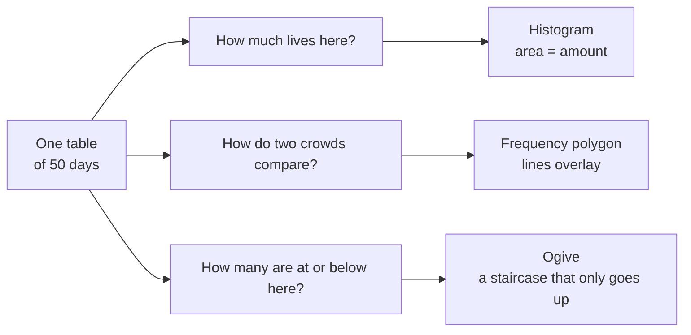

# Draw It Before You Describe It: Three Pictures of the Same Fifty Days

<!-- related-block -->
<div class="reading-time">11 min read</div>
<!-- related-block -->
<div class="related-strip">

**Read first:** [Mira's Notebook: What Kind of Data Is This, and How Do You Count It?](/fields/data-science/probability-statistics/data-types-and-frequency-tables.md)  ·  **See also:** [Probability & Statistics, One Sip at a Time](/fields/data-science/probability-statistics/README.md), [The Bell Curve: Probability as Area, and One Ruler for Every Bell](/fields/data-science/probability-statistics/the-bell-curve.md), [The Map of Leaf & Kettle: Every Idea So Far in One Walk Through the Shop](/fields/data-science/probability-statistics/the-map-of-leaf-and-kettle.md), [Two Things Moving Together: Correlation and the Line](/fields/data-science/probability-statistics/two-things-moving-together.md), [Where Do You Stand? Percentiles, Z-Scores and the Box Plot](/fields/data-science/probability-statistics/where-do-you-stand.md)  ·  **Read next:** [The Number on the Tin: Mean, Median and Mode](/fields/data-science/probability-statistics/the-number-on-the-tin.md)

</div>


> **Part 3 of 15.** Part of the [Probability & Statistics](/fields/data-science/probability-statistics/README.md) series. It builds on the grouped tables from [Mira's Notebook](/fields/data-science/probability-statistics/data-types-and-frequency-tables.md). By the end you will see that the histogram, the frequency polygon and the ogive are not three graphs to memorize: they are three **questions** you can ask of one table. The shop, the people and the counts are invented, and every number can be checked by hand.

## The idea in one minute

A table of counts hides its shape. A picture shows it, and which picture you draw depends on the question:

- **"How much lives here?"** Draw bars that touch, so that **area means amount**. That is the histogram.
- **"How do two crowds compare?"** Draw the outline as a line, so two can be laid over each other. That is the frequency polygon.
- **"How many are at or below here?"** Draw a running total, a staircase that can only go up. That is the ogive, and it sits on the **upper** edge of each class because a class is only counted once it is finished.

The rest of the page is the reason behind those three sentences.

## Table of Contents

- [Prologue: Ravi's blank stare](#prologue-ravis-blank-stare)
- [One table, three questions](#one-table-three-questions)
- [Question 1: how much lives here?](#question-1-how-much-lives-here)
- [Question 2: how do two crowds compare?](#question-2-how-do-two-crowds-compare)
- [Question 3: how many are at or below here?](#question-3-how-many-are-at-or-below-here)
- [The short recipe](#the-short-recipe)
- [Ways these pictures lie](#ways-these-pictures-lie)
- [Check yourself](#check-yourself)
- [Back to the story](#back-to-the-story)
- [Cheat sheet](#cheat-sheet)
- [Answers](#answers)
- [References](#references)

* * *

## Prologue: Ravi's blank stare

Mira has counted the customers who came into Leaf & Kettle on each of the last 50 days, and grouped the counts into classes. She slides the table across the counter to her business partner Ravi, who is deciding how many baristas to schedule.

| Customers per day | Days |
|---|---|
| 100 to 104 | 2 |
| 105 to 109 | 8 |
| 110 to 114 | 18 |
| 115 to 119 | 13 |
| 120 to 124 | 7 |
| 125 to 129 | 1 |
| 130 to 134 | 1 |

Ravi reads the table. He reads it again. Then he looks up and says, "So... is that a lot?"

The table is correct, and useless to him: it makes him see the shape himself. So Mira turns the napkin over and asks him the better question: "What do you actually want to know?"

* * *

## One table, three questions

Because the counts are whole numbers, the class boundaries sit half a unit beyond the limits (as in the previous page): the first class runs from 99.5 to 104.5. Here is the one table every picture comes from.

| Class boundaries | Frequency `f` | Midpoint `M` | Cumulative `CF` |
|---|---|---|---|
| 99.5 to 104.5 | 2 | 102 | 2 |
| 104.5 to 109.5 | 8 | 107 | 10 |
| 109.5 to 114.5 | 18 | 112 | 28 |
| 114.5 to 119.5 | 13 | 117 | 41 |
| 119.5 to 124.5 | 7 | 122 | 48 |
| 124.5 to 129.5 | 1 | 127 | 49 |
| 129.5 to 134.5 | 1 | 132 | 50 |

The midpoint is `(lower + upper) / 2`, so `(99.5 + 104.5) / 2 = 102`. The cumulative column is the running total of `f`, and its last value must equal `n = 50`.



Three questions, one table. Which one is Ravi asking first? "Is that a lot?" is a question about **amount**.

* * *

## Question 1: how much lives here?

> ☕ **Try it before you scroll.** You draw one bar per class. Should the bars touch or have gaps between them? *Hint: what would a gap between 104.5 and 105.5 claim about that stretch of customers?*

Think of the horizontal axis as a ruler. Every stretch of the ruler holds some number of days, and a bar is a way of saying "this stretch holds this much". Sideways, in text:

```text
 99.5 - 104.5 | ██ 2
104.5 - 109.5 | ████████ 8
109.5 - 114.5 | ██████████████████ 18
114.5 - 119.5 | █████████████ 13
119.5 - 124.5 | ███████ 7
124.5 - 129.5 | █ 1
129.5 - 134.5 | █ 1
```

Ravi's eyebrows go up: the days pile up in the 110s, with a thin tail of busy days toward 134. Three reasons, and the rest follows:

- **The bars touch because the ruler has no holes.** A gap would claim a stretch of values that cannot occur. Favourite blends are different: tea types are separate things, not stretches of a ruler, so their bars have gaps.
- **The axis shows boundaries, not limits.** Label the bars with limits (100 to 104, 105 to 109) and the reader sees a hole between 104 and 105 that is not there.
- **Area is the amount, and height is only a shortcut.** When all classes are 5 wide, a taller bar means more days, so height seems to be the story. It is not. Suppose Mira merges the last three classes into one wide class from 119.5 to 134.5, holding 9 days. Drawn at height 9 it would tower over the 8-day class and look like a second peak, though those 9 days are spread over 15 units of the ruler. The honest height is **frequency density**, frequency divided by class width: `9 / 15 = 0.6` days per unit, against `8 / 5 = 1.6` for the neighbouring-sized class. Now **area = height x width = count** again, and the wide class looks as small as it is.

This is why the histogram is the picture to draw first: part 6 shows the box plot is only a thin summary of it. Look first, then summarise.

Ravi has one more worry: this summer against last summer.

* * *

## Question 2: how do two crowds compare?

The second question is not about one crowd at all. Mira puts a dot above the **midpoint** of each class at the height of its frequency, and joins the dots.

The dots are (102, 2), (107, 8), (112, 18), (117, 13), (122, 7), (127, 1), (132, 1).

Close the shape by bringing the line down to zero at both ends, either with an empty class on each side (midpoints 97 and 137) or at the outer boundaries (99.5 and 134.5). Say which you used.

Same information as the histogram, so why bother? **Because lines overlay and bars do not.** Two sets of bars on the same axes cover each other; two outlines show at a glance whether this summer's peak sits left, right or higher.

Ravi's third question is of another kind altogether: "On how many days did we have 114 or fewer customers?"

* * *

## Question 3: how many are at or below here?

With the histogram Ravi must add bars in his head. The ogive plots the running total, so each point answers "how many days **up to here**?" That phrase explains the whole picture.

- **It only goes up.** Counting days up to a value can never lose a day, so the curve starts at 0, never goes down, and ends at `n = 50`. It is a staircase, with the steps smoothed into straight lines. Its steepest stretch is where the crowd is thickest.
- **It sits on the upper boundary.** The count "up to 114.5" is only true once the whole 109.5 to 114.5 class has been counted, that is, at its top edge. Plot it at the midpoint or the lower edge and the curve claims days that have not happened yet. The first point is the lowest boundary with a count of zero.

| Boundary (x) | 99.5 | 104.5 | 109.5 | 114.5 | 119.5 | 124.5 | 129.5 | 134.5 |
|---|---|---|---|---|---|---|---|---|
| Days up to x (y) | 0 | 2 | 10 | 28 | 41 | 48 | 49 | 50 |

You can read it in two directions, and they answer two different families of question:

- **From x to y: "how many are at or below?"** Whole numbers, so "114 or fewer" reaches exactly the boundary 114.5, and the curve reads **28 days**, which is `28 / 50 = 56%`.
- **From y to x: "what value splits the data?"** Half of 50 is 25. At height 25 the curve lies on the straight stretch between (109.5, 10) and (114.5, 28), so

```text
x = 109.5 + (25 - 10) / (18) x 5 = 109.5 + 0.833 x 5 = about 113.7
```

Half the days had about 113.7 customers or fewer: the **median**, found by ruler. Other heights give **percentiles** (part 6). Caution: straight lines assume days are spread **evenly** inside each class, so the curve is exact at the boundaries and an estimate between them.

* * *

## The short recipe

Write boundaries, `f` and the cumulative column (last value = `n`). Then: **histogram**, touching bars on boundaries, height `f` (or `f / width`); **polygon**, dots at (midpoint, `f`), closed at both ends; **ogive**, points at (upper boundary, `CF`) from (lowest boundary, 0).

* * *

## Ways these pictures lie

Each trap is an idea broken. (Labelling bars with limits invents a hole, the same as gaps.)

| Trap | Idea it breaks | The fix |
|---|---|---|
| Gaps between histogram bars | The ruler has no holes | Let bars touch, use boundaries |
| Unequal widths, plain frequency as height | Area is the amount | Plot frequency density |
| Ogive at midpoints or lower boundaries | A count up to here needs the class finished | Plot at upper boundaries |

* * *

## Check yourself

Use the table of 50 days above.

1. On how many days were there 119 customers or fewer, and what share is that?
2. Which two numbers make the first ogive point after (99.5, 0)?
3. You want to compare this summer's days with last summer's on one chart. Which picture, and why?
4. A bar chart of favourite blends has gaps, but a histogram of daily customers does not. Why?
5. Estimate the value below which the lowest 25% of days fall.

* * *

## Back to the story

Ravi holds the napkin up to the light.

"The tallest bar is the 110s," he says. "That's my normal day."

"Eighteen of the fifty," says Mira.

"And 114 or fewer on 28 days." He frowns. "How many were really busy, over 119?"

Mira reads it off the staircase: 41 days at or below 119, so **9 days**, a bit under one day in five.

Ten minutes ago Ravi could not tell if the numbers were large. Now he asks his own questions: that is what a good picture is for.

"Okay," he says. "Two baristas on ordinary days, a third on call. But what's the *typical* day, exactly? One number."

**Takeaway:** do not memorize three graphs. Ask the question: how much, how do two compare, how many up to here.

That is a harder question than it sounds, and it is the next cup: [The Number on the Tin](/fields/data-science/probability-statistics/the-number-on-the-tin.md).

* * *

## Cheat sheet

```text
Midpoint M = (lower boundary + upper boundary) / 2

How much lives here?        -> histogram: touching bars on boundaries, area = count
                               unequal widths: height = f / width
How do two crowds compare?  -> polygon: dots at (midpoint, f), closed, overlaid
How many at or below here?  -> ogive: (UPPER boundary, CF), from (lowest boundary, 0) to n
  read x -> y : count at or below x
  read y -> x : value below which y values fall (median at y = n/2)

Straight lines assume values are spread evenly inside each class
```

* * *

## Answers

1. The cumulative frequency at the boundary 119.5 is **41**, so 41 days, which is `41 / 50 = 82%`.
2. The upper boundary **104.5** and its cumulative frequency **2**.
3. The **frequency polygon**. Outlines share one set of axes and the eye compares peaks and shifts. Two sets of bars would cover each other.
4. Blends are separate **categories**, not stretches of a ruler, so their bars stand apart. Daily customers lie on a continuous scale where classes share boundaries, so the bars touch.
5. 25% of 50 is 12.5. That height lies between (109.5, 10) and (114.5, 28), so `x = 109.5 + (12.5 - 10) / 18 x 5 = 109.5 + 0.694 = about 110.2`. About a quarter of the days had roughly 110 customers or fewer.

* * *

## References

- Every number on this page (cumulative column, 41 and 9 days, 56% and 82%, the interpolations 113.7 and 110.2, the densities 0.6 and 1.6) was recomputed with Python 3.14.4. The merged-class example is an invented illustration. No external source was fetched for this page.
