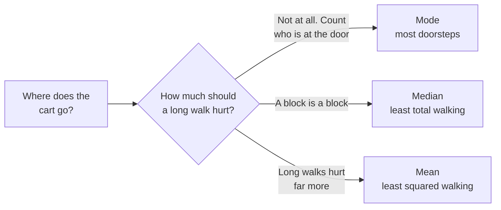

# How Far From the Middle? One Question Behind Every Summary Number

> **Part 5 of 13.** Part of the [Probability & Statistics](/fields/data-science/probability-statistics/README.md) series, and the sequel to [The Number on the Tin](/fields/data-science/probability-statistics/the-number-on-the-tin.md), where the "typical" score was a score nobody gave. By the end you will know why there are three middles and a pile of spreads, and that they are **one question** asked with different rulers. Far less to memorize than it looked.

## Table of Contents

- [Prologue: the cart on Kettle Street](#prologue-the-cart-on-kettle-street)
- [Three rules for one cart](#three-rules-for-one-cart)
- [Why the median counts heads and the mean balances](#why-the-median-counts-heads-and-the-mean-balances)
- [What is left over: spread](#what-is-left-over-spread)
- [The one-house test](#the-one-house-test)
- [The n − 1 mystery](#the-n--1-mystery)
- [Check yourself](#check-yourself)
- [Back to the story](#back-to-the-story)
- [Cheat sheet](#cheat-sheet)
- [Answers](#answers)
- [References](#references)

* * *

## Prologue: the cart on Kettle Street

Mira rents a handcart for the weekend market. Seven regulars live along Kettle Street, and she writes down their block numbers:

```text
block     1    2    3    4    5    6    7    8    9   ...   20
people    1    2    1    0    1    0    0    0    1   ...    1
```

"Park it in the middle," says Tala.

"Which middle?" says Ravi, who lives on block 9. "Mine is block 9. Funny, that."

The cart can stand in exactly one place. So every answer to "where is the middle?" is secretly **a rule for choosing one place**. Last page gave you three rules and let you think they were rivals. They are not.

> ☕ **Try it before you scroll.** Houses on blocks 1, 2, 2, 3, 5, 9 and 20. You get one spot for the cart. Which block do you pick, and what rule did you just use? *Hint: you used a rule whether you noticed or not.*

* * *

## Three rules for one cart

Every rule answers the same question: **how much should a long walk hurt?**



*One question, three answers. Each spot wins its own contest.*

Here is the street, scored all three ways:

| Cart at | Name | Total walk (blocks) | Total of squared walks | People at the door |
|---|---|---|---|---|
| block 2 | mode | 30 | 384 | **2** |
| block 3 | median | **29** | 335 | 1 |
| block 6 | mean | 34 | **272** | 0 |

Each spot wins one column and loses the others. I also scanned every position from block 0 to block 20 in steps of 0.01: nothing beats block 3 on total walking, and nothing beats block 6 on total squared walking.

So the three are not formulas to memorize. They are three attitudes toward distance:

- **Mode:** distance does not matter, only "right here" does.
- **Median:** distance matters in proportion. Ten blocks is ten times one block.
- **Mean:** distance matters more than in proportion. Squaring makes one ten-block walk hurt as much as a hundred one-block walks.

That last attitude is also why the mean is the one that chases tails. Block 20 is one person, but at the mean it owes 196 of the 272 in squared walking, 72% of the bill.

* * *

## Why the median counts heads and the mean balances

You do not have to take the table on trust. Slide the cart one block to the right and ask who is happier.

- **For total walking:** everyone on the left walks one block more, everyone on the right walks one block less. The total changes by *(people on the left) − (people on the right)*. So slide toward the side with more people, and stop when the two sides are equal. That is the **median**: half the heads on each side. (With an even number of people, any spot between the two middle houses ties.)
- **For squared walking:** a far-away person's walk changes by much more when you slide. The total stops improving exactly when the pulls from the left and right cancel, which is when the deviations add up to zero. You met that last page as the seesaw. **The balance point is the spot that minimizes squared walking.**

The seesaw was never a separate idea. It was this one.

Which raises the next question. Once the cart is parked, someone still has to walk. How much?

* * *

## What is left over: spread

**Spread** is the walking that remains after you pick the best spot. Each rule leaves its own kind of leftover, so each middle has a natural partner:

| Middle | Leftover rule | Name | On Kettle Street |
|---|---|---|---|
| Mean (block 6) | Average squared walk | **Variance** `σ²` | 272 / 7 = 38.9 blocks² |
| Mean | The same, square-rooted | **Standard deviation** `σ` | 6.23 blocks |
| Median (block 3) | Average plain walk | **Mean absolute deviation** | 29 / 7 = 4.1 blocks |
| Median | Width of the middle half | **IQR** (Q3 − Q1) | 7 − 2 = 5 blocks |
| none | Farthest minus nearest | **Range** | 20 − 1 = 19 blocks |

Two notes:

- **Why the square root?** Squaring turns blocks into *blocks²*, which nobody can picture. Taking the root brings it back to blocks. That is the whole reason standard deviation exists next to variance.
- **What is IQR?** Q1 and Q3 are the values a quarter and three quarters of the data sit below, the edges of the middle half. [The next page](/fields/data-science/probability-statistics/where-do-you-stand.md) builds them properly. Here, take them as the edges of the crowd.

The one-line memory: **mean goes with standard deviation, median goes with IQR.** Choose the pair, and you have chosen both.

* * *

## The one-house test

How do you choose the pair? Ask the **one-house question**: *if one value were wrong, how much would my number move?*

Mira's helper types house 20 as **200**. Watch the four numbers:

| | Real data | With the typo |
|---|---|---|
| Mean | 6 | **31.7** |
| Standard deviation | 6.23 | **68.75** |
| Median | 3 | 3 |
| IQR | 5 | 5 |

Squares let one house shout. The mean and standard deviation went wild, and the median and IQR did not even notice.

So:

| Your data | Use |
|---|---|
| Roughly symmetric, every value matters, you care about totals | Mean and standard deviation |
| Skewed, or you cannot vouch for the extremes | Median and IQR |
| Two clumps | Neither alone. Describe both clumps |

* * *

## The n − 1 mystery

Everything so far treated the seven houses as **everyone**, so we divided by 7. In real life you almost always see a **sample**, and textbooks tell you to divide by `n − 1` instead. Nobody says why. Here is the reason, and you can verify it by hand.

> ☕ **Try it before you scroll.** A sample picks its own cart spot, its own mean. Is the sample's own squared walking, measured from that spot, bigger or smaller than the walking measured from the **true** mean? *Hint: which spot did we just prove is the best for the sample?*

**Smaller, always.** The sample's mean is, by construction, the spot that suits *that sample* best. The true mean is farther from the sample on average. So squared walking measured from the sample's own mean comes out too small, and dividing by `n` inherits the shortfall.

Take a tiny population you can enumerate: three houses at blocks **2, 4 and 9**. The true mean is 5, and the true variance is `(9 + 1 + 16) / 3 = 8.67`. Now take **every possible sample of two** (nine equally likely draws, with replacement):

| Sample | Sample mean | Divide by `n` (= 2) | Divide by `n − 1` (= 1) |
|---|---|---|---|
| 2, 2 | 2.0 | 0 | 0 |
| 2, 4 | 3.0 | 1 | 2 |
| 2, 9 | 5.5 | 12.25 | 24.5 |
| 4, 2 | 3.0 | 1 | 2 |
| 4, 4 | 4.0 | 0 | 0 |
| 4, 9 | 6.5 | 6.25 | 12.5 |
| 9, 2 | 5.5 | 12.25 | 24.5 |
| 9, 4 | 6.5 | 6.25 | 12.5 |
| 9, 9 | 9.0 | 0 | 0 |
| **Average** | 5.0 | **4.33** | **8.67** |

Dividing by `n` averages **half** the truth. Dividing by `n − 1` lands on **8.67 exactly**. With two points the shortfall is a factor of `(n − 1) / n = 1/2`, and it fades as `n` grows, which is why nobody worries with big samples.

One honest footnote: this fixes the **variance** on average. Its square root, the standard deviation, still comes out a little low on average (2.20 here, against a true 2.94), because taking a root bends the average. Standard practice accepts that.

```python
import statistics as st

data = [2, 4, 9]
st.pvariance(data)   # divides by n.    "this is everyone"        -> 8.666...
st.variance(data)    # divides by n-1.  "this is a sample"        -> 13
st.stdev(data)       # square root of the line above              -> 3.605...
```

The rule: **everyone in the room, divide by `n`. A sample from a bigger group, divide by `n − 1`.** Almost every real data set is the second kind.

* * *

## Check yourself

1. Houses at blocks 1, 3, 4 and 10. Where does the cart go for the **least total walking**? Is the answer unique?
2. For the same houses, find the mean and the variance and standard deviation (treat them as everyone).
3. Why is variance measured in *squared* units, and what turns it back?
4. The twelve staff in Mira's shop, versus twelve customers picked from the loyalty cabinet. Which uses `n`, and which `n − 1`?
5. A sales column has one value mistyped by a factor of 100. Which pair of numbers survives?

* * *

## Back to the story

Mira parks the cart on block 3, the median, the spot with the least total walking. Ravi, on block 9, still thinks it should be on block 9. Everyone's middle is their own doorstep, and he is not wrong about his.

Then she goes back to the tin. The 20 tasting scores had a mean of 75.2, and their sample standard deviation is **17.67**. Only two of the twenty tasters sit within five points of the number on the tin. A spread that wide *next to* a center is the alarm that says the center is lying. Page 4 found the two clumps by looking at the table. Now a single number could have raised the alarm.

**Takeaway:** every summary is a stand-in for a crowd, the middle is the best stand-in under one rule for how distance hurts, and the spread is how badly the stand-in still misses.

Now the harder question. Tala scored **84** on the brewing exam and **61** on the cupping exam. Which is the better result? "Better than what?" Each exam has its own middle and its own leftover. Next cup: [Where Do You Stand?](/fields/data-science/probability-statistics/where-do-you-stand.md)

* * *

## Cheat sheet

```text
ONE QUESTION:  how much should a long walk hurt?
  not at all           -> mode     (most doorsteps)
  in proportion        -> median   (least total walking, half the heads each side)
  more than that       -> mean     (least squared walking, deviations add to 0)

LEFTOVER (spread), by partner:
  mean   <-> variance = average squared walk;  SD = sqrt(variance), back in the data's units
  median <-> IQR = Q3 - Q1 (width of the middle half);  also mean absolute deviation
  range  = max - min, one number, set by the two most extreme values

ONE-HOUSE TEST: one wrong value moves mean and SD a lot, median and IQR almost not at all

DIVIDE BY:  n  if the data are everyone     n - 1  if it is a sample
  python: pvariance / pstdev  (n)           variance / stdev  (n - 1)
```

* * *

## Answers

1. Total walking is 10 at blocks 3, 3.5 and 4 (and anywhere between), so the answer is **not unique**. With an even number of people, any spot between the two middle houses ties. The usual choice is the midpoint, **3.5**, which is also the median.
2. The mean is `(1 + 3 + 4 + 10) / 4 =` **4.5**. The squared walks are 12.25, 2.25, 0.25 and 30.25, which total 45, so the variance is `45 / 4 =` **11.25** and the standard deviation is **3.35**. Check: moving the cart to 3.5 raises the total to 49, to 4 raises it to 46, to 3 raises it to 54. None beats 45.
3. Because each walk is **squared** before averaging, so the result is in blocks², not blocks. The **square root** (the standard deviation) turns it back into blocks.
4. The twelve staff are **everyone** you care about, so use `n`. The twelve customers are a **sample** of a larger group, so use `n − 1`.
5. **Median and IQR.** The typo is the farthest value, and only the squared pair (mean and SD) lets one far value dominate.

* * *

## References

- Python `statistics` module: `pvariance`, `variance`, `pstdev`, `stdev` (population divides by `N`, sample by `N − 1`, "Bessel's correction"). Verified against Python 3.14.4. <https://docs.python.org/3/library/statistics.html>
- Every number on this page was recomputed with Python 3.14.4, including the scan of every cart position and the enumeration of all nine samples of two.
