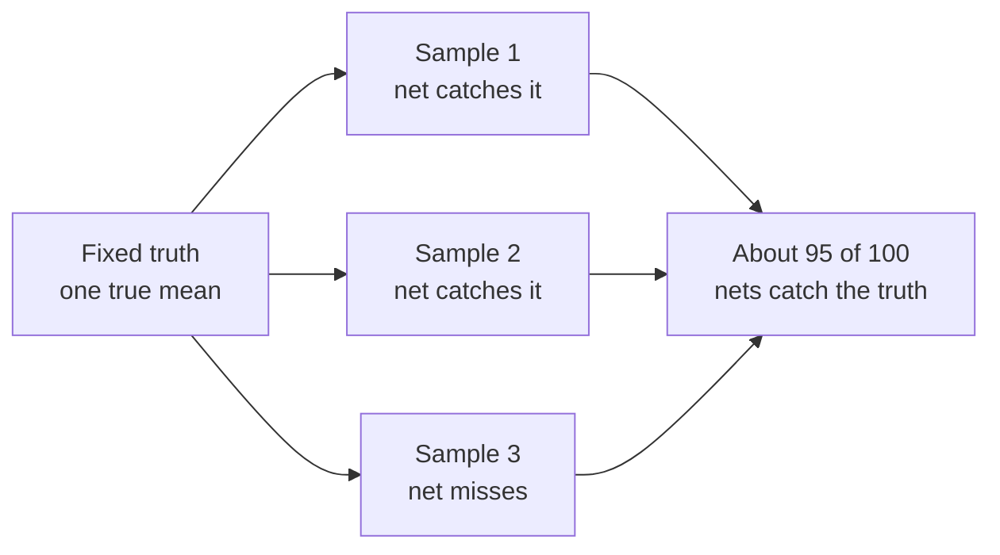

# How Sure Are You? Confidence Intervals

> **Part 13 of 15.** Part of the [Probability & Statistics](/fields/data-science/probability-statistics/README.md) series. It continues from [Why Averages Behave](/fields/data-science/probability-statistics/why-averages-behave.md), where you learned how much a sample average wobbles (the standard error). By the end you will turn that wobble into an honest "give or take", know what the famous "95%" really claims, and know the one way a tight interval can still be wrong. The scenario is invented, and the simulation is labelled as simulated.

## Table of Contents

- [Prologue: the number on the tin, again](#prologue-the-number-on-the-tin-again)
- [One number or a net](#one-number-or-a-net)
- [What the 95% is about](#what-the-95-is-about)
- [More data, narrower net](#more-data-narrower-net)
- [No formula: shake the bag](#no-formula-shake-the-bag)
- [Small samples, and the trap of a tight wrong answer](#small-samples-and-the-trap-of-a-tight-wrong-answer)
- [Check yourself](#check-yourself)
- [Back to the story](#back-to-the-story)
- [Cheat sheet](#cheat-sheet)
- [Answers](#answers)
- [References](#references)

* * *

## Prologue: the number on the tin, again

Mira wants a line on the new tin: **"Customers love it: 78%."** She asked 100 customers and 78 said yes. (Invented numbers.)

Tala, who has been reading the previous part, frowns. "If you asked a different 100 people, would you get 78 again?"

"Probably not. Maybe 74. Maybe 83."

"Then what are we printing? A fact, or one draw out of the bag?"

Mira has no answer. The honest label is a **number with a size of doubt on it**.

* * *

## One number or a net

A sample average is one throw at an unseen target, the true value in the whole population. Last part measured how wide your throws scatter: the **standard error**, `SD / sqrt(n)`. A **confidence interval** just uses that scatter to turn one throw into a **net**:

```text
interval = estimate  ±  margin        margin = z × standard error
```

`z` is how many standard errors you stretch the net. For the usual **95%** net, `z = 1.96` (Python: `NormalDist().inv_cdf(0.975)`: the middle 95% of a bell curve sits between `-1.96` and `+1.96`).

Mira's tin, checked by hand. A yes/no answer is an average of 1s and 0s, and its spread is `sqrt(p × (1 − p))`, so:

```text
p = 0.78, n = 100
standard error = sqrt(0.78 × 0.22 / 100) = 0.0414
margin         = 1.96 × 0.0414           = 0.081
interval       = 78% ± 8.1 points        = 69.9% to 86.1%
```

"Customers love it: 78%, give or take 8 points." That is a label Tala can defend. But what does the 95% promise? Almost everyone gets this wrong, including people who use the phrase daily.

* * *

## What the 95% is about

Tempting reading: "there is a 95% chance the true value is in *this* interval." That is not what it says. The true value is not random. It is a fixed number, sitting still. What is random is the **net**, because each sample lands a different net.

The 95% describes the **method**: pick samples over and over, build a net from each one, and about 95 of every 100 nets catch the truth. Any one net either caught it or did not, and you never learn which.



*The target never moves. The nets move. The 95% is a property of the net-making recipe.*

> ☕ **Try it before you scroll.** Build 100 intervals with the 95% recipe, each from a fresh sample. How many do you expect to catch the truth: exactly 95, about 95, or at least 95? *Hint: the samples are random.*

We can run it, because a simulation lets us do what real life never does: know the truth. Build a population of 10,000 tin ratings (1 to 5 stars, invented), keep its true mean, then send 100 pollsters, each asking 40 customers. (Python 3.14.4, seeded, **simulated**.)

```python
import math, random, statistics as st
from statistics import NormalDist

z = NormalDist().inv_cdf(0.975)            # 1.96: the middle 95% of a bell curve

def interval(sample):                      # estimate +/- z * standard error
    m = st.fmean(sample)
    se = st.stdev(sample) / math.sqrt(len(sample))
    return m - z * se, m + z * se

random.seed(13)                            # simulated tin ratings, 1 to 5 stars
pop = random.choices([1, 2, 3, 4, 5], weights=[5, 10, 20, 35, 30], k=10000)
mu = st.fmean(pop)                         # the truth, known only because we built it
print(f"true mean {mu:.4f}")

covered, missed = 0, []
for i in range(1, 101):                    # 100 pollsters, each asks 40 customers
    lo, hi = interval(random.sample(pop, 40))
    if lo <= mu <= hi:
        covered += 1
    else:
        missed.append(i)
print("covered", covered, "of 100; missed pollsters:", missed)
```

```text
true mean 3.7478
covered 93 of 100; missed pollsters: [5, 39, 45, 64, 77, 83, 87]
```

**93, not 95.** About 95 means about 95, and 100 is a small count to judge a recipe by. It ran a little low because the recipe uses the sample's own SD in place of the unknown true one (more on that below). Seven careful pollsters printed a net with the truth outside. That is not an arithmetic mistake. It is what "95%" means.

So can you shrink the net without taking more risk?

* * *

## More data, narrower net

You buy it with data. The margin is `z × SD / sqrt(n)`, so it shrinks with the **square root** of the sample size. Same population, same method, average width of 200 intervals at each size (**simulated**, from the second loop of the same script):

```python
for n in (25, 100, 400, 1600):             # average width over 200 repeats
    w = [(lambda c: c[1] - c[0])(interval(random.sample(pop, n))) for _ in range(200)]
    print(n, round(st.fmean(w), 3))
```

```text
25 0.887
100 0.441
400 0.222
1600 0.111
```

| Customers asked | Net width (stars) | Compared with the row above |
|---|---|---|
| 25 | 0.887 | |
| 100 | 0.441 | **4x the data, half the width** |
| 400 | 0.222 | 4x the data, half again |
| 1600 | 0.111 | 4x the data, half again |

The price list: **to halve your doubt, quadruple your sample.** The first customers are bargains, the later ones are luxury.

* * *

## No formula: shake the bag

The formula needs a bell-shaped average and an SD you trust. The **bootstrap** needs neither. Your sample is the best picture you have of the population, so treat it as the population: draw from it **with replacement**, as many as you originally had, compute the average, and repeat thousands of times. The middle 95% of those averages is your net.

Continuing the script, one new sample of 40, both routes (**simulated**):

```python
random.seed(5)                             # one real sample, two routes
sample = random.sample(pop, 40)
lo, hi = interval(sample)
print(f"mean {st.fmean(sample):.3f}  formula {lo:.3f} to {hi:.3f}")
means = sorted(st.fmean(random.choices(sample, k=40)) for _ in range(10000))
print(f"bootstrap {means[249]:.3f} to {means[9749]:.3f}")   # middle 95% of 10000 means
```

```text
mean 3.700  formula 3.296 to 4.104
bootstrap 3.300 to 4.075
```

The two nets agree closely (3.30 against 3.296 below, 4.075 against 4.104 above). They are two honest estimates of the same wobble, and neither is "the" answer.

* * *

## Small samples, and the trap of a tight wrong answer

**Small samples.** The `1.96` is exact only if you knew the true SD. You do not: you estimate it from the same few values, and with a small sample that estimate is itself shaky. The fix is to use the **t distribution**, a bell curve with slightly fatter tails, whose critical value depends on the sample size (the "degrees of freedom", `n − 1`). The net gets wider to pay for the extra uncertainty. NIST's formula for the mean uses exactly this t-value, not z. I checked two values by numerically integrating the t density (stdlib only): for `n = 10` the 95% multiplier is **2.262**, and for `n = 40` it is **2.023**, against 1.96. By about `n = 40` the difference is small, which also explains part of the "93, not 95" above.

**The trap.** Everything so far assumes the sample is a fair draw. Now let Mira be lazy: she asks only people at the counter who already bought the tin twice, the fans. In the simulation, that means sampling only from the 4-star and 5-star customers (**simulated**, same script):

```python
fans = [x for x in pop if x >= 4]          # biased: only ask people who already love it
random.seed(7)
inside = 0
for _ in range(100):
    lo, hi = interval(random.sample(fans, 40))
    inside += lo <= mu <= hi
print("fans-only: covered", inside, "of 100; last interval", f"{lo:.3f} to {hi:.3f}")
```

```text
fans-only: covered 0 of 100; last interval 4.223 to 4.527
```

The true mean is 3.75. **None** of 100 nets caught it. Each one is also narrow, because the fans mostly agree with each other, so the standard error is small: a tight, confident, wrong answer. A confidence interval measures only the wobble from **chance**. It cannot see a flaw in **who you asked**: that was the lesson of [Stir the Pot](/fields/data-science/probability-statistics/stir-the-pot-population-and-sampling.md), and no formula repairs it.

> [!WARNING]
> Narrow does not mean right. Narrow means precise. A tight net around the wrong spot is the most dangerous number on the tin, because it looks careful.

* * *

## Check yourself

1. Out of 200 customers, 120 said they love the tin. Give the 95% interval for the share (use `1.96`).
2. A pollster's 95% interval is 3.3 to 4.1. A colleague says "there is a 95% chance the true mean is between 3.3 and 4.1." What is the honest correction?
3. An interval has width 0.40 with 100 customers. About what width with 400? With 25?
4. In the bootstrap, why draw **with** replacement?
5. You ask only people leaving a five-star-review event. You ask 2000 of them. Is the interval trustworthy? Why or why not?

* * *

## Back to the story

Mira prints a new label: **"78% of 100 customers asked said they love it (about 70% to 86%)."** It is less punchy and a lot more defensible. 

Then Ravi, who is never satisfied, pulls two tins off the shelf. "The new blend scored 3.9 from 40 people. The old one scored 3.75 from 40 people. So the new one is better, right?"

Tala looks at the width of the nets. Each is about a third of a star wide. The gap between the blends is 0.15 stars.

**Takeaway:** a confidence interval is estimate plus or minus a margin that measures chance wobble. The 95% is about the **method**, not the single interval, four times the data halves the width, and no interval can fix a biased sample.

**Challenge:** is a gap of 0.15 stars real, or just two bags that happened to differ? Telling those apart is a decision, not a measurement, and it works like a trial. Next cup: [The Courtroom for Numbers](/fields/data-science/probability-statistics/the-courtroom-for-numbers.md).

* * *

## Cheat sheet

```text
CONFIDENCE INTERVAL = estimate ± z × standard error      (95%: z = 1.96)
STANDARD ERROR      = SD / sqrt(n)          proportion: sqrt(p × (1 − p) / n)

95% IS ABOUT THE METHOD: 95 of 100 nets catch the truth. The truth does not move.
WIDTH ~ 1 / sqrt(n):  4x the data = half the width.
BOOTSTRAP: resample your sample WITH replacement, take the middle 95% of the means.
SMALL n: use the t distribution (n = 10: 2.262, n = 40: 2.023, not 1.96).
NARROW ≠ RIGHT: a biased sample gives a tight net around the wrong spot.
```

* * *

## Answers

1. `p = 120 / 200 = 0.60`; standard error `= sqrt(0.6 × 0.4 / 200) = sqrt(0.0012) = 0.0346`; margin `= 1.96 × 0.0346 = 0.068`. Interval: **53.2% to 66.8%**.
2. The true mean is a fixed number, so it either is in that interval or is not. The 95% describes the **method**: if you repeated the sampling, about 95 of 100 nets built this way would catch the truth.
3. Four times the data halves the width: about **0.20** with 400. A quarter of the data doubles it: about **0.80** with 25.
4. The sample stands in for the population, and a fresh draw from a population can repeat a value. Drawing as many values as you had keeps the wobble matched to your real sample size.
5. **No.** The 2000 are all fans, so the interval is tight and describes fans, not customers. Sample size shrinks chance wobble, never bias.

* * *

## References

- NIST/SEMATECH e-Handbook of Statistical Methods, *Confidence Limits for the Mean*: interval estimate, 90/95/99% levels, the t-value formula, the 95% level read over repeated samples, width shrinking with larger N. Fetched and confirmed. <https://www.itl.nist.gov/div898/handbook/eda/section3/eda352.htm>
- Python `statistics` module: `NormalDist.inv_cdf`, `fmean`, `stdev`. The docs do not discuss confidence intervals or the t distribution, so those parts of this page come from NIST and from the runs above. <https://docs.python.org/3/library/statistics.html>
- The t critical values (2.262 for 9 degrees of freedom, 2.023 for 39) were computed on this page's behalf by numerically integrating the t density with the standard library, not copied from a table.
- Every simulated number is from Python 3.14.4 with the seeds shown. Every other number was recomputed by hand and with Python.
