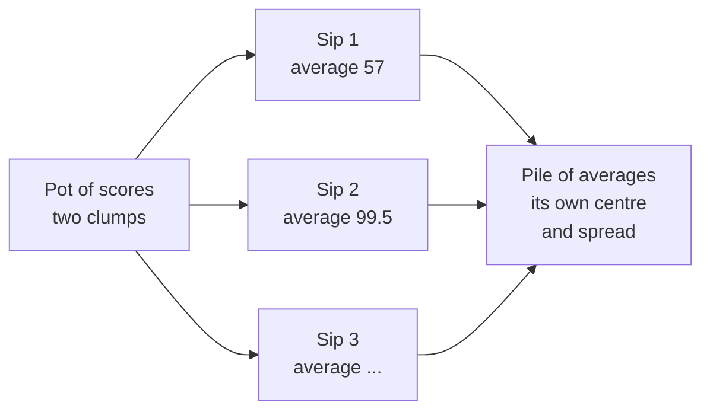
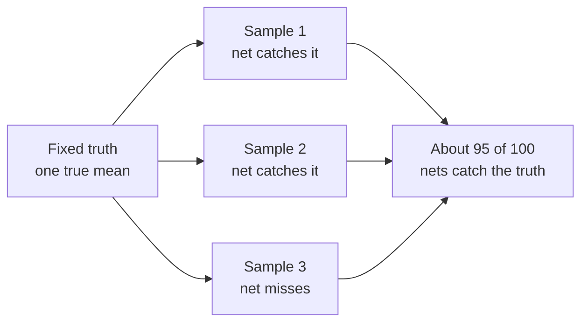

<!-- related-block -->
<nav class="crumbs" aria-label="Breadcrumb"><a href="#/fields/">Fields</a> / <a href="#/fields/data-science/">Data Science</a> / <a href="#/fields/data-science/probability-statistics/">Probability &amp; Statistics, One Sip at a Time</a> / <a href="#/fields/data-science/probability-statistics/inference/">Inference</a></nav>

# Averages and Intervals: Why Averages Behave and How Sure You Can Be

<!-- related-block -->
<div class="reading-time">Intermediate · Concept · 13 min read · Updated 25 Nov 2026</div>
<!-- related-block -->
<div class="tag-chips"><a class="chip" href="#/.docs/generated/explore/tags/sampling">sampling</a> <a class="chip" href="#/.docs/generated/explore/tags/statistics">statistics</a></div>
<!-- related-block -->
<div class="lab-line">Interactive lab: <a href="#/fields/data-science/probability-statistics/inference/averages-and-intervals?id=try-it-draw-samples-watch-the-averages-and-the-nets">Draw samples, watch the averages and the nets</a></div>
<!-- related-block -->
<div class="related-strip">

**Read first:** [The Bell Curve: Probability as Area, and One Ruler for Every Bell](/fields/data-science/probability-statistics/probability/the-bell-curve.md)  ·  **Read next:** [The Courtroom for Numbers: Could Plain Luck Do This?](/fields/data-science/probability-statistics/inference/the-courtroom-for-numbers.md), [Inference, Technically: Sampling Distributions, Intervals, Tests and Regression](/fields/data-science/probability-statistics/inference/technical-reference.md)

</div>


> **Parts 12 and 13 of 15.** Part of the [Probability & Statistics](/fields/data-science/probability-statistics/README.md) series. It joins the sip from [Samples, Data Types and Tables](/fields/data-science/probability-statistics/describing-data/samples-data-types-and-tables.md) and the bell from [The Bell Curve](/fields/data-science/probability-statistics/probability/the-bell-curve.md). The scenario is invented; every number was simulated with a fixed seed or recomputed with Python 3.14.4 (standard library only), and simulated output is labelled.

Mira is about to print a number on a tin. It will be one draw out of a bag, presented as a fact, and the one way to make it look more careful is to ask more people, all of the same kind.

**By the end of this page you will be able to:**

- Describe an average as a random thing with its own centre, spread (`σ / √n`) and shape (a bell).
- State what the central limit theorem does and does not say.
- Build a 95% interval by formula and by bootstrap, and say what the 95% is about.
- Recognise that bias survives any `n`, and that a tight interval can be wrong.

* * *

## Two sips, and a label

Mira stirs the pot of tasting scores and takes a sip of two cups: the average is **57**. Tala stirs the same pot, sips two cups and gets **99.5**: 42 points apart. "One of us is wrong," says Tala. "Neither," says Mira. "Each of us took a *different sip*."

An hour later Mira wants a line on the new tin: **"Customers love it: 78%."** She asked 100 customers and 78 said yes (invented numbers). Tala frowns: "If you asked a different 100 people, would you get 78 again?" "Probably not. Maybe 74. Maybe 83."

* * *

## Three wrong ways to settle it

1. **"One of us made a mistake."** Two honest averages from the same pot can differ by 42 points. The mistake is in treating an average as a fixed fact.
2. **Print 78% as it stands.** A fact, or one draw out of the bag?
3. **Ask only the regulars at the counter, 2,000 of them.** More data. Ravi is delighted by the narrow result. (The page says later why that is the most dangerous number on the tin.)

Mira has no label that survives the second question. The honest label is a number with a size of doubt on it. Find the size.

* * *

## The sip you could take a thousand times

### An average is a random thing

The population is the 20 tasting scores: two clumps, around 58 and 93. Its mean is **75.20** and its SD (dividing by N, since this is the whole pot) **17.22**. Nobody scored near 75, so this is not a bell. Take the sip over and over and write each average down: the collection has its own centre, spread and shape. It is the **sampling distribution** of the mean: *what the sip would say if you took it ten thousand times.* You never see it (you get one sip), but you can reason about it, and that reasoning is inference.



### Fact 1: the spread of averages shrinks

Draw `n` scores (with replacement, so draws are independent), average them, repeat 10,000 times:

```python
import random, statistics as st, math

pop = [52,55,55,58,58,58,62,62,62,71,71,89,89,89,93,93,94,94,95,104]
mu = st.fmean(pop)
sigma = st.pstdev(pop)
print(f"population: N={len(pop)} mean={mu:.2f} sigma={sigma:.2f}")

random.seed(12)
REPS = 10000
print(f"{'n':>3} {'mean of means':>14} {'SD of means':>12} {'sigma/sqrt(n)':>14}")
store = {}
for n in (1, 2, 5, 30):
    means = [st.fmean(random.choices(pop, k=n)) for _ in range(REPS)]
    store[n] = means
    print(f"{n:>3} {st.fmean(means):>14.2f} {st.stdev(means):>12.2f} {sigma/math.sqrt(n):>14.2f}")
```

Output (simulated, Python 3.14.4):

```text
population: N=20 mean=75.20 sigma=17.22
  n  mean of means  SD of means  sigma/sqrt(n)
  1          75.29        17.23         17.22
  2          75.11        12.29         12.18
  5          75.08         7.61          7.70
 30          75.23         3.14          3.14
```

- **The centre does not move:** the average of the averages sits at 75 for every `n`.
- **The spread falls like σ over √n.** This spread is the **standard error**: 17.22 for one cup, about 12 for two, 3.14 for thirty. That is the **law of large numbers** in working form.

The root is the catch: to halve the spread you need **four times** the sample. For `n = 30`, about **89%** of the simulated averages landed within 5 points of 75.2, against only **41%** for `n = 2`.

### Fact 2: the averages pile into a bell

```python
def hist(means, lo=50, hi=106, w=4, scale=100):
    out = []
    for a in range(lo, hi, w):
        c = sum(a <= m < a + w for m in means)
        out.append(f"{a:>3}-{a+w-1:<3} {'#'*round(c/scale)}")
    return "\n".join(out)
for n in (1, 2, 30):
    print(f"\nn={n}  (each # = 100 of {REPS} sample means)")
    print(hist(store[n]))
```

The run printed three histograms; here are `n = 2` and `n = 30` (simulated):

```text
n=2  (each # = 100 of 10000 sample means)
 50-53  #
 54-57  #######
 58-61  ###########
 62-65  #######
 66-69  ###
 70-73  ############
 74-77  ####################
 78-81  ##########
 82-85  ######
 86-89  ###
 90-93  ##########
 94-97  #####
 98-101 ###
102-105 

n=30  (each # = 100 of 10000 sample means)
 50-53  
 54-57  
 58-61  
 62-65  
 66-69  #####
 70-73  ##############################
 74-77  ##############################################
 78-81  #################
 82-85  ##
 86-89  
 90-93  
 94-97  
 98-101 
102-105 
```

With `n = 2` the pot's two clumps are smeared, with a new bump in the middle (one low cup plus one high cup averages to about 75). With `n = 30` they are **gone**: one hump near 75, a little lopsided. That is the **central limit theorem**: the average of many independent draws approaches a normal curve, whatever the crowd's shape. NIST: as the sample size becomes large, the sampling distribution of the mean becomes approximately normal regardless of the original distribution, is centred at the population mean, and has standard deviation approaching sigma over root N. Averaging smooths: thirty cups would all need to be extreme in the same direction.

### Try it: Draw samples, watch the averages and the nets

> **What to try:** Draw 1,000 samples of any size and watch the averages pile into a bell; compare their spread with σ/√n. Then build 100 intervals, switch between z and t at n = 5, and ask only the fans to see narrow nets around the wrong value.  
> **Start with:** the preset *n = 1: no bell yet*.

[Sampling and intervals lab](/fields/data-science/probability-statistics/labs/sampling.html#embed ':ignore')

### What the theorem does not say

| Tempting claim | What is true |
|---|---|
| "Large samples make the data bell-shaped." | No. A sample of 30 still shows two clumps. Only the **average** over repeated samples is bell-shaped. |
| "With n of at least 30, it is guaranteed normal." | No. 30 is a **rule of thumb**; the theorem is a limit, and skewed crowds need more. |
| "It works for any population." | It needs a mean and SD to exist (and independent draws). The Cauchy distribution has neither (NIST lists them as undefined). |
| "More data fixes everything." | It shrinks **random** error only. |

The condition comes from the statement in the MIT 18.05 reading (variables "having mean μ and standard deviation σ").

### The failure path: a biased sip

Suppose sips only ever come from the high clump, the 11 scores of 70 or more (mean **89.27**):

```python
biased = [x for x in pop if x >= 70]
print(f"biased pool: {len(biased)} scores, mean={st.fmean(biased):.2f}")
random.seed(12)
print(f"{'n':>5} {'mean of means':>14} {'SD of means':>12}")
for n in (2, 30, 500):
    means = [st.fmean(random.choices(biased, k=n)) for _ in range(2000)]
    print(f"{n:>5} {st.fmean(means):>14.2f} {st.stdev(means):>12.2f}")
print("true population mean:", round(mu,2))
```

```text
biased pool: 11 scores, mean=89.27
    n  mean of means  SD of means
    2          89.41         6.64
   30          89.23         1.73
  500          89.28         0.42
true population mean: 75.2
```

(simulated.) The spread shrinks beautifully, 6.64, 1.73, 0.42, and the averages are **confidently, tightly wrong**: they converge on 89.3, not 75.2. The law of large numbers promises convergence to the mean *of what you are drawing from*; whether that is the pot you care about is decided before any arithmetic, by who gets sipped.

### One number or a net

A confidence interval uses the scatter of throws to turn one throw into a **net**:

```text
interval = estimate  ±  margin        margin = z × standard error
```

For the usual **95%** net, `z = 1.96` (`NormalDist().inv_cdf(0.975)`: the middle 95% of a bell lies between −1.96 and +1.96). A yes/no answer is an average of 1s and 0s with spread `sqrt(p × (1 − p))`. The tin:

```text
p = 0.78, n = 100
standard error = sqrt(0.78 × 0.22 / 100) = 0.0414
margin         = 1.96 × 0.0414           = 0.081
interval       = 78% ± 8.1 points        = 69.9% to 86.1%
```

### What the 95% is about

Tempting reading: "a 95% chance the true value is in *this* interval". Wrong: the truth is a fixed number; what is random is the **net**. The 95% describes the **method**: build a net from each of many samples and about 95 of every 100 catch the truth. Any one net either caught it or did not, and you never learn which.



A simulation can know the truth: a population of 10,000 tin ratings (1 to 5 stars, invented), 100 pollsters each asking 40 customers (Python 3.14.4, seeded, **simulated**):

```python
from statistics import NormalDist

z = NormalDist().inv_cdf(0.975)            # 1.96: the middle 95% of a bell curve

def interval(sample):                      # estimate +/- z * standard error
    m = st.fmean(sample)
    se = st.stdev(sample) / math.sqrt(len(sample))
    return m - z * se, m + z * se

random.seed(13)                            # simulated tin ratings, 1 to 5 stars
pop = random.choices([1, 2, 3, 4, 5], weights=[5, 10, 20, 35, 30], k=10000)
mu = st.fmean(pop)                         # the truth, known only because we built it
print(f"true mean {mu:.4f}")

covered, missed = 0, []
for i in range(1, 101):                    # 100 pollsters, each asks 40 customers
    lo, hi = interval(random.sample(pop, 40))
    if lo <= mu <= hi:
        covered += 1
    else:
        missed.append(i)
print("covered", covered, "of 100; missed pollsters:", missed)
```

```text
true mean 3.7478
covered 93 of 100; missed pollsters: [5, 39, 45, 64, 77, 83, 87]
```

**93, not 95**: about 95 is about 95, 100 is a small count, and the recipe uses the sample's own SD in place of the unknown true one. Seven careful pollsters printed a net with the truth outside; that is what "95%" means.

### More data, narrower net

The margin is `z × SD / sqrt(n)`, so it shrinks with the **square root** of the sample size. Average width of 200 intervals at each size (**simulated**):

```python
for n in (25, 100, 400, 1600):             # average width over 200 repeats
    w = [(lambda c: c[1] - c[0])(interval(random.sample(pop, n))) for _ in range(200)]
    print(n, round(st.fmean(w), 3))
```

```text
25 0.887
100 0.441
400 0.222
1600 0.111
```

| Customers asked | Net width (stars) | Compared with the row above |
|---|---|---|
| 25 | 0.887 | |
| 100 | 0.441 | **4x the data, half the width** |
| 400 | 0.222 | 4x the data, half again |
| 1600 | 0.111 | 4x the data, half again |

**To halve your doubt, quadruple your sample.**

### No formula: shake the bag

The **bootstrap** needs neither a bell nor a trusted SD: treat your sample as the population, draw from it **with replacement** as many as you had, average, repeat thousands of times; the middle 95% of those averages is the net. One new sample of 40, both routes (**simulated**):

```python
random.seed(5)                             # one real sample, two routes
sample = random.sample(pop, 40)
lo, hi = interval(sample)
print(f"mean {st.fmean(sample):.3f}  formula {lo:.3f} to {hi:.3f}")
means = sorted(st.fmean(random.choices(sample, k=40)) for _ in range(10000))
print(f"bootstrap {means[249]:.3f} to {means[9749]:.3f}")   # middle 95% of 10000 means
```

```text
mean 3.700  formula 3.296 to 4.104
bootstrap 3.300 to 4.075
```

The two nets agree closely; they are two honest estimates of the same wobble.

### Small samples

`1.96` is exact only if you knew the true SD; with a small sample the estimate is itself shaky. Use the **t distribution**, a bell with slightly fatter tails whose critical value depends on the degrees of freedom `n − 1`; the net gets wider. NIST's formula for the mean uses that t-value. Computed by numerically integrating the t density (stdlib only): for `n = 10` the 95% multiplier is **2.262**, for `n = 40` it is **2.023**, against 1.96. By about `n = 40` the difference is small, which also explains part of the "93, not 95".

### The trap of a tight wrong answer

Everything assumes a fair draw. If only the fans are asked, sampling only the 4- and 5-star customers (**simulated**):

```python
fans = [x for x in pop if x >= 4]          # biased: only ask people who already love it
random.seed(7)
inside = 0
for _ in range(100):
    lo, hi = interval(random.sample(fans, 40))
    inside += lo <= mu <= hi
print("fans-only: covered", inside, "of 100; last interval", f"{lo:.3f} to {hi:.3f}")
```

```text
fans-only: covered 0 of 100; last interval 4.223 to 4.527
```

The true mean is 3.75; **none** of 100 nets caught it, and each is narrow because fans mostly agree. A confidence interval measures only the wobble from **chance**; it cannot see a flaw in **who you asked**.

> [!WARNING]
> Narrow does not mean right. Narrow means precise. A tight net around the wrong spot is the most dangerous number on the tin, because it looks careful.

* * *

## 78%, give or take eight

Mira and Tala line up their 2-cup averages, 57 and 99.5. "We were never going to agree," says Tala; a two-cup sip is a wide pile. Mira takes a 30-cup sip, then Tala does, and their averages land within a few points of each other, both near 75.

Mira prints a new label: **"78% of 100 customers asked said they love it (about 70% to 86%)."** Less punchy, a lot more defensible.

Ravi pulls two tins off the shelf. "The new blend scored 3.9 from 40 people. The old one scored 3.75 from 40 people. So the new one is better, right?" Each net is about a third of a star wide; the gap is 0.15 stars. Is that real, or two bags that happened to differ? Telling those apart is a decision, not a measurement, and it works like a trial. Next cup: [The Courtroom for Numbers](/fields/data-science/probability-statistics/inference/the-courtroom-for-numbers.md).

* * *

## Never again

| Mistake | Symptom | Fix |
|---|---|---|
| Reading one average as a fact | 57 and 99.5 from the same pot | It is one draw; report an interval |
| Expecting a bell from a single sample | "The data should be normal" | Only the **average** over repeated samples is bell-shaped |
| Treating n ≥ 30 as a guarantee | Skewed crowd, small n | It is a rule of thumb; check the shape |
| Reading 95% as the chance for this interval | "95% sure it is 3.3 to 4.1" | 95 of 100 nets built this way catch the fixed truth |
| Using 1.96 on a small sample | Net too narrow | Use t (n = 10: 2.262; n = 40: 2.023) |
| Believing a narrow net | Tight interval, wrong place | Check who was asked; no `n` cures bias |

* * *

## Check yourself

1. A population has `σ = 20`: standard error for `n = 25` and `n = 100`? By what factor must `n` grow to cut the standard error to a third?
2. 120 of 200 customers love the tin: the 95% interval for the share (use 1.96)?
3. An interval has width 0.40 with 100 customers: about what width with 400? With 25?
4. Does the CLT say a single sample of 30 should look like a bell? Is "n = 30 guarantees a normal sample mean" true?
5. A colleague says "there is a 95% chance the true mean is between 3.3 and 4.1": the honest correction? In the bootstrap, why draw **with** replacement?
6. A survey of 2,000 people leaving a five-star-review event: trustworthy?

<details>
<summary>Answers</summary>

1. `20 / sqrt(25) = 4` and `20 / sqrt(100) = 2`; **nine times**, since the standard error goes as 1/sqrt(n) and 3 squared is 9.
2. `p = 0.60`, standard error `sqrt(0.6 × 0.4 / 200) = sqrt(0.0012) = 0.0346`, margin `1.96 × 0.0346 = 0.068`: **53.2% to 66.8%**.
3. About **0.20** with 400 (four times the data halves it), about **0.80** with 25.
4. **No**: the theorem is about the distribution of **averages** across samples, and a single sample still looks like its population. **False**: 30 is a rule of thumb; the theorem is a limit and the speed depends on the shape.
5. The truth is a fixed number: it either is in that interval or not; the 95% describes the **method**. Drawing **with** replacement lets a fresh draw repeat a value, as a draw from a real population would, and keeps the wobble matched to your real sample size.
6. **No**: they are all fans, so the interval is tight and describes fans, not customers. Sample size shrinks chance wobble, never bias.

</details>

* * *

## 📜 The Scroll (keep this)

```text
Sampling dist.   : the averages from many samples of size n; centre = population mean
Standard error   : sigma / sqrt(n) (proportion: sqrt(p(1-p)/n)); 4x the sample halves it
LLN / CLT        : averages converge to the mean of what you draw from; approach a bell
                   (mean and SD must exist); n >= 30 is a rule of thumb only
Interval         : estimate +/- z x SE (95%: z = 1.96); small n: t (n=10: 2.262, n=40: 2.023)
95% is           : about the METHOD (95 of 100 nets catch the fixed truth), not this net
Bootstrap        : resample your sample WITH replacement; middle 95% of the means
Do not           : trust a narrow net on a biased sample; more n never cures bias
```

* * *

## References

- NIST/SEMATECH e-Handbook of Statistical Methods, section 1.3.6.6.1, *Normal Distribution*, "Theoretical Justification - Central Limit Theorem". <https://www.itl.nist.gov/div898/handbook/eda/section3/eda3661.htm>; and *Confidence Limits for the Mean*: interval estimate, 90/95/99% levels, the t-value formula, the 95% level read over repeated samples, width shrinking with larger N (fetched and confirmed). <https://www.itl.nist.gov/div898/handbook/eda/section3/eda352.htm>
- NIST/SEMATECH e-Handbook, section 1.3.6.6.3, *Cauchy Distribution*: the mean and standard deviation are listed as undefined. <https://www.itl.nist.gov/div898/handbook/eda/section3/eda3663.htm>
- MIT OpenCourseWare 18.05 (Spring 2022), Class 6 reading on the central limit theorem and the law of large numbers, section 5.2: for independent, identically distributed variables with mean μ and standard deviation σ, the average is approximately N(μ, σ²/n) for large n. Read from the PDF's page images. <https://ocw.mit.edu/courses/18-05-introduction-to-probability-and-statistics-spring-2022/mit18_05_s22_class06-prep-b.pdf>
- OpenStax *Introductory Statistics 2e*, section 7.1: sample means tend toward a normal distribution for any population shape, centred on the population mean with standard deviation σ/√n; the text gives no minimum sample size, so "n ≥ 30" here is a rule of thumb. <https://openstax.org/books/introductory-statistics-2e/pages/7-1-the-central-limit-theorem-for-sample-means-averages>
- Python `random` (`seed`, `choices`, `sample`; seeded output may change between versions) and `statistics` (`NormalDist.inv_cdf`, `fmean`, `stdev`; the docs do not discuss confidence intervals or the t distribution). <https://docs.python.org/3/library/random.html>, <https://docs.python.org/3/library/statistics.html>
- The t critical values (2.262 for 9 degrees of freedom, 2.023 for 39) were computed by numerically integrating the t density with the standard library, not copied from a table. Every simulated number is from Python 3.14.4 with the seeds shown (12, 13, 5, 7); every other number was recomputed by hand and with Python.

<!-- related-block -->
<div class="see-also">

**See also**

- [From a Sample to a Statement: Intervals, Tests and Lines](/fields/data-science/probability-statistics/inference/quick-guide.md) — A cheat sheet for parts 12 to 15 - the spread of averages, a confidence interval, a shuffle test and a regression line - with the check and the common trap for each.
- [Probability & Statistics, One Sip at a Time](/fields/data-science/probability-statistics/README.md) — A slow-brewed series on the ideas in probability and statistics that make people say "wait, why?", each one told as a small story in a tea shop.
- [Samples, Data Types and Tables: Who You Asked, What Kind of Column, How to Count It](/fields/data-science/probability-statistics/describing-data/samples-data-types-and-tables.md) — A sample speaks for a crowd only if you chose it fairly. The kind of column decides which arithmetic is allowed, and a frequency table counts it without losing the shape, if the drawers touch.
- [Spread and Position: Variance, n − 1, Percentiles, Z-Scores and the Box Plot](/fields/data-science/probability-statistics/describing-data/spread-and-position.md) — Mean, median and mode are three attitudes to how a long walk hurts; spread is the walking left over. A value then has a position only in its crowd: rank (percentile) or distance (z-score).

</div>
<!-- related-block -->
<div class="mentioned-in">

**Mentioned in**

- [Expectation and the Two Count Recipes: Binomial and Poisson](/fields/data-science/probability-statistics/probability/expectation-binomial-poisson.md) — Expected value is the data's seesaw with probability as the weight, not the likeliest outcome. Binomial and Poisson are recipes for a count; each is right only as far as its assumptions hold.
- [From a Sample to a Statement: Intervals, Tests and Lines](/fields/data-science/probability-statistics/inference/quick-guide.md) — A cheat sheet for parts 12 to 15 - the spread of averages, a confidence interval, a shuffle test and a regression line - with the check and the common trap for each.
- [Inference, Technically: Sampling Distributions, Intervals, Tests and Regression](/fields/data-science/probability-statistics/inference/technical-reference.md) — The formal layer under parts 12 to 15: the sampling distribution of the mean, intervals and the t distribution, p-values and permutation tests, multiple testing, and least-squares regression.
- [Probability & Statistics, One Sip at a Time](/fields/data-science/probability-statistics/README.md) — A slow-brewed series on the ideas in probability and statistics that make people say "wait, why?", each one told as a small story in a tea shop.
- [The Bell Curve: Probability as Area, and One Ruler for Every Bell](/fields/data-science/probability-statistics/probability/the-bell-curve.md) — Many small nudges add up to a bell. For continuous data probability is area, and the z-score makes every bell the same bell, so one table serves all of them, until the data are not a bell.
- [The Courtroom for Numbers: Could Plain Luck Do This?](/fields/data-science/probability-statistics/inference/the-courtroom-for-numbers.md) — A hypothesis test asks one question: could plain luck have produced a difference this big? Shuffle the labels and count. What the p-value is, what it is not, and how testing twenty things fools you.
- [The Map of Leaf & Kettle: Every Idea So Far in One Walk Through the Shop](/fields/data-science/probability-statistics/the-map-of-leaf-and-kettle.md) — A concept map, decision chart and definitions sheet for the whole series, as a memory palace in one tea shop: nine rooms for describing data, an upstairs for chance.

</div>
