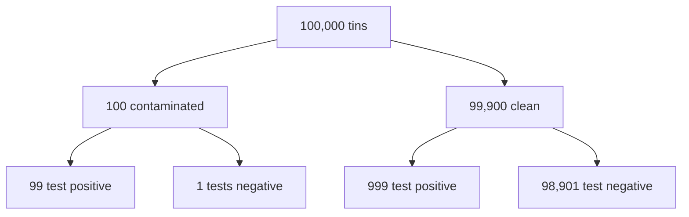

<!-- related-block -->
<nav class="crumbs" aria-label="Breadcrumb"><a href="#/fields/">Fields</a> / <a href="#/fields/data-science/">Data Science</a> / <a href="#/fields/data-science/probability-statistics/">Probability &amp; Statistics, One Sip at a Time</a> / <a href="#/fields/data-science/probability-statistics/probability/">Probability</a></nav>

# Counting and Conditioning: Why a 99% Accurate Test Is Usually Wrong

<!-- related-block -->
<div class="reading-time">Beginner · Concept · 11 min read · Updated 25 Nov 2026</div>
<!-- related-block -->
<div class="tag-chips"><a class="chip" href="#/.docs/generated/explore/tags/statistics">statistics</a></div>
<!-- related-block -->
<div class="lab-line">Interactive lab: <a href="#/fields/data-science/probability-statistics/probability/counting-and-conditioning?id=try-it-why-a-99-accurate-test-is-so-often-wrong">Why a 99% accurate test is so often wrong</a></div>
<!-- related-block -->
<div class="related-strip">

**Read first:** [Spread and Position: Variance, n − 1, Percentiles, Z-Scores and the Box Plot](/fields/data-science/probability-statistics/describing-data/spread-and-position.md)  ·  **Read next:** [Expectation and the Two Count Recipes: Binomial and Poisson](/fields/data-science/probability-statistics/probability/expectation-binomial-poisson.md), [Probability, Technically: Definitions, Identities and Assumptions](/fields/data-science/probability-statistics/probability/technical-reference.md)

</div>


> **Parts 7 and 8 of 15.** Part of the [Probability & Statistics](/fields/data-science/probability-statistics/README.md) series. Parts 1 to 6 described data you **have**; from here on, chance. The scenario is invented, and every count was checked by listing the ways in Python 3.14.4 (exact fractions).

At 10:40 on a Monday, Tala will hold a tin over the bin because a leaflet said "99% accurate". The leaflet will be telling the truth. She will be answering a different question, and the difference is about ten to one.

**By the end of this page you will be able to:**

- Count a probability as a share of the list of equally likely ways, and apply "or", "not" and "and" correctly.
- Turn "at least one" into 1 minus none.
- Shrink a crowd to the people who match a clue and count again (conditional probability).
- Build a tree of whole tins and read Bayes' rule off it, then update on a second result.

* * *

## The leaflet said 99%

A supplier sends Mira a rapid check for a rare problem: a contaminated tin in a delivery. The leaflet is proud: **"99% accurate."** Roughly one tin in a thousand is contaminated (invented numbers).

Tala, three weeks into the job, runs the check on a tin from the new delivery.

```text
CHECK RESULT: POSITIVE
```

She goes pale and reaches for the bin. "It's ninety-nine percent sure. It says so on the leaflet."

* * *

## Three attempts, one bin

1. **Bin the tin.** 99% is nearly certain. Cost: one tin, which is cheap.
2. **Check the whole delivery and bin every positive.** If the check is that good, trust it everywhere. Cost: a delivery of 1,000 tins.
3. **Recall last month's 100,000 tins, because the same check passed them.** Ravi, reading the leaflet aloud, backs this one. Cost: the shop.

Mira stops it at the third with one question: "If the check is wrong about 1 tin in 100, and nearly every tin is fine, how many fine tins does it flag?"

Nobody answers. The question needs a crowd, so build one.

* * *

## The list, the share and the crowd

### Probability is a share of the list of ways

Chance needs a list of **what could happen**, written down first.

- The **sample space** is the list of all possible outcomes. An **event** is a group of them.
- If every outcome is equally likely, `P(event) = (ways the event can happen) / (all ways)`. OpenStax gives the sample space, event and this counting rule in these terms.

Two dice have 6 × 6 = **36** outcomes. `D` marks doubles, `8` total-8 and `X` both:

```text
         second die
          1  2  3  4  5  6
first  1  D  .  .  .  .  .
die    2  .  D  .  .  .  8
       3  .  .  D  .  8  .
       4  .  .  .  X  .  .
       5  .  .  8  .  D  .
       6  .  8  .  .  .  D
```

*The whole sample space. Probability is how many cells you shade, out of 36.*

A relative frequency is **what happened** divided by the number of throws; a probability is **what could happen** divided by the number of cells. Roll often enough and the first drifts toward the second.

### Or, not, and

A shop promotion reads: "Roll a double, or a total of 8, and the biscuit is free." Adding the two lists gives 6/36 + 5/36 = 11/36. The grid has 10 shaded cells, because `X` is in both groups and the sum counts it twice.

```text
P(A or B) = P(A) + P(B) − P(A and B)       6 + 5 − 1 = 10, so 10/36, about 28%
```

If the events cannot happen together, the overlap is empty and "or" is plain addition. The same trap in another form: **at least one six** in two rolls is **11/36**, not 1/6 + 1/6 = 12/36, because (6, 6) is on the list twice.

**At least one** hides a long list. Its **complement**, no six at all, is one rectangle: 5 × 5 = 25 cells.

```text
P(not A) = 1 − P(A)          at least one six = 1 − 25/36 = 11/36
```

**And** asks for the cells where both hold. "First die even" is 18 cells, "second die is 5 or 6" is 12, and where both hold is a block of 3 rows by 2 columns: 6 cells.

```text
18/36 × 12/36 = 6/36          independent: the shaded cells form a rectangle
```

That is **independence**: knowing one tells you nothing about the other. A pair that talks: "first die is a 6" (6 cells) and "total is at least 10" (6 cells: 4+6, 5+5, 5+6, 6+4, 6+5, 6+6) overlap in 3 cells, not 6/36 × 6/36 = 1. Multiplying would have been wrong.

The same idea kills the gambler's fallacy. Of the 6⁴ = 1296 four-roll sequences, exactly 6 start with three sixes, and in 1 of those 6 the fourth roll is a six: **1/6**. The dice have no memory.

### Counting without writing the list

Picking 2 free samples from 6 blends: with order, 6 × 5 = **30**; without order each pair is counted twice, so 30 / 2 = **15**. Python lists them and has the shortcuts:

```python
import itertools, math

grid = list(itertools.product(range(1, 7), repeat=2))
double = {g for g in grid if g[0] == g[1]}
eight  = {g for g in grid if sum(g) == 8}
print(len(grid), len(double), len(eight), len(double & eight), len(double | eight))
no_six = [g for g in grid if 6 not in g]
print(len(grid) - len(no_six))                           # at least one six: 1 minus none
print(len(list(itertools.permutations(range(6), 2))), math.perm(6, 2))
print(len(list(itertools.combinations(range(6), 2))), math.comb(6, 2))
```

```text
36 6 5 1 10
11
30 30
15 15
```

If two of the six blends are secret, a random pair holds **both** with probability 1/15, and **at least one** with `1 − comb(4, 2)/15 = 9/15 = 60%` (the complement again). Counting a share of the list is a probability only when every pick is equally likely.

### Conditional probability: shrink the crowd

Extra information changes the crowd. `P(A | B)`, "the chance of A given B", means: throw away everyone who does not match B, then count the share inside what is left.

| Without the clue | With the clue |
|---|---|
| Count among all tins | Count among only the tins that tested positive |
| Denominator: everyone | Denominator: the tins that match |

### Natural frequencies: the 100,000 tins

Start with people-sized things you can count, not percentages: 100,000 tins, split by truth, then by test result.



*The test is 99% right about each branch, and the branches are very unequal.*

Tala's tin tested positive, so shrink the crowd to the positives: 99 + 999 = **1,098** tins, of which 99 are contaminated.

```python
from fractions import Fraction as F

crowd = 100_000
sick  = crowd * F(1, 1000)
clean = crowd - sick
tp = sick  * F(99, 100)               # contaminated and flagged
fp = clean * F(1, 100)                # clean but flagged
print(tp, fp, tp + fp, tp / (tp + fp), float(tp / (tp + fp)))
```

```text
99 999 1098 11/122 0.09016393442622951
```

About **9%**, not 99%. The check is not broken; the **base rate** is the issue. Contaminated tins are so rare that a 1% false-alarm rate on a huge clean crowd makes ten times more false alarms than true catches. Ignoring this is **base-rate neglect**.

### Two questions, two crowds

| Question | Crowd you count inside | Answer |
|---|---|---|
| `P(positive \| contaminated)`: if a tin is bad, does the test flag it? | The 100 contaminated tins | 99 / 100 = **99%** |
| `P(contaminated \| positive)`: if the test flags a tin, is it bad? | The 1,098 flagged tins | 99 / 1,098 = **about 9%** |

The leaflet reports the first. Tala needs the second. Same two events, different crowd.

### Bayes' rule is the tree with the people divided out

```text
P(A | B) = P(B | A) × P(A) / P(B)
```

With A = contaminated and B = positive: `P(B | A) = 0.99` (the leaflet), `P(A) = 0.001` (the base rate), and `P(B)`, all the ways to be positive, is `0.99 × 0.001 + 0.01 × 0.999 = 0.01098`. So `0.00099 / 0.01098 = 11/122`, about 9%. You do not need to memorize it: rebuild the crowd, shrink it, count.

> [!NOTE]
> The tree of counts is the **frequency format** studied by Gigerenzer and Hoffrage (1995). Their paper is about how people reason with it; this page uses the idea, not their results.

### Try it: Why a 99% accurate test is so often wrong

> **What to try:** Move the base rate, the catch rate and the false-alarm rate, and watch the 100 positive tins change colour. The starting dials are this page's numbers.  
> **Start with:** the preset *The page: rare*.

[Bayes lab](/fields/data-science/probability-statistics/labs/bayes.html#embed ':ignore')

### Updating on a second positive

After one positive the belief is not 0.1% and not 99%: it is **about 9%**, and that becomes the new starting crowd. Run a second check, **assuming the two checks make independent mistakes**, and suppose it is positive again. Of 99 contaminated tins about 98 flag again; of 999 clean ones about 10 do. `98 / (98 + 10)` is about **90.7%**, and exact fractions give `363/400 = 90.75%`.

```python
p = F(11, 122)                         # belief after the first positive
p2 = F(99, 100) * p / (F(99, 100) * p + F(1, 100) * (1 - p))
print(p2, float(p2))
```

```text
363/400 0.9075
```

```text
before any test       0.1%
after one positive    9.0%
after two positives   90.75%
```

> [!WARNING]
> If the second check shares the first one's flaw (same dirty reagent, same bad batch), the mistakes are not independent, and repeating it teaches you much less.

* * *

## The tin goes in the bin, eventually

Tala puts the tin down on the counter and counts it out on the back of the leaflet: 99 real, 999 false, 1,098 flagged.

"So the leaflet wasn't lying," she says. "It told me how the check treats bad tins. I asked it about *this* tin."

"And this tin sits in a crowd where almost everything is fine," says Mira. "Nine alarms in ten are false. Run it again, and read the batch code while we wait."

Positive again. Now the tin goes in the bin, 90% sure rather than 99% fooled. Ravi quietly un-recalls the shop.

* * *

## Never again

| Trap | What it looks like | Fix |
|---|---|---|
| Adding overlapping chances | "10 customers × 0.3 = 300%" | `P(A or B)` subtracts the overlap; "at least one" is 1 minus none |
| Multiplying events that talk | "first die 6" and "total ≥ 10" as 1/6 × 1/6 | Multiply only if the cells form a rectangle; otherwise count the overlap |
| Flipping the condition | 99% reported for a rare thing | Count inside the positives, not inside the sick |
| Ignoring the base rate | A good test, a rare problem | Build the 100,000 crowd first |
| Repeating a correlated test | Same reagent twice | Update only if the mistakes are independent |

**Next:** Ravi has been counting tins in his head. How many alarms should he **expect** altogether if he runs the check on all 100,000? Next cup: [Expectation and the Two Count Recipes](/fields/data-science/probability-statistics/probability/expectation-binomial-poisson.md).

* * *

## Check yourself

1. Two dice: chance the total is 7, and chance of **at least one** even number?
2. In the tree, how many of the 100,000 tins test **negative**, and how many of those are contaminated?
3. A school has 1,000 pupils; 10 are in the chess club; 6 of the club wear glasses and 90 of the other 990 do. What is the chance a pupil with glasses is in the club?
4. The same check is used on a delivery where **half** the tins are contaminated. Is a positive more or less trustworthy than 9%?
5. How many ways to pick 3 blends from 6 when order does not matter?

<details>
<summary>Answers</summary>

1. The total is 7 in 6 cells: **1/6**. No even number means both dice odd, 3 × 3 = 9 cells, so 1 − 9/36 = **3/4**.
2. 98,901 + 1 = **98,902** test negative, and **1** of them is contaminated (about 0.001%): a negative is very trustworthy here.
3. 6 + 90 = 96 wear glasses, so 6 / 96 = **1/16**, about 6%.
4. **More**: 49,500 of 50,000 contaminated are caught and 500 clean ones are flagged, so 49,500 / 50,000 = 99%. The base rate did the work.
5. `math.comb(6, 3)` = **20** (6 × 5 × 4 = 120 ordered picks, divided by the 6 orderings of each trio).

</details>

## 📜 The Scroll (keep this)

```text
Probability : ways it happens / all ways (equally likely outcomes only)
Or / not    : P(A or B) = P(A) + P(B) - P(A and B);  P(not A) = 1 - P(A)
And         : P(A) x P(B) only if independent (a rectangle of cells)
Picks       : math.perm(n, k) ordered, math.comb(n, k) unordered
Conditional : shrink to the matching crowd, count again
Bayes       : P(A | B) = P(B | A) P(A) / P(B); rebuild the crowd instead
Do not      : confuse P(positive | sick) with P(sick | positive)
```

* * *

* * *

## References

- OpenStax, *Introductory Statistics 2e*, Ch. 3 "Probability Topics", section 3.1 Terminology: sample space, event, and probability as a count for equally likely outcomes. The page fetched did not define independence, so the definition above is this page's own plain-words version. <https://openstax.org/books/introductory-statistics-2e/pages/3-1-terminology>
- Python `itertools` (`product`, `permutations`, `combinations`) and `math` (`comb(n, k)` "without repetition and without order", `perm(n, k)` "with order"; soft-deprecated aliases in 3.15, working as shown on 3.14.4). <https://docs.python.org/3/library/itertools.html>, <https://docs.python.org/3/library/math.html>
- Gigerenzer, G. and Hoffrage, U. (1995), *How to improve Bayesian reasoning without instruction: Frequency formats*, Psychological Review 102(4), 684-704. <https://doi.org/10.1037/0033-295X.102.4.684>. Bibliographic details confirmed through Crossref; the paper's text and findings are not quoted.
- Every count, fraction and percentage was recomputed with Python 3.14.4 using exact `fractions.Fraction`, including the 1296 four-roll sequences. The scenario and its rates (1 in 1,000, 99% and 1%) are invented.

<!-- related-block -->
<div class="see-also">

**See also**

- [Pick and Compute the Right Probability Model](/fields/data-science/probability-statistics/probability/quick-guide.md) — A cheat sheet for parts 7 to 11 - the method, the code and the expected output for counting outcomes, flipping a test result, expected value, binomial or Poisson, and the normal curve.
- [Probability & Statistics, One Sip at a Time](/fields/data-science/probability-statistics/README.md) — A slow-brewed series on the ideas in probability and statistics that make people say "wait, why?", each one told as a small story in a tea shop.

</div>
<!-- related-block -->
<div class="mentioned-in">

**Mentioned in**

- [Expectation and the Two Count Recipes: Binomial and Poisson](/fields/data-science/probability-statistics/probability/expectation-binomial-poisson.md) — Expected value is the data's seesaw with probability as the weight, not the likeliest outcome. Binomial and Poisson are recipes for a count; each is right only as far as its assumptions hold.
- [Pick and Compute the Right Probability Model](/fields/data-science/probability-statistics/probability/quick-guide.md) — A cheat sheet for parts 7 to 11 - the method, the code and the expected output for counting outcomes, flipping a test result, expected value, binomial or Poisson, and the normal curve.
- [Probability & Statistics, One Sip at a Time](/fields/data-science/probability-statistics/README.md) — A slow-brewed series on the ideas in probability and statistics that make people say "wait, why?", each one told as a small story in a tea shop.
- [Probability, Technically: Definitions, Identities and Assumptions](/fields/data-science/probability-statistics/probability/technical-reference.md) — The formal layer under parts 7 to 11: axioms, Bayes in odds form, pmf, cdf and density, moment rules, the Poisson limit, the normal approximation and each model's assumptions.
- [Spread and Position: Variance, n − 1, Percentiles, Z-Scores and the Box Plot](/fields/data-science/probability-statistics/describing-data/spread-and-position.md) — Mean, median and mode are three attitudes to how a long walk hurts; spread is the walking left over. A value then has a position only in its crowd: rank (percentile) or distance (z-score).
- [The Courtroom for Numbers: Could Plain Luck Do This?](/fields/data-science/probability-statistics/inference/the-courtroom-for-numbers.md) — A hypothesis test asks one question: could plain luck have produced a difference this big? Shuffle the labels and count. What the p-value is, what it is not, and how testing twenty things fools you.
- [The Map of Leaf & Kettle: Every Idea So Far in One Walk Through the Shop](/fields/data-science/probability-statistics/the-map-of-leaf-and-kettle.md) — A concept map, decision chart and definitions sheet for the whole series, as a memory palace in one tea shop: nine rooms for describing data, an upstairs for chance.

</div>
