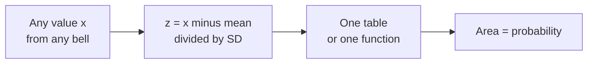

<!-- related-block -->
<nav class="crumbs" aria-label="Breadcrumb"><a href="#/fields/">Fields</a> / <a href="#/fields/data-science/">Data Science</a> / <a href="#/fields/data-science/probability-statistics/">Probability &amp; Statistics, One Sip at a Time</a> / <a href="#/fields/data-science/probability-statistics/probability/">Probability</a></nav>

# The Bell Curve: Probability as Area, and One Ruler for Every Bell

<!-- related-block -->
<div class="reading-time">Intermediate · Concept · 8 min read · Updated 25 Nov 2026</div>
<!-- related-block -->
<div class="tag-chips"><a class="chip" href="#/.docs/generated/explore/tags/statistics">statistics</a></div>
<!-- related-block -->
<div class="lab-line">Interactive lab: <a href="#/fields/data-science/probability-statistics/probability/the-bell-curve?id=try-it-pick-the-recipe-turn-the-dials">Pick the recipe, turn the dials</a></div>
<!-- related-block -->
<div class="related-strip">

**Read first:** [Expectation and the Two Count Recipes: Binomial and Poisson](/fields/data-science/probability-statistics/probability/expectation-binomial-poisson.md)  ·  **Read next:** [Averages and Intervals: Why Averages Behave and How Sure You Can Be](/fields/data-science/probability-statistics/inference/averages-and-intervals.md)

</div>


> **Part 11 of 15.** Part of the [Probability & Statistics](/fields/data-science/probability-statistics/README.md) series, after [Expectation and the Two Count Recipes](/fields/data-science/probability-statistics/probability/expectation-binomial-poisson.md). The scenario is invented, and every figure was recomputed with Python 3.14.4 (stdlib only).

Tala will answer a question about Ravi's tea bag with the single most useless sentence in statistics: "Zero." She will be completely right, and it will explain why every probability on a bell curve is an area.

**By the end of this page you will be able to:**

- Say where the bell comes from and why the chance of an exact value is zero.
- Read a probability off a normal curve as an area, with one ruler: the z-score.
- Go both ways: value to area (`cdf`) and area to value (`inv_cdf`).
- Refuse to use a bell when the histogram has two humps or a long tail.

* * *

## The scale that is never exact

Mira sells loose tea in bags marked **100 g**. Tala weighs thirty of them: "None weighs exactly 100. One is 100.3, one is 98.9, one is 101.4..."

"Of course," says Mira. "What is the chance Ravi's bag weighs exactly 100.000 grams?"

Tala thinks, then says something that sounds wrong and is right: "Zero."

If the chance of any exact weight is zero, how can anyone talk about the chance of a weight at all? Ravi's bag is on the scale: 106 g. Is that suspicious?

* * *

## Three ways to answer, all stuck

1. **Ask for the chance of exactly 106 g.** Zero, so the bag is "impossible". It is on the scale.
2. **Count it from the thirty weighed bags.** Nobody weighed exactly 106, so the count is 0 of 30 and says nothing about a range.
3. **Draw a hill for each product and measure its area by calculus.** Every mean and SD is a different hill, and the shop sells forty products.

Mira stops the third one before the whiteboard comes out. "There is one ruler for all of them. Find it."

* * *

## One hill, one ruler

### Where the bell comes from

Flip a fair coin `n` times and count heads. Each flip is one small nudge; the table shows how nudges pile up (each `#` is a share of the 2^n equally likely sequences):

```text
n = 4  (one # = 1%)
  0   6.2% ######
  1  25.0% #########################
  2  37.5% ######################################
  3  25.0% #########################
  4   6.2% ######

n = 30  (one # = 0.5%)
 10   2.8% ######
 11   5.1% ##########
 12   8.1% ################
 13  11.2% ######################
 14  13.5% ###########################
 15  14.4% #############################
 16  13.5% ###########################
 17  11.2% ######################
 18   8.1% ################
 19   5.1% ##########
 20   2.8% ######
```

(Rows under 0.5% are left out. Exact counts, computed with Python.) The bell is what you get when **many small independent nudges add up**: the middle gets every mix of ups and downs, the ends need all the nudges to line up. Tiny scoop errors push each bag a little up or down in the same way.

### Probability is area

With 30 flips there are 31 possible counts, each with its own probability. A weight has **infinitely many** possible values between 99 and 101; share 100% among them and each gets nothing: `P(weight = exactly 100.000...) = 0`. So ask about **ranges**: draw the hill and let the **area under it** be the probability. The whole area is 1. The height is not a probability but a *density*: how crowded the chances are near that spot.

This is the histogram of [part 3](/fields/data-science/probability-statistics/describing-data/pictures-and-the-middle.md) taken to its end: a bar's area was the share of the data, and with infinitely thin bars the bars become a curve.

### Two dials, one bell

The normal distribution has exactly two dials (NIST calls them the **location** and **scale** parameters):

| Dial | What it does | You already know it as |
|---|---|---|
| **Mean** (μ) | Slides the whole bell left or right | The middle, [part 4](/fields/data-science/probability-statistics/describing-data/pictures-and-the-middle.md) |
| **Standard deviation** (σ) | Stretches or squeezes it (the total area stays 1) | The spread, [part 5](/fields/data-science/probability-statistics/describing-data/spread-and-position.md) |

A mean and an SD fix the whole bell. That is convenient, and a very strong claim about your data.

### The one ruler: the z-score

`z = (x − mean) / SD` (from [part 6](/fields/data-science/probability-statistics/describing-data/spread-and-position.md)) slides the bell to the middle and rescales the SD to 1, so **every normal bell becomes the same bell**: the **standard normal**, mean 0, SD 1.



*One standardizing step, then one table for all bells.*

`statistics.NormalDist` holds that table; `cdf(x)` is the area to the left of `x`, `P(X <= x)`:

```python
from statistics import NormalDist

std = NormalDist()                      # mean 0, SD 1
for k in (1, 2, 3):
    print(k, round(std.cdf(k) - std.cdf(-k), 4))
```

```text
1 0.6827
2 0.9545
3 0.9973
```

That is the **68-95-99.7 rule** with its exact decimals: 68.27% of a normal crowd lies within 1 SD, 95.45% within 2, 99.73% within 3 (the famous "95%" is 1.96 SD). Ravi's bag, bags being normal with mean 100 g and SD 4 g (invented):

```python
bag = NormalDist(100, 4)
z = bag.zscore(106)
print(z, round(bag.cdf(106), 4))                     # z, then P(weight <= 106)
print(round(bag.cdf(106) - bag.cdf(98), 4))          # P(98 <= weight <= 106)
print(round(1 - bag.cdf(108), 4))                    # P(weight > 108): two SD above
print(round(bag.cdf(100.0001) - bag.cdf(99.9999), 6))  # a sliver 0.0002 g wide
```

```text
1.5 0.9332
0.6247
0.0228
2e-05
```

A 106 g bag is z = 1.5, and 93.32% of bags weigh less. Between 98 and 106 g is the area from z = −0.5 to z = 1.5: `0.9332 − 0.3085 =` 0.6247. Over 108 g (z = 2) is the thin 2.28% tail. The sliver around exactly 100 is 0.00002, and only gets smaller: that is the prologue's zero.

### From z back to a value

To ask "how heavy is a bag that beats 95% of bags?", run the ruler backwards. That is a **percentile** (part 6), and `inv_cdf` inverts `cdf`:

```python
print(round(bag.inv_cdf(0.95), 2), round(std.inv_cdf(0.95), 4))
```

```text
106.58 1.6449
```

The 95th percentile is at z = 1.6449, so in grams `100 + 1.6449 × 4 = 106.58`. Two directions, one ruler: value → z → area (`cdf`), or area → z → value (`inv_cdf`).

### Try it: Pick the recipe, turn the dials

> **What to try:** Choose the Normal tab, set a mean and an SD, and move a and b: the shaded area is the probability. Hover the curve to read a value's z-score.  
> **Start with:** the preset *Smoky orders*.

[Distributions lab](/fields/data-science/probability-statistics/labs/distributions.html#embed ':ignore')

### When the data are not a bell

The 20 tasting scores of the earlier parts have mean 75.2 and SD 17.67. Compare what a bell predicts with what is there:

```python
from statistics import NormalDist, mean, stdev

scores = [52,55,55,58,58,58,62,62,62,71,71,89,89,89,93,93,94,94,95,104]
m, sd = mean(scores), stdev(scores)
print(round(m, 1), round(sd, 2))
for k in (0.5, 1, 2):
    inside = sum(1 for x in scores if abs(x - m) <= k * sd)
    model = NormalDist().cdf(k) - NormalDist().cdf(-k)
    print(k, "SD: model says", round(model * 20, 1), "of 20, actually", inside)
```

```text
75.2 17.67
0.5 SD: model says 7.7 of 20, actually 2
1 SD: model says 13.7 of 20, actually 11
2 SD: model says 19.1 of 20, actually 20
```

Within half an SD the bell expects nearly 8 scores and there are **2**: the mean sits in a valley. The 2 SD line looks fine (19.1 versus 20), which is the trap: **passing one check does not make a crowd normal.** A long tail breaks it too: Kettle Street's houses (1, 2, 2, 3, 5, 9, 20) have one huge value dragging the right side out, so a bell around their mean gives real probability to impossible negative values. So the habit comes first: **draw the histogram.** One hump, roughly symmetric, thin tails: a bell is a fair model. Two humps or a long tail: use percentiles and describe the shape.

* * *

## 93% lighter, one in fourteen heavier

Ravi's bag weighs 106 g. Tala does not guess. She turns 106 into z = 1.5, says "93% of bags are lighter, 7% heavier", and shrugs: "About one in fourteen. Unusual, not suspicious."

Mira asks the question now sitting on the counter: "All that works if a bag is bell-shaped. But if I weigh *ten* bags and average them, what do the *averages* look like?" Next cup: [Averages and Intervals](/fields/data-science/probability-statistics/inference/averages-and-intervals.md).

* * *

## Never again

| Mistake | Symptom | Fix |
|---|---|---|
| Asking for the chance of an exact value | `P(x) = 0`, "impossible" | Ask about a range: probability is area |
| Treating the curve's height as a probability | Heights above 1 | Height is density; area is probability |
| Using the 68-95-99.7 rule on two humps | Shares that do not match the counts | Histogram first; percentiles if not one hump |
| Passing one check as proof of normality | 2 SD fits, 0.5 SD does not | Check several landmarks, not one |
| Mixing the two ruler directions | `cdf` where `inv_cdf` is needed | value → z → area is `cdf`; area → z → value is `inv_cdf` |

* * *

## Check yourself

1. Bags have mean 100 g and SD 4 g. What are the z-scores of 92 g and 108 g, and what share lies between them?
2. In a normal crowd, about what share lies more than 3 SD from the mean?
3. Tala scored 61 on a normal exam (mean 50, SD 4). What is her z-score, and what does it say about her rank?
4. A histogram shows two clear humps. Can you use the 68-95-99.7 rule? Which ruler do you use instead?

<details>
<summary>Answers</summary>

1. `(92 − 100) / 4 = −2` and `(108 − 100) / 4 = +2`: **95.45%** (`0.9772 − 0.0228`). A range has width, so its area is not zero; a single point has none.
2. `1 − 0.9973 =` about **0.27%**, split between both tails.
3. `(61 − 50) / 4 =` **2.75**: well under 1% scored higher, a top-of-the-class result.
4. **No**: the mean sits in a valley and the rule gets the shares wrong (the count test above). Use **percentiles**.

</details>

* * *

## 📜 The Scroll (keep this)

```text
Normal       : two dials, mean (location) and SD (scale); total area = 1
Probability  : a point is 0; ask about ranges, probability = area
z            : (x - mean) / SD   value -> z -> area is cdf;  area -> z -> value is inv_cdf
Landmarks    : within 1 / 2 / 3 SD = 68.27% / 95.45% / 99.73%; 1.96 SD = 95%
Code         : NormalDist(mu, sigma).cdf(x) / .inv_cdf(p) / .zscore(x)
Do not       : use a bell on two humps or a long tail; histogram first
```

* * *

## References

- Python `statistics.NormalDist`: `cdf`, `inv_cdf` and `zscore`, with `mu` and `sigma` as mean and standard deviation. Verified against Python 3.14.4. <https://docs.python.org/3/library/statistics.html>
- NIST/SEMATECH e-Handbook of Statistical Methods, *Normal Distribution*: the density with location and scale parameters, and the standard normal (mean 0, SD 1). The page does not state the 68-95-99.7 percentages, so those come from the run above. <https://www.itl.nist.gov/div898/handbook/eda/section3/eda3661.htm>
- Every number and output on this page was recomputed with Python 3.14.4 (stdlib only).

<!-- related-block -->
<div class="see-also">

**See also**

- [Pick and Compute the Right Probability Model](/fields/data-science/probability-statistics/probability/quick-guide.md) — A cheat sheet for parts 7 to 11 - the method, the code and the expected output for counting outcomes, flipping a test result, expected value, binomial or Poisson, and the normal curve.
- [Pictures and the Middle: Histogram, Polygon, Ogive, and What 'Typical' Means](/fields/data-science/probability-statistics/describing-data/pictures-and-the-middle.md) — Draw the table before you summarise it: histogram for amount, polygon for comparison, ogive for up to here. Then "typical" is three questions, mean, median and mode, and none answers two clumps.
- [Probability & Statistics, One Sip at a Time](/fields/data-science/probability-statistics/README.md) — A slow-brewed series on the ideas in probability and statistics that make people say "wait, why?", each one told as a small story in a tea shop.
- [Probability, Technically: Definitions, Identities and Assumptions](/fields/data-science/probability-statistics/probability/technical-reference.md) — The formal layer under parts 7 to 11: axioms, Bayes in odds form, pmf, cdf and density, moment rules, the Poisson limit, the normal approximation and each model's assumptions.
- [Spread and Position: Variance, n − 1, Percentiles, Z-Scores and the Box Plot](/fields/data-science/probability-statistics/describing-data/spread-and-position.md) — Mean, median and mode are three attitudes to how a long walk hurts; spread is the walking left over. A value then has a position only in its crowd: rank (percentile) or distance (z-score).

</div>
<!-- related-block -->
<div class="mentioned-in">

**Mentioned in**

- [Averages and Intervals: Why Averages Behave and How Sure You Can Be](/fields/data-science/probability-statistics/inference/averages-and-intervals.md) — An average is itself random: its spread shrinks as sigma over root n and its shape tends to a bell. A confidence interval turns that wobble into a give-or-take, and bias is invisible to it.
- [Expectation and the Two Count Recipes: Binomial and Poisson](/fields/data-science/probability-statistics/probability/expectation-binomial-poisson.md) — Expected value is the data's seesaw with probability as the weight, not the likeliest outcome. Binomial and Poisson are recipes for a count; each is right only as far as its assumptions hold.
- [Pick and Compute the Right Probability Model](/fields/data-science/probability-statistics/probability/quick-guide.md) — A cheat sheet for parts 7 to 11 - the method, the code and the expected output for counting outcomes, flipping a test result, expected value, binomial or Poisson, and the normal curve.
- [Probability & Statistics, One Sip at a Time](/fields/data-science/probability-statistics/README.md) — A slow-brewed series on the ideas in probability and statistics that make people say "wait, why?", each one told as a small story in a tea shop.
- [Probability, Technically: Definitions, Identities and Assumptions](/fields/data-science/probability-statistics/probability/technical-reference.md) — The formal layer under parts 7 to 11: axioms, Bayes in odds form, pmf, cdf and density, moment rules, the Poisson limit, the normal approximation and each model's assumptions.
- [The Courtroom for Numbers: Could Plain Luck Do This?](/fields/data-science/probability-statistics/inference/the-courtroom-for-numbers.md) — A hypothesis test asks one question: could plain luck have produced a difference this big? Shuffle the labels and count. What the p-value is, what it is not, and how testing twenty things fools you.
- [The Map of Leaf & Kettle: Every Idea So Far in One Walk Through the Shop](/fields/data-science/probability-statistics/the-map-of-leaf-and-kettle.md) — A concept map, decision chart and definitions sheet for the whole series, as a memory palace in one tea shop: nine rooms for describing data, an upstairs for chance.

</div>
