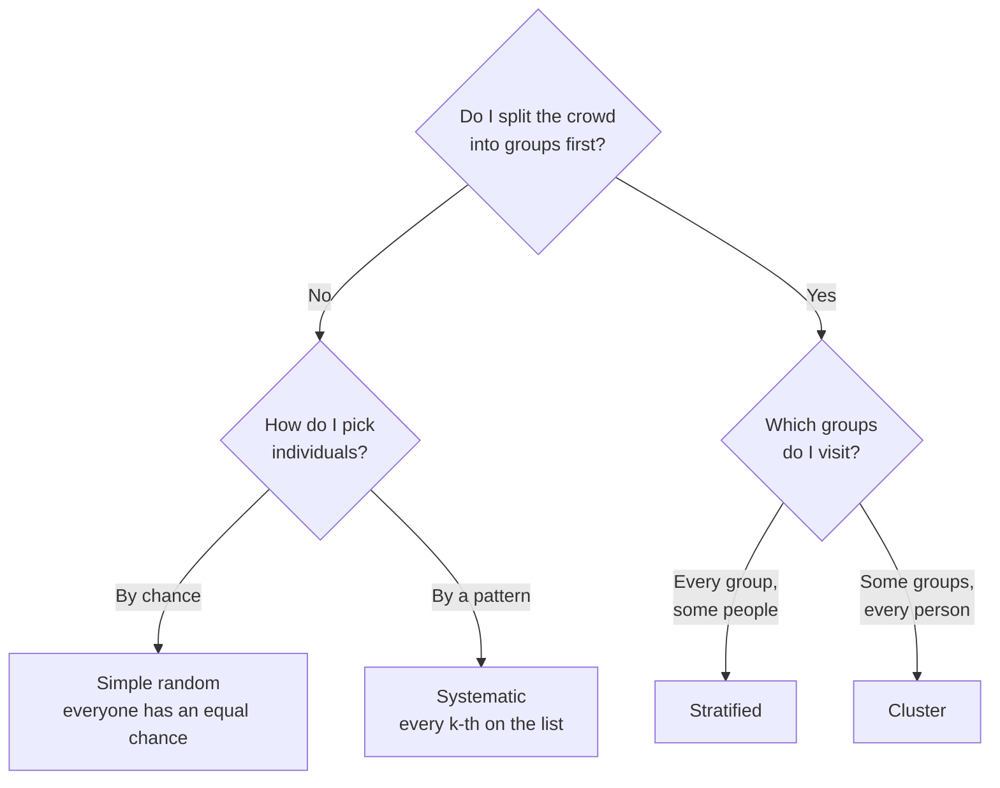

# Stir the Pot First: Population, Sample, and Why We Guess

<!-- related-block -->
<div class="reading-time">11 min read</div>
<!-- related-block -->
<div class="related-strip">

**See also:** [Probability & Statistics, One Sip at a Time](/fields/data-science/probability-statistics/README.md), [The Map of Leaf & Kettle: Every Idea So Far in One Walk Through the Shop](/fields/data-science/probability-statistics/the-map-of-leaf-and-kettle.md), [Why Averages Behave: The Sip You Could Take a Thousand Times](/fields/data-science/probability-statistics/why-averages-behave.md)  ·  **Read next:** [Mira's Notebook: What Kind of Data Is This, and How Do You Count It?](/fields/data-science/probability-statistics/data-types-and-frequency-tables.md)

</div>


> **Part 1 of 15.** Part of the [Probability & Statistics](/fields/data-science/probability-statistics/README.md) series. The tea shop and its customers are invented. The 1936 poll in the middle of the page is real, and its sources are listed at the end. By the end you will see why a sip can speak for a whole pot, and that the four famous sampling methods are **one idea** asked two ways.

## Table of Contents

- [Prologue: the Saturday morning poll](#prologue-the-saturday-morning-poll)
- [The idea in one minute](#the-idea-in-one-minute)
- [Three words, and why we sip at all](#three-words-and-why-we-sip-at-all)
- [How you chose, not how many](#how-you-chose-not-how-many)
- [Four ways to choose fairly, from two questions](#four-ways-to-choose-fairly-from-two-questions)
- [The poll that asked 2.4 million people](#the-poll-that-asked-24-million-people)
- [Two jobs for statistics](#two-jobs-for-statistics)
- [Check yourself](#check-yourself)
- [Back to the story](#back-to-the-story)
- [Cheat sheet](#cheat-sheet)
- [Answers](#answers)
- [References](#references)

* * *

## Prologue: the Saturday morning poll

Mira runs Leaf & Kettle, a tea shop with 4,000 customers on its loyalty list. She has developed a new smoky blend, and before she orders 500 kilos of it she wants to know whether her customers will like it.

On Saturday morning she asks the first 30 people through the door to try a cup. Twenty-seven say they love it. That is 90%. She places the big order.

By March, most of the smoky blend is still on the shelf.

Her arithmetic was fine: 27 out of 30 really is 90%. The mistake came **before** any arithmetic, in **who got asked**. Early Saturday visitors come on purpose and like trying new things. They are not a small copy of her 4,000 customers, only of the kind of person who shows up early on Saturdays.

> ☕ **Try it before you scroll.** Mira's friend says: "Fine, so ask 3,000 people next time, not 30." Would that fix it? *Hint: who would the 3,000 be, if she asked the same way?*

* * *

## The idea in one minute

**A sample is a promise about a crowd:** "these few people look like all of them." Whether the promise holds depends on **how you chose** the few, not on how many you chose.

- Ask 3,000 early-Saturday visitors and you are 3,000 times as sure about the wrong crowd.
- Ask 40 picked so every kind of customer had a fair chance, and you can speak for all 4,000.

That is the whole page. The rest names the parts and shows ways to keep the promise when you cannot stir the whole pot.

* * *

## Three words, and why we sip at all

| Word | Meaning | In Mira's story |
|---|---|---|
| **Population** | The complete group you want to know about | All 4,000 loyalty-card customers |
| **Sample** | The part of it you actually observe | The 30 people she asked |
| **Statistic** vs **parameter** | A number from a sample, versus the true number for the whole population | 90% of her 30, versus the real share among all 4,000 |

The parameter is what you want and cannot see; the statistic is what you have. Statistics is saying something honest about the first using the second. One more word hides in every survey: the **sampling frame**, the actual list you draw from. Mira's frame was "whoever walks in on Saturday morning", her population "everyone on the loyalty list". The sample can only speak for the frame.

Why not ask everyone (a **census**)? Often you cannot: it costs too much, it destroys the thing (you cannot taste the whole pot and still have a pot), or the answers change before you finish. So you sip. The question is when the sip is trustworthy.

* * *

## How you chose, not how many

Tasting the top of an unstirred pot tells you about the top of the pot, where the tea is weakest. A sip is fair only if every part of the pot had a fair chance of reaching the spoon. Stirring is what **randomness** does in sampling.

A sample can miss for two reasons. **Bad luck** shrinks as you ask more people. **Bias** (the method leans one way every time, like "only early Saturday visitors") does not shrink at all: more people only make the wrong answer look more convincing.

So the real question of sampling is: **how do I choose fairly when I cannot stir the whole pot?** The four classic methods are four answers.

* * *

## Four ways to choose fairly, from two questions

Mira wants `n = 40` from `N = 4,000`. Two questions give the four methods.



*One worry, "is this fair?", answered four ways.*

**No groups: chance or pattern.**

- **Simple random.** Number the customers 1 to 4,000 and let a random number generator pick 40. Every customer, and every possible group of 40, has the same chance. The pot, properly stirred. It needs a full list.
- **Systematic.** A shortcut for the same stirring: step `k = N / n = 4,000 / 40 = 100`, random start (say 37), then every 100th customer: 37, 137, 237, up to 3,937. That is 40 customers. The trap is a rhythm in the list. If rows alternate between her two shops and `k` is even, every pick lands on the same shop (I checked: all 40 picks starting at 37 are odd rows). The pattern replaces the chance, so check that the list has no rhythm that matches `k`.

**Groups: every group or some groups.**

- **Stratified: every group, some people.** Split the crowd into groups that *differ* in ways that matter, then draw at random inside each. Mira's customers are 1,600 students, 1,400 office workers and 1,000 retirees, and she draws in proportion (`n_h = n × N_h / N`): 16, 14 and 10. Every kind of person is guaranteed a seat, which pays off when groups really differ.
- **Cluster: some groups, every person.** Split the crowd into natural groups that each look like a mini-crowd, such as neighborhoods (40 of about 100 people each), pick a few at random and survey everyone inside them: 4 neighborhoods, 400 people. Cheap when no full list exists. The price: neighbors resemble each other, so 400 people from 4 neighborhoods tell you less than 400 drawn from everywhere.

Stratified and cluster are the pair students mix up. Stratified groups **differ** from each other (students versus retirees) and you do it for precision; cluster groups **resemble** each other (each neighborhood is a mini-crowd) and you do it for cost.

> ☕ **Try it before you scroll.** Which method would you pick to survey every child in a country's schools with no list of children, only a list of schools? *Hint: you have groups, but you cannot visit them all.*

* * *

## The poll that asked 2.4 million people

If you believe that more data fixes everything, the 1936 US presidential election is a cold shower.

The magazine *Literary Digest* mailed about **10 million** questionnaires to automobile and telephone owners, and about **2.4 million** came back (sources give 2.27 to 2.38 million). It had called every winner from 1920 to 1932, and now predicted that Alf Landon would beat Franklin Roosevelt by about 57% to 43%.

Roosevelt won with about **61%** of the vote, in a landslide.

Enormous sample, badly wrong answer, for the two reasons above:

- **The frame did not match the population.** In the middle of the Great Depression, owning a car or a telephone leaned toward the better off, who leaned toward Landon.
- **Who answered was not random either.** Only about a quarter of the questionnaires came back, and the people who answered were not like those who did not. A study cited in the arXiv paper below (Squire, 1988) found the two together produced the error.

Meanwhile George Gallup polled about **50,000** people using a "scientific sample" built to include the right proportion of voters from each economic group (in the spirit of stratification), and predicted Roosevelt's win.

Mira's lesson, a million times larger: **a huge biased sample is just a more confident way of being wrong.**

* * *

## Two jobs for statistics

**Descriptive** statistics summarizes the numbers in front of you: Mira's 30 ratings have an average and a spread, and nothing is a guess. **Inferential** statistics speaks about the people you did not ask, so it comes with uncertainty: a **confidence interval** gives a range, and a **hypothesis test** asks "is this gap real, or luck in who I asked?" The second job is only honest when the sample was drawn fairly, which is why it starts here.

* * *

## Check yourself

Answers are below the cheat sheet.

1. A school has 900 students in 30 classes of 30. The principal picks 3 classes at random and surveys **every** student in them. Which method?
2. A list holds 1,200 employees sorted by ID. You pick a random number between 1 and 40, then take every 40th employee after it. Which method, and how large is the sample?
3. A company has 600 men and 400 women, and you want a sample of 50 that mirrors that mix. How many of each?
4. Which sample would you trust more to estimate the opinion of all voters: 10,000 volunteers who answered an online poll, or 400 people chosen at random from the voter list? Why?
5. Mira sorts her customers into three age groups and asks 10 people from each group. Is that stratified sampling? What detail would you check?

* * *

## Back to the story

Mira still has the unsold smoky blend on her shelf, and she is not going to make the same mistake twice.

This time she works from the loyalty list and draws a **stratified** sample of 40: 16 students, 14 office workers and 10 retirees, each picked at random from its own list. Twenty-two of the 40 say they would buy the smoky blend. That is 55%, far below the 90% she celebrated in the doorway, and much closer to how the blend actually sold. She orders 100 kilos instead of 500. The 55% is a **statistic**; the true share is a **parameter** she will never see.

**Takeaway:** a sample is a promise about a crowd, and what keeps the promise is how you chose, not how many. The difference between the two Saturdays was never the arithmetic. It was the stirring.

But 55% from 40 people is still a number, and numbers come in kinds. Is "smoky: yes or no" the same sort of thing as "score out of 100" or "number of cups per week"? It is not, and the kind decides which tools are allowed. Next cup: [Data Types and Frequency Tables](/fields/data-science/probability-statistics/data-types-and-frequency-tables.md).

* * *

## Cheat sheet

```text
SAMPLE = a promise about a crowd. HOW you chose keeps it, not how many.
population = everyone you care about        sample = the part you observe
parameter  = true value for the population  statistic = value from the sample
sampling frame = the actual list you draw from (must match the population)

bad luck shrinks with n; bias does not

TWO QUESTIONS -> FOUR METHODS
no groups, by chance   : simple random  (equal chance, full list)
no groups, by pattern  : systematic     (k = N / n, random start, beware rhythm)
groups, EVERY group, SOME people : stratified (proportional: n_h = n * N_h / N)
groups, SOME groups, EVERY person: cluster

descriptive = summarize the data you have; inferential = speak about the whole
```

* * *

## Answers

1. **Cluster sampling.** The classes are the clusters, and every student in the chosen classes is surveyed.
2. **Systematic sampling**, with `1,200 / 40 = 30` employees in the sample.
3. **Stratified, proportional:** 60% of 50 is **30 men**, and 40% of 50 is **20 women**.
4. **The 400 random people.** Volunteers choose themselves, and size does not fix that (1936 again). The 400 have a wider margin of error, but it is the honest kind that shrinks with size.
5. **Yes, it is stratified** (every group, some people from each). Check whether 10 per group matches each group's size: equal samples from unequal groups over-represent the small ones unless you reweight. And each 10 should be drawn at random.

Pauses: 3,000 asked the same way are the same early-Saturday crowd, so no fix. Schools but no child list: **cluster**, pick some schools and survey every child in them.

* * *

## References

- [Why do polls fail? (arXiv 2107.14166)](https://arxiv.org/pdf/2107.14166): the mailing to automobile and telephone owners, 2,376,523 returns of 10 million, the roughly 25% return rate, Gallup's 50,000, Squire (1988). Fetched and read.
- [The poll that changed polling: selection bias and the 1936 US election (Pivotal Research)](https://www.pivotalresearch.ca/2024/07/03/the-poll-that-changed-polling-selection-bias-and-the-1936-us-election/): the 57% to 43% prediction and over 2.27 million returns. It gives Roosevelt 62% and a subscriber-list source, which differ from the others; this page uses "about 61%" and the arXiv list description. Fetched and read.
- [Roosevelt's smashing of Landon in the 1936 presidential election (Brewminate)](https://brewminate.com/roosevelts-smashing-of-landon-in-the-1936-presidential-election/): Roosevelt's 60.8%, the Digest's 57.1% for Landon. Fetched and read.
- Two sources of the earlier version (Emory Math Center, Mathspace) could not be retrieved on rework, so nothing here relies on them.
- The numbers in the story (16, 14, 10; the 40 systematic picks from 37 to 3,937; 30; 30 and 20; 55%) were recomputed with Python 3.14.4. The customers and shop are invented.
