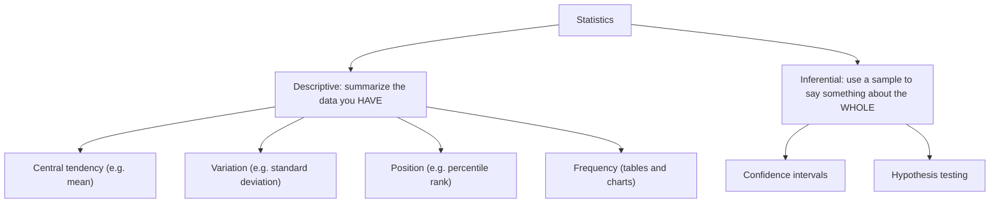

# Stir the Pot First: Population, Sample, and Why We Guess

> **Part of the [Probability & Statistics](https://github.com/AhmedYousriSobhi/aCupOfTea/blob/main/fields/data-science/probability-statistics/README.md) series.** The tea shop and its customers are invented. The 1936 poll in the middle of the page is real, and its sources are listed at the end.

## Table of Contents

- [Stir the Pot First: Population, Sample, and Why We Guess](#stir-the-pot-first-population-sample-and-why-we-guess)
  - [Table of Contents](#table-of-contents)
  - [Prologue: the Saturday morning poll](#prologue-the-saturday-morning-poll)
  - [Three words you need](#three-words-you-need)
  - [Why not just ask everyone?](#why-not-just-ask-everyone)
  - [Stir the pot](#stir-the-pot)
  - [Four ways to draw a sample](#four-ways-to-draw-a-sample)
    - [1. Simple random sampling](#1-simple-random-sampling)
    - [2. Systematic sampling](#2-systematic-sampling)
    - [3. Stratified sampling](#3-stratified-sampling)
    - [4. Cluster sampling](#4-cluster-sampling)
    - [Stratified versus cluster: the mix-up that costs marks](#stratified-versus-cluster-the-mix-up-that-costs-marks)
  - [The poll that asked 2.4 million people](#the-poll-that-asked-24-million-people)
  - [Two jobs for statistics](#two-jobs-for-statistics)
  - [Check yourself](#check-yourself)
  - [Cheat sheet](#cheat-sheet)
  - [Answers](#answers)
  - [Back to the story](#back-to-the-story)
  - [References](#references)

* * *

## Prologue: the Saturday morning poll

Mira runs Leaf & Kettle, a tea shop with 4,000 customers on its loyalty list. She has developed a new smoky blend, and before she orders 500 kilos of it she wants to know whether her customers will like it.

On Saturday morning she asks the first 30 people through the door to try a cup. Twenty-seven say they love it. That is 90%. She places the big order.

By March, most of the smoky blend is still on the shelf.

Nothing in her arithmetic was wrong. 27 out of 30 really is 90%. The mistake happened **before** any arithmetic, in the question of **who got asked**. Early Saturday visitors are the people who come on purpose, who like trying new things, and who have time to stand and drink a sample. They are not a small copy of her 4,000 customers. They are a small copy of the kind of person who shows up early on Saturdays.

This page is about that gap.

* * *

## Three words you need

| Word | Meaning | In Mira's story |
|---|---|---|
| **Population** | The complete group you want to know about | All 4,000 loyalty-card customers |
| **Sample** | The part of the population you actually observe | The 30 people she asked |
| **Statistic** vs **parameter** | A number computed from a sample, versus the true number for the whole population | 90% of her 30 versus the real percentage among all 4,000 |

The parameter is the thing you want and cannot see. The statistic is the thing you have. The whole of statistics is the discipline of **saying something honest about the first, using the second**.

A small habit of notation helps later: the true average of a population is written `μ` (a parameter), and the average of a sample is written `x̄` (a statistic). Population size is `N`, sample size is `n`.

One more word that hides inside every survey: the **sampling frame**, the actual list you draw from. Mira's frame was "whoever walks in on Saturday morning". Her population was "everyone on the loyalty list". When the frame and the population differ, the sample can only speak for the frame.

* * *

## Why not just ask everyone?

Sometimes you can. A full count of the population is called a **census**. Most of the time you cannot, for three reasons:

- **Cost and time.** Phoning 4,000 customers is possible. Surveying a country is not.
- **Destructive testing.** To know whether a batch of tea is stale, you have to open the tin. You cannot taste the whole pot and still have a pot.
- **Moving targets.** By the time you finish asking everyone, the answers have changed.

So you take a sip. The sip is a good idea. The question is when it is a **trustworthy** one.

* * *

## Stir the pot

Tasting from the top of an unstirred pot of tea tells you about the top of the pot, where it is weakest. A sip is only a fair summary of the pot if every part of the pot had a fair chance of ending up in the spoon. That is what **randomness** does in sampling: it is the stirring.

A sample that systematically over- or under-represents part of the population is **biased**, and bias is a different kind of problem from bad luck. Bad luck shrinks as you take bigger samples. Bias does not. You can ask 30 early-Saturday visitors or 30,000 of them, and you will be equally wrong about everyone else.

The rule to keep: **how you choose matters more than how many you choose.**

* * *

## Four ways to draw a sample

Each of these is a different way of stirring. Mira's list has 4,000 customers, and she wants a sample of `n = 40`.

### 1. Simple random sampling

Number the customers 1 to 4,000. Let a random number generator pick 40 different numbers. Every customer, and every possible group of 40, has the same chance of being chosen.

- **Good:** the cleanest idea, and the easiest to analyze.
- **Costly when:** you need a full list of the population, and the draw might miss small groups entirely by chance.

### 2. Systematic sampling

Work out a step size `k = N / n = 4,000 / 40 = 100`. Pick a random starting point between 1 and 100, say 37. Then take every 100th customer after that: 37, 137, 237, and so on up to 3,937. That is 40 customers.

- **Good:** quick, with no random-number lookups beyond the first, and spread evenly across the list.
- **The trap:** a hidden pattern in the list. If the list alternates between her two shops (odd rows downtown, even rows uptown) and `k` is even, her sample would contain **only one shop's customers**. Check that the order of the list has no rhythm that matches `k`.

### 3. Stratified sampling

Split the population into groups, called **strata**, that differ in ways that matter, and sample **from every group**. Suppose Mira's customers are 1,600 students, 1,400 office workers and 1,000 retirees. If she wants her sample of 40 to mirror that mix, she draws in proportion:

| Stratum | Size `N_h` | Share | Sample size `n_h = n × N_h / N` |
|---|---|---|---|
| Students | 1,600 | 40% | 16 |
| Office workers | 1,400 | 35% | 14 |
| Retirees | 1,000 | 25% | 10 |
| **Total** | 4,000 | 100% | **40** |

Within each group, the draw is random.

- **Good:** guarantees that every group appears, and usually gives more precise results when the groups really do differ (students may love smoky tea and retirees may not).
- **Costly when:** you need to know each person's group before sampling.

### 4. Cluster sampling

Split the population into natural groups, called **clusters**, such as neighborhoods, then **randomly pick some clusters and survey everyone inside the chosen ones**. If Mira's customers live in 40 neighborhoods of about 100 each, she might pick 4 neighborhoods at random and visit them all.

- **Good:** cheap and practical when the population is spread over a wide area and a full list of individuals does not exist.
- **The trap:** people in the same cluster tend to resemble each other, so 400 people from 4 clusters carry less information than 400 people drawn from everywhere.

### Stratified versus cluster: the mix-up that costs marks

Both start by splitting the population into groups. They differ in what they do next:

| | Stratified | Cluster |
|---|---|---|
| Groups are chosen to be | **Different from each other** (students versus retirees) | **Similar to each other** (each neighborhood is a mini-population) |
| What you sample | **Some** people from **every** group | **Everyone** from **some** groups |
| Why you do it | Precision, and representation | Convenience and cost |

A memory hook: stratified means *every group, some people*. Cluster means *some groups, every person*.

* * *

## The poll that asked 2.4 million people

If you believe that more data fixes everything, the 1936 US presidential election is a useful cold shower.

The magazine *Literary Digest* mailed about **10 million** questionnaires, and roughly **2.3 to 2.4 million** came back (sources differ on the exact count). It had correctly called the winner of every election since 1920. This time it predicted that Alf Landon would beat Franklin Roosevelt by about 57% to 43%.

Roosevelt won with about **61%** of the vote, in a landslide.

The sample was enormous and the answer was badly wrong. Two things went wrong, and both are on this page:

- **The frame did not match the population.** The mailing list came from telephone directories, car registrations and the magazine's own subscribers. In the middle of the Great Depression, that list leaned toward wealthier people, who leaned toward Landon.
- **Who answered was not random either.** Only about a quarter of the questionnaires came back. People who return a ballot are often those with the strongest feelings, and the Digest's returns turned out to be skewed.

Meanwhile George Gallup polled a **much smaller** sample of about 50,000 people, chosen so that it matched the population's makeup (a quota approach, in the spirit of stratification), and predicted Roosevelt's win.

The lesson is the same as Mira's, scaled up by a factor of a million: **a huge biased sample is just a more confident way of being wrong.**

* * *

## Two jobs for statistics

Once you have data, there are two different things to do with it.



**Descriptive statistics** answers "what does this data look like?" about the numbers in front of you. Mira's 30 ratings have an average, a spread, a highest and a lowest, and a count in each category. Nothing here is a guess. It is a summary, and it is exactly right for those 30 people.

**Inferential statistics** answers "what can I say about everyone?" That requires leaving the data you have and making a claim about the data you do not. A claim like that comes with uncertainty, and the tools are built to measure the uncertainty:

- A **confidence interval** gives a range: "between 52% and 71% of all customers would buy it".
- A **hypothesis test** asks a yes-or-no question: "is the new blend really more popular than the old one, or could this gap come from luck in who I asked?"

Everything later in this series sits in one of these two boxes. And everything in the second box depends on this page: inference is only honest when the sample was drawn fairly.

* * *

## Check yourself

Answers are below the cheat sheet.

1. A school has 900 students in 30 classes of 30. The principal picks 3 classes at random and surveys **every** student in them. Which method?
2. A list holds 1,200 employees sorted by ID. You pick a random number between 1 and 40, then take every 40th employee after it. Which method, and how large is the sample?
3. A company has 600 men and 400 women, and you want a sample of 50 that mirrors that mix. How many of each?
4. Which sample would you trust more to estimate the opinion of all voters: 10,000 volunteers who answered an online poll, or 400 people chosen at random from the voter list? Why?
5. Mira sorts her customers into three age groups and asks 10 people from each group. Is that stratified sampling? What detail would you check?

* * *

## Cheat sheet

```
population = everyone you care about        sample = the part you observe
parameter  = true value for the population  statistic = value computed from the sample
sampling frame = the actual list you draw from (must match the population)

simple random : everyone has an equal chance, drawn at random from the full list
systematic    : k = N / n, random start, then every k-th (beware patterns in the list)
stratified    : EVERY group, SOME people from each (proportional: n_h = n * N_h / N)
cluster       : SOME groups, EVERY person in them

bias does not shrink with sample size; bad luck does
descriptive = summarize the data you have; inferential = use a sample to speak about the whole
```

* * *

## Answers

1. **Cluster sampling.** The classes are the clusters, and every student in the chosen classes is surveyed.
2. **Systematic sampling**, with `1,200 / 40 = 30` employees in the sample.
3. **Stratified, proportional:** 60% of 50 is **30 men**, and 40% of 50 is **20 women**.
4. **The 400 random people.** The volunteers choose themselves, so the sample may reflect people who feel strongly or spend time online, and its size does nothing to fix that. The 400 have a wider margin of error, but their errors are the honest kind that shrinks with size. The 1936 poll is the cautionary tale.
5. **Yes, it is stratified** (every group, some people from each). The detail to check is whether 10 from each group matches how large each group is. Equal sample sizes from unequal groups over-represent the small ones unless you reweight. And within each group, the 10 should be drawn at random.

* * *

## Back to the story

Mira still has the unsold smoky blend on her shelf, and she is not going to make the same mistake twice.

This time she works from the loyalty list. She knows how her 4,000 customers divide, 1,600 students, 1,400 office workers and 1,000 retirees, so she draws a **stratified** sample of 40: 16, 14 and 10, each group picked at random from its own list. She phones them over a week, not on one Saturday morning, and counts the answers.

Twenty-two of the 40 say they would buy the smoky blend. That is 55%, a long way below the 90% she celebrated in the doorway, and much closer to how the blend actually sold.

She orders 100 kilos instead of 500, and puts "smoky" on the tasting counter for a fortnight to see what happens. The 55% is a **statistic**: a number from her 40 people. The true share among all 4,000 customers is a **parameter** she will never see exactly. A later page shows how to put an honest "give or take" around the number, so that she can say how far off it might be.

The difference between the two Saturdays was never the arithmetic. It was the stirring.

* * *

## References

- [Why do polls fail? The case of four US presidential elections, Brexit, and two India general elections (arXiv)](https://arxiv.org/pdf/2107.14166), on the *Literary Digest* mailing, returns and Gallup's approach
- [The poll that changed polling: selection bias and the 1936 US election (Pivotal Research)](https://www.pivotalresearch.ca/2024/07/03/the-poll-that-changed-polling-selection-bias-and-the-1936-us-election/)
- [Famous statistical blunders in history (Emory University Math Center)](https://mathcenter.oxford.emory.edu/site/math117/historicalBlunders/), on the sample's frame and return rate
- [Bias from samples and surveys: the Literary Digest poll (Mathspace)](https://mathspace.co/textbooks/syllabuses/Syllabus-814/topics/Topic-20261/subtopics/Subtopic-266472), on size versus method
- [Roosevelt's smashing of Landon in the 1936 presidential election](https://brewminate.com/roosevelts-smashing-of-landon-in-the-1936-presidential-election/), on the vote share and the Digest's record