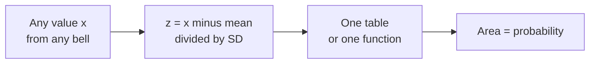

# The Bell Curve: Probability as Area, and One Ruler for Every Bell

> **Part 11 of 15.** Part of the [Probability & Statistics](/fields/data-science/probability-statistics/README.md) series. It continues from [Coins and Calls](/fields/data-science/probability-statistics/coins-and-calls.md), where chance came as a table of counts. By the end you will know where the bell comes from, why probability on a bell is an area and not a height, how one ruler (the z-score) makes every bell the same bell, and when to refuse to use it. The scenario is invented, and every figure was recomputed with Python.

## Table of Contents

- [Prologue: the scale that is never exact](#prologue-the-scale-that-is-never-exact)
- [Where the bell comes from](#where-the-bell-comes-from)
- [Probability is area](#probability-is-area)
- [Two dials, one bell](#two-dials-one-bell)
- [The one ruler](#the-one-ruler)
- [From z back to a value](#from-z-back-to-a-value)
- [When the data are not a bell](#when-the-data-are-not-a-bell)
- [Check yourself](#check-yourself)
- [Back to the story](#back-to-the-story)
- [Cheat sheet](#cheat-sheet)
- [Answers](#answers)
- [References](#references)

* * *

## Prologue: the scale that is never exact

Mira sells loose tea in bags marked **100 g**. Tala weighs thirty of them on the shop scale and reports: "None weighs exactly 100. One is 100.3, one is 98.9, one is 101.4..."

"Of course," says Mira. "What is the chance Ravi's bag weighs exactly 100.000 grams?"

Tala thinks, then says something that sounds wrong and is right: "Zero."

If the chance of any exact weight is zero, how can we ever talk about the chance of a weight at all?

* * *

## Where the bell comes from

Start with something you already own: the table of coin-flip counts from last part. Flip a fair coin `n` times, count heads. Each flip is one small nudge, up or down, and the table shows how the nudges pile up (each `#` is a share of the 2^n equally likely sequences):

```text
n = 4  (one # = 1%)
  0   6.2% ######
  1  25.0% #########################
  2  37.5% ######################################
  3  25.0% #########################
  4   6.2% ######

n = 10  (one # = 1%)
  1   1.0% #
  2   4.4% ####
  3  11.7% ############
  4  20.5% #####################
  5  24.6% #########################
  6  20.5% #####################
  7  11.7% ############
  8   4.4% ####
  9   1.0% #

n = 30  (one # = 0.5%)
 10   2.8% ######
 11   5.1% ##########
 12   8.1% ################
 13  11.2% ######################
 14  13.5% ###########################
 15  14.4% #############################
 16  13.5% ###########################
 17  11.2% ######################
 18   8.1% ################
 19   5.1% ##########
 20   2.8% ######
```

(Rows under 0.5% are left out. Exact counts, computed with Python.)

Nobody drew a bell. The bell is what you get when **many small independent nudges add up**: the middle gets every mix of ups and downs, the ends need all the nudges to line up. Mira's bags are the same story, with tiny scoop errors pushing each bag a little up or down. What happens when the steps get so fine that no step is left?

* * *

## Probability is area

With 30 flips there are 31 possible counts, and each has its own probability. A weight on a scale has **infinitely many** possible values between 99 and 101. Share 100% among infinitely many exact values and each gets nothing: `P(weight = exactly 100.000...) = 0`.

So we stop asking about points and ask about **ranges**. Draw the hill, and let the **area under it** be the probability. The whole area is 1; the area between 98 and 106 g is the chance a bag lands there. The height of the curve is not a probability, it is a *density*: how crowded the chances are near that spot.

This is the histogram from [part 3](/fields/data-science/probability-statistics/draw-it-before-you-describe-it.md) taken to its end: a bar's area was the share of the data, and with infinitely thin bars the bars become a curve. A single line has no width, so it has no area. How do we measure the area under a hill?

* * *

## Two dials, one bell

The curve with the nice formula is the **normal distribution**. It has exactly two dials:

| Dial | What it does | You already know it as |
|---|---|---|
| **Mean** (μ) | Slides the whole bell left or right | The middle, [part 4](/fields/data-science/probability-statistics/the-number-on-the-tin.md) |
| **Standard deviation** (σ) | Stretches or squeezes it (the total area stays 1) | The spread, [part 5](/fields/data-science/probability-statistics/how-far-from-the-middle.md) |

NIST's handbook calls these the **location** and **scale** parameters. Give me a mean and an SD and the whole bell is fixed. That is convenient, and a very strong claim about your data. But every pair of dials is a different hill, and areas need calculus. Do we need a table for each?

* * *

## The one ruler

No. Remember the z-score from [part 6](/fields/data-science/probability-statistics/where-do-you-stand.md): `z = (x − mean) / SD` converts any value into "how many typical distances from the middle". On a normal curve that conversion does something remarkable. Slide the bell to the middle (subtract the mean), then rescale so the SD is 1 (divide by it) and **every normal bell becomes the same bell**: the **standard normal**, mean 0, SD 1.



*Part 6's ruler finally earns its keep: one standardizing step, then one table for all bells.*

Python's `statistics.NormalDist` holds that one table. Its `cdf(x)` gives the area to the left of `x`, that is `P(X <= x)`. With the standard bell:

```python
from statistics import NormalDist

std = NormalDist()                      # mean 0, SD 1: THE bell
for k in (1, 2, 3):
    print(k, round(std.cdf(k) - std.cdf(-k), 4))
```

```text
1 0.6827
2 0.9545
3 0.9973
```

That is the **68-95-99.7 rule**, with its exact decimals: about 68.27% of a normal crowd lies within 1 SD of the mean, 95.45% within 2, 99.73% within 3. (The famous "95%" is really 1.96 SD, which gives 0.95 almost exactly; "2" is the friendly round version.)

> ☕ **Try it before you scroll.** Mira's bags are normal with mean 100 g and SD 4 g (invented). What share weigh **under 106 g**? *Hint: turn 106 into a z-score first.*

Here is Ravi's bag, on the ruler:

```python
bag = NormalDist(100, 4)                # invented: bag weights, mean 100 g, SD 4 g
z = bag.zscore(106)                     # (106 - 100) / 4
print(z, round(bag.cdf(106), 4))        # z, then P(weight <= 106)
print(round(bag.cdf(106) - bag.cdf(98), 4))          # P(98 <= weight <= 106)
print(round(1 - bag.cdf(108), 4))                    # P(weight > 108): two SD above
print(round(bag.cdf(100.0001) - bag.cdf(99.9999), 6))  # a sliver 0.0002 g wide
```

```text
1.5 0.9332
0.6247
0.0228
2e-05
```

A 106 g bag is z = 1.5, and 93.32% of bags weigh less. Between 98 and 106 g is the area from z = −0.5 to z = 1.5, so `0.9332 − 0.3085 =` 0.6247, which matches the code. Over 108 g (z = 2) is the thin 2.28% tail. And the sliver around exactly 100 is 0.00002: tiny, and it only gets smaller. That answers the prologue.

Same function, after one subtraction and one division. Remember that one fact. Now run the ruler backwards.

* * *

## From z back to a value

Sometimes you know the share and want the value: "how heavy is a bag that beats 95% of bags?" That is a **percentile**, the rank ruler from part 6, and `inv_cdf` is the inverse of `cdf`:

```python
print(round(bag.inv_cdf(0.95), 2))      # the 95th percentile of the bag weights
print(round(std.inv_cdf(0.95), 4))      # the same landmark on the standard bell
```

```text
106.58
1.6449
```

The 95th percentile sits at z = 1.6449, so in grams it is `100 + 1.6449 × 4 = 106.58`. Two directions, one ruler: value → z → area (`cdf`), or area → z → value (`inv_cdf`).

So far the bell has behaved. What happens when the data disagree?

* * *

## When the data are not a bell

Go back to Mira's 20 tasting scores, the two-clump crowd from earlier parts. Their mean is 75.2 and their SD 17.67. Treat them as normal and ask what the model *predicts* for how many scores lie within a given distance of the mean, then count:

```python
from statistics import NormalDist, mean, stdev

scores = [52,55,55,58,58,58,62,62,62,71,71,89,89,89,93,93,94,94,95,104]
m, sd = mean(scores), stdev(scores)
print(round(m, 1), round(sd, 2))
for k in (0.5, 1, 2):
    inside = sum(1 for x in scores if abs(x - m) <= k * sd)
    model = NormalDist().cdf(k) - NormalDist().cdf(-k)
    print(k, "SD: model says", round(model * 20, 1), "of 20, actually", inside)
```

```text
75.2 17.67
0.5 SD: model says 7.7 of 20, actually 2
1 SD: model says 13.7 of 20, actually 11
2 SD: model says 19.1 of 20, actually 20
```

Read the three lines together. Within half an SD of the mean the bell expects nearly 8 scores and there are **2**: the mean sits in the valley where nobody lives. The 2 SD line, on its own, looks fine (19.1 versus 20), which is the trap: **passing one check does not make a crowd normal.** The shape failed where the middle is.

A long tail breaks it too. Kettle Street's houses (1, 2, 2, 3, 5, 9, 20) have one huge value dragging the right side out, so a bell around their mean would give real probability to impossible negative values. Incomes and waiting times are lopsided the same way.

So the habit from parts 3 and 6 comes first, before any `NormalDist`: **draw the histogram.** One hump, roughly symmetric, thin tails: a bell is a fair model. Two humps or a long tail: use percentiles and describe the shape.

* * *

## Check yourself

1. Why is the probability that a bag weighs exactly 100 g equal to zero, and why is that not a problem for asking about 98 to 106 g?
2. Bags have mean 100 g and SD 4 g. What are the z-scores of 92 g and 108 g, and what share of bags lies between them?
3. In a normal crowd, about what share lies more than 3 SD from the mean?
4. Tala scored 61 on a normal exam (mean 50, SD 4). What is her z-score and, in words, what does that say about her rank?
5. A histogram shows two clear humps. Can you use the 68-95-99.7 rule? Which ruler from part 6 do you use instead?

* * *

## Back to the story

Ravi's bag turns out to weigh 106 g. "Is that suspiciously heavy?" he asks.

Tala does not guess. She turns 106 into z = 1.5, says "93% of bags are lighter, 7% are heavier", and shrugs: "About one in fourteen. Unusual, not suspicious."

Then Mira asks the question that is now sitting on the counter: "All that works if a bag's weight is bell-shaped. But Tala, if I weigh *ten* bags and average them, what do the *averages* look like?"

Nobody knows yet. But it is the sort of question that decides whether anyone can trust a survey. Next cup: [Why Averages Behave](/fields/data-science/probability-statistics/why-averages-behave.md).

**Takeaway:** a bell is many small nudges added up, probability on it is area, and the z-score is the one ruler that makes every bell the same bell, as long as the data really are one.

* * *

## Cheat sheet

```text
NORMAL = two dials: mean (location) and SD (scale). Total area = 1.
POINT PROBABILITY = 0.  Ask about RANGES: probability = area.

z = (x - mean) / SD            value -> z -> area   (cdf)
x = mean + z * SD              area  -> z -> value  (inv_cdf)

within 1 / 2 / 3 SD = 68.27% / 95.45% / 99.73%    (1.96 SD = 95%)

NormalDist(mu, sigma).cdf(x)       P(X <= x)
NormalDist(mu, sigma).inv_cdf(p)   the x with P(X <= x) = p
NormalDist(mu, sigma).zscore(x)    (x - mu) / sigma

HISTOGRAM FIRST. Two humps or a long tail: no bell, use percentiles.
```

* * *

## Answers

1. A range between two numbers has width, so the area under the curve over it is not zero. A single point has no width, so its area is zero. We always ask about ranges.
2. `(92 − 100) / 4 = −2` and `(108 − 100) / 4 = +2`, so the share is the 2 SD figure, **95.45%** (`0.9772 − 0.0228`).
3. `1 − 0.9973 =` about **0.27%**, split between both tails.
4. `(61 − 50) / 4 =` **2.75**. By the table, only a very small share (well under 1%) of that crowd scored higher: it is a top-of-the-class result.
5. **No.** The mean sits in a valley and the rule gets the shares wrong (the count test above). Use **percentiles** instead.

* * *

## References

- Python `statistics.NormalDist`: `cdf`, `inv_cdf` and `zscore`, with `mu` and `sigma` as mean and standard deviation. Verified against Python 3.14.4. <https://docs.python.org/3/library/statistics.html>
- NIST/SEMATECH e-Handbook of Statistical Methods, *Normal Distribution*: the density with location and scale parameters, and the standard normal (mean 0, SD 1). The page does not state the 68-95-99.7 percentages, so those come from the run above. <https://www.itl.nist.gov/div898/handbook/eda/section3/eda3661.htm>
- Every number and output on this page was recomputed with Python 3.14.4 (stdlib only).
