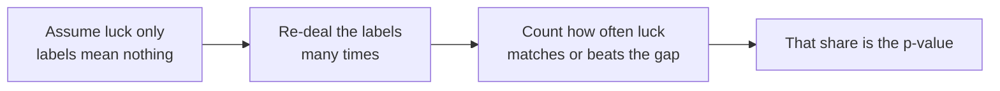

# The Courtroom for Numbers: Could Plain Luck Do This?

> **Part 14 of 15.** Part of the [Probability & Statistics](/fields/data-science/probability-statistics/README.md) series. It continues from [How Sure Are You?](/fields/data-science/probability-statistics/how-sure-are-you.md), where a confidence interval put honest error bars on one number. By the end you will see every hypothesis test as one question, "could plain luck have produced a difference this big?", answer it by shuffling and counting, and know the three ways the answer gets misread. The scenario is invented, and every figure was recomputed with Python 3.14.4 (standard library only).

## Table of Contents

- [Prologue: the blend that won](#prologue-the-blend-that-won)
- [The presumption of innocence](#the-presumption-of-innocence)
- [Shuffle the labels and count](#shuffle-the-labels-and-count)
- [What the p-value is, and is not](#what-the-p-value-is-and-is-not)
- [Two ways to be wrong](#two-ways-to-be-wrong)
- [Twenty tries](#twenty-tries)
- [Back to the story](#back-to-the-story)
- [Check yourself](#check-yourself)
- [Cheat sheet](#cheat-sheet)
- [Answers](#answers)
- [References](#references)

* * *

## Prologue: the blend that won

Mira has two house blends, **A** and **B**. Ten customers taste each blind and score it from 1 to 10 (invented scores):

```text
A: 7 8 6 9 7 8 9 7 8 6    mean 7.5
B: 6 7 5 7 6 8 6 5 7 6    mean 6.3
```

"A wins by 1.2 points," says Tala, reaching for the menu-board chalk.

"Does it?" says Mira. "Put the same tea in both cups and I would still not get two identical averages. How big a gap does *luck alone* make?"

☕ **Try it before you scroll.** Write the 20 scores on cards, deal them at random into two piles of ten. How often would the A pile still beat the B pile by 1.2 or more?

* * *

## The presumption of innocence

A hypothesis test works like a courtroom.

| Courtroom | The test |
|---|---|
| The defendant is presumed innocent | The **null hypothesis**: the blends are the same, the gap is luck only |
| The evidence | The gap you actually saw: +1.2 |
| "Could an innocent person look this guilty by coincidence?" | "Could luck alone make a gap this big?" |
| Convict only if coincidence is a poor explanation | Reject the null only if luck is a poor explanation |



*The whole method in four boxes. Everything else is bookkeeping.*

If the labels A and B mean nothing, **any way of dealing the 20 scores into two piles was equally likely**. That is a world you can build yourself, with cards.

* * *

## Shuffle the labels and count

First a case small enough to do by hand. Three tasters per blend: A scored 8, 9, 7 and B scored 5, 6, 7. The gap is `8 − 6 = 2`. Under "luck only", the six scores `8 9 7 5 6 7` could have been dealt into two piles of three in 20 ways (that is `6 choose 3`, from [Counting the Ways](/fields/data-science/probability-statistics/counting-the-ways.md)). Which deals give A a lead of 2 or more? The scores add to 42, so A's pile must add to 24 or more. Only two do: `8 9 7` (the real one) and the same pile with the *other* 7 swapped in. Two of twenty: **0.10**. Luck does that one time in ten.

Now Mira's real data. Twenty scores into two piles of ten has 184,756 deals, too many for the chalkboard, so we **shuffle many times and count**:

```python
import itertools, random
from statistics import mean

# --- Small case: 3 scores per blend, every possible split counted (exact)
a, b = [8, 9, 7], [5, 6, 7]
pool, seen = a + b, mean(a) - mean(b)          # seen = 2.0
splits = list(itertools.combinations(range(6), 3))
hits = 0
for idx in splits:                              # idx = who "gets" label A
    ga = [pool[i] for i in idx]
    gb = [pool[i] for i in range(6) if i not in idx]
    if mean(ga) - mean(gb) >= seen - 1e-9:      # as good as, or better than, what we saw
        hits += 1
print(hits, "of", len(splits), "splits:", hits / len(splits))

# --- Mira's real data: 10 scores per blend, shuffle the labels 10,000 times
random.seed(14)
A = [7, 8, 6, 9, 7, 8, 9, 7, 8, 6]
B = [6, 7, 5, 7, 6, 8, 6, 5, 7, 6]
seen, pool, count = mean(A) - mean(B), A + B, 0
for _ in range(10_000):
    random.shuffle(pool)                        # luck only: labels mean nothing
    if mean(pool[:10]) - mean(pool[10:]) >= seen - 1e-9:
        count += 1
print(round(mean(A), 1), round(mean(B), 1), round(seen, 1), count / 10_000)
print(1 - 0.95 ** 20)
```

```text
2 of 20 splits: 0.1
7.5 6.3 1.2 0.0143
0.6415140775914581
```

The simulated answer is **0.0143**: in about 1.4% of re-dealt piles, luck alone gave A a lead of 1.2 or more (we asked "A better by at least this much", a one-sided question). The first line matches the hand count; the second is a simulation, so another seed moves the last digits. The third line is for later.

That number is the **p-value**: *how often luck alone would produce a difference at least as extreme as the one you saw.*

The classical test is the same question with a shortcut. Instead of shuffling, the t-test divides the gap by its standard error ([Why Averages Behave](/fields/data-science/probability-statistics/why-averages-behave.md)) and looks it up on a bell curve ([The Bell Curve](/fields/data-science/probability-statistics/the-bell-curve.md)). It is faster and assumes more; when its assumptions hold, the answers agree closely.

* * *

## What the p-value is, and is not

A p of 0.0143 says: *if the blends were identical, we would see a gap this big about 1.4% of the time.* Luck is a poor explanation. Three misreadings, all named in the American Statistical Association's 2016 statement:

| The tempting reading | Why it is wrong |
|---|---|
| "There is a 1.4% chance the blends are the same" | The p-value assumes the null *to compute itself*. It is not the probability the null is true |
| "A is much better" | p says how surprising the gap is, not how big it is. The ASA: it "does not measure the size of an effect or the importance of a result" |
| "p above 0.05 means no difference" | It means luck is not a poor enough explanation yet. Absence of proof, not proof of absence |

**Effect size versus significance.** They come apart. With 50,000 tasters per blend and a true gap of 0.03 points, a simulation gave an observed gap of 0.0277 and p about 0.00001: wildly "significant", practically nothing.

**The link to part 13.** A confidence interval is the same story in points instead of surprise. If the 95% interval for "A minus B" sits entirely above 0, "no difference" is not a comfortable value: the same message as a small p. The interval is the better report, since it also says *how big*.

* * *

## Two ways to be wrong

A court can convict the innocent or free the guilty. So can a test.

| | Luck only (truth) | A real difference (truth) |
|---|---|---|
| **Test says "luck is a poor explanation"** | **False alarm** (Type I): convicted the innocent | Right |
| **Test says "luck could explain it"** | Right | **Missed effect** (Type II): freed the guilty |

The significance level, often 0.05, is the false-alarm rate you accept. NIST's handbook puts it as "A value of α = 0.05 implies that the null hypothesis is rejected 5 % of the time when it is in fact true". The handbook lists 0.1, 0.05 and 0.01 as common choices and calls the choice somewhat arbitrary. **0.05 is a convention, not a law**: a different cost of being wrong would justify a different line.

The missed effect is the one people forget. We simulated 400 experiments where B is truly a full standard deviation worse than A, with only 5 tasters per blend. The test caught the difference in **110 of 400, about 27.5%**. Seven times in ten, a real, large effect was waved through. That is why "not significant" cannot mean "no effect". Only more data lowers both errors.

* * *

## Twenty tries

Tala has an idea: "Let me also split by morning vs evening, by age, by day, by milk or none..." Twenty comparisons later, one has p below 0.05. She wants it on the board.

Each comparison has a 5% chance of a false alarm when nothing is going on. The chance of **no** false alarm in twenty independent tries is `0.95^20`, so at least one is `1 − 0.95^20 = 0.6415`: about **64%**. A "discovery" is more likely than not, even if everything is identical. Simulate it: 300 imaginary studies, each with 20 comparisons between two groups of ten drawn from the *same* distribution, each tested by shuffling:

```python
import random
from statistics import mean
random.seed(20)

def one_test(m=10, reps=200):                  # two groups from the SAME distribution
    x = [random.gauss(0, 1) for _ in range(m)]
    y = [random.gauss(0, 1) for _ in range(m)]
    obs, pool, c = abs(mean(x) - mean(y)), x + y, 0
    for _ in range(reps):
        random.shuffle(pool)
        if abs(mean(pool[:m]) - mean(pool[m:])) >= obs:
            c += 1
    return c / reps

singles = hit = 0
for s in range(300):                           # 300 studies of 20 tests each
    ps = [one_test() for _ in range(20)]
    singles += sum(p <= 0.05 for p in ps)
    hit += any(p <= 0.05 for p in ps)
print("single-test false alarm rate", singles / 6000)
print("studies with >=1 hit of 20:", hit, "/ 300 =", hit / 300)
```

```text
single-test false alarm rate 0.05616666666666666
studies with >=1 hit of 20: 205 / 300 = 0.6833333333333333
```

Each test is close to its promised 5%, yet **205 of 300 studies (68%, simulated) found a "significant" difference** that was nothing but luck, against 64% calculated. The gap to 64% is the noise of only 300 studies. This is **p-hacking**: try enough things, report the one that "worked". The cure is the ASA's fourth principle: "Proper inference requires full reporting and transparency." Say how many things you tried.

* * *

## Back to the story

Mira holds the chalk back. "Our one planned question had p = 0.0143, so A probably is better. The milk 'win' came from twenty tries, and twenty tries will always find something. Rerun it with fresh tasters before we believe it."

Tala writes: *"Preferred in a blind test of 10 per blend, +1.2 points."* Not "proven".

**Takeaway:** a test asks whether luck alone could do this. A small p-value says luck is a poor explanation. It does not say the effect is big, the null is false with some probability, or that an unsignificant result means nothing is there.

**Challenge.** Ravi counts that on days it rains, more people order tea. Rain and sales move together, but does one *cause* the other? Next cup: [Two Things Moving Together](/fields/data-science/probability-statistics/two-things-moving-together.md).

* * *

## Check yourself

1. In the three-per-blend example, why is the p-value 0.10 and not something small, even though A averaged 2 points more?
2. A study reports p = 0.03. Is there a 3% chance the null hypothesis is true?
3. Study X (20 people, p = 0.2) and study Y (20,000 people, p = 0.0001) find the same gap. Which effect is larger?
4. Compute the chance of at least one false alarm in 5 independent tests at the 0.05 level.
5. A test on 5 people per group is "not significant". Does that show the two groups do not differ?

* * *

## Cheat sheet

```text
NULL            "luck only": the labels mean nothing
p-VALUE         how often luck alone gives a result at least this extreme
                small p = luck is a poor explanation
                NOT effect size, NOT P(null true), NOT proof when large

SHUFFLE TEST    re-deal labels many times, count matches of what you saw
CLASSICAL TEST  same question, bell-curve shortcut

ERRORS          false alarm (reject a true null)    missed effect (keep a false null)
0.05            a convention, not a law
MANY TESTS      P(at least one false alarm) = 1 - 0.95^k      k=20 -> 0.64
REPORT          the effect size and interval, and how many things you tried
```

* * *

## Answers

1. Only 20 deals exist, and two reach a lead of 2 (the real pile, and the one with the other 7 swapped in): 2 of 20 is 0.10. Small samples let luck make big gaps.
2. No. It is the chance of data this extreme *given* the null, not the chance of the null given the data (ASA principle 2).
3. You cannot tell: the gap is the same, and p reflects gap *and* sample size.
4. `1 − 0.95^5 = 1 − 0.7738 =` **0.2262**, about 23%.
5. No. With 5 per group even a true 1-SD difference was caught only about 27.5% of the time (simulated). "Not significant" means "not shown".

* * *

## References

- Wasserstein, R. L. and Lazar, N. A. (2016), *The ASA's Statement on p-Values: Context, Process, and Purpose*, The American Statistician 70(2):129-133. <https://doi.org/10.1080/00031305.2016.1154108>. The journal page returned HTTP 403, so the paper itself was not read. The six principles quoted above come from the ASA's own press release of the statement, which was retrieved: <https://www.amstat.org/asa/files/pdfs/p-valuestatement.pdf>.
- NIST/SEMATECH e-Handbook of Statistical Methods, *7.1.3. What are statistical tests?* (null and alternative hypotheses, the risk of the first and second kind) <https://www.itl.nist.gov/div898/handbook/prc/section1/prc13.htm>, and *7.1.3.1. Critical values and p values* (the α = 0.05 sentence and the arbitrariness of the choice) <https://www.itl.nist.gov/div898/handbook/prc/section1/prc131.htm>.
- Every number was recomputed with Python 3.14.4 (`python3 -I`, standard library, fixed seeds). The 50,000-per-blend and 400-experiment simulations are described, but their code is not shown.
