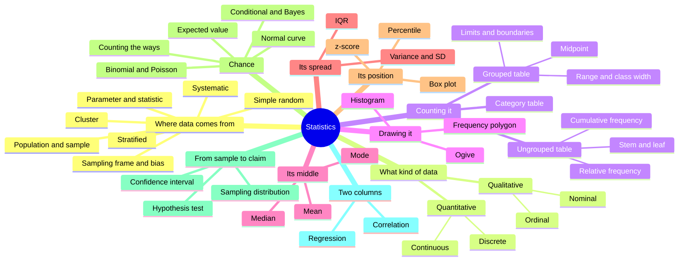
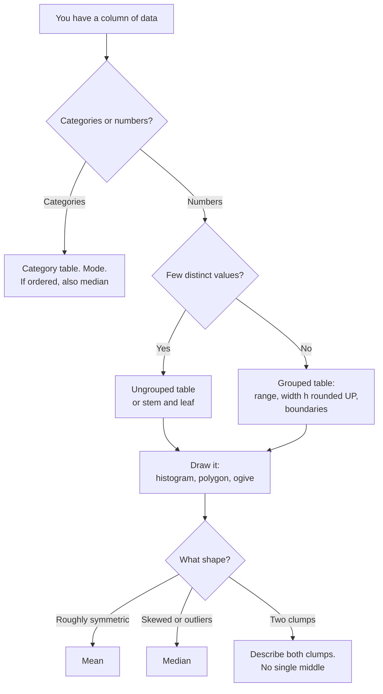

# The Map of Leaf & Kettle: Every Idea So Far in One Walk Through the Shop

> **Part of the [Probability & Statistics](https://github.com/AhmedYousriSobhi/aCupOfTea/blob/main/fields/data-science/probability-statistics/README.md) series.** This is the reference page: no new ideas, only the old ones laid out so you can find and remember them. Each row says which page to go back to for the full story. It grows as the series does.

## Table of Contents

- [Prologue: the apprentice's first morning](#prologue-the-apprentices-first-morning)
- [The whole picture on one page](#the-whole-picture-on-one-page)
- [Which tool for which question](#which-tool-for-which-question)
- [The memory palace: downstairs and upstairs](#the-memory-palace-downstairs-and-upstairs)
- [Definitions at a glance](#definitions-at-a-glance)
- [The formula sheet](#the-formula-sheet)
- [The mistakes that cost the most](#the-mistakes-that-cost-the-most)
- [Walk the shop with your eyes closed](#walk-the-shop-with-your-eyes-closed)
- [Back to the story](#back-to-the-story)

* * *

## Prologue: the apprentice's first morning

Mira has hired an apprentice, Tala, who starts on a Monday. By ten o'clock Tala has filled half a page with terms she has overheard: *stratified, ordinal, ogive, class boundary, median class, cumulative, bimodal.* She looks at the list and then at Mira.

"Do I have to memorize all of this?"

"No," says Mira. "You have to be able to **walk through the shop**. Every one of those words lives in a particular room. If you remember the room, the word comes with it."

She hands Tala a map.

* * *

## The whole picture on one page

Everything so far hangs from one trunk, and the branches follow the order of the series.



And the two jobs that all of it serves:

| | Descriptive statistics | Inferential statistics |
|---|---|---|
| Question | What does the data I **have** look like? | What can I say about the **whole** group? |
| Tools | Tables, pictures, mean, median, mode, spread, position | Confidence intervals, hypothesis tests |
| Depends on | Honest counting | An honest **sample** |

* * *

## Which tool for which question

Start at the top and follow your data down.



And the picture question, separately:

| You want to know | Use |
|---|---|
| The shape, where the bulk is, whether there is a tail | **Histogram** |
| How two data sets compare | **Frequency polygon**, overlaid |
| How many are at or below a value, or the median or a percentile | **Ogive** |

* * *

## The memory palace: downstairs and upstairs

The oldest memory trick there is: put each idea on a vivid object in a place you know, then walk the same route every time. The shop is the place. Walk it in this order, and **never more than three or four things per room**.

### Room 1: The doorstep

A **big wooden spoon** leans against the door, and a sign above it says *STIR FIRST*.

| Object | Idea |
|---|---|
| The pot of tea on the step | **Population**: everyone you care about |
| The sip in the spoon | **Sample**: the part you actually taste |
| The unstirred top of the pot | **Bias**: a sample that cannot speak for the whole |
| Stirring | **Random** selection |

*Hook:* a sip only speaks for the pot if you stirred it. **How you choose matters more than how many you choose.**

### Room 2: The loyalty-card cabinet

A tall cabinet with 4,000 cards. The drawer labels are the list you draw from: the **sampling frame**.

| Object | Idea |
|---|---|
| A **hat** full of numbered cards | **Simple random**: everyone has an equal chance |
| A **red clip** on every 100th card | **Systematic**: `k = N / n`, random start, then every k-th |
| **Three colored boxes** (students, office, retirees) | **Stratified**: *every group, some people* |
| A **map with pins** on four neighborhoods | **Cluster**: *some groups, every person* |

*Hook:* boxes are *every group, some people*, and the pins are *some groups, every person*.

### Room 3: The notebook on the counter

A notebook with five columns, each tied with a different colored ribbon.

| Object | Idea |
|---|---|
| A **name tag** column (blend name) | **Nominal**: categories, no order |
| A **ladder** (mild, medium, strong) | **Ordinal**: ordered, gaps not measured |
| A **tally counter** (cups per week) | **Discrete**: counted, whole numbers |
| A **thermometer** (brewing temperature) | **Continuous**: measured, recorded rounded |
| A **loyalty-card number** pinned on the cover | A **label in digits**, not a quantity |

*Hook:* if you cannot sensibly add two of them, it is a label, however many digits it has.

### Room 4: The chalkboard tally wall

Three chalkboards side by side.

| Board | Idea |
|---|---|
| Board 1, words with tally marks | **Category table**: `f`, percentage; `Σf = n` |
| Board 2, every score on its own line | **Ungrouped table**: `f`, `RF = f/n`, `CF` running total; **stem and leaf** |
| Board 3, scores in drawers of equal width | **Grouped table**: `Range`, `h` rounded **up**, **boundaries** |

Two props stand by Board 3. A **halo** of half a unit around every class limit, which gives the **boundaries** (±0.5, or ±0.05 for one decimal). And a **lift that only goes up**, which is the reminder to round `h` **up**.

*Hook:* a class from 52 to 62 is **eleven** wide, because width is measured between boundaries, not limits.

### Room 5: The window with three drawings

Three drawings taped to the glass.

| Object | Idea |
|---|---|
| **Window panes** that touch | **Histogram**: bars on boundaries, touching, height = `f` |
| **String** between pegs at the pane centers | **Frequency polygon**: dots at midpoints, closed at the ends; good for overlays |
| A **staircase that never goes down** | **Ogive**: points at **upper** boundaries, `CF`, ends at `n`; read for medians and percentiles |

*Hook:* the staircase counts only once you reach the **top** of a step, so use the upper boundary.

### Room 6: The scale by the till

A seesaw, a shelf of sorted tins, and one tin with a dented lid.

| Object | Idea |
|---|---|
| The **seesaw** | **Mean**: the balance point; deviations add to 0; a heavy far-away weight drags it |
| The **middle tin** on the sorted shelf | **Median**: half the values on each side; unmoved by extremes |
| The **dented tin**, handled the most | **Mode**: the most frequent value; may be several, or none |

*Hook:* mean above median means a tail on the **right**. The seesaw tips toward the heavy weight.

### Room 7: The label shelf

A shelf of tins, each with a printed label, and one label crossed out.

| Object | Idea |
|---|---|
| The **crossed-out "Typical score: 75"** | One number can describe **nobody** when the data have two clumps |
| A tin that says **"Divides opinion"** | When there is no single middle, **describe the clumps** |

*Hook:* before you print a number, look at the picture.

### Room 8: The pavement outside

A handcart parked on Kettle Street, with a ball of string running from the cart to each customer's door.

| Object | Idea |
|---|---|
| The **cart** | The one stand-in for the whole crowd: the middle |
| String that counts **only who is at the door** | **Mode** |
| String where **a block is a block** | **Median**: least total walking, half the heads each side |
| String where **long walks hurt far more** | **Mean**: least squared walking, the balance point |
| The **leftover string** coiled on the cart | **Spread**: variance and SD with the mean, IQR with the median |
| One house with a **very long string** | Why the mean and SD **shout** at one far value |
| Two cartloads, **n** and **n − 1** | Everyone: divide by `n`. A sample: divide by `n − 1` |

*Hook:* mean, median and mode are not three formulas. They are one question: **how much should a long walk hurt?**

### Room 9: The scoreboard by the till

Two exam results taped to the till, and two rulers hanging beside them.

| Object | Idea |
|---|---|
| A **queue** at the door | **Percentile rank**: the share of the crowd below you |
| A **tape measure marked in SD steps** | **z-score**: `(x − mean) / SD`, distance in units of spread |
| A **box with a line and two whiskers** | **Box plot**: Q1, median, Q3, and the fences at 1.5 × IQR |
| The **staircase** from Room 5, with four marks | The box plot **is** the ogive, kept at its landmarks |

*Hook:* a score has no position without its crowd. **Histogram first, to look. Box plot second, to compare.**

### Upstairs: the chance wing (Rooms 10 to 18)

The same walk, one floor up. Each room is one part of the series, with one object to remember and one question to carry in.

| Room | Part | The object | The idea | The question to carry |
|---|---|---|---|---|
| 10 · The Lucky Roll | [7](/fields/data-science/probability-statistics/counting-the-ways.md) | A **grid of 36 ways** by the till | Probability is the share of the equally likely ways. Shaded cells are an event, the overlap cell is counted once, and a rectangle means independent | Why did Ravi's 11/36 overcount? |
| 11 · The Alarm Bell | [8](/fields/data-science/probability-statistics/the-test-that-was-99-percent-accurate.md) | A **tree of 100,000 tins** | Conditional probability shrinks the crowd to the positives and counts again. "99% accurate" is P(positive given bad), not P(bad given positive) | Which crowd are you counting inside? |
| 12 · The Lucky Tin | [9](/fields/data-science/probability-statistics/what-to-expect.md) | A **card bag** with a prize table | A random variable is a number on each outcome. Expected value is the seesaw again, weighted by probability | The expected prize is 4.5 and no card says 4.5 |
| 13 · Coins and Calls | [10](/fields/data-science/probability-statistics/coins-and-calls.md) | **Ten customers** choosing, and a **phone** ringing | A distribution is a recipe for who gets how much probability. Binomial counts yeses, Poisson counts events in a window | Three is the average, not the answer |
| 14 · The Bell Curve | [11](/fields/data-science/probability-statistics/the-bell-curve.md) | **Bags of tea** never exactly 100 g | Many small nudges add up to a bell. Probability is area, and the z-score is one ruler for every bell | Is the average of ten bags also a bell? |
| 15 · The Thousand Sips | [12](/fields/data-science/probability-statistics/why-averages-behave.md) | A **pot** sipped again and again | An average is itself random. The pile of sips is the sampling distribution, and its spread is `σ / √n` | Which pile is narrower, 2 cups or 30? |
| 16 · The Net | [13](/fields/data-science/probability-statistics/how-sure-are-you.md) | A **net** over a fixed target | A confidence interval is the estimate plus or minus a margin. The 95% describes the method, not one net | Narrow is not the same as right |
| 17 · The Courtroom | [14](/fields/data-science/probability-statistics/the-courtroom-for-numbers.md) | A **judge** who presumes luck | The null is "luck only", and the p-value is how often luck matches the evidence | Could plain luck do this? |
| 18 · The Scatter Plot Over the Till | [15](/fields/data-science/probability-statistics/two-things-moving-together.md) | A **scatter plot** and a **line** | Correlation is paired z-scores agreeing. The regression line is least squared walking again | The number is a summary, the picture is the crowd |

* * *

## Definitions at a glance

### Where data comes from

| Term | Definition | Page |
|---|---|---|
| **Statistics** | The practice of collecting, organizing, summarizing and interpreting data | [1](https://github.com/AhmedYousriSobhi/aCupOfTea/blob/main/fields/data-science/probability-statistics/stir-the-pot-population-and-sampling.md) |
| **Descriptive statistics** | Summarizing the data you have | 1 |
| **Inferential statistics** | Using a sample to make a claim about a larger group | 1 |
| **Population** (`N`) | The complete group you want to know about | 1 |
| **Sample** (`n`) | The part of the population you actually observe | 1 |
| **Parameter** (e.g. `μ`) | A true value for the whole population | 1 |
| **Statistic** (e.g. `x̄`) | A value computed from a sample | 1 |
| **Sampling frame** | The actual list you draw from | 1 |
| **Census** | Measuring the entire population | 1 |
| **Bias** | A systematic tilt in who ends up in the sample, which does not shrink with sample size | 1 |
| **Simple random sample** | Every member has an equal chance of selection | 1 |
| **Systematic sample** | Step `k = N / n`, random start, then every k-th member | 1 |
| **Stratified sample** | Divide into different groups (strata), sample from **every** group | 1 |
| **Cluster sample** | Divide into similar groups (clusters), pick **some** and survey everyone in them | 1 |

### Kinds of data and how to count them

| Term | Definition | Page |
|---|---|---|
| **Qualitative** | Data in categories | [2](https://github.com/AhmedYousriSobhi/aCupOfTea/blob/main/fields/data-science/probability-statistics/data-types-and-frequency-tables.md) |
| **Nominal** | Categories with no natural order | 2 |
| **Ordinal** | Categories with an order, but unmeasured gaps | 2 |
| **Quantitative** | Numbers that count or measure | 2 |
| **Discrete** | Counted values (whole numbers) | 2 |
| **Continuous** | Measured values; any value in a range is possible, recorded rounded | 2 |
| **Frequency** (`f`) | How many times a value, or a value in a class, occurs | 2 |
| **Relative frequency** | `f / n`, the fraction of the data | 2 |
| **Cumulative frequency** (`CF`) | A running total: how many values are at or below this one | 2 |
| **Stem and leaf** | A table that keeps every value: the leading digits are the stem, the last digit is the leaf | 2 |
| **Range** | Largest value minus smallest | 2 |
| **Class width** (`h`) | `Range / k`, rounded **up**; the distance between a class's boundaries | 2 |
| **Class limits** | The smallest and largest values that can be recorded in a class | 2 |
| **Class boundaries** | Limits ± half the measurement unit; neighboring classes share them | 2 |
| **Midpoint** (`M`) | `(lower boundary + upper boundary) / 2` | [3](https://github.com/AhmedYousriSobhi/aCupOfTea/blob/main/fields/data-science/probability-statistics/draw-it-before-you-describe-it.md) |

### Pictures

| Term | Definition | Page |
|---|---|---|
| **Histogram** | Touching bars on class boundaries; height is frequency | 3 |
| **Frequency polygon** | Dots at (midpoint, frequency), joined and closed at the ends | 3 |
| **Ogive** (cumulative frequency curve) | Points at (upper boundary, cumulative frequency), never decreasing, ending at `n` | 3 |
| **Frequency density** | Frequency divided by class width; needed when class widths differ | 3 |

### The middle

| Term | Definition | Page |
|---|---|---|
| **Mean** (`x̄`, `μ`) | The sum divided by the count; the balance point | [4](https://github.com/AhmedYousriSobhi/aCupOfTea/blob/main/fields/data-science/probability-statistics/the-number-on-the-tin.md) |
| **Deviation** | A value minus the mean; deviations sum to 0 | 4 |
| **Weighted average** | A mean where each value counts according to its frequency | 4 |
| **Median** | The middle value when sorted; half the data on each side | 4 |
| **Resistant** | Not moved much by extreme values (the median is, the mean is not) | 4 |
| **Mode** | The most frequent value; there may be several, or none | 4 |
| **Modal class** | The class with the highest frequency in a grouped table | 4 |
| **Bimodal / multimodal** | Two / more than two modes | 4 |
| **Right tail** (right-skewed) | A few large values stretch the data to the right; typically mean > median | 4 |
| **Left tail** (left-skewed) | A few small values stretch it to the left; typically mean < median | 4 |

### The spread

| Term | Definition | Page |
|---|---|---|
| **Variance** (`σ²`, `s²`) | The average squared distance from the mean. Divide by `n` for everyone, `n − 1` for a sample | [5](/fields/data-science/probability-statistics/how-far-from-the-middle.md) |
| **Standard deviation** (`σ`, `s`) | The square root of the variance, back in the data's own units | 5 |
| **Mean absolute deviation** | The average plain distance from the median | 5 |
| **Quartiles** (`Q1`, `Q3`) | The values a quarter and three quarters of the data sit below | 5 |
| **IQR** | `Q3 − Q1`, the width of the middle half | 5 |
| **Range** | Largest minus smallest: set by the two most extreme values | 5 |

### Position

| Term | Definition | Page |
|---|---|---|
| **Percentile rank** | `(below + 0.5 × equal) / n × 100`: the share of the crowd below a value | [6](/fields/data-science/probability-statistics/where-do-you-stand.md) |
| **z-score** | `(x − mean) / SD`: how many SDs a value sits above or below the mean | 6 |
| **Box plot** | Min, Q1, median, Q3, max, with whiskers to the last point inside the fences | 6 |
| **Fences** | `Q1 − 1.5 × IQR` and `Q3 + 1.5 × IQR`; points beyond are drawn alone | 6 |

### Chance (parts 7 to 11)

| Term | Definition | Part |
|---|---|---|
| **Sample space** | The list of all possible outcomes | [7](/fields/data-science/probability-statistics/counting-the-ways.md) |
| **Event** | A group of outcomes from that list | 7 |
| **Complement** | Everything the event is not; "at least one" is 1 minus "none" | 7 |
| **Independent** | Knowing one tells you nothing about the other | 7 |
| **Conditional probability** | `P(A given B)`: shrink the crowd to B, count A inside it | [8](/fields/data-science/probability-statistics/the-test-that-was-99-percent-accurate.md) |
| **Base rate** | How common the thing is before any clue | 8 |
| **Natural frequencies** | Whole-number counts in a tree instead of percentages | 8 |
| **Bayes' rule** | The flip from `P(B given A)` to `P(A given B)` | 8 |
| **Random variable** | A number attached to each way things could turn out | [9](/fields/data-science/probability-statistics/what-to-expect.md) |
| **Expected value** | The balance point of the values weighted by probability, `Σ x × p` | 9 |
| **Probability table** | Each possible value with its probability; they sum to 1 | 9 |
| **Distribution** | A table of how much probability each value gets | [10](/fields/data-science/probability-statistics/coins-and-calls.md) |
| **Binomial** | The count of yeses in `n` independent tries with the same `p` | 10 |
| **Poisson** | The count of events in a window at a constant rate | 10 |
| **Normal curve** | A bell set by two dials, the mean and the SD; total area 1 | [11](/fields/data-science/probability-statistics/the-bell-curve.md) |
| **Density** | The height of the curve, not a probability; probability is area | 11 |
| **Standard normal** | The bell with mean 0 and SD 1; every normal becomes it through z | 11 |
| **68-95-99.7 rule** | The share within 1, 2 and 3 SD: 68.27%, 95.45%, 99.73% | 11 |

### From a sample to a claim (parts 12 to 14)

| Term | Definition | Part |
|---|---|---|
| **Sampling distribution** | The averages you would get from many samples of size `n` | [12](/fields/data-science/probability-statistics/why-averages-behave.md) |
| **Standard error** | The spread of sample averages, `σ / √n` | 12 |
| **Law of large numbers** | Averages converge on the mean of what you draw from | 12 |
| **Central limit theorem** | Sample averages approach a bell, whatever the crowd looks like | 12 |
| **Confidence interval** | Estimate `± z × SE`: an honest "give or take" | [13](/fields/data-science/probability-statistics/how-sure-are-you.md) |
| **Confidence level (95%)** | The share of repeated nets that catch the truth: a property of the method | 13 |
| **Bootstrap** | Resample your sample with replacement, take the middle 95% of the means | 13 |
| **Null hypothesis** | The "luck only" assumption: the labels mean nothing | [14](/fields/data-science/probability-statistics/the-courtroom-for-numbers.md) |
| **p-value** | How often luck alone gives a result at least this extreme | 14 |
| **False alarm / missed effect** | Rejecting a true null / keeping a false one | 14 |
| **p-hacking** | Testing many things and reporting the one that "worked" | 14 |

### Two columns (part 15)

| Term | Definition | Part |
|---|---|---|
| **Scatter plot** | One dot per pair; draw it before computing `r` | [15](/fields/data-science/probability-statistics/two-things-moving-together.md) |
| **Correlation** (`r`) | The average product of paired z-scores, from −1 to +1; straight-line togetherness only | 15 |
| **Residual** | Actual minus the line: the leftover | 15 |
| **Regression line** | The line with the smallest total squared residual | 15 |

* * *

## The formula sheet

```
SAMPLING     systematic step: k = N / n          stratified: n_h = n × N_h / N

FREQUENCIES  RF = f / n         percentage = RF × 100        CF_k = f_1 + ... + f_k
             checks:  Σf = n     ΣRF = 1     last CF = n

CLASSES      Range = largest − smallest         h = Range / k   (round UP)
             boundary = limit ± half the measurement unit  (0.5, 0.05, 0.005, ...)
             class width = upper boundary − lower boundary = h
             midpoint M = (lower boundary + upper boundary) / 2
             number of classes (one rule of thumb, Sturges): k ≈ 1 + 3.322 × log10(n)

MEAN         ungrouped:  x̄ = Σx / n
             grouped:    x̄ = Σ(f × M) / Σf          (an estimate)

MEDIAN       sort first.  n odd: value at position (n + 1) / 2
                          n even: average of positions n/2 and n/2 + 1
             grouped:  median class = first class with CF ≥ N/2
                       median = L + ((N/2 − cf) / f) × h
                       L = lower boundary of median class, cf = CF of class before it,
                       f = its frequency, h = class width

MODE         most frequent value; for grouped data, the modal class

SHAPE        mean > median → right tail     mean < median → left tail     similar → roughly symmetric

SPREAD       variance = Σ(x − mean)² / n   (everyone)   or   / (n − 1)   (a sample)
             SD = √variance          IQR = Q3 − Q1          range = max − min
             mean goes with SD, median goes with IQR

POSITION     percentile rank = (below + 0.5 × equal) / n × 100
             z = (x − mean) / SD
             fences: Q1 − 1.5 × IQR   and   Q3 + 1.5 × IQR
             quartile methods differ between tools: pick one, say which

CHANCE       P(event) = ways / all ways (equally likely only)
             P(A or B) = P(A) + P(B) − P(A and B)      P(A and B) = P(A) × P(B) if independent
             P(A given B) = count(A and B) / count(B)
             P(A given B) = P(B given A) × P(A) / P(B)
             E[X] = Σ x × p       E[aX + b] = a E[X] + b       E[X + Y] = E[X] + E[Y]
             binomial: P(k) = C(n,k) p^k (1−p)^(n−k)    mean np    variance np(1−p)
             Poisson:  P(k) = e^−λ λ^k / k!             mean = variance = λ
             normal:   z = (x − mean) / SD     probability = area

FROM SAMPLE  SE = σ / √n   (4× the data halves it)      CI = estimate ± z × SE   (z = 1.96 for 95%)
TO CLAIM     small samples use t instead of z           p small = luck is a poor explanation
             P(at least one false alarm in k tests) = 1 − 0.95^k

TWO COLUMNS  r = mean of (z_x × z_y)      slope = r × SD(y) / SD(x)      r² = share of squared miss removed
```

* * *

## The mistakes that cost the most

| Mistake | Where it lives | The fix |
|---|---|---|
| Averaging a nominal column or a column of labels | Room 3 | Ask what the column *means* before computing |
| Mixing up stratified and cluster | Room 2 | Every group, some people / some groups, every person |
| Trusting a huge sample that was not chosen fairly | Room 1 | Size cannot cure bias |
| Frequencies that do not add to `n` | Room 4 | Recount |
| Computing class width from limits | Room 4 | Use **boundaries** |
| Rounding `h` down | Room 4 | Round **up** |
| Plotting an ogive at midpoints or lower boundaries | Room 5 | Use **upper boundaries** |
| Leaving gaps between histogram bars for continuous data | Room 5 | Let them touch |
| Treating a grouped mean or median as exact | Room 6 | They are estimates |
| Giving one middle for data with two clumps | Room 7 | Look at the picture, describe the clumps |
| Dividing by `n` for a sample, or `n − 1` for everyone | Room 8 | Everyone: `n`. A sample: `n − 1` |
| Quoting SD for data with one wild value | Room 8 | Use the median and IQR, or fix the value |
| Comparing raw scores from different crowds | Room 9 | Convert to z-scores or percentile ranks |
| Trusting a box plot to show two clumps | Room 9 | Draw the histogram first |
| Adding probabilities of overlapping events | Room 10 | Subtract the overlap |
| Treating `P(positive given sick)` as `P(sick given positive)` | Room 11 | Rebuild the tree, count only the positives |
| "Expected" means "most likely" | Room 12 | It is the balance point; no outcome need equal it |
| Trusting Poisson without checking variance ≈ mean | Room 13 | Compare the variance with the mean |
| Using the bell on a two-clump crowd | Room 14 | Draw the histogram first |
| "A bigger sample fixes bias" | Room 15 | It shrinks chance wobble, never bias |
| "95% chance the truth is in this interval" | Room 16 | The 95% describes the method, not one interval |
| "p = 0.03 means a 3% chance the null is true" | Room 17 | `p` assumes the null: it is data given the null |
| "Correlated, so one causes the other" | Room 18 | Look for a hidden third thing, and draw it |

* * *

## Walk the shop with your eyes closed

Close the page and answer. Each answer is in one room.

1. Which object tells you that *stratified* means "every group, some people"?
2. What is the half-unit halo for data recorded to one decimal place?
3. Why does the staircase use the **upper** boundary?
4. Mean above median: which way is the tail, and which tool tips toward it?
5. A column of digits that you cannot sensibly add: what is it, and what hangs on the notebook cover?
6. Two clumps and one printed number: which room, and what does the new label say?
7. Which string makes the mean, and which makes the median?
8. 84 on an easy exam or 61 on a brutal one: which ruler hangs by the till, and which score wins?

**Answers.** 1. The three colored boxes in the cabinet. 2. 0.05, so a limit of 12.4 gets a boundary of 12.35 or 12.45. 3. The count at a step only becomes true at the top of the class, so a cumulative count belongs at the upper boundary. 4. To the right, the seesaw. 5. A nominal label, the loyalty-card number. 6. Room 7: "Divides opinion", with the clumps described. 7. The string where long walks hurt far more is the mean, and the string where a block is a block is the median (Room 8). 8. The tape measure marked in SD steps (Room 9): `z = 2.00` for the 84 and `z = 2.75` for the 61, so the 61 wins.

* * *

## Back to the story

On Tuesday morning Ravi leans over the counter. He has a column of numbers on his phone, and he wants to know what the typical value is.

Tala does not reach for the Average button. She walks the shop in her head, quickly, from the doorstep to the label shelf. *Who was asked? How was the list drawn? What kind of column is this? What does the picture look like? Is there a tail? Are there two clumps?*

"Send me the numbers," she says. "I want to see the shape before I give you a number."

Mira, wiping a cup behind the counter, does not say anything. She does not have to. The first week of anyone's training is learning the words. The second is learning which room each one lives in, and the third is learning to ask the room's question before reaching for the formula.

The shop has an upstairs now: the rooms for chance, from the grid of ways to the scatter plot over the till. It is built from the same bricks as downstairs: the expected value is the seesaw again, the z-score finally meets the bell, and the regression line is the least squared walking of Room 8.
