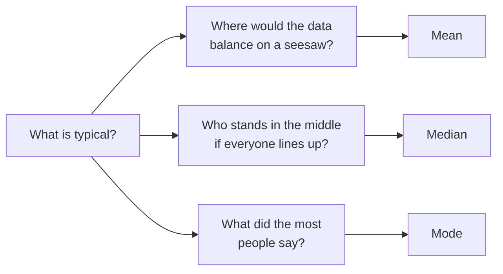

# The Number on the Tin: Mean, Median and Mode

> **Part 4 of 15.** Part of the [Probability & Statistics](/fields/data-science/probability-statistics/README.md) series. It continues from [Draw It Before You Describe It](/fields/data-science/probability-statistics/draw-it-before-you-describe-it.md), where Ravi asked for "one number" for a typical day. The scenario is invented, and every figure can be checked by hand.

## Table of Contents

- [Prologue: the number on the tin](#prologue-the-number-on-the-tin)
- [The idea in one minute](#the-idea-in-one-minute)
- [The mean: where the seesaw balances](#the-mean-where-the-seesaw-balances)
- [The median: the one in the middle of the line](#the-median-the-one-in-the-middle-of-the-line)
- [The mode: the most popular](#the-mode-the-most-popular)
- [When the answers disagree](#when-the-answers-disagree)
- [What grouping costs you](#what-grouping-costs-you)
- [Choosing, and looking first](#choosing-and-looking-first)
- [Check yourself](#check-yourself)
- [Back to the story](#back-to-the-story)
- [Cheat sheet](#cheat-sheet)
- [Answers](#answers)
- [References](#references)

* * *

## Prologue: the number on the tin

Mira is about to print the labels for her new smoky blend. The tins will carry a line she has always wanted: **"Typical taster score: __."**

She has the 20 tasting scores from earlier (on a 0 to 120 scale), and she knows how to find the average: add them up and divide.

```text
52, 55, 55, 58, 58, 58, 62, 62, 62, 71, 71, 89, 89, 89, 93, 93, 94, 94, 95, 104
```

The sum is 1,504, and 1,504 divided by 20 is **75.2**. She sends "Typical taster score: 75" to the printer.

Then she remembers the table she built a few days ago. Scores from 74 to 84 had a frequency of zero. **Not one taster gave the blend anything close to 75.** The "typical" score on every tin is a score nobody gave.

The arithmetic was right. The question she asked was not the question she meant.

> ☕ **Try it before you scroll.** Before reading on: if someone asked you for the "typical" score of those 20, what would you actually say? Is it the same number you would give if the question were "which score did most people give?"

* * *

## The idea in one minute

**"Typical" is an ambiguous word.** It hides three different questions, and each has an honest answer:



*Three questions, three answers. None of them is wrong. Each is wrong only when it answers a question you did not mean.*

So the skill is not memorizing three formulas. It is two habits: **say which question you mean, and draw the picture first.** The picture tells you whether a single "typical" even exists. For Mira's tin, it did not. The rest of the page gives each question a short recipe.

* * *

## The mean: where the seesaw balances

*Question: where would the data balance?* Add up and divide by how many:

```text
x̄ = Σx / n
```

Take eight tasting scores: 70, 65, 69, 85, 94, 62, 79, 100. The sum is 624, so `x̄ = 624 / 8 = 78`.

Picture each value as a weight on a seesaw. The mean is the pivot where it balances. The check is the **deviations**, `x − 78`: they are −8, −13, −9, +7, +16, −16, +1, +22, and they **add to zero**. The pull from below equals the pull from above. That is what "balance point" means, and why one far-away value drags the mean so hard: a heavy weight on a long arm.

**The mean of a table.** When the data arrive as a frequency table, each value simply counts `f` times, so the mean is a weighted average. When the table is **grouped**, the exact values inside a class are gone. So each class **casts `f` votes for its midpoint `M`**, a stand-in for the values we cannot see:

```text
x̄ = Σ(f × M) / Σf
```

Fifty visits to the shop, grouped by minutes inside:

| Class boundaries | `f` | Midpoint `M` | `f × M` |
|---|---|---|---|
| 9.5 to 12.5 | 4 | 11 | 44 |
| 12.5 to 15.5 | 12 | 14 | 168 |
| 15.5 to 18.5 | 20 | 17 | 340 |
| 18.5 to 21.5 | 14 | 20 | 280 |
| **Total** | **50** | | **832** |

`x̄ = 832 / 50 = 16.64` minutes. Because midpoints stand in for unknown values, this is an **estimate**.

* * *

## The median: the one in the middle of the line

*Question: if everyone lines up in order, who stands in the middle?* Sort the data. Half sit on each side.

```text
n odd  : the value at position (n + 1) / 2
n even : the average of the values at positions n/2 and n/2 + 1
```

- **Odd:** {3, 2, 6, 2, 7} sorted is 2, 2, 3, 6, 7. Position `(5 + 1) / 2 = 3`, so the median is **3**.
- **Even:** add an 8: 2, 2, 3, 6, 7, 8. Average the 3rd and 4th, `(3 + 6) / 2 =` **4.5**. With an even count the median need not be a data value.

The eight scores sorted are 62, 65, 69, 70, 79, 85, 94, 100. The 4th and 5th are 70 and 79, so the median is `(70 + 79) / 2 = 74.5`, near the mean of 78.

**Now the experiment that shows why the median exists.** Change the 100 into a 1,000, as if one taster hit the wrong key:

| | Original | With the typo |
|---|---|---|
| Mean | 78 | `1,524 / 8 =` **190.5** |
| Median | 74.5 | **74.5** (the 4th and 5th values are still 70 and 79) |

One wrong entry moved the mean by more than 110 points and the median by none. The median uses only the **order** of the values, not how far out the extremes are. That makes it **resistant** to outliers.

**The median of a grouped table.** Here the raw values are gone, but you can still find the middle of the line, using one assumption: *inside a class, the values are spread evenly.* Then the median is the cumulative-frequency curve (the ogive from the previous page) read with a ruler. In symbols, with `L` the lower boundary of the class holding the middle position, `cf` the count before that class, `f` its count and `h` its width:

```text
median = L + ((N/2 − cf) / f) × h
```

Quality scores of 21 batches:

| Class boundaries | `f` | `CF` |
|---|---|---|
| 50.5 to 55.5 | 2 | 2 |
| 55.5 to 60.5 | 7 | 9 |
| 60.5 to 65.5 | 8 | 17 |
| 65.5 to 70.5 | 4 | 21 |

The middle position is `N/2 = 10.5`. The first class whose `CF` reaches it is 60.5 to 65.5, with `cf = 9`, `f = 8`, `h = 5`:

```text
median = 60.5 + ((10.5 − 9) / 8) × 5 = 60.5 + 0.9375 = 61.4375
```

**Why it works:** nine values lie below the class and we need the 10.5th, so we need 1.5 more. If the 8 values are spread evenly, 1.5 of 8 is 18.75% of the way across the width of 5, which is 0.9375 above the boundary. For the 50 days of customers (`N/2 = 25`, class 109.5 to 114.5, `cf = 10`, `f = 18`) it gives `109.5 + (15 / 18) × 5 ≈ 113.7`, the value you read off the ogive.

* * *

## The mode: the most popular

*Question: what did the most people say?* The mode is the value that appears most often. It does three things the others cannot:

- **It works for any kind of data.** Among 20 customers' favorite blends, Green was chosen by 6, more than any other. A mean of blend names does not exist. A mode does.
- **It may not exist.** In the eight scores, every value appears once.
- **It may not be unique.** In 2, 2, 2, 3, 3, 3, 4, 7, 7, 8, 10, both 2 and 3 appear three times: **bimodal**. The 20 tasting scores have three values that tie at three: 58, 62 and 89.

For a grouped table, use the **modal class**, the one with the highest frequency. For the 50 days it is 109.5 to 114.5, with 18 days.

* * *

## When the answers disagree

Same data, three answers:

| Data | Mean | Median | Mode |
|---|---|---|---|
| 2, 2, 2, 3, 3, 3, 4, 7, 7, 8, 10 | 4.64 | 3 | 2 and 3 |
| 50 days of customers (grouped) | 114.2 | 113.7 | modal class 109.5 to 114.5 |
| The 20 tasting scores | 75.2 | 71 | 58, 62 and 89 |

(The mean of the 50 days is `5,710 / 50 = 114.2`, from the midpoints on the previous page.)

In the first two rows, `mean > median`, and both have a **tail on the right**: the seesaw is dragged toward a long tail, while the median only counts positions. As a rule of thumb (not a law), `mean > median` hints at a right tail, `mean < median` at a left tail.

The third row is Mira's tin. The mean (75.2) and median (71) are close, and **both mislead**, for a different reason: there are **two clumps**. Nine tasters scored 62 or less, nine scored 89 or more, and two sit in between. No single answer rescues a data set with two centers. Only the picture shows it.

* * *

## What grouping costs you

The grouped formulas are estimates. Mira can measure how good, because she has the raw 20 scores and a grouped version of the same data:

| Class boundaries | `f` | Midpoint `M` | `f × M` | `CF` |
|---|---|---|---|---|
| 51.5 to 62.5 | 9 | 57 | 513 | 9 |
| 62.5 to 73.5 | 2 | 68 | 136 | 11 |
| 73.5 to 84.5 | 0 | 79 | 0 | 11 |
| 84.5 to 95.5 | 8 | 90 | 720 | 19 |
| 95.5 to 106.5 | 1 | 101 | 101 | 20 |

- **Grouped mean:** `1,470 / 20 = 73.5`, against the true 75.2.
- **Grouped median:** `N/2 = 10` falls in the second class, so `62.5 + ((10 − 9) / 2) × 11 = 68.0`, against the true 71.

Both are off, because the real values neither sit at the midpoints nor spread evenly. That error is the price of having only the table. If you hold the raw data, use it.

* * *

## Choosing, and looking first

Pick the question the data can answer and your reader cares about:

| Your data | Best choice | Reason |
|---|---|---|
| Nominal (blend names) | **Mode** | No order and no arithmetic, so it is the only one that exists |
| Ordinal (mild, medium, strong) | **Median** (and mode) | Order exists, distances do not |
| Quantitative, roughly symmetric | **Mean** | Uses every value, the natural balance point |
| Quantitative, skewed or with outliers | **Median** | It does not chase the extremes |
| Two or more clumps | **None alone.** Describe the clumps | A single center hides the structure |

* * *

## Check yourself

1. Find the mean and median of 4, 8, 6, 5, 3, 200. Which one answers "what is typical?" better, and why?
2. For 20 visits, a grouped table has boundaries 0.5 to 5.5 (frequency 3), 5.5 to 10.5 (9), 10.5 to 15.5 (6) and 15.5 to 20.5 (2). Estimate the mean and the median, and name the modal class.
3. Find the modes, the median and the mean of 5, 5, 7, 9, 9, 12.
4. Which measure of center works for the favorite-blend column, and why?
5. True or false: the mean computed from a grouped table is exact.
6. A café reports an average order of 12.40 but a median order of 8.10. What does the gap tell you?

* * *

## Back to the story

Mira calls the printer before the labels go out.

"Typical" was the wrong thing to ask for. The data were never one group with a typical member. They were two groups: nine tasters who scored the blend low, nine who scored it high, and two in between.

So she changes the line. The new label says: **"Divides opinion: about half of our tasters loved it, about half did not."** Underneath, in small print, she adds the median, 71, for customers who like a number.

**Takeaway:** "typical" is three questions in a trench coat. Ask which one you mean, and draw the picture before you trust any of them.

Now a loose thread. Why *these* three questions, and not a fourth? Tala suspects they are not strangers: one question hides underneath all three, and once you see it, you will also see why Mira's scores, running from 52 to 104, deserve a second number beside the first. Next cup: [How Far From the Middle?](/fields/data-science/probability-statistics/how-far-from-the-middle.md)

* * *

## Cheat sheet

```text
"Typical" = three questions.  Say which one.  Draw the picture first.

Mean   (balance point)   x̄ = Σx / n        deviations add to 0; pulled by tails and outliers
  grouped: x̄ = Σ(f × M) / Σf              each class casts f votes for its midpoint (estimate)

Median (middle of the line)  sort first
  n odd : position (n+1)/2     n even: average of positions n/2 and n/2 + 1
  grouped: median = L + ((N/2 − cf) / f) × h     (the ogive read with a ruler)

Mode   (most popular)   may be absent or several; modal class for grouped data

mean > median -> right tail    mean < median -> left tail    two clumps -> describe both
Nominal: mode   Ordinal: median   Symmetric numbers: mean   Skewed or outliers: median
```

* * *

## Answers

1. The sum is 226, so the **mean is `226 / 6 ≈ 37.7`**. Sorted: 3, 4, 5, 6, 8, 200, so the median is `(5 + 6) / 2 =` **5.5**. The median answers it better: the mean is dominated by the 200, and five of the six values are below 9.
2. Midpoints are 3, 8, 13 and 18, so `Σ f×M = 9 + 72 + 78 + 36 = 195`, and the **mean ≈ 195 / 20 = 9.75**. For the median, `N/2 = 10`; cumulative frequencies are 3, 12, 18, 20, so the median class is 5.5 to 10.5 with `cf = 3`, `f = 9`, `h = 5`: `5.5 + ((10 − 3) / 9) × 5 ≈` **9.39**. The **modal class** is 5.5 to 10.5 (frequency 9).
3. The values 5 and 9 each appear twice, so the **modes are 5 and 9**. With `n = 6`, the median is `(7 + 9) / 2 =` **8**. The sum is 47, so the **mean is `47 / 6 ≈ 7.83`**.
4. The **mode**. Blend names are nominal: no order, no arithmetic, so only "which appears most" is meaningful.
5. **False.** It is an estimate, because every value in a class is replaced by the class midpoint.
6. The mean is much higher than the median, which points to a **tail on the right**: a few very large orders pull the average up while most orders are small. The median describes the typical order better.

* * *

## References

- Every number on this page was recomputed with Python 3.14.4 (`statistics.mean`, `median`, `multimode`, plus the grouped formulas written out by hand), including the typo experiment and both grouped tables. No external source was fetched for this rework.
