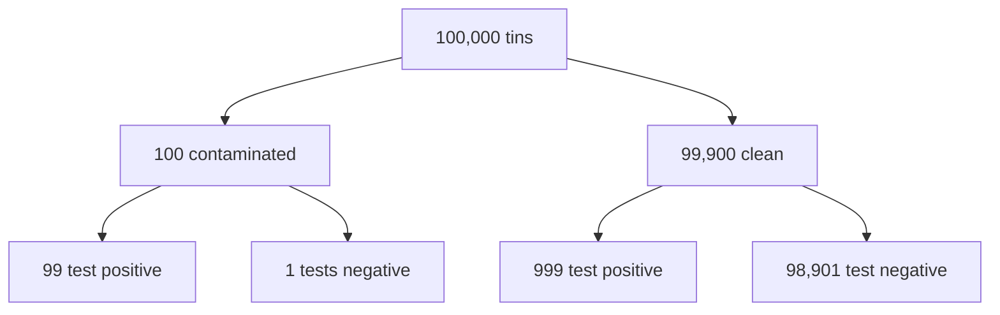

# The Test That Was 99% Accurate: Conditional Probability and Bayes' Rule

> **Part 8 of 15.** Part of the [Probability & Statistics](/fields/data-science/probability-statistics/README.md) series. It continues from [Counting the Ways](/fields/data-science/probability-statistics/counting-the-ways.md), where probability became "count the outcomes you want, over all the outcomes". By the end you will see conditional probability as one move, shrinking the crowd, and Bayes' rule as nothing more than that move seen from the other side. The scenario is invented, and every number can be checked by hand.

## Table of Contents

- [Prologue: the alarm that rang](#prologue-the-alarm-that-rang)
- [Shrink the crowd, then count again](#shrink-the-crowd-then-count-again)
- [Build the crowd: 100,000 tins](#build-the-crowd-100000-tins)
- [Two questions that sound alike](#two-questions-that-sound-alike)
- [The formula, after the fact](#the-formula-after-the-fact)
- [A second positive: beliefs move](#a-second-positive-beliefs-move)
- [Check yourself](#check-yourself)
- [Back to the story](#back-to-the-story)
- [Cheat sheet](#cheat-sheet)
- [Answers](#answers)
- [References](#references)

* * *

## Prologue: the alarm that rang

A supplier sends Mira a rapid check for a rare problem: a contaminated tin in a delivery. The leaflet is proud: **"99% accurate."** Roughly one tin in a thousand is contaminated. (Invented numbers, as always.)

Tala runs the check on a tin from the new delivery. **Positive.** She goes pale and reaches for the bin.

"Wait," says Mira. "How sure are we that this tin is actually bad?"

"Ninety-nine percent! It says so on the leaflet."

Hold that number. By the end of the page you will know it is far from the truth, and you will be able to see why without any formula.

* * *

## Shrink the crowd, then count again

Last page, probability was a count: wanted outcomes over all outcomes. Now someone hands you extra information: *"the tin tested positive."* What changes?

The crowd. You throw away everyone who does not match the clue and count again **inside what is left**.

That is all **conditional probability** is. `P(A | B)`, read "the chance of A given B", means: restrict to the crowd where B happened, then ask what share of *that* crowd also has A.

| Without the clue | With the clue |
|---|---|
| Count among all tins | Count among only the tins that tested positive |
| Denominator: everyone | Denominator: the people who match |

> ☕ **Try it before you scroll.** One tin in a thousand is contaminated. The check catches 99% of the contaminated ones, and wrongly flags 1% of the clean ones. Out of 100,000 tins, about how many will test positive? *Hint: there are two ways to be positive.*

* * *

## Build the crowd: 100,000 tins

Do not start with percentages. Start with **people-sized things you can count**: a crowd of 100,000 tins, split by what is true, then by what the test says. These are called **natural frequencies**.



*Read the leaves from the bottom up: the test is 99% right about each branch, and the branches are very unequal.*

Now apply the one move. Tala's tin tested positive, so shrink the crowd to **the positives**: 99 (really contaminated) plus 999 (false alarms) is **1,098 tins**. Only 99 of them are contaminated.

```text
chance contaminated, given positive = 99 / 1,098 = 11/122 = about 9%
```

Not 99%. About **9%**. Roughly nine alarms in ten are false. The check is not broken; the **base rate** is the issue. Contaminated tins are so rare that even a tiny false-alarm rate (1% of a huge clean crowd) produces ten times more false alarms than true catches. Ignoring that is called **base-rate neglect**, and doctors, juries and engineers all fall for it.

Check it by machine too, with exact fractions so nothing hides in rounding:

```python
from fractions import Fraction as F

crowd = 100_000
sick  = crowd * F(1, 1000)            # contaminated tins
clean = crowd - sick
tp = sick  * F(99, 100)               # contaminated and flagged
fp = clean * F(1, 100)                # clean but flagged
print(tp, fp, tp + fp)                # 99 999 1098
print(tp / (tp + fp))                 # 11/122
print(float(tp / (tp + fp)))          # 0.09016393442622951
```

The naive answer, 99/100, answers a different question. Which one?

* * *

## Two questions that sound alike

| Question | Crowd you count inside | Answer |
|---|---|---|
| `P(positive \| contaminated)`: if a tin is bad, does the test flag it? | The 100 contaminated tins | 99 / 100 = **99%** |
| `P(contaminated \| positive)`: if the test flags a tin, is it bad? | The 1,098 flagged tins | 99 / 1,098 = **about 9%** |

The leaflet reports the first. Tala needs the second. Same two events, **different crowd**, wildly different answer. The tree makes the mix-up impossible: the first question stays on the left branch, the second collects all the positives from both branches.

So how do you get from the first answer to the second without drawing a tree? That is where the famous formula comes in.

* * *

## The formula, after the fact

The tree gave `99 / (99 + 999)`. Write each piece as a probability instead of a head count and you have **Bayes' rule**:

```text
P(A | B) = P(B | A) × P(A) / P(B)
```

Here A is "contaminated" and B is "positive". Fill it in:

- `P(B | A) = 0.99`: the leaflet's number.
- `P(A) = 0.001`: the base rate.
- `P(B)`: all the ways to be positive, `0.99 × 0.001 + 0.01 × 0.999 = 0.01098`.

```text
P(A | B) = 0.99 × 0.001 / 0.01098 = 0.00099 / 0.01098 = 11/122, about 9%
```

Same answer, as it must be: the numerator is the 99 true catches (as a share of 100,000), the denominator is all 1,098 positives. The formula is the tree with the people divided out. You never need to memorize it: **rebuild the crowd, shrink it, count.** The rule just tells you how to flip `P(B | A)` into `P(A | B)`: multiply by the base rate, divide by how common the clue is.

> [!NOTE]
> The tree-of-counts way of explaining Bayesian problems is the **frequency format** studied by Gigerenzer and Hoffrage (1995). Their paper is about how people reason with it; this page uses the idea, not any of their results.

* * *

## A second positive: beliefs move

Ravi wanders in. "Just run it again."

After the first positive, the right belief is not 0.1% (before) and not 99% (the leaflet): it is **about 9%**. That is now the new starting point. Run a second check on the same tin, **assuming the two checks make independent mistakes** (a big assumption, see below), and suppose it is positive again. Shrink the crowd again: from 1,098 flagged tins, 99 contaminated and 999 clean.

- Of the 99 contaminated: about 98 flag again.
- Of the 999 clean: about 10 flag again (rounded to whole tins).

Positives now: `98 / (98 + 10) = 98/108`, about **90.7%**. Exact fractions give `363/400 = 90.75%`.

```python
p = F(11, 122)                         # belief after the first positive
p2 = F(99, 100) * p / (F(99, 100) * p + F(1, 100) * (1 - p))
print(p2, float(p2))                   # 363/400 0.9075
```

```text
before any test       0.1%
after one positive    9.0%
after two positives   90.75%
```

That is **updating**: the old answer becomes the new base rate. One positive was weak evidence against a rare event; two independent ones are strong. Nothing about the test changed. Only the starting crowd did.

> [!WARNING]
> If the second check shares the first one's flaw (same dirty reagent, same bad batch), the mistakes are not independent, and repeating it teaches you much less. Count the crowd honestly: who really passed through each branch?

* * *

## Check yourself

1. In the tree, how many of the 100,000 tins test **negative**, and how many of those are contaminated?
2. Why is `P(positive | contaminated)` not the same as `P(contaminated | positive)`? Which one is on the leaflet?
3. A school has 1,000 pupils; 10 are in the chess club; 6 of the chess club wear glasses and 90 of the other 990 wear glasses. What is the chance a pupil with glasses is in the chess club?
4. Suppose the same check, still 99% accurate, were used on a delivery where **half** the tins are contaminated. Without computing: would a positive be more or less trustworthy than 9%?
5. Why does the second positive move the belief so much further than the first?

* * *

## Back to the story

Tala is still holding the tin over the bin.

"So the leaflet was not lying," she says. "It told me how the test treats bad tins. I asked it about *this* tin."

"And this tin sits in a crowd where almost everything is fine," says Mira. "Nine alarms in ten are false. We run it again, and we check the batch code while we wait."

They run it again. Positive. Now the tin goes in the bin with a clear conscience, 90% sure rather than 99% fooled.

**Takeaway:** conditional probability is "shrink the crowd to those who match the clue, then count again"; Bayes' rule is that count read the other way, and rare things make even good tests mostly wrong when positive.

Ravi has been counting tins in his head. "That is a lot of 'about'. If I run the check on all 100,000 tins, how many alarms should I **expect** altogether?" That is a question about the *average* of a chance, and it needs its own tool. Next cup: [What to Expect](/fields/data-science/probability-statistics/what-to-expect.md).

* * *

## Cheat sheet

```text
CONDITIONAL   P(A | B) = count(A and B) / count(B)     shrink to B, count again
BAYES' RULE   P(A | B) = P(B | A) x P(A) / P(B)        the flip, with the base rate
P(B)          = all the ways to get the clue, added up

TREE OF WHOLE PEOPLE: crowd -> true state -> test result; keep only the matching leaves
P(positive | sick) is NOT P(sick | positive)     base rate decides the gap
UPDATE: yesterday's answer is today's base rate (if the tests are independent)
```

* * *

## Answers

1. 98,901 + 1 = **98,902** test negative, and **1** of them is contaminated (1/98,902, about 0.001%). A negative is very trustworthy here.
2. They count inside different crowds: the first inside the contaminated tins, the second inside the flagged tins. The leaflet reports `P(positive | contaminated)`.
3. Glasses wearers: 6 in the club plus 90 outside = 96. `6 / 96 =` **1/16**, about 6%.
4. **More** trustworthy. With 50,000 contaminated tins, 49,500 are caught and only 500 clean ones are flagged: `49,500 / 50,000 = 99%`. The base rate did the work.
5. Because the first positive already moved the starting crowd from 100 contaminated out of 100,000 to 99 out of 1,098. The second check works inside that far richer crowd.

* * *

## References

- Gigerenzer, G. and Hoffrage, U. (1995), *How to improve Bayesian reasoning without instruction: Frequency formats*, Psychological Review 102(4), 684-704. <https://doi.org/10.1037/0033-295X.102.4.684>. Bibliographic details confirmed through Crossref's record for that DOI; the publisher's page would not load here, so the paper's text and findings are not quoted.
- All counts, fractions and percentages on this page were recomputed with Python 3.14.4 using exact `fractions.Fraction`. The scenario and its rates (1 in 1,000, 99% and 1%) are invented for teaching.
