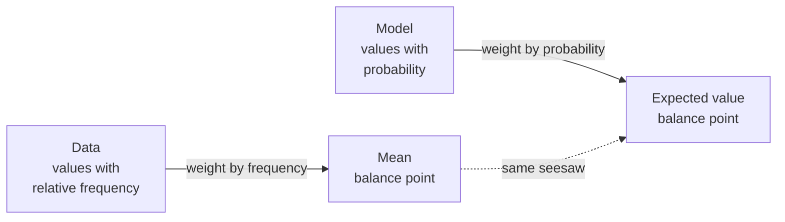

# What to Expect: Random Variables and Expected Value

<!-- related-block -->
<div class="reading-time">9 min read</div>
<!-- related-block -->
<div class="related-strip">

**Read first:** [The Test That Was 99% Accurate: Conditional Probability and Bayes' Rule](/fields/data-science/probability-statistics/the-test-that-was-99-percent-accurate.md)  ·  **See also:** [How Far From the Middle? One Question Behind Every Summary Number](/fields/data-science/probability-statistics/how-far-from-the-middle.md), [Probability & Statistics, One Sip at a Time](/fields/data-science/probability-statistics/README.md), [The Number on the Tin: Mean, Median and Mode](/fields/data-science/probability-statistics/the-number-on-the-tin.md)  ·  **Read next:** [Coins and Calls: Binomial and Poisson as Recipes](/fields/data-science/probability-statistics/coins-and-calls.md)

</div>


> **Part 9 of 15.** Part of the [Probability & Statistics](/fields/data-science/probability-statistics/README.md) series, after [The Test That Was 99 Percent Accurate](/fields/data-science/probability-statistics/the-test-that-was-99-percent-accurate.md). By the end you will know that expected value is **not a new idea**: it is the seesaw of [The Number on the Tin](/fields/data-science/probability-statistics/the-number-on-the-tin.md) and the leftover walk of [How Far From the Middle?](/fields/data-science/probability-statistics/how-far-from-the-middle.md), with probability in place of frequency.

## Table of Contents

- [Prologue: the lucky tin](#prologue-the-lucky-tin)
- [A number for every way it could go](#a-number-for-every-way-it-could-go)
- [The seesaw again](#the-seesaw-again)
- [The surprise: nobody wins 4.5](#the-surprise-nobody-wins-45)
- [What is left over, again](#what-is-left-over-again)
- [Expect, don't predict](#expect-dont-predict)
- [Shifting and adding](#shifting-and-adding)
- [Check yourself](#check-yourself)
- [Back to the story](#back-to-the-story)
- [Cheat sheet](#cheat-sheet)
- [Answers](#answers)
- [References](#references)

* * *

## Prologue: the lucky tin

Mira has an idea for the weekend market: the **lucky tin**. A customer pays 5 coins, pulls one card from a bag, and wins the prize printed on it. The bag is invented for this page, and every number can be checked by hand. Ten cards:

```text
5 cards say 0     (a sticker)
3 cards say 5     (a sachet)
1 card  says 10   (a small tin)
1 card  says 20   (the big tin)
```

"Is it a good deal for us?" asks Tala. "For them?"

"On any one pull, who knows," says Mira. "Over a whole Saturday, I would like to know what to *expect*."

Ravi, first in line, says what everyone says: "Expect the most likely thing, a sticker."

Hold that thought. It is going to be wrong, and the reason is the whole page.

> ☕ **Try it before you scroll.** If a customer pulled a card, put it back, and pulled again, 100 times, about how many coins of prizes would you hand out per pull? Just guess. *Hint: you have done a "typical value of a table" before.*

* * *

## A number for every way it could go

A **random variable** is a number attached to each way things could turn out. That is the whole definition. Pulling a card is the chance; the prize printed on it is the random variable, call it `X`. The card is not a number, the prize is.

Write down each possible `X` and how much probability it gets, and you have a **probability table**, the "who gets how much probability" list:

| Prize `x` | 0 | 5 | 10 | 20 |
|---|---|---|---|---|
| Probability `p` | 5/10 | 3/10 | 1/10 | 1/10 |

The probabilities add to 1, because *something* must happen. This table looks exactly like the frequency table from [Part 2](/fields/data-science/probability-statistics/data-types-and-frequency-tables.md), and that is not an accident. A frequency table is what a bag *did* produce. A probability table is what a bag *would* produce, in the model. **Relative frequency in the data; probability in the model.** Everything below uses that twin.

* * *

## The seesaw again

Remember the mean as a balance point: put each value on a seesaw, weighted by how often it shows up, and the mean is where it balances. Here the weights are the probabilities instead:



*The twins: swap frequency for probability and the mean becomes the expected value.*

The **expected value** is each prize times its probability, added up. Use exact fractions so nothing hides in rounding:

```python
from fractions import Fraction as F

table = {0: F(5, 10), 5: F(3, 10), 10: F(1, 10), 20: F(1, 10)}
print(sum(x * p for x, p in table.items()))   # E[X], exact
```

```text
9/2
```

That is `0*0.5 + 5*0.3 + 10*0.1 + 20*0.1 = 4.5` coins. And here is the twin at work: put the same ten cards in a tray and take the plain mean of the ten prizes.

```python
import statistics as st

tray = [0] * 5 + [5] * 3 + [10] + [20]      # the ten cards as data
print(st.fmean(tray))                       # the mean of Part 4
print(st.fmean(list(table), weights=[0.5, 0.3, 0.1, 0.1]))   # prizes weighted by probability
```

```text
4.5
4.5
```

Same number, because it is the same seesaw. With a pile of cards you take the mean; with a table of probabilities you weight. Nothing new to memorize.

So the lucky tin hands out 4.5 coins per pull *on average*, and Mira charges 5. The customer is behind by half a coin per pull. But what is "4.5" to someone holding a single card?

* * *

## The surprise: nobody wins 4.5

Look at the table. No card says 4.5. The expected value is **not a possible prize**, and that is fine, because it is not a prediction of one pull. Same story as the number on the tin: 75.2 was a score nobody gave, and it was still the balance point.

Now fix Ravi's instinct. He said "expect the most likely thing". Compare:

| Question | Answer |
|---|---|
| Most likely prize (the **mode**) | 0, with probability 0.5 |
| Expected value (the **balance point**) | 4.5 |
| Chance that a pull pays exactly the expected value | 0 |

The most likely outcome is 0 and the expected value is 4.5. They answer different questions: the mode asks "what one thing is likeliest?", the expected value asks "where does the pile of outcomes balance?". The 20-coin card is rare, but it sits far out on the seesaw and drags the balance point up. **Expected does not mean likely. It means balanced.**

> ☕ **Try it before you scroll.** Is the expected value ever a possible value? *Hint: a fair six-sided die. What is its balance point?* (Answer: 3.5, and no face says that.)

How trustworthy is the 4.5, then? Only over many pulls, which we can test. But first, the other half of the twin.

* * *

## What is left over, again

A balance point alone hides how wild the day will be. In Part 5 the leftover was the **average squared walk** from the mean. Same here, weighted by probability: the variance is the probability-weighted average of `(x - 4.5)²`, and a shortcut gives the same answer, `E[X²] - (E[X])²`. By exact fractions:

```python
EX = sum(x * p for x, p in table.items())
EX2 = sum(x * x * p for x, p in table.items())
var = EX2 - EX**2
print(EX2, var, float(var), float(var) ** 0.5)
print(st.pvariance(tray))                 # the data twin: ten cards, divide by n
```

```text
115/2 149/4 37.25 6.103277807866851
37.25
```

The variance is 37.25 coins², the standard deviation about **6.1 coins**. A typical pull misses the 4.5 by about 6 coins, which is more than the expected value itself: a lumpy game. The data twin `pvariance` agrees, since the ten cards *are* the whole bag, so we divide by `n` (Part 5's rule: everyone in the room).

* * *

## Expect, don't predict

The honest reading of "expected value" is a **long-run average**: do it many times and the average drifts to it. Do it once and anything on the table can happen. Let a computer pull cards (simulated, `random.seed(9)`):

```python
import random
random.seed(9)
for n in (10, 1000, 100000):
    xs = random.choices(list(table), weights=[0.5, 0.3, 0.1, 0.1], k=n)
    print(n, "pulls: mean", round(st.fmean(xs), 3), " share of zeros", round(xs.count(0) / n, 3))
```

```text
10 pulls: mean 3.5  share of zeros 0.5
1000 pulls: mean 4.365  share of zeros 0.512
100000 pulls: mean 4.485  share of zeros 0.502
```

Ten pulls: 3.5, a full coin off. A thousand: 4.365. A hundred thousand: 4.485, nearly the exact 4.5. Notice the share of zeros hovers around 0.5 the whole time, while the average creeps toward 4.5 without ever being a prize. Why the long-run average settles down, and how fast, is the subject of [Why Averages Behave](/fields/data-science/probability-statistics/why-averages-behave.md).

* * *

## Shifting and adding

Two rules save work, and you can check both by listing every outcome. Every customer pays 5, so the **net** result is `X - 5`:

```python
def moments(d):
    m = sum(x * p for x, p in d.items())
    return m, sum(x * x * p for x, p in d.items()) - m * m

print(moments({x - 5: p for x, p in table.items()}))     # shift every prize by -5
```

```text
(Fraction(-1, 2), Fraction(149, 4))
```

Net expected value is **-1/2**: shifting every value shifts the balance point by the same amount, and the variance stays 149/4, since a shifted walk is the same walk. Scaling by `a` multiplies the expected value by `a` and the variance by `a²`.

Now two customers' pulls added, `X + Y`, listing all 16 combinations of cards:

```python
from itertools import product
two = {}
for (a, pa), (b, pb) in product(table.items(), repeat=2):
    two[a + b] = two.get(a + b, 0) + pa * pb
print(moments(two))
```

```text
(Fraction(9, 1), Fraction(149, 2))
```

The expected total is **9 = 4.5 + 4.5**: expected values add, always. The variance also doubled to 149/2 here, because the two pulls are independent (the card is put back). That second part is a trap: variances add only when the pulls do not influence each other. Contrast `2X`, one pull paid out twice, where the variance is `4 * 37.25 = 149`, twice as big as for two separate pulls.

The rule: **expected values always add; variances add only for independent pulls.**

* * *

## Check yourself

1. A fair die: write the probability table and the expected value. Is it a possible roll?
2. The lucky tin charges 6 instead of 5. What is the customer's expected net, and what happens to the variance?
3. In 1,000 pulls, roughly how many coins of prizes does Mira hand out? Roughly how many pulls pay nothing?
4. Ravi says "expect a sticker." Which statement is true, and which is the thing he is confusing it with?
5. A pull is made twice and the prizes are added. What is the expected total, and why can the variance not simply be assumed to double?

* * *

## Back to the story

Mira prints the sign: "Lucky tin: 5 coins, prizes worth 4.5 on average." Ravi pulls once and wins the big tin. "The deal is rigged in my favour!" One pull cannot show that. Over the whole Saturday, 4.5 is what the cards will average to, and the half coin lost per customer is Mira's pay for the lumpy ride.

**Takeaway:** a random variable is a number for each way things could go, the expected value is the balance point of those numbers weighted by probability (the seesaw of Part 4), and the variance is the leftover walk (Part 5). It is what to *expect* on average, not what will happen on a single go.

Now the challenge. Tala flips a coin 3 times and counts heads. The count is a random variable with a table of its own. What are its probabilities, and what is its expected value, with no cards in sight? Next cup: [Coins and Calls](/fields/data-science/probability-statistics/coins-and-calls.md)

* * *

## Cheat sheet

```text
RANDOM VARIABLE X : a number attached to each way things could turn out
PROBABILITY TABLE : each value x with its probability p; the p add to 1
TWINS             : data -> relative frequency;  model -> probability

E[X]    = sum of x * p                (the seesaw, weighted by probability)
Var(X)  = sum of (x - E[X])^2 * p  = E[X^2] - E[X]^2
SD      = sqrt(Var)                   (back in the data's units)

E[X] need not be a possible value; it is NOT the most likely value
long run: the average of many repeats drifts to E[X]; one repeat can be anything

E[aX + b] = a E[X] + b       Var(aX + b) = a^2 Var(X)
E[X + Y]  = E[X] + E[Y]      always
Var(X + Y) = Var X + Var Y   only if X and Y are independent
```

* * *

## Answers

1. Faces 1 to 6, each with probability 1/6. `E = (1+2+3+4+5+6)/6 = 3.5`, and no face says 3.5.
2. The expected net becomes `4.5 - 6 =` **-1.5**. The variance is unchanged at 37.25, because shifting every value does not change the spread.
3. About `1000 * 4.5 =` **4,500 coins**, and about **500** pulls pay nothing (the simulation gave 512).
4. A sticker is the **most likely** single prize (probability 0.5). The expected value (4.5) is the balance point. They are different questions, and here they are far apart.
5. The expected total is `4.5 + 4.5 = 9`. Expected values always add. The variance doubles (to 149/2) only because the two pulls are independent; for dependent pulls, such as `2X`, it does not.

* * *

## References

- Python `fractions` module: `Fraction` does rational arithmetic exactly. <https://docs.python.org/3/library/fractions.html>
- Python `statistics` module: `fmean` (with `weights`), `pvariance`, `pstdev`. <https://docs.python.org/3/library/statistics.html>
- OpenStax, *Introductory Statistics 2e*, section 4.2 "Mean or Expected Value and Standard Deviation": the expected value as the long-term average, `mu = sum of x * P(x)`. <https://openstax.org/books/introductory-statistics-2e/pages/4-2-mean-or-expected-value-and-standard-deviation>
- Every number on this page was recomputed with Python 3.14.4 (exact fractions, and a seeded simulation, `random.seed(9)`); the linearity claims were checked by enumeration for one table, not proved in general.
