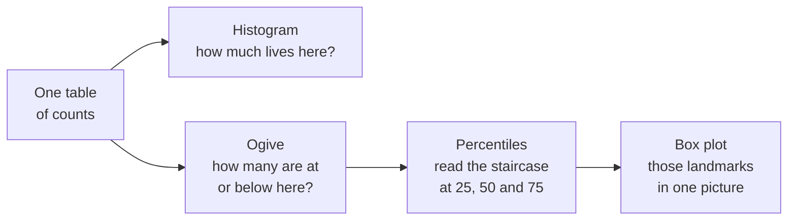

# Where Do You Stand? Percentiles, Z-Scores and the Box Plot

<!-- related-block -->
<div class="reading-time">10 min read</div>
<!-- related-block -->
<div class="related-strip">

**Read first:** [How Far From the Middle? One Question Behind Every Summary Number](/fields/data-science/probability-statistics/how-far-from-the-middle.md)  ·  **See also:** [Draw It Before You Describe It: Three Pictures of the Same Fifty Days](/fields/data-science/probability-statistics/draw-it-before-you-describe-it.md), [Probability & Statistics, One Sip at a Time](/fields/data-science/probability-statistics/README.md), [The Bell Curve: Probability as Area, and One Ruler for Every Bell](/fields/data-science/probability-statistics/the-bell-curve.md), [The Map of Leaf & Kettle: Every Idea So Far in One Walk Through the Shop](/fields/data-science/probability-statistics/the-map-of-leaf-and-kettle.md), [Two Things Moving Together: Correlation and the Line](/fields/data-science/probability-statistics/two-things-moving-together.md)  ·  **Read next:** [Counting the Ways: Probability as a Share of the List](/fields/data-science/probability-statistics/counting-the-ways.md)

</div>


> **Part 6 of 15.** Part of the [Probability & Statistics](/fields/data-science/probability-statistics/README.md) series. It continues from [How Far From the Middle?](/fields/data-science/probability-statistics/how-far-from-the-middle.md), where every summary was a stand-in for a crowd. By the end you will place any single value inside its crowd with two rulers, and see that the box plot is not a new graph to memorize but the staircase you already know, read at four marks. The scenario is invented, and every figure can be checked by hand.

## Table of Contents

- [Prologue: 84 versus 61](#prologue-84-versus-61)
- [A score needs a crowd](#a-score-needs-a-crowd)
- [Ruler 1: rank, the percentile](#ruler-1-rank-the-percentile)
- [Ruler 2: distance, the z-score](#ruler-2-distance-the-z-score)
- [Which ruler when](#which-ruler-when)
- [Fewer graphs, not more](#fewer-graphs-not-more)
- [The box plot, and the clump it cannot see](#the-box-plot-and-the-clump-it-cannot-see)
- [Check yourself](#check-yourself)
- [Back to the story](#back-to-the-story)
- [Cheat sheet](#cheat-sheet)
- [Answers](#answers)
- [References](#references)

* * *

## Prologue: 84 versus 61

Tala has taken two apprentice exams this month and tapes both results to the till.

- **Brewing:** she scored **84**.
- **Cupping:** she scored **61**.

"Brewing is my strong subject," she says.

Mira looks at the till and asks the only question that matters: "Better than what?"

It turns out the brewing exam was easy: the class averaged **70**, and scores typically landed about **7** away from that. The cupping exam was brutal: the class averaged **50**, with a typical distance of **4**. (Invented numbers, chosen to be easy to check.)

Now which result is stronger? Before you do any arithmetic, notice what you just did: you went looking for the **crowd**.

* * *

## A score needs a crowd

An 84 alone says nothing. It is a point on a number line with no landmarks. A **position** is a value *plus its crowd*, and there are two natural ways to say where a value sits in that crowd:

| Ruler | The question it asks | Name | Uses |
|---|---|---|---|
| **Rank** | What share of the crowd is below me? | Percentile | Only the order of the data |
| **Distance** | How many "typical distances" am I from the middle? | z-score | The mean and the standard deviation |

These are the same two ideas from last page in a new costume: rank is the median's attitude (count heads), distance is the mean's attitude (measure steps in spread units).

* * *

## Ruler 1: rank, the percentile

The **percentile rank** of a value is the share of the data below it. A common convention adds half of any ties, so a value is not penalized for sharing its place:

```text
percentile rank = (number below + 0.5 × number equal) / n × 100
```

Take the eight tasting scores sorted: 62, 65, 69, 70, 79, 85, 94, 100. For **85**: five values are below it, one equals it, so `(5 + 0.5) / 8 = 68.75%`. About the 69th percentile.

Run it backwards and you get the **percentile value**: the 75th percentile is the value with 75% of the data below it. Three of these have their own names:

| Name | Percentile | What it marks |
|---|---|---|
| **Q1**, first quartile | 25th | A quarter of the data are below |
| **Q2**, the median | 50th | Half are below |
| **Q3**, third quartile | 75th | Three quarters are below |

**The trap nobody mentions: different tools give different quartiles.** For the numbers 1 to 9, Python's `statistics.quantiles` returns quartiles **2.5 and 7.5** by default (`method='exclusive'`) and **3 and 7** with `method='inclusive'`. Both are legitimate: they differ in how they interpolate between data points. R's documentation lists nine quantile types, with type 7 as the default, and cites Hyndman and Fan (1996), who recommended type 8. NumPy's documentation lists the same nine, numbered the same way, with its default `linear` being type 7.

```python
import statistics as st

d = list(range(1, 10))                      # 1, 2, ..., 9
st.quantiles(d, n=4)                        # [2.5, 5.0, 7.5]  exclusive (the default)
st.quantiles(d, n=4, method='inclusive')    # [3.0, 5.0, 7.0]  inclusive
```

The advice: **pick one method, write down which, and never compare quartiles across tools.** On the pages here the quartiles use the inclusive method, which treats your data as the whole story. The story is the same under either. Only the decimals move.

* * *

## Ruler 2: distance, the z-score

The **z-score** says how many standard deviations a value sits above (positive) or below (negative) the mean:

```text
z = (x − mean) / SD
```

Now Tala's question has an answer:

| Exam | Her score | Class mean | Class SD | z-score |
|---|---|---|---|---|
| Brewing | 84 | 70 | 7 | (84 − 70) / 7 = **2.00** |
| Cupping | 61 | 50 | 4 | (61 − 50) / 4 = **2.75** |

Cupping wins. Her 61 is **2.75 typical distances** above a hard exam's middle, farther out than her 84 on an easy one. A z-score is a ruler that **converts every crowd into the same units**, which is why it lets you compare things that have different scales.

It carries one condition from last page: the mean and SD must be a fair summary of the crowd. In a two-clump crowd like Mira's tasting scores, a z-score measures distance from a middle where nobody lives, and the number is technically correct and practically useless.

> ☕ **Try it before you scroll.** Mira's 20 tasting scores have quartiles 58, 71 and 93, and no value at all between 71 and 89. If you draw a box from Q1 to Q3 with a line at the median, will the picture show the two clumps? *Hint: where does the box sit relative to the gap?*

* * *

## Which ruler when

| Situation | Ruler |
|---|---|
| Comparing across different scales (two exams, two stalls) | **z-score** |
| Skewed data, outliers, or two clumps | **Percentile** (it does not rely on a middle) |
| "Top 10%", "bottom quarter", grading on rank | **Percentile** |
| You will go on to chance and the bell curve | **z-score**: it is how the normal distribution is read, coming up |

* * *

## Fewer graphs, not more

The box plot sounds like a third or fourth graph to memorize. It is not. Look at where each picture comes from:



*Three graphs, one table. The box plot is the ogive with only its landmarks kept.*

| You want to know | Use |
|---|---|
| The **shape**: where the bulk is, any tail, any clumps | **Histogram**. Always draw this first |
| How many are at or below a value | **Ogive** |
| How **several groups** compare at a glance | **Box plot**, side by side |

The rule of thumb that saves you from drawing everything: **histogram first, to look. Box plot second, to compare groups.**

* * *

## The box plot, and the clump it cannot see

A box plot is built from five landmarks: **minimum, Q1, median, Q3, maximum.** The box runs from Q1 to Q3 (the middle half), the line inside marks the median, and the whiskers reach out to the farthest values that are not outliers.

What counts as an outlier? NIST's handbook describes the usual rule: compute `IQR = Q3 − Q1` and the **fences** `Q1 − 1.5 × IQR` and `Q3 + 1.5 × IQR`. The whiskers stop at the last data point inside the fences, and anything beyond a fence is drawn as its own dot.

For Mira's 20 scores, `Q1 = 58`, median `71`, `Q3 = 93`, so `IQR = 35` and the fences are 5.5 and 145.5. Nothing falls outside, so the whiskers run from 52 to 104:

```text
52                                                104
|-----[============|=====================]----------|
      58           71                    93
```

Now look at the histogram of the same 20 scores in classes five wide:

```text
50-54    #
55-59    #####
60-64    ###
65-69
70-74    ##
75-79
80-84
85-89    ###
90-94    ####
95-99    #
100-104  #
```

The box plot shows one tidy box with the median sitting inside it. The histogram shows **two clumps and a valley** between them. The box plot is *blind* to the valley: the box simply swallows it. That is exactly why the rule above says to look at the histogram first.

> [!NOTE]
> A box plot answers "where is the middle half, and are there outliers?" It cannot answer "how many clumps?". That is not a flaw, it is a limit. Know which question you are asking before you pick the picture.

* * *

## Check yourself

1. In the eight scores (62, 65, 69, 70, 79, 85, 94, 100), what is the percentile rank of **70**?
2. The mean of those eight is 78 and the sample SD is 13.94. What is the z-score of **100**?
3. A test has mean 60 and SD 10. A student scores 55. What is the z-score, and what does it say?
4. Mira's 20 tasting scores form two clumps. Which ruler would you trust for a single taster's position, and why?
5. A data set has Q1 = 10 and Q3 = 18. Is a value of 31 an outlier by the 1.5 × IQR rule? What about 29?

* * *

## Back to the story

Tala looks at her two exam results again. The 84 she was proud of was the *easier exam*. The 61 she was embarrassed by was **2.75 typical distances** above a brutal crowd. She peels the brewing result off the till and moves the cupping one to the top.

"So I am better at cupping."

"Than most people on that exam," says Mira. "Which is the only kind of better there is."

Every question so far has been about **what already happened**: where the data came from, what kind it is, what it looks like, its middle, its spread, one value's place in it. Then Ravi leans over the counter with a different kind of question: "How many people will walk in tomorrow?"

That is not a question about data you have. It is a question about **chance**, and it needs a different language. Next cup: [Counting the Ways](/fields/data-science/probability-statistics/README.md).

**Takeaway:** a value has no position without its crowd. Rank counts heads, distance counts spreads, and the box plot is the ogive with its landmarks kept.

* * *

## Cheat sheet

```text
PERCENTILE RANK = (below + 0.5 × equal) / n × 100        uses order only, resistant
z-SCORE         = (x − mean) / SD                         units of "typical distance"

Q1 / median / Q3 = 25th / 50th / 75th percentile    IQR = Q3 − Q1
Quartile method differs between tools: pick one, say which, do not mix.

BOX PLOT: min, Q1, median, Q3, max;  fences at Q1 − 1.5×IQR and Q3 + 1.5×IQR
          whiskers stop at the last point inside the fences; beyond = drawn alone

HISTOGRAM FIRST (shape, clumps).   BOX PLOT SECOND (compare groups).
```

* * *

## Answers

1. Three values are below 70 (62, 65, 69) and one equals it, so `(3 + 0.5) / 8 × 100 =` **43.75%**.
2. `(100 − 78) / 13.94 ≈` **1.58**. (With the population SD of 13.04 it would be 1.69: the divisor choice from last page again.)
3. `(55 − 60) / 10 =` **−0.5**: half a typical distance **below** the middle. A little under average, nothing dramatic.
4. The **percentile rank**. The mean and SD describe a middle where nobody lives, so a z-score would measure distance from an empty spot. Rank only counts how many are below, and that stays meaningful.
5. `IQR = 8`, so the fences are `10 − 12 = −2` and `18 + 12 = 30`. **31 is an outlier** (beyond 30), **29 is not** (inside the fence).

* * *

## References

- NIST/SEMATECH e-Handbook of Statistical Methods, *Box Plot*: quartiles, the 1.5 × IQR fences and the outlier circles. <https://www.itl.nist.gov/div898/handbook/eda/section3/boxplot.htm>
- Python `statistics` module: `quantiles` with `method='exclusive'` (default) and `'inclusive'`. Verified against Python 3.14.4. <https://docs.python.org/3/library/statistics.html>
- NumPy `percentile`: nine selectable methods, default `'linear'`. This page did not run NumPy (not installed in the test environment), so no NumPy output is shown. <https://numpy.org/doc/stable/reference/generated/numpy.percentile.html>
- Hyndman, R. J. and Fan, Y. (1996), *Sample Quantiles in Statistical Packages*, The American Statistician 50(4). <https://doi.org/10.1080/00031305.1996.10473566>. The origin of the nine-type numbering. The paper itself was not retrievable here, so it is cited through the R documentation below, which names it and states its recommendation.
- R documentation, `quantile` (package stats): nine types, default type 7, Hyndman and Fan (1996) cited, type 8 recommended by them. <https://stat.ethz.ch/R-manual/R-devel/library/stats/html/quantile.html>
- Every other number on this page was recomputed with Python 3.14.4.
