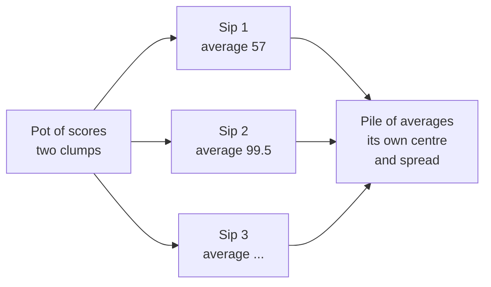

# Why Averages Behave: The Sip You Could Take a Thousand Times

<!-- related-block -->
<div class="reading-time">10 min read</div>
<!-- related-block -->
<div class="related-strip">

**Read first:** [The Bell Curve: Probability as Area, and One Ruler for Every Bell](/fields/data-science/probability-statistics/the-bell-curve.md)  ·  **See also:** [How Far From the Middle? One Question Behind Every Summary Number](/fields/data-science/probability-statistics/how-far-from-the-middle.md), [Probability & Statistics, One Sip at a Time](/fields/data-science/probability-statistics/README.md), [Stir the Pot First: Population, Sample, and Why We Guess](/fields/data-science/probability-statistics/stir-the-pot-population-and-sampling.md), [The Courtroom for Numbers: Could Plain Luck Do This?](/fields/data-science/probability-statistics/the-courtroom-for-numbers.md)  ·  **Read next:** [How Sure Are You? Confidence Intervals](/fields/data-science/probability-statistics/how-sure-are-you.md)

</div>


> **Part 12 of 15.** Part of the [Probability & Statistics](/fields/data-science/probability-statistics/README.md) series. It joins two halves: the sip from a stirred pot in [Stir the Pot First](/fields/data-science/probability-statistics/stir-the-pot-population-and-sampling.md) and the bell from [The Bell Curve](/fields/data-science/probability-statistics/the-bell-curve.md). By the end you will see an average as a random thing with its own shape and spread, and know exactly what makes it trustworthy and what cannot. Every number below was simulated with a fixed seed.

## Table of Contents

- [Prologue: two sips, two answers](#prologue-two-sips-two-answers)
- [An average is a random thing](#an-average-is-a-random-thing)
- [Fact 1: the spread of averages shrinks](#fact-1-the-spread-of-averages-shrinks)
- [Fact 2: the averages pile into a bell](#fact-2-the-averages-pile-into-a-bell)
- [What the theorem does not say](#what-the-theorem-does-not-say)
- [The failure path: a biased sip](#the-failure-path-a-biased-sip)
- [Check yourself](#check-yourself)
- [Back to the story](#back-to-the-story)
- [Cheat sheet](#cheat-sheet)
- [Answers](#answers)
- [References](#references)

* * *

## Prologue: two sips, two answers

Mira stirs the pot of tasting scores and takes a sip of two cups: the average is **57**. Tala stirs the same pot, sips two cups, and gets **99.5**. Same pot, same stirring, two honest averages, 42 points apart.

"One of us is wrong," says Tala.

"Neither," says Mira. "Each of us took a *different sip*. The surprise is not that we disagree. The surprise is how rarely a bigger sip would let us."

Hold that thought: **the average of a sample is not a fixed fact. It is whatever that sip happened to say.**

* * *

## An average is a random thing

The population here is the 20 tasting scores from earlier: two clumps, one around 58 and one around 93. Its mean is **75.20** and its standard deviation (dividing by N, since this is the whole pot) is **17.22**. Nobody scored near 75, so this is not a bell.

Now do what no real shop can afford: take the sip over and over and write each average down. The collection of those averages has its own shape, centre and spread. It is called the **sampling distribution** of the mean: *what the sip would say if you took the sip ten thousand times.* You never see it in real life (you get one sip), but you can reason about it, and that reasoning is the whole of statistical inference.



*One pot, many sips, one pile of averages. The pile is what we study.*

> ☕ **Try it before you scroll.** Sips of 30 cups instead of 2: will the pile of averages be wider, narrower, or the same width as the pile for 2? And will it still have two clumps? *Hint: how likely is a 30-cup sip to be all low scores?*

* * *

## Fact 1: the spread of averages shrinks

Here is the experiment. Draw n scores from the pot (with replacement, so each draw is independent), average them, repeat 10,000 times. Python's `random` module, seeded so you can reproduce it:

```python
import random, statistics as st, math

pop = [52,55,55,58,58,58,62,62,62,71,71,89,89,89,93,93,94,94,95,104]
mu = st.fmean(pop)
sigma = st.pstdev(pop)
print(f"population: N={len(pop)} mean={mu:.2f} sigma={sigma:.2f}")

random.seed(12)
REPS = 10000
print(f"{'n':>3} {'mean of means':>14} {'SD of means':>12} {'sigma/sqrt(n)':>14}")
store = {}
for n in (1, 2, 5, 30):
    means = [st.fmean(random.choices(pop, k=n)) for _ in range(REPS)]
    store[n] = means
    print(f"{n:>3} {st.fmean(means):>14.2f} {st.stdev(means):>12.2f} {sigma/math.sqrt(n):>14.2f}")
```

Output (simulated, Python 3.14.4):

```text
population: N=20 mean=75.20 sigma=17.22
  n  mean of means  SD of means  sigma/sqrt(n)
  1          75.29        17.23         17.22
  2          75.11        12.29         12.18
  5          75.08         7.61          7.70
 30          75.23         3.14          3.14
```

Two things to read off:

- **The centre does not move.** The average of the averages sits at 75, the population mean, for every n. An average aimed at the right target stays aimed at it.
- **The spread falls like sigma over root n.** The spread of the averages is called the **standard error**, and it tracks `sigma / sqrt(n)` closely: 17.22 for one cup, about 12 for two, 3.14 for thirty. That is the **law of large numbers** in its working form: bigger sips cluster tighter around the truth.

The root is the catch. To halve the spread you need **four times** the sample, not twice. Going from 30 cups to 120 cups buys a second halving; going from 2 to 4 buys only a little. Precision gets expensive.

In plain terms for n = 30: about **89%** of the simulated averages landed within 5 points of 75.2, against only **41%** for n = 2.

* * *

## Fact 2: the averages pile into a bell

Spread is only half the shape. Print the pile of averages as a text histogram, one `#` per 100 averages:

```python
def hist(means, lo=50, hi=106, w=4, scale=100):
    out = []
    for a in range(lo, hi, w):
        c = sum(a <= m < a + w for m in means)
        out.append(f"{a:>3}-{a+w-1:<3} {'#'*round(c/scale)}")
    return "\n".join(out)
for n in (1, 2, 30):
    print(f"\nn={n}  (each # = 100 of {REPS} sample means)")
    print(hist(store[n]))
```

The run printed three histograms; here are n = 2 and n = 30 (simulated):

```text
n=2  (each # = 100 of 10000 sample means)
 50-53  #
 54-57  #######
 58-61  ###########
 62-65  #######
 66-69  ###
 70-73  ############
 74-77  ####################
 78-81  ##########
 82-85  ######
 86-89  ###
 90-93  ##########
 94-97  #####
 98-101 ###
102-105 

n=30  (each # = 100 of 10000 sample means)
 50-53  
 54-57  
 58-61  
 62-65  
 66-69  #####
 70-73  ##############################
 74-77  ##############################################
 78-81  #################
 82-85  ##
 86-89  
 90-93  
 94-97  
 98-101 
102-105 
```

With n = 2 you still see the pot's two clumps, now smeared, with a new bump in the middle: one low cup plus one high cup averages to about 75. With n = 30 the two clumps are **gone**. One hump, centred near 75, falling away on both sides. A little lopsided, but a bell shape from a pot that has no bell in it.

That is the **central limit theorem**: take the average of many independent draws, and the distribution of that average approaches a normal curve, whatever the shape of the crowd. NIST's handbook puts it this way: as the sample size becomes large, the sampling distribution of the mean becomes approximately normal regardless of the distribution of the original variable, is centred at the population mean, and has standard deviation approaching sigma over root N.

Why a bell? One way to see it: averaging smooths. A single cup can be extreme. Thirty cups would need nearly *all* to be extreme in the same direction for the average to be, and the many ways of mixing highs and lows land in the middle. That is exactly the stacking-up-of-small-pushes picture from the bell curve page.

* * *

## What the theorem does not say

These are the places people trip, so be exact:

| Tempting claim | What is true |
|---|---|
| "Large samples make the data bell-shaped." | No. The 30 scores in your sample still show two clumps. Only the **average** over repeated samples is bell-shaped. |
| "With n of at least 30, it is guaranteed normal." | No. 30 is a **rule of thumb**, not a theorem. The theorem is a limit as n grows; how fast it arrives depends on how lopsided the crowd is. Heavily skewed crowds need more. |
| "It works for any population." | It needs a mean and standard deviation to exist (and independent draws). Some populations, such as the Cauchy distribution, have neither, so the theorem does not apply. |
| "More data fixes everything." | It shrinks **random** error only. See below. |

The condition comes from the statement in the MIT 18.05 reading (variables "having mean μ and standard deviation σ"). NIST's handbook lists the Cauchy distribution's mean and standard deviation as undefined, which is why it is the standard example of a crowd the theorem cannot tame.

* * *

## The failure path: a biased sip

Remember the Saturday-morning poll: the first 30 people through the door were not a fair copy of the 4,000. Suppose Mira's sips only ever come from the high clump, the 11 scores of 70 or more (mean **89.27**), because those are the cups people stay to finish. Repeat the experiment on that biased pool:

```python
biased = [x for x in pop if x >= 70]
print(f"biased pool: {len(biased)} scores, mean={st.fmean(biased):.2f}")
random.seed(12)
print(f"{'n':>5} {'mean of means':>14} {'SD of means':>12}")
for n in (2, 30, 500):
    means = [st.fmean(random.choices(biased, k=n)) for _ in range(2000)]
    print(f"{n:>5} {st.fmean(means):>14.2f} {st.stdev(means):>12.2f}")
print("true population mean:", round(mu,2))
```

```text
biased pool: 11 scores, mean=89.27
    n  mean of means  SD of means
    2          89.41         6.64
   30          89.23         1.73
  500          89.28         0.42
true population mean: 75.2
```

(simulated.) The spread shrinks beautifully, 6.64 then 1.73 then 0.42, and the averages are **confidently, tightly wrong**: they converge on 89.3, not 75.2. A bigger biased sample is just a more precise answer to the wrong question. The law of large numbers promises convergence to the mean *of what you are drawing from*. Whether that is the pot you care about is decided before any arithmetic, by who gets sipped. Stirring the pot is not optional, and no n compensates for skipping it.

* * *

## Check yourself

1. A population has sigma = 20. What is the standard error of the average of n = 25? Of n = 100?
2. You want to cut the standard error to one third. By what factor must n grow?
3. The 30 scores in a sample show two clumps. Does the CLT say the *sample* should look like a bell?
4. A survey of 10,000 people is taken only from one city's train station. Does the large n help you estimate the whole country?
5. True or false: "n = 30 guarantees the sample mean is normal."

* * *

## Back to the story

Mira and Tala line up their 2-cup averages: 57 and 99.5. "We were never going to agree," says Tala. "A two-cup sip is a wide pile." Mira takes a 30-cup sip, then Tala does, and their averages come out within a few points of each other, both near 75.

"So how close is close enough?" asks Tala. "If I say the true average is 75, how wrong could I be?"

Mira smiles. "Now you can answer that. You know the pile of averages is a bell, centred on the truth, with spread sigma over root n. Use the bell page's tricks on it." That is the next cup: [How Sure Are You?](/fields/data-science/probability-statistics/how-sure-are-you.md)

**Takeaway:** an average is a random thing with its own distribution; its spread shrinks as sigma over root n, its shape tends to a bell whatever the crowd looks like, and none of that cures a biased sample.

**Challenge:** you took one 30-cup sip and got an average of 78. You do not know the true mean. Using only the bell and the standard error, what range would you be willing to bet on?

* * *

## Cheat sheet

```text
SAMPLING DISTRIBUTION  the averages you would get from many samples of size n
CENTRE                 the population mean (unbiased sampling)
STANDARD ERROR         sigma / sqrt(n)  (4x the sample to halve it)
LAW OF LARGE NUMBERS   averages converge on the mean of what you draw from
CENTRAL LIMIT THEOREM  averages approach a bell, whatever the crowd (mean and SD must exist)
n >= 30                rule of thumb only; skewed crowds need more
BIAS                   not cured by n: tight and wrong
```

* * *

## Answers

1. `20 / sqrt(25) = 4` and `20 / sqrt(100) = 2`.
2. Nine times: the standard error goes as 1/sqrt(n), so n must grow by 3 squared.
3. No. The theorem is about the distribution of **averages** across samples. A single sample still looks like its population.
4. No. It shrinks the random error about the station crowd, which is a different population. The estimate converges to the wrong value, tightly.
5. False. It is a rule of thumb. The theorem is a limit, and the speed depends on the shape of the population.

* * *

## References

- NIST/SEMATECH e-Handbook of Statistical Methods, section 1.3.6.6.1, *Normal Distribution*, "Theoretical Justification - Central Limit Theorem": the statements of approximate normality, the centre at the population mean and the sigma over root N standard deviation. <https://www.itl.nist.gov/div898/handbook/eda/section3/eda3661.htm>
- MIT OpenCourseWare 18.05, Introduction to Probability and Statistics (Spring 2022), Class 6 reading on the central limit theorem and the law of large numbers, section 5.2: for independent, identically distributed variables with mean μ and standard deviation σ, the average is approximately N(μ, σ²/n) for large n, and the precise statement is that the cdf of the standardized average converges to the standard normal cdf. Read from the PDF's page images, since its text layer is not extractable. <https://ocw.mit.edu/courses/18-05-introduction-to-probability-and-statistics-spring-2022/mit18_05_s22_class06-prep-b.pdf>
- OpenStax *Introductory Statistics 2e*, section 7.1, *The Central Limit Theorem for Sample Means*: sample means tend toward a normal distribution for any population shape, centred on the population mean with standard deviation σ/√n (the standard error); the text gives no minimum sample size, so "n ≥ 30" on this page is a rule of thumb, not something that source states. <https://openstax.org/books/introductory-statistics-2e/pages/7-1-the-central-limit-theorem-for-sample-means-averages>
- NIST/SEMATECH e-Handbook, section 1.3.6.6.3, *Cauchy Distribution*: the mean and standard deviation are listed as undefined. <https://www.itl.nist.gov/div898/handbook/eda/section3/eda3663.htm>
- Python `random` module: `seed` and `choices` (draws with replacement); seeded output is reproducible on a given Python version but may change between versions. <https://docs.python.org/3/library/random.html>
- Every number on this page was simulated or recomputed with Python 3.14.4, standard library only, seed 12.
