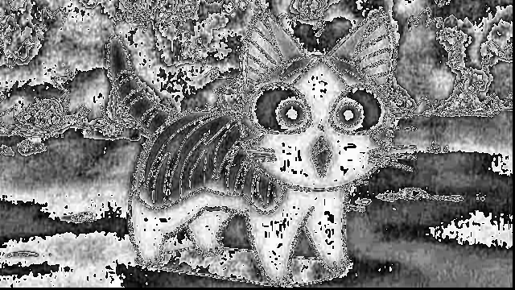

# convolution.ipynb

<div class="code-file">

Notebook from the repository  ·  [View on GitHub](https://github.com/AhmedYousriSobhi/aCupOfTea/blob/main/fields/deep-learning/workspace/convolution/convolution.ipynb)  ·  [Raw file](https://raw.githubusercontent.com/AhmedYousriSobhi/aCupOfTea/main/fields/deep-learning/workspace/convolution/convolution.ipynb)  ·  [Open in Colab](https://colab.research.google.com/github/AhmedYousriSobhi/aCupOfTea/blob/main/fields/deep-learning/workspace/convolution/convolution.ipynb)

</div>


```python
import numpy as np
from PIL import Image
```

```python
# Load image using PIL
image_path = 'data/cat.jpg'
pil_image = Image.open(image_path)

# Convert PIL image to numpy array
image_array = np.array(pil_image)

# Display information about the image
print('Image shape:', image_array.shape)
print('Image data type:', image_array.dtype)

# Display the image
display(pil_image)
```

```output
Image shape: (360, 640, 3)
Image data type: uint8
```


```python
kernel = np.array([[0, 1, 0], [1, 1, 1], [0, 1, 0]])
result = np.zeros(image_array.shape)
# Output array
for ii in range(image_array.shape[0] - 3):
    for jj in range(image_array.shape[1] - 3):
        result[ii, jj] = (image_array[ii:ii+3, jj:jj+3] * kernel).sum()
# Print result
print(result)
```

```output
[[[2735. 2735. 2735.]
  [2694. 2694. 2694.]
  [2689. 2689. 2689.]
  ...
  [   0.    0.    0.]
  [   0.    0.    0.]
  [   0.    0.    0.]]

 [[2721. 2721. 2721.]
  [2693. 2693. 2693.]
  [2700. 2700. 2700.]
  ...
  [   0.    0.    0.]
  [   0.    0.    0.]
  [   0.    0.    0.]]

 [[2704. 2704. 2704.]
  [2684. 2684. 2684.]
  [2704. 2704. 2704.]
  ...
  [   0.    0.    0.]
  [   0.    0.    0.]
  [   0.    0.    0.]]

 ...

 [[   0.    0.    0.]
  [   0.    0.    0.]
  [   0.    0.    0.]
  ...
  [   0.    0.    0.]
  [   0.    0.    0.]
  [   0.    0.    0.]]

 [[   0.    0.    0.]
  [   0.    0.    0.]
  [   0.    0.    0.]
  ...
  [   0.    0.    0.]
  [   0.    0.    0.]
  [   0.    0.    0.]]

 [[   0.    0.    0.]
  [   0.    0.    0.]
  [   0.    0.    0.]
  ...
  [   0.    0.    0.]
  [   0.    0.    0.]
  [   0.    0.    0.]]]
```

```python
# COnvert to image
result_image = Image.fromarray(result.astype(np.uint8))

# Save the image
output_path = 'data/cat_output.jpg'
result_image.save(output_path)

# Show the image
display(result_image)
```


