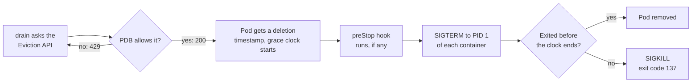

# Draining a GPU Node With a Three-Day Run on It

> **Page 9 of the [Kubernetes series](/fields/devops/kubernetes/README.md).** One word means two opposite things in Slurm and Kubernetes, and a three-day training run pays for the difference. By the end you'll know which command is the polite one, what the termination clock does to your checkpoint, and how to set up a run that survives maintenance night. Written against Kubernetes 1.31 and later. The story is invented; **nothing here was run on a live cluster**. Claims trace to the docs in the references, and the commands and YAML follow the patterns those docs show. The Python sketch is mine, not the docs'.

## Table of Contents

[Two tickets](#two-tickets-one-word) · [The hotel](#the-hotel-with-two-signs) · [The night manager](#what-the-night-manager-does) · [The packing clock](#the-packing-clock) · [Five ways](#five-ways-the-guest-leaves-without-the-suitcase) · [The refusing guest](#the-guest-who-refuses-to-leave) · [Maintenance night](#a-maintenance-night-that-keeps-the-checkpoint) · [Back to the tickets](#back-to-the-two-tickets)

* * *

## Two tickets, one word

Tuesday, two tickets land in the platform team's queue.

**Ticket 1** (from a Slurm cluster): *"I drained `gpu-09` for a firmware update. My job on it is still running. Is drain broken?"*

**Ticket 2** (from the new Kubernetes cluster): *"I drained `gpu-17` for a firmware update. My three-day training run is gone, and so is the checkpoint I was counting on."*

Sana, who ran Slurm for six years and joined the Kubernetes team last month, reads both. Ticket 1 is a customer who expected `drain` to evict. Ticket 2 is Sana, three hours ago, who expected it not to.

Same word. Opposite behavior. To see why, think of the node as a hotel.

* * *

## The hotel with two signs

In Slurm, **drain** hangs a *No Vacancy* sign: guests already inside stay until they check out, and nobody new gets a room. In Kubernetes, there are two signs, and they have different names:

| You want | Slurm | Kubernetes |
|---|---|---|
| No new guests, current guests stay | `State=DRAIN` | **`kubectl cordon`** |
| No new guests, and current guests leave | cancel the jobs | **`kubectl drain`** |
| Reopen the hotel | `State=RESUME` | `kubectl uncordon` |

The `kubectl drain` reference says it plainly: the node is marked unschedulable "to prevent new pods from arriving", and then `drain` evicts what is there. Cordon is the first half of drain. **Slurm's drain is Kubernetes's cordon.** What `kubectl drain` adds is the night manager knocking on every door.

One caveat from the drain task page: pods that tolerate the `node.kubernetes.io/unschedulable` taint can still land on a cordoned node, so *No Vacancy* has exceptions.

☕ **Try it before you scroll.** Sana wants the run to finish on its own, with `gpu-17` empty by Friday. Which command does she run tonight? *(Hint: which sign did she actually want?)*

`kubectl cordon gpu-17`, then wait. But some night she will need the room back, and the manager will have to knock. What exactly does he do?

* * *

## What the night manager does

Per the `kubectl drain` reference, the manager evicts every guest through the Eviction API, which respects PodDisruptionBudgets. He never touches the staff (DaemonSet pods) and refuses to start unless you say `--ignore-daemonsets`, which on a GPU node is always, because the device plugin is a DaemonSet. He refuses guests with `emptyDir` luggage unless you pass `--delete-emptydir-data`. And he **waits**: "You should not operate on the machine until the command completes."

Two flags will matter in a minute:

- `--grace-period` defaults to `-1`, meaning "use the pod's own value". **Any number you type overrides what the job's author chose.**
- `--timeout` defaults to `0`, which means wait forever.

So the manager knocks. How long does the guest get to pack?

* * *

## The packing clock



*The knock (SIGTERM) comes with a deadline. The lock change (SIGKILL) comes after it.*

The default clock, `terminationGracePeriodSeconds`, is **30 seconds**. Fine for a web server. Absurd for a trainer that needs minutes to write a checkpoint.

The preStop hook and your shutdown run on the same clock. The pod lifecycle docs say a slow hook means you "must modify `terminationGracePeriodSeconds`", and the kubelet grants only one 2-second extension. The docs never say "one shared budget" in a sentence; it follows from the flow, so budget as if it were.

Exit codes tell the story afterward. By the usual 128 + signal convention, **137** is SIGKILL (the lock change) and **143** is a SIGTERM nobody caught.

If that sounds like Slurm's [`KillWait`](/fields/schedulers/slurm-preemption/slurm-preemption-requeue-signals.md), it is: ask politely, wait a fixed time, kill. So how does a run still die even when the manager is polite?

* * *

## Five ways the guest leaves without the suitcase

**1. Nobody answers the door.** The knock goes to PID 1, and PID 1 is special. Per `pid_namespaces(7)`, `init` receives a signal from inside its namespace or from an ancestor only if it installed a handler for it. A trainer with no SIGTERM handler never hears the eviction. Only SIGKILL is forced through. The usual accomplice is `command: ["sh", "-c", "python train.py"]`: the shell is PID 1 and Python never hears the knock. Use the exec form (`["python", "train.py"]`) or `exec python train.py`. A sketch of the trainer side (my own illustration, not from the Kubernetes docs, and not run):

```python
import signal

stop = False
def on_sigterm(signum, frame):
    global stop
    stop = True                      # only set a flag: do NOT write the checkpoint in here

signal.signal(signal.SIGTERM, on_sigterm)

for step in range(start_step, total_steps):
    train_one_step()
    if stop:                         # the knock arrived: finish this step, then pack
        save_checkpoint(step)        # to the PVC, not to emptyDir
        raise SystemExit(0)
    if step % 1000 == 0:
        save_checkpoint(step)        # regular checkpoints: the SIGTERM one is the last chance
```

**2. Ten minutes to pack, thirty seconds on the clock.** A checkpoint that takes minutes against a 30-second clock ends in SIGKILL mid-write: a half-file that looks like a checkpoint. Set `terminationGracePeriodSeconds` to your measured worst case plus margin. The sneaky version hides in a runbook: a copied `drain --grace-period=30` quietly throws away the number the author chose.

**3. The suitcase stayed in the room.** The `--delete-emptydir-data` error is a warning, not an obstacle, and adding the flag to silence it is the temptation. Anything on `emptyDir` or the container's own filesystem dies with the pod. Checkpoints belong on a PersistentVolumeClaim, and the trainer must look there at startup.

**4. The hotel bans the guest after a few evictions.** A Job gives up after `backoffLimit` failed pods (default 6), and by default an evicted pod is a failed pod. Enough maintenance nights and the run is declared failed for reasons that have nothing to do with its code. The fix is the **pod failure policy**, stable since 1.31 (the rule is in the Job spec below). Disruptions such as preemption, API-initiated eviction (that is `drain`), taint-based eviction, node-pressure eviction and graceful node shutdown get a `DisruptionTarget` condition, and an `Ignore` rule keeps them out of the `backoffLimit` count. Exceeding the container's own limits does not get it, "because the disruptions were probably caused by the Pod and would reoccur on retry". It requires `restartPolicy: Never`.

**5. One guest is the whole party.** For a single-pod run, one eviction is one failure. For a distributed run, evicting one pod usually takes the whole job down, because collectives stall when a rank disappears. Whether your framework aborts, hangs or restarts elastically is something to find out before the window, not during it. ([Isolating GPU Workloads](/fields/devops/kubernetes/isolating-gpu-workloads.md) covers why such jobs are scheduled all-or-nothing.)

Which leaves one more question: can someone say "this guest does not leave tonight"?

* * *

## The guest who refuses to leave

A **PodDisruptionBudget (PDB)** limits how many pods of a set may be down at once through voluntary disruptions, and a drain is one. If an eviction would break the budget, the Eviction API answers `429 Too Many Requests` and `drain` keeps retrying. With the default infinite `--timeout`, the night manager stands at the door until morning.

Two things from the docs change the plan for a training Job:

- **For a restartable batch Job, the docs' advice is not to create a PDB.** The Job controller replaces the pod anyway, which is why the pod failure policy exists.
- **A PDB on pods not owned by a Deployment, ReplicaSet, StatefulSet, ReplicationController or a custom resource with a `scale` subresource is restricted.** Only an integer `minAvailable` works: no `maxUnavailable`, no percentage. A copied `maxUnavailable: 0` recipe will not do what you expect.

If you want a hard brake anyway, an integer `minAvailable` equal to the pod count does it. Then set a `--timeout`, so a stuck drain names the pod in the way. Know that `--disable-eviction` skips the PDB check entirely ("use with caution"): it turns a protected run into a dead one. And decide who may override the brake before the night you need it, because automated node upgrades drain nodes too.

* * *

## A maintenance night that keeps the checkpoint

```bash
# 0. What is on the node? (all namespaces)
kubectl get pods --all-namespaces --field-selector spec.nodeName=gpu-17 -o wide

# 1. Hang the No Vacancy sign. This is Slurm's "drain".
kubectl cordon gpu-17

# 2. Choose: wait for the run, or evict it on purpose.
#    Waiting works because nothing new can arrive.
#    --timeout defaults to 30s, so set it to cover the remaining run:
kubectl wait --for=condition=complete job/train-llm --timeout=96h

# 3. Rehearse the eviction without doing it.
kubectl drain gpu-17 --ignore-daemonsets --dry-run=server

# 4. Evict, with a timeout, and WITHOUT overriding the pod's grace period.
kubectl drain gpu-17 --ignore-daemonsets --timeout=30m

# 5. Maintain only after the command returns.

# 6. Reopen, and confirm the GPUs are advertised again.
kubectl uncordon gpu-17
kubectl describe node gpu-17 | grep -A2 'nvidia.com/gpu'
```

What the docs back: `--field-selector spec.nodeName=...` is a supported Pod selector; `kubectl wait --for=condition=<name>` and `--timeout` are in the reference, though its examples use Pods, so the `Complete` condition on a Job comes from the Job's own status; `drain --dry-run=server` is in the drain reference. Step 4 leaves out `--grace-period` and `--delete-emptydir-data` on purpose: if drain asks for the second, find out why a pod has local data. The `30m` is an example; pick it to cover your longest checkpoint.

And a Job that makes the whole story survivable. The `podFailurePolicy` rule and `restartPolicy: Never` are the pattern from the Job docs; the rest is a typical GPU trainer, not run:

```yaml
apiVersion: batch/v1
kind: Job
metadata:
  name: train-llm
spec:
  backoffLimit: 3
  podFailurePolicy:
    rules:
    - action: Ignore                 # evictions do not count as failures
      onPodConditions:
      - type: DisruptionTarget
        status: "True"
  template:
    spec:
      restartPolicy: Never           # required for podFailurePolicy
      terminationGracePeriodSeconds: 900   # measured worst-case checkpoint + margin
      containers:
      - name: trainer
        image: registry.example/trainer:1.0
        command: ["python", "train.py", "--resume-latest", "--ckpt-dir", "/ckpt"]   # exec form: python is PID 1
        resources:
          limits:
            nvidia.com/gpu: 8
        volumeMounts:
        - name: ckpt
          mountPath: /ckpt
      volumes:
      - name: ckpt
        persistentVolumeClaim:
          claimName: train-llm-ckpt  # outlives the pod
```

`--resume-latest` is a flag of the example trainer, not of Kubernetes. It makes the replacement pod **resume** instead of start over: the Job controller creates the new pod, and nothing makes it continue where the old one stopped. Slurm's `--requeue` has the same trap: a requeue is a re-run, not a resume.

* * *

## Back to the two tickets

Ticket 1 gets a one-line answer: Slurm's drain is a cordon, and nothing is broken. Ticket 2 takes longer. Sana's `kubectl drain` did exactly what its reference says: cordon, evict, SIGTERM, 30 seconds, SIGKILL. Her trainer had no handler, her checkpoint sat on the wrong volume, and the clock was the default, so she hit four of the five doors. One Slurm habit survives the move, though: Slurm can warn a job minutes before its end with `--signal=B:USR1@300`, and as far as I could find Kubernetes has no equivalent, so the pod hears about an eviction only when the clock has already started. Checkpoint **regularly**, and treat the SIGTERM checkpoint as the last chance, not the only one. (A pod stuck in `Terminating` is a cousin of [Kill task failed](/fields/schedulers/slurm-cluster-operations/slurm-kill-task-failed.md); for the Slurm-side order of operations see [rolling reboot order](/fields/schedulers/slurm-cluster-operations/slurm-reboot-order.md).)

**Takeaway:** in Kubernetes the gentle command is `cordon`, and `drain` is the one that evicts. Give a long run a handler, a PVC, a measured grace period and a pod failure policy *before* maintenance night.

**Challenge:** your 64-GPU job spans eight nodes and one must be patched. Cordon or drain, and what do the other seven ranks do when one leaves? Find out on a test run. Related: [Broken Pods, the Rogues' Gallery](/fields/devops/kubernetes/broken-pods-rogues-gallery.md) shows what 137 and 143 look like in the wild, and the next page, [The Pod Killed With Memory to Spare](/fields/devops/kubernetes/oomkilled-with-memory-to-spare.md), is a SIGKILL that no drain asked for.

* * *

## References

- [kubectl drain (Kubernetes reference)](https://kubernetes.io/docs/reference/kubectl/generated/kubectl_drain/): cordon, eviction, flags and defaults.
- [Safely drain a node (Kubernetes task)](https://kubernetes.io/docs/tasks/administer-cluster/safely-drain-node/): PDB behaviour and the unschedulable taint caveat.
- [API-initiated eviction](https://kubernetes.io/docs/concepts/scheduling-eviction/api-eviction/): the 200, 429 and 500 answers and the termination steps.
- [Pod lifecycle: termination of Pods](https://kubernetes.io/docs/concepts/workloads/pods/pod-lifecycle/#pod-termination): grace period, preStop, SIGTERM, SIGKILL.
- [Disruptions: pod disruption conditions](https://kubernetes.io/docs/concepts/workloads/pods/disruptions/): the `DisruptionTarget` reasons.
- [Job: pod failure policy and backoff limit](https://kubernetes.io/docs/concepts/workloads/controllers/job/#pod-failure-policy): `Ignore`, `restartPolicy: Never`, stable since 1.31.
- [Specifying a PodDisruptionBudget](https://kubernetes.io/docs/tasks/run-application/configure-pdb/): arbitrary workloads and the integer `minAvailable` restriction.
- [kubectl wait](https://kubernetes.io/docs/reference/kubectl/generated/kubectl_wait/) and [Field selectors](https://kubernetes.io/docs/concepts/overview/working-with-objects/field-selectors/): `--timeout` default, `spec.nodeName`.
- [pid_namespaces(7)](https://man7.org/linux/man-pages/man7/pid_namespaces.7.html): signals to the init process of a PID namespace.
