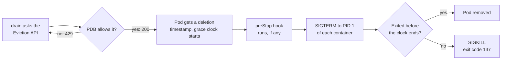

# Draining a GPU Node With a Three-Day Run on It

> **Page 9 of the [Kubernetes series](/fields/devops/kubernetes/README.md).** A Slurm admin types the command she has typed a hundred times, and Kubernetes throws a three-day training run out of the building. By the end you'll know which command is the polite one, what the termination clock does to your checkpoint, and how to set up a run that survives maintenance night. Written against Kubernetes 1.31 and later. The story is invented; **nothing here was run on a live cluster**. Claims trace to the docs in the references, and the commands and YAML follow the patterns those docs show. The Python sketch is mine, not the docs'.

## Table of Contents

[Check-in](#check-in-the-word-she-already-knew) · [Two signs](#two-signs-on-the-door) · [The manager](#what-the-night-manager-actually-does) · [The clock](#the-packing-clock) · [Five ways](#five-ways-the-guest-leaves-without-the-suitcase) · [The PDB](#the-guest-who-refuses-to-leave) · [Runbook](#a-maintenance-night-that-keeps-the-checkpoint) · [Slurm mirror](#the-slurm-mirror) · [Back to Sana](#back-to-sana)

* * *

## Check-in: the word she already knew

Sana ran Slurm clusters for six years. Her new employer runs Kubernetes, and tonight `gpu-17` needs a firmware update. The node has eight GPUs and one pod on it: a training run, three days into a four-day job.

She knows what to do. In Slurm you **drain** a node: running jobs finish, nothing new starts, and when the node is empty you do your maintenance. So she types `kubectl drain gpu-17`.

The pod is gone within the minute. The checkpoint she was counting on is not where she thought it was.

Think of the node as a hotel. In Slurm, "drain" hangs a *No Vacancy* sign on the door: current guests stay until they check out. In Kubernetes, `drain` hangs the sign **and sends the night manager to knock on every room**. Same word. Very different night.

* * *

## Two signs on the door

| You want | Slurm | Kubernetes |
|---|---|---|
| No new guests, current guests stay | `scontrol update NodeName=n State=DRAIN Reason="..."` | **`kubectl cordon <node>`** |
| No new guests **and** current guests leave | cancel the jobs | **`kubectl drain <node>`** |
| Reopen the hotel | `State=RESUME` | `kubectl uncordon <node>` |

The `kubectl drain` reference says it plainly: the node is marked unschedulable "to prevent new pods from arriving", and then `drain` evicts the pods. Cordon is the first half of drain. Slurm's meaning of drain is the cordon.

One catch on a GPU node. Pods that tolerate the `node.kubernetes.io/unschedulable` taint can still land on a cordoned node (drain task page).

☕ **Try it before you scroll.** Sana wants the pod to finish on its own and `gpu-17` empty by Friday. Which command does she run tonight? *(Hint: which sign did she actually want?)*

`kubectl cordon gpu-17`. Then she waits, or picks the moment to evict on purpose. But what does the night manager do when the moment comes?

* * *

## What the night manager actually does

Per the `kubectl drain` reference, it evicts through the Eviction API (respecting PodDisruptionBudgets), never deletes DaemonSet pods and refuses to run without `--ignore-daemonsets` (always needed on a GPU node: the device plugin is a DaemonSet), refuses `emptyDir` pods without `--delete-emptydir-data`, and **waits**: "You should not operate on the machine until the command completes."

Two flags bite later. `--grace-period` defaults to `-1`, "use the pod's own value", so **any number you type overrides what the job's author set**. `--timeout` defaults to `0`, which means wait forever.

So the manager knocks. How long does the guest get to pack?

* * *

## The packing clock



*The knock (SIGTERM) comes with a deadline. The lock change (SIGKILL) comes after it.*

What the pod lifecycle docs say, and what follows from it:

- **The default is 30 seconds** (`terminationGracePeriodSeconds`). Fine for a web service, far too short for a trainer that needs minutes to write a checkpoint.
- **The preStop hook and your shutdown share the clock.** A slow hook means you "must modify `terminationGracePeriodSeconds`", and the kubelet grants only one 2-second extension. The docs never say "one shared budget" in a sentence; it follows from the flow, so budget as if it were.
- **The knock goes to the main process of each container**, PID 1. By the usual 128 + signal convention, exit code 137 is a SIGKILL (128 + 9) and 143 is a SIGTERM that nothing caught (128 + 15).

It is Slurm's [`KillWait`](/fields/schedulers/slurm-preemption-requeue-signals.md) in different clothes: ask, wait a fixed time, kill. So which guests don't hear the knock at all?

* * *

## Five ways the guest leaves without the suitcase

Suppose Sana got it right and the pod is evicted later, on purpose. The run can still die five ways.

### 1. Nobody answers the door

PID 1 is special. Per `pid_namespaces(7)`, `init` receives a signal from inside its namespace or from an ancestor namespace only if it installed a handler for it. A trainer with no SIGTERM handler never hears the eviction. Only SIGKILL is forced through.

The second trap is the shell wrapper. With `command: ["sh", "-c", "python train.py"]` the shell is PID 1 and Python never hears the knock. Use the exec form (`["python", "train.py"]`) or `exec python train.py` inside the shell.

A trainer-side sketch (my own illustration of the idea, not from the Kubernetes docs, and not run):

```python
import signal

stop = False
def on_sigterm(signum, frame):
    global stop
    stop = True                      # only set a flag: do NOT write the checkpoint in here

signal.signal(signal.SIGTERM, on_sigterm)

for step in range(start_step, total_steps):
    train_one_step()
    if stop:                         # the knock arrived: finish this step, then pack
        save_checkpoint(step)        # to the PVC, not to emptyDir
        raise SystemExit(0)
    if step % 1000 == 0:
        save_checkpoint(step)        # regular checkpoints: the SIGTERM one is the last chance
```

### 2. The guest needs ten minutes to pack and gets thirty seconds

A checkpoint that takes minutes against a 30-second clock ends in SIGKILL mid-write: a half-file that looks like a checkpoint. Set `terminationGracePeriodSeconds` on the pod to your measured worst case plus margin.

The sneaky version lives in the runbook: a copied `drain --grace-period=30` quietly throws away the number the job's author chose.

### 3. The suitcase was left in the room

The `--delete-emptydir-data` error is a warning, not an obstacle, and adding the flag to silence it is the temptation. Anything on `emptyDir` or the container's own filesystem dies with the pod. Checkpoints belong on a PersistentVolumeClaim, and the trainer must look there when it starts.

### 4. The hotel bans the guest after a few evictions

A Job gives up after `backoffLimit` failed pods (default 6), and by default an evicted pod is a failed pod. Enough maintenance nights and the run is declared failed for reasons that have nothing to do with its code.

The fix is the **pod failure policy**, stable since 1.31 (rule in the Job spec below). Disruptions such as preemption, API-initiated eviction (that is `drain`), taint-based eviction, node-pressure eviction and graceful node shutdown get a `DisruptionTarget` condition, and an `Ignore` rule keeps them out of the `backoffLimit` count. Exceeding the container's own limits does not get it, "because the disruptions were probably caused by the Pod and would reoccur on retry". It requires `restartPolicy: Never`.

### 5. One guest is the whole party

For a single-pod run, one eviction is one failure. For a distributed run, evicting one pod usually takes the whole job down, because collectives stall when a rank disappears. Whether your framework aborts, hangs or restarts elastically is something to find out before the window, not during it. ([Isolating GPU Workloads](/fields/devops/kubernetes/isolating-gpu-workloads.md) covers why such jobs are scheduled all-or-nothing.)

So who can say "this guest does not leave tonight"?

* * *

## The guest who refuses to leave

A **PodDisruptionBudget (PDB)** limits how many pods of a set may be down at once through voluntary disruptions, and a drain is one. If an eviction would break the budget, the Eviction API answers `429 Too Many Requests`, and `drain` keeps retrying. The default `--timeout` is infinite, so a stuck drain is a night manager standing at the door until morning.

Two things the docs say that change the plan for a training Job:

- **For a restartable batch Job, the docs' advice is to not create a PDB.** The Job controller replaces the pod anyway, which is exactly why the pod failure policy above exists.
- **A PDB on pods owned by a Job is restricted.** For pods not controlled by Deployment, ReplicaSet, StatefulSet, ReplicationController or a custom resource with a `scale` subresource, only an integer `minAvailable` works, not `maxUnavailable` and not a percentage. A copied `maxUnavailable: 0` recipe will not do what you expect.

If you want a hard brake anyway, an integer `minAvailable` equal to the pod count does it. Then set a `--timeout` so a stuck drain names the pod in the way, and know that `--disable-eviction` skips the check entirely: it turns a protected run into a dead one. Decide who may override the brake before the night you need it, because automated node upgrades drain nodes too.

* * *

## A maintenance night that keeps the checkpoint

```bash
# 0. What is on the node? (all namespaces)
kubectl get pods --all-namespaces --field-selector spec.nodeName=gpu-17 -o wide

# 1. Hang the No Vacancy sign. This is Slurm's "drain".
kubectl cordon gpu-17

# 2. Choose: wait for the run, or evict it on purpose.
#    Waiting works because nothing new can arrive.
#    --timeout defaults to 30s, so set it to cover the remaining run:
kubectl wait --for=condition=complete job/train-llm --timeout=96h

# 3. Rehearse the eviction without doing it.
kubectl drain gpu-17 --ignore-daemonsets --dry-run=server

# 4. Evict, with a timeout, and WITHOUT overriding the pod's grace period.
kubectl drain gpu-17 --ignore-daemonsets --timeout=30m

# 5. Maintain only after the command returns.

# 6. Reopen, and confirm the GPUs are advertised again.
kubectl uncordon gpu-17
kubectl describe node gpu-17 | grep -A2 'nvidia.com/gpu'
```

What the docs back for these commands: `--field-selector spec.nodeName=...` is a supported Pod selector; `kubectl wait --for=condition=<name>` and its `--timeout` are in the reference, though its examples use Pods, so the `Complete` condition on a Job comes from the Job's own status; and `drain --dry-run=server` is in the drain reference.

Step 4 leaves out `--grace-period` and `--delete-emptydir-data` on purpose. If drain asks for the second, stop and find out why a pod has local data. The `30m` is an example: pick it to cover your longest checkpoint, and read the error if it expires.

And a Job spec that makes the whole story survivable. The `podFailurePolicy` rule and `restartPolicy: Never` are the pattern from the Job docs; the rest is a typical GPU trainer, not run:

```yaml
apiVersion: batch/v1
kind: Job
metadata:
  name: train-llm
spec:
  backoffLimit: 3
  podFailurePolicy:
    rules:
    - action: Ignore                 # evictions do not count as failures
      onPodConditions:
      - type: DisruptionTarget
        status: "True"
  template:
    spec:
      restartPolicy: Never           # required for podFailurePolicy
      terminationGracePeriodSeconds: 900   # measured worst-case checkpoint + margin
      containers:
      - name: trainer
        image: registry.example/trainer:1.0
        command: ["python", "train.py", "--resume-latest", "--ckpt-dir", "/ckpt"]   # exec form: python is PID 1
        resources:
          limits:
            nvidia.com/gpu: 8
        volumeMounts:
        - name: ckpt
          mountPath: /ckpt
      volumes:
      - name: ckpt
        persistentVolumeClaim:
          claimName: train-llm-ckpt  # outlives the pod
```

`--resume-latest` is a flag of the example trainer, not of Kubernetes. It is the part that makes the replacement pod **resume** instead of start over: the Job controller creates the new pod, and nothing makes it continue where the old one stopped.

* * *

## The Slurm mirror

| Slurm | Kubernetes |
|---|---|
| `State=DRAIN` | `kubectl cordon` |
| Cancel the jobs | `kubectl drain` |
| [`KillWait`](/fields/schedulers/slurm-preemption-requeue-signals.md) (30 s on the sites I read) | `terminationGracePeriodSeconds` (30 s default) |
| `--requeue` | A replacement pod. Either way, **a requeue is a re-run, not a resume** |
| `--signal=B:USR1@300`, a warning before the end | As far as I could find, none: the clock has already started when the pod hears |
| [Rolling reboot order](/fields/schedulers/slurm-reboot-order.md) | Cordon, wait or drain, maintain, uncordon |

The missing row is the lesson. Checkpoint **regularly**, and treat the SIGTERM checkpoint as the last chance, not the only one. A pod stuck in `Terminating` is a cousin of [Kill task failed](/fields/schedulers/slurm-kill-task-failed.md).

* * *

## Back to Sana

Her `kubectl drain` did exactly what its reference page says: cordon, evict, SIGTERM, wait 30 seconds, SIGKILL. Her trainer had no handler, no checkpoint on a PVC and the default clock, so it hit four of the five doors. She wanted the sign on the door. The word on the keyboard sent the manager.

**Takeaway:** in Kubernetes the gentle command is `cordon`, and `drain` is the one that evicts. Give a long run a handler, a PVC, a measured grace period and a pod failure policy *before* maintenance night.

**Challenge:** your 64-GPU job spans eight nodes and one must be patched. Cordon or drain, and what do the other seven ranks do when one leaves? Find out on a test run. Related: [Broken Pods, the Rogues' Gallery](/fields/devops/kubernetes/broken-pods-rogues-gallery.md) shows what exit codes 137 and 143 look like in the wild.

* * *

## References

- [kubectl drain (Kubernetes reference)](https://kubernetes.io/docs/reference/kubectl/generated/kubectl_drain/): cordon, eviction, flags and defaults.
- [Safely drain a node (Kubernetes task)](https://kubernetes.io/docs/tasks/administer-cluster/safely-drain-node/): PDB behaviour and the unschedulable taint caveat.
- [API-initiated eviction](https://kubernetes.io/docs/concepts/scheduling-eviction/api-eviction/): the 200, 429 and 500 answers and the termination steps.
- [Pod lifecycle: termination of Pods](https://kubernetes.io/docs/concepts/workloads/pods/pod-lifecycle/#pod-termination): grace period, preStop, SIGTERM, SIGKILL, forced deletion.
- [Disruptions: pod disruption conditions](https://kubernetes.io/docs/concepts/workloads/pods/disruptions/): the `DisruptionTarget` reasons.
- [kubectl wait](https://kubernetes.io/docs/reference/kubectl/generated/kubectl_wait/) and [Field selectors](https://kubernetes.io/docs/concepts/overview/working-with-objects/field-selectors/): `--timeout` default, `spec.nodeName`.
- [Job: pod failure policy and backoff limit](https://kubernetes.io/docs/concepts/workloads/controllers/job/#pod-failure-policy): `Ignore`, `restartPolicy: Never`, stable since 1.31.
- [Specifying a PodDisruptionBudget](https://kubernetes.io/docs/tasks/run-application/configure-pdb/): arbitrary workloads and the integer `minAvailable` restriction.
- [pid_namespaces(7)](https://man7.org/linux/man-pages/man7/pid_namespaces.7.html): signals to the init process of a PID namespace.
