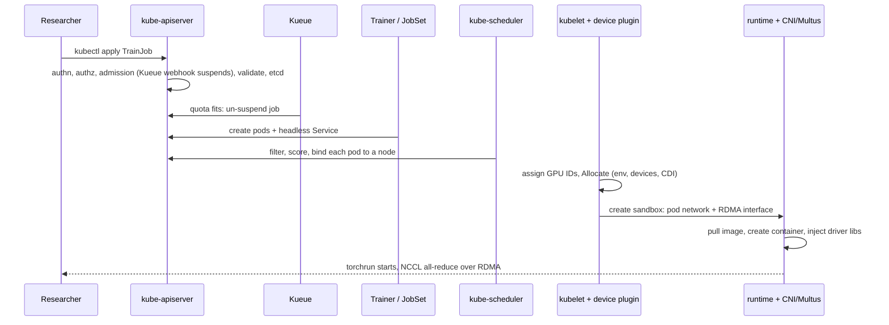

# The Job Execution Journey: From `kubectl apply` to the First All-Reduce

<!-- related-block -->

13 min read

<!-- related-block -->

**Read first:** [Isolating GPU Workloads: Taints, Labels and the Device Plugin](/fields/devops/kubernetes/isolating-gpu-workloads.md)  ·  **See also:** [RDMA, InfiniBand and GPUDirect: Taking the CPU Out of the Way](/fields/system-administration/ai-storage-and-fabric/rdma-infiniband-gpudirect.md)

> **Page 8 of the [Kubernetes series](/fields/devops/kubernetes/README.md).** A distributed training job passes through about a dozen components before its first gradient crosses the network. This page follows one 8-GPU job through all of them, in the order they actually run, and fact-checks a popular description of that journey along the way. By the end you'll know which component to blame when a job is stuck, and you'll be able to narrate the whole path in an interview without the three mistakes most descriptions make.

## Table of Contents
- [The Job Execution Journey: From `kubectl apply` to the First All-Reduce](#the-job-execution-journey-from-kubectl-apply-to-the-first-all-reduce)
  - [Table of Contents](#table-of-contents)
  - [Where is my job?](#where-is-my-job)
  - [The popular version, fact-checked](#the-popular-version-fact-checked)
  - [Stop 1: the API server's four gates](#stop-1-the-api-servers-four-gates)
  - [Stop 2: Kueue says "not yet"](#stop-2-kueue-says-not-yet)
  - [Stop 3: the operator builds the job](#stop-3-the-operator-builds-the-job)
  - [Stop 4: kube-scheduler picks nodes](#stop-4-kube-scheduler-picks-nodes)
  - [Try it before you scroll](#try-it-before-you-scroll)
  - [Stop 5: the kubelet and the device plugin](#stop-5-the-kubelet-and-the-device-plugin)
  - [Stop 6: network first, then containers](#stop-6-network-first-then-containers)
  - [The whole journey on one page](#the-whole-journey-on-one-page)
  - [When it gets stuck: which stop to check](#when-it-gets-stuck-which-stop-to-check)
    - [References](#references)

---

## Where is my job?

A researcher runs `kubectl apply -f training-job.yaml` for an 8-GPU run: two nodes, four GPUs each. The command returns instantly: `trainjob.trainer.kubeflow.org/llama-ft created`.

Then nothing. No pods. `kubectl get pods` shows an empty list for ten minutes.

She messages the platform team: "Kubernetes lost my job." It didn't. Her job is sitting, on purpose, at stop 2 of a six-stop journey, exactly where the cluster was designed to park it. The platform engineer who knows the stops finds it in thirty seconds. The one who doesn't starts restarting things.

Let's learn the stops.

---

## The popular version, fact-checked

A widely shared description of this journey has five steps. It's a good skeleton with three real errors, and they matter because they send you to the wrong component when something breaks.

| Step in the popular version | Verdict | What's actually true |
|----------------------------|---------|----------------------|
| 1. API server authenticates, validates the custom resource, stores it in etcd | **Mostly right** | It also **authorizes** the request and runs **admission control**, which can change or reject it, before validation and storage |
| 2. The PyTorch Operator watches for `PyTorchJob`s and creates a launcher pod, worker pods and headless Services | **Outdated, and out of order** | Kubeflow Trainer v2's `TrainJob` replaces framework-specific CRDs like `PyTorchJob`. "Launcher" is an MPI concept; `PyTorchJob` used master and worker. And with Kueue, the operator creates no pods until the job is admitted |
| 3. Kueue intercepts unscheduled pods, gang-schedules them and binds them to nodes | **Wrong about what Kueue is** | Kueue is a job **queueing and admission** controller. It holds whole jobs suspended until quota allows, then lets them start; **kube-scheduler** places and binds the pods |
| 4. The kubelet asks the device plugin over gRPC; the plugin finds free GPU PCIe addresses and has the runtime mount drivers and CUDA libraries | **Partly right** | The kubelet's device manager tracks and assigns device IDs; the plugin's `Allocate` tells the kubelet how to expose them; the **NVIDIA Container Toolkit** injects the driver libraries. The CUDA toolkit libraries come from the container image |
| 5. The runtime pulls images and boots containers; Multus adds RDMA interfaces via SR-IOV; NCCL uses them | **Right, but the order is reversed** | The pod's network, including Multus's extra interfaces, is set up when the pod sandbox is created, **before** the training containers start |

Now the stops, in the order they really happen.

---

## Stop 1: the API server's four gates

Every request to Kubernetes goes through `kube-apiserver`, and the official docs describe it as a series of gates:

1. **Authentication**: who are you? Client certificate, token, or an identity provider. Fail: HTTP 401.
2. **Authorization**: are you allowed to create this, in this namespace? Usually RBAC. Fail: HTTP 403.
3. **Admission control**: modules that can **modify or reject** the object. The docs stress the difference: if any admission controller rejects, the request is rejected immediately, and admission controllers can also set defaults.
4. **Validation and storage**: the object is checked against its schema (for a custom resource, the schema its CRD defines) and written to **etcd**.

Gate 3 is the one people forget, and it's where our job's fate gets decided. Kueue installs an admission webhook. When the `TrainJob` arrives in a namespace that uses a Kueue queue, the webhook marks the job **suspended** before it's even stored. That's why the researcher's pods never appeared.

---

## Stop 2: Kueue says "not yet"

Kueue's own README describes it precisely: a job-level manager that decides **when a job should be admitted to start** (as in, pods can be created) and **when it should stop**. The original Kueue announcement on the Kubernetes blog explains the design choice: rather than replacing kube-scheduler, Kueue uses the job's **suspend** field to say "start" or "wait," and **delegates the actual pod-to-node scheduling to kube-scheduler**.

So Kueue never touches a pod. It works one level up:

1. The suspended job joins a **queue**.
2. When it reaches the head of its ClusterQueue, Kueue checks whether **all** of the job's resource requests fit the available **quota**. By default it never admits part of a job.
3. If they fit, Kueue un-suspends the job, optionally adding node selectors for the right kind of nodes.

That's Kueue's main defense for **all-or-nothing** behavior, and its docs are honest about the limits. Quota alone is **blind to node layout**: eight GPUs of quota doesn't guarantee two nodes with four free GPUs each. Two more mechanisms close the gap:

| Mechanism | What it adds |
|-----------|-------------|
| **Topology Aware Scheduling (TAS)** | Kueue only admits the job if all its pods fit into the requested topology domains, checking real placement before committing |
| **`waitForPodsReady`** | A timeout-based safety net: if an admitted job's pods aren't all running in time, Kueue suspends it again and requeues it |

Our researcher's job is here: queued behind two other teams' jobs, waiting for quota. Nothing is lost. It's in line.

> [!NOTE]
> Kueue isn't the only option. Volcano is a separate batch **scheduler** that does place pods itself, and recent Kubernetes releases have been adding native gang scheduling to kube-scheduler ([page 7](/fields/devops/kubernetes/isolating-gpu-workloads.md#concept-3-training-jobs-need-all-or-nothing)). Know which one your cluster runs before you debug.

---

## Stop 3: the operator builds the job

Once admitted, the training operator turns one high-level object into the pieces a distributed job needs.

The current Kubeflow project, **Kubeflow Trainer v2**, replaces the old per-framework CRDs (`PyTorchJob`, `TFJob`, `MPIJob`) with a single **`TrainJob`**, which points at a reusable **training runtime** such as `torch-distributed`. Under the hood, Trainer v2 translates each `TrainJob` into a **JobSet**, a Kubernetes API for running a group of Jobs as one unit, which creates:

- the **pods** for each training node,
- a **headless Service**, so pods can find each other by stable DNS names, which is how `torchrun`'s nodes locate their rendezvous point,
- and the environment `torchrun` needs (node count, ranks, master address), filled in by the runtime.

If your cluster still runs the older Training Operator v1, a `PyTorchJob` produces a **master** pod and **worker** pods with Services. The "launcher" pod in the popular description belongs to **MPIJob**, where a launcher starts `mpirun` across workers.

---

## Stop 4: kube-scheduler picks nodes

Now there are pods, and each one is **unscheduled**. kube-scheduler takes them one by one (or as a group, with native gang scheduling) through two phases:

- **Filter**: drop nodes that can't run the pod. Not enough free `nvidia.com/gpu`? Out. A taint the pod doesn't tolerate? Out. Doesn't match the node selector Kueue added? Out.
- **Score**: rank the survivors and pick the best.

Then it **binds** the pod: it records the chosen node name on the pod object through the API server. That's all "scheduling" means in Kubernetes. Nothing has started running yet.

This is also where [page 7's](/fields/devops/kubernetes/isolating-gpu-workloads.md) taints, tolerations and affinity do their work, here in kube-scheduler, not in Kueue.

---

## Try it before you scroll

☕ Three stuck jobs. At which stop is each one waiting?

1. The `TrainJob` exists, but `kubectl get pods` shows nothing for that job.
2. The pods exist, all `Pending`, with an event saying `0/12 nodes are available: insufficient nvidia.com/gpu`.
3. The pods are assigned to nodes, but stuck in `ContainerCreating`.

Answers: (1) **stop 2**: Kueue hasn't admitted it, so check the workload's status and the queue; (2) **stop 4**: kube-scheduler can't find room, often because Kueue's quota said yes but no node has enough free GPUs, exactly the gap TAS closes; (3) **stop 5 or 6**: on the node, so check device allocation, image pulls and network attachment.

---

## Stop 5: the kubelet and the device plugin

On each chosen node, the **kubelet** notices a pod bound to it and starts making it real. For the GPUs, three components cooperate, and the popular description blurs them together.

**The kubelet's device manager does the bookkeeping.** The NVIDIA device plugin, running as a DaemonSet, registered with the kubelet over gRPC on a Unix socket under `/var/lib/kubelet/device-plugins/` and has been streaming its list of healthy GPUs ever since (`ListAndWatch`). The kubelet only reports the **count** to the API server; it keeps the device IDs itself and decides which ones this pod gets. A plugin can suggest a preferred set (`GetPreferredAllocation`), useful for picking GPUs that share an NVLink or PCIe switch.

**The device plugin says how to expose them.** The official docs say `Allocate` is called **during container creation** so the plugin can run device-specific steps and instruct the kubelet how to make the devices available: environment variables, device nodes, mounts, or, since the kubelet gained support for it (GA in Kubernetes 1.31), fully qualified **CDI** device names.

**The NVIDIA Container Toolkit does the injection.** When the container runtime creates the container, NVIDIA's toolkit, either as a runtime hook or through a CDI specification generated with `nvidia-ctk cdi generate`, injects the selected GPUs' device nodes and the host's **driver** libraries into the container.

What's *not* injected: the **CUDA toolkit**. NVIDIA's toolkit docs note that you don't need the CUDA toolkit on the host at all, only the driver. CUDA libraries like cuBLAS and NCCL come from the container image. That's why one node can run containers built for different CUDA versions, as long as the host driver is new enough for all of them.

> [!TIP]
> There's a newer path. **Dynamic Resource Allocation (DRA)**, GA since Kubernetes 1.34, lets a workload describe the devices it needs and leaves it to the scheduler to allocate actual devices. Device plugins still dominate GPU clusters today, but DRA is where Kubernetes device management is heading.

---

## Stop 6: network first, then containers

Before any of your containers start, the kubelet asks the container runtime (containerd or CRI-O) to create the pod's **sandbox**, and that's when networking is set up, by calling the cluster's CNI plugins. Only then are images pulled and the training containers created.

The default pod network is an **overlay**, fine for web traffic and far too slow for all-reduces. So GPU clusters add a second network:

- **Multus** is a **meta-plugin**: it doesn't implement networking itself, it calls other CNI plugins, so a pod can have its normal interface **plus** extra ones described by `NetworkAttachmentDefinition` resources.
- The **SR-IOV device plugin** advertises a NIC's **virtual functions** (slices of one physical card that look like separate PCIe devices) as schedulable resources, and the **SR-IOV CNI** plugs one into the pod. Alternatively, an **RDMA shared device plugin** exposes RDMA devices to pods without slicing.
- **NVIDIA's Network Operator** installs these pieces, along with the networking driver and the peer-memory support that GPUDirect RDMA needs.

Then the containers start, `torchrun` finds its peers through the headless Service, and NCCL's first all-reduce goes over the RDMA interface, ideally GPU memory to network card to GPU memory, with no CPU in the way ([RDMA and GPUDirect](/fields/system-administration/ai-storage-and-fabric/rdma-infiniband-gpudirect.md)).

The first gradient has crossed the network. Six stops, about a dozen components.

---

## The whole journey on one page

| Stop | Component | Decides | Common mix-up |
|------|-----------|---------|---------------|
| 1 | kube-apiserver (+ etcd) | Whether the request is allowed and well-formed | Forgetting authorization and admission |
| 2 | Kueue | **When** the whole job may start | Thinking it schedules or binds pods |
| 3 | Training operator / JobSet | **What** pods and Services exist | `PyTorchJob` "launcher" pods |
| 4 | kube-scheduler | **Where** each pod runs | Crediting Kueue with placement |
| 5 | kubelet, device plugin, NVIDIA Container Toolkit | **Which** GPUs, and how they appear in the container | Thinking CUDA libraries come from the host |
| 6 | Container runtime, CNI, Multus | The pod's networks, then its containers | Network set up after containers start |

---

## When it gets stuck: which stop to check

| Symptom | Stop | First command |
|---------|------|---------------|
| `kubectl apply` fails with 401 or 403 | 1 | Check your kubeconfig credentials and RBAC (`kubectl auth can-i create trainjobs`) |
| `apply` rejected with a webhook error | 1 | Read the message: an admission webhook (often Kueue or a policy engine) refused it |
| Job exists, no pods | 2 | `kubectl get workloads -n <ns>` and the ClusterQueue's status |
| Pods `Pending`, `insufficient nvidia.com/gpu` | 4 | `kubectl describe pod`: quota admitted it but no node fits; consider TAS |
| Pods `Pending`, `untolerated taint` | 4 | Tolerations and selectors ([page 7](/fields/devops/kubernetes/isolating-gpu-workloads.md)) |
| `ContainerCreating` for a long time | 5-6 | `kubectl describe pod` events: image pull, device allocation, or network attachment errors |
| Containers run, NCCL is slow or falls back to TCP | 6 | Check the pod has its RDMA interface and NCCL sees it ([NCCL benchmark guide](/fields/benchmarks/nccl.md)) |
| Admitted job requeued after a timeout | 2 | `waitForPodsReady` fired: some pods never became ready |

**Takeaway:** the API server admits the request, Kueue decides when the whole job may start, the operator decides what pods exist, kube-scheduler decides where they run, the kubelet and device plugin decide which GPUs they get, and the network is plumbed before the containers start, so when a job is stuck, find the stop before you touch anything.

Back to the [series README](/fields/devops/kubernetes/README.md).

### References
- [Kubernetes: Controlling Access to the Kubernetes API (authentication, authorization, admission, storage)](https://kubernetes.io/docs/reference/access-authn-authz/controlling-access/)
- [Kubernetes blog: Introducing Kueue (suspend, delegation to kube-scheduler)](https://kubernetes.io/blog/2022/10/04/introducing-kueue)
- [Kueue: All-or-nothing scheduling (quota admission, TAS, waitForPodsReady)](https://kueue.sigs.k8s.io/docs/concepts/all_or_nothing/)
- [Kueue repository README](https://github.com/kubernetes-sigs/kueue)
- [Kubeflow Trainer: Migrating to Trainer v2 (TrainJob replaces PyTorchJob)](https://kubeflow.org/docs/components/trainer/operator-guides/migration)
- [Kubeflow blog: Introducing Kubeflow Trainer V2](https://blog.kubeflow.org/trainer/intro/)
- [Kubernetes: Device Plugins (registration, ListAndWatch, Allocate, CDI)](https://kubernetes.io/docs/concepts/extend-kubernetes/compute-storage-net/device-plugins/)
- [NVIDIA Container Toolkit: Architecture Overview](https://docs.nvidia.com/datacenter/cloud-native/container-toolkit/latest/arch-overview.html)
- [Kubernetes blog: Kubernetes v1.34, DRA has graduated to GA](https://kubernetes.io/blog/2025/09/01/kubernetes-v1-34-dra-updates/)
- [NVIDIA developer blog: NVIDIA Network Operator (Multus, SR-IOV, RDMA shared device plugin)](https://developer.nvidia.com/blog/?p=34099)
- [Red Hat: Demystifying Multus](https://www.redhat.com/en/blog/demystifying-multus)