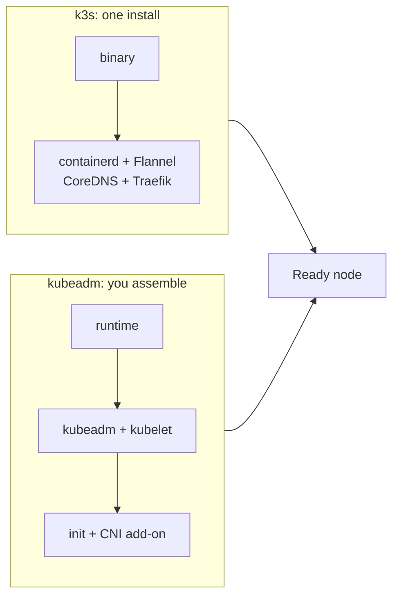
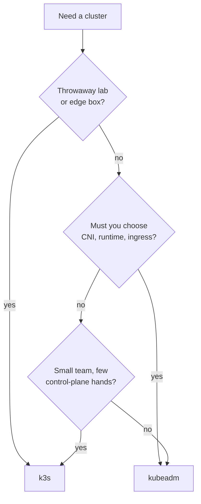

# k3s vs kubeadm: Furnished Flat or Empty Unit?

> **Part 11 of the Kubernetes series.** Two colleagues, two confident answers, one cluster to stand up. By the end you'll know what each tool actually installs, what each leaves for you, and which one to pick for a lab, an edge box and a GPU cluster.

- [The Friday request](#the-friday-request)
- [Same landlord, different keys](#same-landlord-different-keys)
- [What you get on day one](#what-you-get-on-day-one)
- [The part nobody asks about: day two](#the-part-nobody-asks-about-day-two)
- [High availability, honestly](#high-availability-honestly)
- [Picking one](#picking-one)
- [Back to Priya](#back-to-priya)
- [References](#references)

---

## The Friday request

Priya runs the batch cluster at a small research site. On Monday she is told to "stand up Kubernetes" for the new GPU nodes. She built a lab on her laptop with k3s ([part 2](/fields/devops/kubernetes/build-a-two-node-k3s-lab.md)), and it took twenty minutes.

On Tuesday two colleagues review her plan. Dmitri says: "k3s is a toy. Production means kubeadm." Aiko says: "kubeadm is a month of yak shaving. k3s is the same Kubernetes in one binary."

Both sound sure. Both can't be right. Priya does what any sensible engineer does and opens a spreadsheet, and the spreadsheet is wrong in the first row, because the first row is "which one is real Kubernetes?"

**Both are.** Start there.

---

## Same landlord, different keys

The series has used one picture since [part 1](/fields/devops/kubernetes/kubernetes-in-five-nouns.md): Kubernetes is the landlord with opinions. A **distribution** is how the building gets delivered to you.

- **k3s** is a furnished flat. Bed, kettle and a lease come with the keys. You can move in tonight and replace the sofa later.
- **kubeadm** is an empty unit with a very good checklist. The walls are sound and the plumbing is certified, but you choose and install the furniture, and you bring your own movers for the heavy parts.

The landlord is the same in both. The docs for each say so in their own words:

| Tool | What its docs claim |
| --- | --- |
| k3s | "a fully compliant Kubernetes distribution", shipped as a single binary of less than 100 MB |
| kubeadm | creates a cluster that "conforms to best practices" and can pass the Kubernetes Conformance tests |

`kubectl`, your manifests, your Deployments and your `nvidia.com/gpu` requests behave the same on both. What differs is who assembles the building and who maintains it afterwards.

> [!NOTE]
> Neither is a toy and neither is "the production one". The question is how much assembly you want to own, and that is a cost question, not a quality one.

So what exactly arrives with the keys?

---

## What you get on day one

☕ **Try it before you scroll.** On a bare Ubuntu host you run `kubeadm init` and it succeeds. Is the node ready to run your first pod? Hint: look at what the output asks you to do next.

The answer is no, and the tool tells you so. After `kubeadm init` finishes, its output says: "You should now deploy a Pod network to the cluster." The Kubernetes docs add a caution: you must deploy a CNI-based Pod network add-on so pods can talk to each other, and CoreDNS will not start before a network is installed. Before that, you also had to install a container runtime and `kubeadm` on every host yourself.

k3s makes those choices for you and ships them together:

| Piece | k3s | kubeadm |
| --- | --- | --- |
| Container runtime | containerd, bundled | You install one first |
| Pod network (CNI) | Flannel, bundled | You pick and apply one |
| Cluster DNS | CoreDNS, packaged | Added with the cluster, but idle until a CNI exists |
| Ingress | Traefik, packaged | Not included |
| LoadBalancer for Services | ServiceLB, embedded | Not included |
| Datastore | SQLite by default for one server | etcd |
| Install | `curl -sfL https://get.k3s.io \| sh -` | Packages on every host, then `kubeadm init` and `kubeadm join` |

The k3s extras are optional. You switch a packaged component off with `--disable=traefik` (comma-separate several, or repeat the flag), and k3s removes it from the cluster. An empty `traefik.yaml.skip` file does the same before the first start, but creating it afterwards removes nothing.

*Both paths end at a Ready node. One has more steps you choose, the other has more steps already chosen.*

Priya notices something else in that table. Every empty cell on the kubeadm side is a decision, and every decision is a future conversation with a security team. That can be a feature. For an HPC site with strict network rules, picking your own CNI might be the entire point.

But the first day is the easy day. What about the day you have to upgrade?

---

## The part nobody asks about: day two

Installing is a story you tell once. Upgrading is a story you tell every quarter.

| | k3s | kubeadm |
| --- | --- | --- |
| Upgrade order | Servers first, one at a time, then agents | First control-plane node, other control-plane nodes, then workers |
| How | Re-run the install script with `INSTALL_K3S_VERSION` pinned, repeating your original config, or use the system-upgrade-controller | Upgrade the `kubeadm` package, run `kubeadm upgrade`, then upgrade `kubelet` and `kubectl` on each node |
| Draining | Your choice | Required before a minor-version kubelet upgrade |
| Skipping minor versions | Don't | Unsupported |

Two lessons hide in that table.

1. **Neither lets you skip a minor version.** If you stood the cluster up and left it for a year, you'll upgrade in steps, in both worlds.
2. **kubeadm makes you drain a node for a minor kubelet upgrade.** On a GPU node with a long run on it, that is exactly [part 9's problem](/fields/devops/kubernetes/draining-a-gpu-node.md). The upgrade calendar needs to know when the training windows are.

The k3s docs don't make draining a rule for upgrades, but upgrading a node under a long run is still your call to plan around.

> [!WARNING]
> With the k3s install script, re-run it with the same configuration you used originally. The docs warn that settings you leave out are lost.

Next question: what if one control-plane box dying must not take the cluster with it?

---

## High availability, honestly

Both tools can run several control planes. The shapes differ.

| | k3s | kubeadm |
| --- | --- | --- |
| Default | One server, embedded SQLite | One control-plane node |
| HA with built-in storage | Three or more servers with embedded etcd | Stacked etcd: three or more control-plane nodes, etcd on the same machines |
| HA with separate storage | Two or more servers with an external SQL database or etcd | External etcd: three or more control-plane nodes plus three or more etcd machines |
| In front of the API | Agents use a local load balancer to reach servers | You provide a load balancer whose address matches `ControlPlaneEndpoint` |

The k3s docs describe this honestly: SQLite is for a single server, and embedded etcd needs three servers. Moving from the first to the second is a project, not a flag, so decide before the cluster has users.

kubeadm is more explicit and more work. You build the load balancer, health-check TCP port 6443 on each control-plane node, and keep its address in step with kubeadm's configuration. In return you decide every part of the topology.

---

## Picking one

*A rule of thumb, not a law: the more of the stack your site already has opinions about, the closer you are to kubeadm.*

My recommendation, with the trade-off named:

- **Lab, CI, edge, a three-node proof of concept:** k3s. You'll learn Kubernetes instead of installers, which is why [part 2](/fields/devops/kubernetes/build-a-two-node-k3s-lab.md) uses it.
- **A GPU cluster with a site CNI, a security review and a platform team:** kubeadm. The extra assembly buys you a stack you chose rather than one you inherited.
- **Everything in between:** start with k3s, and keep the manifests plain. Your Deployments don't care which distribution runs them, so moving later costs you the cluster rebuild and not an application rewrite.

> [!IMPORTANT]
> Nothing on this page was run on a test cluster. Every statement comes from the k3s and Kubernetes documentation read on 8 November 2026. Check the version-specific pages (upgrades especially, which are written against a specific minor release) before you plan a real change.

---

## Back to Priya

She writes one line in the spreadsheet's first row: "Both are conformant Kubernetes." Then she answers Dmitri and Aiko in the same email. For the lab, k3s stays. For the GPU cluster, her site's network team wants its own CNI and a written upgrade policy, so it's kubeadm, with one rule borrowed from the k3s world: keep the manifests plain.

Dmitri was right about the cluster and wrong about the lab. Aiko was right about the lab and wrong about the cluster. Nobody got a trophy.

**Takeaway:** k3s and kubeadm deliver the same Kubernetes, so choose by how much of the stack you want to own, and plan the upgrade day before the install day.

**Challenge:** your GPU cluster uses kubeadm and a three-day training run sits on a node that needs a minor kubelet upgrade. Using [part 9](/fields/devops/kubernetes/draining-a-gpu-node.md), what do you do first, and what does the run need to survive it?

---

## References

- [K3s documentation](https://docs.k3s.io/): what K3s is, the single binary, and the bundled components.
- [K3s architecture](https://docs.k3s.io/architecture): server and agent roles, SQLite and embedded etcd datastores.
- [K3s requirements](https://docs.k3s.io/installation/requirements): minimum hardware and ports.
- [K3s packaged components](https://docs.k3s.io/installation/packaged-components): AddOns, `--disable` and `.skip` files.
- [K3s manual upgrades](https://docs.k3s.io/upgrades/manual): the install script, upgrade order and minor-version rule.
- [Creating a cluster with kubeadm](https://kubernetes.io/docs/setup/production-environment/tools/kubeadm/create-cluster-kubeadm/): `kubeadm init`, the Pod network add-on and join tokens.
- [Installing kubeadm](https://kubernetes.io/docs/setup/production-environment/tools/kubeadm/install-kubeadm/): requirements and swap.
- [Upgrading kubeadm clusters](https://kubernetes.io/docs/tasks/administer-cluster/kubeadm/kubeadm-upgrade/): upgrade order, draining and skipped minor versions.
- [Creating Highly Available clusters with kubeadm](https://kubernetes.io/docs/setup/production-environment/tools/kubeadm/high-availability/): stacked and external etcd, and the load balancer.
