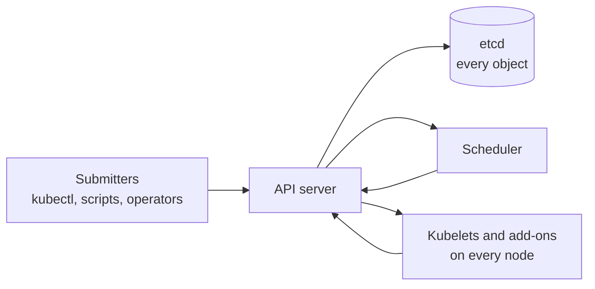

# Kubernetes at HPC Scale: The Front Desk Meets a 100,000-Task Array

> **Part 15 of the Kubernetes series.** A Slurm habit that costs nothing on Slurm can bury a Kubernetes cluster. By the end you'll know the limits the project publishes, where the pressure lands first, and how to turn a job array into one object that the cluster can carry.

- [The array](#the-array)
- [What the project promises](#what-the-project-promises)
- [Where the pressure lands](#where-the-pressure-lands)
- [Your array, as one Job](#your-array-as-one-job)
- [What gang scheduling changes at this size](#what-gang-scheduling-changes-at-this-size)
- [Back to the array](#back-to-the-array)
- [References](#references)

---

## The array

Noor has run Slurm for years. A researcher asks her to move a parameter sweep to the new Kubernetes cluster. On Slurm it was one line, `sbatch --array=0-99999`, and the scheduler barely noticed.

Noor does the obvious translation. A small script loops from 0 to 99,999 and runs `kubectl create job` for each task. It starts well. Then the commands slow down, the dashboards from [part 14](/fields/devops/kubernetes/polite-api-server-monitoring.md) crawl, and an hour later the finished pods are still sitting there, because nobody told the cluster to clean up.

Nothing is broken. Noor sent 100,000 separate letters to the front desk, and each one was filed forever.

So how big is the building, really?

---

## What the project promises

The series' landlord has had a front desk since [part 1](/fields/devops/kubernetes/kubernetes-in-five-nouns.md): the API server, with etcd as the filing cabinet behind it. Every object, whether a Job, a pod or an Event, is a file in that cabinet.

The Kubernetes docs for v1.37 say the project "supports clusters with up to 5,000 nodes", and that it is designed for configurations that meet **all** of these criteria at once:

| Limit | Value |
| --- | --- |
| Pods per node | No more than 110 |
| Nodes | No more than 5,000 |
| Pods in total | No more than 150,000 |
| Containers in total | No more than 300,000 |

Two things to notice. These are design targets for the whole cluster, not per-feature promises. And the pod limit is a **count of objects**, not of running work: a finished pod you didn't delete is still a file in the cabinet.

☕ **Try it before you scroll.** Noor's 100,000 tasks are all done and nothing was cleaned up. Is she under the 150,000-pod figure? Hint: what else lives in the cluster already?

She's under it on paper, and she has used two thirds of the budget for one sweep. Every other team now shares what's left. The next question is which part complains first.

---

## Where the pressure lands



*Everything goes through the API server. Load that grows with the number of objects or nodes lands on the same four places.*

The Kubernetes docs name these ones. For each, I add what it means for an HPC site.

| Part | What the docs say | What it means for you |
| --- | --- | --- |
| Control plane | A large cluster "needs a control plane with sufficient compute and other resources." Typically one or two instances per failure zone, "scaling those instances vertically first". The page gives no sizing numbers | Size it before the cluster is busy, and watch it, politely, with the [page 14](/fields/devops/kubernetes/polite-api-server-monitoring.md) habits |
| etcd | You can store Event objects in a separate dedicated etcd instance. etcd's default request limit is 1.5 MiB, its default storage limit is 2 GiB, and 8 GiB is "a suggested maximum size for normal environments" | Events are noisy when thousands of pods start and fail. Keeping them out of the main cabinet is a project, so plan it early |
| Scheduler | See below | See below |
| Add-ons | Their default limits "are typically based on data collected from experience running each addon on small or medium Kubernetes clusters", and on large clusters they "may continuously get killed because they keep hitting the memory limit" | This is [part 10](/fields/devops/kubernetes/oomkilled-with-memory-to-spare.md) for the platform itself. Raise limits as you grow, and give CoreDNS and metrics-server a system PriorityClass |
| Cloud quotas | Request increases ahead of time, and bring up new nodes in batches with a pause between them | Matters if you burst onto rented nodes |

The scheduler is the interesting one. By default it doesn't score every node. If you don't set `percentageOfNodesToScore`, Kubernetes computes it with a linear formula that "yields 50% for a 100-node cluster and yields 10% for a 5000-node cluster", with a lower bound of 5%. There is also a hardcoded minimum of 100 nodes. So on a 5,000-node cluster, it stops searching once it has found enough feasible nodes, which is about 500 by the docs' 10%.

The docs warn: don't set it below 10% "unless the scheduler's throughput is critical for your application and the score of nodes is not important."

That sentence is the HPC catch. On a web cluster, any decent node is a good node. On a GPU cluster, node choice can mean the right NVLink domain or the wrong one. My recommendation: leave the default alone, and when placement quality matters, ask for it explicitly with the topology tools from [part 7](/fields/devops/kubernetes/isolating-gpu-workloads.md), not by hoping the scheduler looked at enough nodes. I haven't measured scheduler behaviour here.

> [!NOTE]
> Nothing on this page was run on a test cluster. A two-VM lab can't show the effect of 5,000 nodes, and I won't present numbers I didn't measure. Every figure comes from the documentation read on 8 November 2026 (Kubernetes v1.37 pages).

So the cabinet and the desk have limits. How does Noor send the work without paying for 100,000 files?

---

## Your array, as one Job

The Kubernetes Job docs describe the trade-off in one sentence: "One Job per work item creates some overhead for the user and for the system to manage large numbers of Job objects. A single Job for all work items is better for large numbers of items."

The Slurm array has a Kubernetes sibling: the **Indexed Job**, stable since v1.24. Its pods get a completion index from 0 to `completions - 1`, exposed to the container as the `JOB_COMPLETION_INDEX` environment variable. It plays the role of the array task index in a Slurm script.

| Slurm array | Indexed Job |
| --- | --- |
| `--array=0-99999` | `completions: 100000`, `completionMode: Indexed` |
| `--array=0-99999%50` | `parallelism: 50` |
| The task index in the script | `JOB_COMPLETION_INDEX` |
| A failed task is requeued by hand, or by the site's policy | `backoffLimitPerIndex` and `maxFailedIndexes` |
| Old jobs age out of the accounting database | `ttlSecondsAfterFinished` |

The `%` in Slurm's `--array=0-15%4` "specifies a maximum number of simultaneously running tasks", which is what `parallelism` does here.

Here is Noor's sweep as one object. It is built from the field examples in the Job docs. I haven't applied it to a cluster.

```yaml
apiVersion: batch/v1
kind: Job
metadata:
  name: sweep
spec:
  completionMode: Indexed       # each pod gets an index, like an array task
  completions: 100000           # the whole array
  parallelism: 50               # at most 50 running at once (the % in Slurm)
  backoffLimitPerIndex: 1       # one retry per index, independently
  maxFailedIndexes: 500         # stop the Job if this many indexes fail
  ttlSecondsAfterFinished: 3600 # delete the Job and its pods an hour after it ends
  template:
    spec:
      restartPolicy: Never      # required for per-index backoff
      containers:
      - name: task
        image: registry.example.org/sweep:1   # a placeholder image
        command: ["/bin/sh", "-c", "run-task --index $JOB_COMPLETION_INDEX"]
```

Three lines matter most.

- **`parallelism: 50`.** `parallelism` is the number of pods the Job runs at once, so the Job doesn't need 100,000 pods to exist together. That's the difference between one big Job and a loop of small ones.
- **`backoffLimitPerIndex`.** With it, "a failing index does not interrupt execution of other indexes." Failed ones land in `.status.failedIndexes`, and `maxFailedIndexes` stops a broken sweep before it burns the whole allocation. One catch from the docs: if any index fails, the Job ends up marked Failed, "even if some, potentially nearly all, of the indexes were processed successfully."
- **`ttlSecondsAfterFinished`.** This is the habit Noor skipped. The docs recommend it because Jobs you create directly have a default deletion policy of `orphanDependents`, which leaves their pods around after the Job is deleted. Set the TTL, and the TTL controller deletes the Job together with its pods.

> [!WARNING]
> `restartPolicy: Never` is also required if you add a `podFailurePolicy`, which lets you stop retrying on an exit code that means "this will never work" (`FailJob`) and ignore failures caused by a node drain (`Ignore` on the `DisruptionTarget` condition). The drain part ties back to [part 9](/fields/devops/kubernetes/draining-a-gpu-node.md).

> [!TIP]
> Many tiny tasks are better as fewer, longer ones. The Job docs say "having each Pod process multiple work items is better for large numbers of items." If a task takes seconds, make each index a chunk of tasks. I haven't measured it, but a pod is a heavier object than a Slurm task, so fewer, longer ones are the safer default.

An array is many independent tasks. What about the other HPC shape, one job that needs a hundred GPUs at the same moment?

---

## What gang scheduling changes at this size

[Page 7](/fields/devops/kubernetes/isolating-gpu-workloads.md) explained why a big training job needs all-or-nothing placement, and [page 8](/fields/devops/kubernetes/job-execution-journey.md) showed Kueue holding the job back until quota fits. This is what the current docs add:

| Fact from the docs | Version | What it means |
| --- | --- | --- |
| The `gang` policy places a group of pods "on an 'all-or-nothing' basis", and if the group can't fit, none are bound | Beta since v1.37, behind the `GenericWorkload` feature gate, disabled by default | Native gang scheduling exists, but you have to turn it on |
| The Job controller can create the Workload and PodGroup for a Job from `.spec.scheduling` | Alpha since v1.36, behind `WorkloadWithJob`, disabled by default | Not something to build a production plan on yet |
| `CompositePodGroup` groups child groups, for example for gangs of gangs | Alpha since v1.37, disabled by default | Interesting for multi-slice jobs, and still experimental |

One more sentence is worth reading twice. The scheduler never admits fewer than `minCount` pods at first, but "the actual runtime count of scheduled Pods can drop below this threshold if running Pods are later deleted or evicted." A gang is guaranteed at the start, not for life. For a three-day run, checkpoints still matter more than any scheduler feature.

And Kueue's own page says it "works alongside kube-scheduler, cluster-autoscaler and your job controllers instead of replacing them". Which means that at scale you run both, and you need to know which one is saying no.

---

## Back to the array

Noor deletes the loop and writes one Indexed Job. It runs 50 pods at a time, retries each failed index once, stops itself if 500 indexes fail, and cleans up an hour after it ends. The cabinet holds 50 pods at a time instead of 100,000. The other teams don't notice anything.

On Slurm that would have been a one-liner. On Kubernetes it's twenty lines, and the twenty lines are the price of a general-purpose building.

**Takeaway:** the cluster's limits are counts of objects, so send an array as one Indexed Job with a parallelism cap and a TTL, and leave the scheduler's defaults alone until you've measured a reason.

**Challenge:** index 417 of Noor's Job failed twice and shows up in `.status.failedIndexes`. In one command, how do you find that pod's log, and which three commands would you run first if the pod is already gone? The [kubectl troubleshooting cheat sheet](/tips/kubectl-troubleshooting.md) answers it.

---

## References

- [Considerations for large clusters](https://kubernetes.io/docs/setup/best-practices/cluster-large/): the 110, 5,000, 150,000 and 300,000 figures, control plane sizing advice, separate etcd for Events, add-on limits.
- [Scheduler performance tuning](https://kubernetes.io/docs/concepts/scheduling-eviction/scheduler-perf-tuning/): `percentageOfNodesToScore`, the 50% to 10% formula, the 5% floor, the 100-node minimum.
- [etcd limits](https://etcd.io/docs/v3.5/dev-guide/limit/): the request size and storage limits.
- [Jobs](https://kubernetes.io/docs/concepts/workloads/controllers/job/): Indexed completion mode, `backoffLimitPerIndex`, `maxFailedIndexes`, pod failure policy, `ttlSecondsAfterFinished`, job patterns, and the alpha Job-level gang scheduling.
- [Gang scheduling](https://kubernetes.io/docs/concepts/scheduling-eviction/gang-scheduling/): the `gang` policy, feature gates, stages, and the `minCount` caveat.
- [Kueue](https://github.com/kubernetes-sigs/kueue): what it decides and how it works alongside kube-scheduler.
- [sbatch](https://slurm.schedmd.com/sbatch.html): `--array` ranges and the `%` limit.
- [Polite API server monitoring](/fields/devops/kubernetes/polite-api-server-monitoring.md) and [Isolating GPU workloads](/fields/devops/kubernetes/isolating-gpu-workloads.md): the pages this one builds on.
