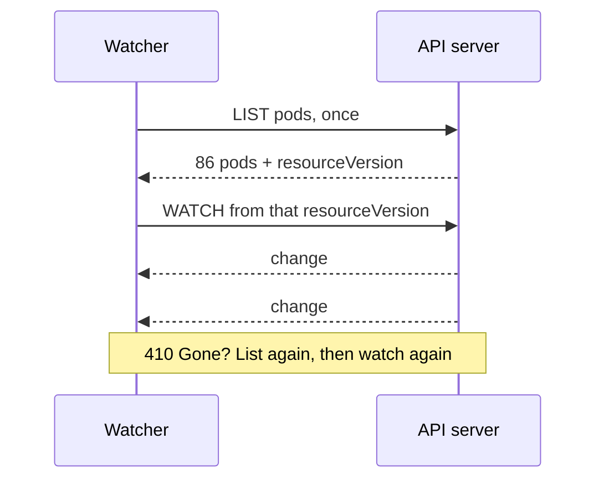

# Polite API Server Monitoring: Leave Your Number, Don't Knock Every Second

<!-- related-block -->
<div class="reading-time">10 min read</div>
<!-- related-block -->
<div class="related-strip">

**Read first:** [Kubernetes in Five Nouns, Explained Like You Just Inherited the Cluster](/fields/devops/kubernetes/kubernetes-in-five-nouns.md)  ·  **See also:** [Kubernetes at HPC Scale: The Front Desk Meets a 100,000-Task Array](/fields/devops/kubernetes/kubernetes-at-hpc-scale.md), [RBAC: The Error Message Writes the Rule for You](/fields/devops/kubernetes/rbac-and-the-limited-viewer.md), [The Job Execution Journey: From `kubectl apply` to the First All-Reduce](/fields/devops/kubernetes/job-execution-journey.md)

</div>


> **Part 14 of the Kubernetes series.** A wallboard that "just refreshes every second" is a stack of requests on the cluster's front desk. By the end you'll know what a poll costs, how a watch costs almost nothing, which queue your tool stands in, and the five habits that make a monitor polite.

- [The wallboard](#the-wallboard)
- [Knocking vs leaving your number](#knocking-vs-leaving-your-number)
- [What one list costs](#what-one-list-costs)
- [The pattern: list once, then watch](#the-pattern-list-once-then-watch)
- [Which queue are you in?](#which-queue-are-you-in)
- [A key that only reads](#a-key-that-only-reads)
- [The right tool for the question](#the-right-tool-for-the-question)
- [Five habits](#five-habits)
- [Back to the wallboard](#back-to-the-wallboard)
- [References](#references)

---

## The wallboard

Someone on the platform team writes a GPU wallboard. It runs `kubectl get pods -A` in a loop, once a second, and shows the result on a screen. It's lovely. The team likes it so much that a dozen engineers run their own copy on their laptops.

Nothing breaks. The cluster just gets a little slower for everyone, and nobody connects it to a small shell loop. The control plane has a front desk, and a dozen people have started knocking on it every second to ask the same question: "anything new?"

You can ask the desk to call you instead. First, how bad is the knocking?

---

## Knocking vs leaving your number

> [!NOTE]
> Everything with numbers on this page was run on a throwaway single-node k3s VM (k3s v1.37.2+k3s1, Ubuntu 22.04) with 80 small pods, 86 pods in total with k3s's own, and then destroyed. The counts come from the API server's own `apiserver_request_total` metric.

Same 20 seconds, three ways:

| What ran | LIST pods requests | WATCH pods requests |
| --- | --- | --- |
| Nothing (an idle control) | +0 | +0 |
| `kubectl get pods -A` once a second, 20 times | **+20** | +0 |
| One `kubectl get pods -A -w`, while two scale changes happened | **+1** | +1 |

Twenty polls made twenty full lists. The watcher made one list and one long-lived watch request, and the changes arrived as they happened. Its output was 115 lines: the 86 pods of the first list, then 29 change events.



*A watcher pays the cost of a list once and then hears only what changed.*

☕ **Try it before you scroll.** One poller at one request per second: how many list requests does it make in an hour, and how many does a dozen laptops make? Hint: 60 times 60.

That's 3,600 lists an hour for one poller, and 43,200 for twelve. Each of those returns the whole collection. How big is that?

---

## What one list costs

The same 86 pods, fetched different ways through the API, with the byte counts measured:

| How the list was asked | Bytes returned |
| --- | --- |
| Full objects (plain JSON) | 899,207 |
| Server-side Table (what `kubectl get` uses) | 469,407 |
| Metadata only (`PartialObjectMetadataList`) | 420,143 |
| Full objects, first 10 only (`limit=10`) | 159,731 |
| Full objects, a label selector that matches nothing | 111 |

Four lessons are hiding here.

1. **A full list is heavy.** About 0.9 MB for a small lab. The docs warn that retrieving all pods across all namespaces can be a very large response, 10-20 MB, on large clusters.
2. **Asking for less really helps.** The Table format is roughly half the size of full objects, and a selector can shrink a response to almost nothing.
3. **Metadata alone is not small.** 420 KB for 86 pods, close to the Table. Don't expect "just names and labels" to be tiny.
4. **Pages work.** `limit=10` returned 10 items, a `continue` token, and `remainingItemCount: 76`. Per the docs, you fetch the next page with that token, and the collection stays a consistent snapshot across pages.

Using the Table size and the poller from above, one poller moves roughly 1.7 GB an hour from the API server. This is arithmetic on the measured numbers, not a separate measurement.

Bytes aren't the only price. The docs on API Priority and Fairness say a list the server expects to be large occupies more than one "seat" in its queue, in proportion to the estimated number of objects. So a heavy list also makes everyone else wait longer.

---

## The pattern: list once, then watch

Every Kubernetes object has a `resourceVersion`, and a list response carries one for the whole collection. The pattern from the docs:

1. **List** and remember the `resourceVersion`.
2. **Watch** from that version. The server streams changes, with no missed events.
3. If the watch drops, **watch again from the last version you saw**.
4. If the server answers `410 Gone`, your version is too old: **clear your cache, list again, watch again**.

The docs say a cluster using etcd 3 keeps the last 5 minutes of changes by default, and a `continue` token for a chunked list expires after about 5 minutes too. For the stale case, I asked for a watch from `resourceVersion=1`:

```text
{"type":"ERROR","object":{"kind":"Status","apiVersion":"v1","metadata":{},"status":"Failure","message":"too old resource version: 1 (3)","reason":"Expired","code":410}}
```

That's the 410 in the flesh. Your client must handle it, and the client libraries already do: the Go client's `Reflector` implements list-then-watch for you. Watch bookmarks (`allowWatchBookmarks=true`) help a short history window by sending small events that carry only a newer `resourceVersion`. I did not test bookmarks.

> [!TIP]
> Don't write this loop by hand. Use a client library's informer or reflector, or a tool built on one. Write your own, and the 410 case is the one you'll forget.

---

## Which queue are you in?

The API server doesn't treat all callers alike. API Priority and Fairness sorts every request into a priority level with its own concurrency, and fair-queues within it. Here is the table from the lab cluster, trimmed to the rows that matter:

| FlowSchema | Priority level | For |
| --- | --- | --- |
| `system-nodes` | `system` | Kubelets |
| `kube-controller-manager`, `kube-scheduler` | `workload-high` | Built-in controllers |
| `kube-system-service-accounts` | `workload-high` | ServiceAccounts in `kube-system` |
| `service-accounts` | **`workload-low`** | **Every other ServiceAccount** |
| `global-default` | `global-default` | Everything else, such as a person's `kubectl` |

A monitoring tool running in a pod with its own ServiceAccount lands in `workload-low`, where the docs say requests from "any other service account" go. In the test, the API server's counter confirmed it: `apiserver_flowcontrol_dispatched_requests_total{flow_schema="service-accounts",priority_level="workload-low"}` was 118.

That has two implications. A polite monitor doesn't lean on the high-priority lanes, and an impolite one is competing in a lane meant for ordinary workloads. When the queue overflows, the server answers HTTP 429. The counter for that, `apiserver_flowcontrol_rejected_requests_total`, had no series at all on the quiet lab, which means nothing was ever rejected. On your real cluster, it's the first number to chart.

The stable metrics worth a dashboard:

| Metric | What it tells you |
| --- | --- |
| `apiserver_request_total` | Requests by verb, resource and response code |
| `apiserver_request_duration_seconds` | How long they take |
| `apiserver_current_inflight_requests` | Load, per request kind |
| `apiserver_flowcontrol_rejected_requests_total` | Requests turned away (beta) |

---

## A key that only reads

This is part 13 put to work. The lab's monitor got its own ServiceAccount, a read-only ClusterRole and a binding, all with the commands from the docs:

```bash
kubectl create serviceaccount monitor -n mon
kubectl create clusterrole polite-monitor --verb=get,list,watch --resource=pods,nodes,events
kubectl create clusterrolebinding polite-monitor --clusterrole=polite-monitor --serviceaccount=mon:monitor
kubectl create token monitor -n mon --duration=1h        # a short-lived token, not a forever one
```

What it could and couldn't do, as run:

| Command as the monitor | Result |
| --- | --- |
| `get pods -A` | works (86 pods) |
| `get nodes` | works |
| `get secrets -A` | `Forbidden: ... cannot list resource "secrets" ... at the cluster scope` |
| `delete pod -n load -l app=web --dry-run=server` | 80 `Forbidden` lines, one per pod. Even a dry run is refused |
| `get --raw /metrics` | `Forbidden: ... cannot get path "/metrics"` |

That last row is a small trap. The API server's own metrics aren't a resource, so they need a separate `nonResourceURLs` rule. If your monitor scrapes `/metrics`, give it that one explicitly and nothing more.

---

## The right tool for the question

Not every number should come from asking the API server.

| Question | Right source | Note |
| --- | --- | --- |
| Is the pod pending, crash-looping, out of GPUs? | The object state: a watch, or kube-state-metrics | kube-state-metrics describes itself as listening to the API server and keeping a snapshot of cluster state in memory |
| How much CPU and memory is it using right now? | metrics-server, for autoscaling and `kubectl top` | Its README says it's meant only for autoscaling and not an accurate source of usage, and tells monitoring to scrape the kubelet's `/metrics/resource` |
| Is the API server itself healthy? | Its `/metrics` endpoint | The table above |

In the lab, `kubectl top nodes` as admin showed `969m` CPU and `1903Mi` memory, and the raw Metrics API showed `"window":"10.058s"`: an average over a short window, not a timeline.

> [!NOTE]
> The monitor identity failed `kubectl top nodes` with "Metrics API not available". I did not investigate why, so don't read it as a rule.

---

## Five habits

1. **Watch, don't poll.** One list, then a watch from its `resourceVersion`, with a client library handling 410.
2. **Ask for less.** Label and field selectors, namespaces, and `limit` with `continue`. A selector that matches nothing cost 111 bytes in the test.
3. **Own your lane.** A dedicated ServiceAccount and a read-only ClusterRole with explicit resources and verbs. No wildcards.
4. **Back off when told.** On 429, wait and retry; on 410, relist. Never answer a rejection by asking faster.
5. **One collector, many viewers.** A dozen wallboards should read from one cached collector, not a dozen API watchers. This is my recommendation, not a doc rule, and it's the biggest saving of the five.

---

## Back to the wallboard

The platform team replaces the shell loop with a single small collector. It lists once, watches, and serves the screens from its own cache. A dozen laptops stop knocking, and the front desk gets quiet. Where the API server used to see 43,200 lists an hour, it now sees one list and one watch.

The wallboard looks exactly the same. That's the best kind of fix.

**Takeaway:** a poll asks the API server the whole question again every time, so list once, watch from the `resourceVersion`, filter on the server, and run it all as a read-only ServiceAccount.

**Challenge:** on a cluster of a few thousand nodes with many teams' controllers, everything on this page gets bigger, and some of it gets different. Which of the five habits stops being optional first? The next page, Kubernetes at HPC scale, takes that on.

---

## References

- [Kubernetes API concepts](https://kubernetes.io/docs/reference/using-api/api-concepts/): efficient detection of changes, `resourceVersion`, 410 Gone, watch bookmarks, chunked lists.
- [API Priority and Fairness](https://kubernetes.io/docs/concepts/cluster-administration/flow-control/): priority levels, seats for large lists, HTTP 429 and the rejected-requests metric.
- [Kubernetes metrics reference](https://kubernetes.io/docs/reference/instrumentation/metrics/): `apiserver_request_total`, `apiserver_request_duration_seconds`, `apiserver_current_inflight_requests`.
- [Resource metrics pipeline](https://kubernetes.io/docs/tasks/debug/debug-cluster/resource-metrics-pipeline/): the Metrics API and metrics-server's purpose.
- [metrics-server README](https://github.com/kubernetes-sigs/metrics-server): its intended use and the advice about monitoring.
- [kube-state-metrics README](https://github.com/kubernetes/kube-state-metrics): what it exposes and how it differs from metrics-server.
- [RBAC and the limited viewer](/fields/devops/kubernetes/rbac-and-the-limited-viewer.md): the read-only key this page builds on.
