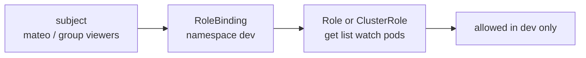

# RBAC: The Error Message Writes the Rule for You

<!-- related-block -->
<div class="reading-time">9 min read</div>
<!-- related-block -->
<div class="related-strip">

**Read first:** [Kubernetes in Five Nouns, Explained Like You Just Inherited the Cluster](/fields/devops/kubernetes/kubernetes-in-five-nouns.md)  ·  **See also:** [k3s vs kubeadm: Furnished Flat or Empty Unit?](/fields/devops/kubernetes/k3s-vs-kubeadm.md), [Polite API Server Monitoring: Leave Your Number, Don't Knock Every Second](/fields/devops/kubernetes/polite-api-server-monitoring.md), [Your kubeconfig Is a House Key](/fields/devops/kubernetes/your-kubeconfig-is-a-house-key.md)

</div>


> **Part 13 of the Kubernetes series.** Mateo has his certificate and gets a wall of "Forbidden". By the end you'll read that error as a ready-made recipe, build a read-only user in four commands, and see why RBAC refuses to let anyone hand out keys they don't hold.

- [Forbidden, again](#forbidden-again)
- [The error is a sentence](#the-error-is-a-sentence)
- [Four objects, one grammar](#four-objects-one-grammar)
- [Build the limited viewer](#build-the-limited-viewer)
- [Ask before you break things](#ask-before-you-break-things)
- [Bind groups, not people](#bind-groups-not-people)
- [Three traps that are actually guardrails](#three-traps-that-are-actually-guardrails)
- [Revoking at the binding](#revoking-at-the-binding)
- [Back to Mateo](#back-to-mateo)
- [References](#references)

---

## Forbidden, again

Mateo from [part 12](/fields/devops/kubernetes/your-kubeconfig-is-a-house-key.md) has a certificate of his own, valid for an hour. He runs his first command:

```text
$ kubectl get pods -n dev
Error from server (Forbidden): pods is forbidden: User "mateo" cannot list resource "pods" in API group "" in the namespace "dev"
```

The teammate who cut his key sighs. "RBAC is a headache. Just bind him to `cluster-admin` and move on."

Don't. That message isn't a wall. It's the exact rule you need, written out in plain words, and most people never read it.

---

## The error is a sentence

Read it again, slowly: **User "mateo" cannot list resource "pods" in API group "" in the namespace "dev".**

The authorization docs say every request carries the same attributes: the user, its groups, a verb, a resource, an API group and a namespace. The server compares that sentence with the rules it holds. Access is denied by default, and if no rule says yes, the answer is HTTP 403.

So the error maps onto a rule field by field:

| The error says | The rule field is |
| --- | --- |
| `User "mateo"` | the **subject** in a binding |
| `list` | `verbs` |
| `resource "pods"` | `resources` |
| `API group ""` | `apiGroups` (an empty string is the core group) |
| `namespace "dev"` | where the Role and its binding live |

That table is most of RBAC. Everything else is the plumbing that turns the sentence into a yes.

---

## Four objects, one grammar

RBAC has four kinds of object, and permissions are purely additive: there are no "deny" rules. That is why it's simpler than it looks. You only ever write the sentences you want to allow.

| Object | Role in the grammar | Scope |
| --- | --- | --- |
| **Role** | A list of allowed sentences: verbs on resources | One namespace |
| **ClusterRole** | The same list, or rules for cluster-wide things like nodes | No namespace |
| **RoleBinding** | "These subjects get that list", here | One namespace |
| **ClusterRoleBinding** | "These subjects get that list", everywhere | Whole cluster |

A **subject** is a user, a group or a ServiceAccount. A RoleBinding can point at a Role in its own namespace or at a ClusterRole, which grants it only inside the binding's namespace. That second trick is how one reusable ClusterRole serves many namespaces.



*The binding is the glue and the namespace. The role is only a list.*

☕ **Try it before you scroll.** Mateo has a RoleBinding in `dev` to the built-in `view` ClusterRole. He runs `kubectl get pods -n prod`. Does it work? Hint: where does a RoleBinding grant its role?

No. A RoleBinding grants only in its own namespace, even when it points at a ClusterRole. The proof is in [Bind groups, not people](#bind-groups-not-people).

---

## Build the limited viewer

> [!NOTE]
> Everything in this section was run on a throwaway single-node k3s VM (k3s v1.37.2+k3s1 on Ubuntu 22.04, kernel 5.15), then destroyed. Outputs are real, trimmed only where marked.

Mateo's certificate says `/CN=mateo/O=viewers`, so he arrives as user `mateo` in group `viewers`. First, the state before any rule exists:

```text
$ kubectl --kubeconfig mateo.kubeconfig auth whoami
Username     mateo
Groups       [viewers system:authenticated]
```

He's authenticated and can do nothing. Now the limited viewer, as an admin, in two commands:

```bash
kubectl create role limited-viewer -n dev --verb=get --verb=list --verb=watch --resource=pods,pods/log
kubectl create rolebinding mateo-limited-viewer -n dev --role=limited-viewer --user=mateo
```

Then Mateo tries things. Real results:

| Command | Result |
| --- | --- |
| `get pods -n dev` | works |
| `get pods -n prod` | `Forbidden: ... cannot list resource "pods" ... in the namespace "prod"` |
| `get secrets -n dev` | `Forbidden: ... cannot list resource "secrets" ...` |
| `delete pod web -n dev` | `Forbidden: ... cannot delete resource "pods" ...` |
| `get nodes` | `Forbidden: ... cannot list resource "nodes" ... at the cluster scope` |

Same user, same cluster, and every neighbour is closed. Log access needed its own entry, `pods/log`, because a subresource is a separate resource in the rule.

> [!WARNING]
> The first thing that failed in this test wasn't RBAC. Creating a pod right after `kubectl create namespace dev` returned `error looking up service account dev/default: serviceaccount "default" not found`, because the namespace's `default` ServiceAccount is created a moment later. So no pod existed in `dev`, and `logs` and `exec` were not exercised end to end. `kubectl auth can-i get pods/log` answered `yes`; treat the rest as untested.

---

## Ask before you break things

The most useful RBAC command isn't one that changes anything. `kubectl auth can-i` asks the server a yes/no question, and as an admin you can ask it as someone else with `--as`.

```text
$ kubectl auth can-i list pods -n dev --as mateo
no                                  # before the Role
$ kubectl auth can-i get pods/log -n dev --as mateo
yes                                 # after
$ kubectl auth can-i delete pods -n dev --as mateo
no
```

Add `--list` to see everything he can do in a namespace. After the binding, Mateo's list gained exactly two rows, `pods` and `pods/log`, each `[get list watch]`. Even before any binding it wasn't empty: every user gets `selfsubjectreviews`, `selfsubjectaccessreviews`, `selfsubjectrulesreviews` and a few read-only discovery URLs like `/healthz` and `/version`. That's how `whoami` works for someone who can't see anything else.

Build the habit: write the rule, then ask the server whether it does what you meant. It takes seconds and replaces a Slack message that starts with "it still says forbidden".

---

## Bind groups, not people

Binding `mateo` by name works, but now every new colleague is another binding. The certificate's `O=viewers` already put him in a group, so bind that instead, to the built-in `view` ClusterRole:

```bash
kubectl create rolebinding viewers-view -n dev --clusterrole=view --group=viewers
```

Results: `get pods -n dev` works, `get pods -n prod` stays `Forbidden`, and `get secrets -n dev` stays `Forbidden` too. That last one is by design. The docs say `view` does not allow reading Secrets, because a Secret can hold a ServiceAccount token that would give API access as that account. In the test, `can-i list secrets --as mateo --as-group viewers` answered `no`.

The built-in roles are worth knowing by name:

| ClusterRole | In one line (from the docs) |
| --- | --- |
| `view` | Read most things in a namespace; no Secrets, no Roles or RoleBindings |
| `edit` | Read and write most things; can read Secrets and run pods as any ServiceAccount there, so it can act as them |
| `admin` | Everything in a namespace, including Roles and RoleBindings |
| `cluster-admin` | Anything, anywhere. Bound to the `system:masters` group |

My recommendation: start from `view`, bind a group, and add a small Role beside it only for what's missing.

---

## Three traps that are actually guardrails

Each of these looks like RBAC being annoying. Each is RBAC protecting you. All three were run.

**1. You can't edit what a binding points at.** Trying to swap the role on `viewers-view` for `admin`:

```text
The RoleBinding "viewers-view" is invalid: roleRef: Invalid value: {... "Name":"admin"}: field is immutable
```

Delete the binding and create a new one. The docs explain why: someone allowed to change a binding's subjects can't quietly change what it grants.

**2. You can't hand out keys you don't hold.** Mateo was given the right to create Roles and RoleBindings in `dev`, but no right to read Secrets. He tries to write himself a Secret-reading role:

```text
Error from server (Forbidden): roles.rbac.authorization.k8s.io "grab-secrets" is forbidden: user "mateo" ... is attempting to grant RBAC permissions not currently held:
{APIGroups:[""], Resources:["secrets"], Verbs:["get" "list"]}
```

A role for pods, which he already can read, was created fine. Binding himself to `admin` was refused too, with a list of every permission he lacked. (That list was long, so I've cut it.) The docs call this privilege escalation prevention, and it's enforced by the API itself. It's why delegating "can manage access in this namespace" is much safer than it sounds.

**3. A ServiceAccount starts with nothing.**

```text
$ kubectl auth can-i list pods -n dev --as system:serviceaccount:dev:default
no
# after: kubectl create rolebinding sa-view -n dev --clusterrole=view --serviceaccount=dev:default
yes
$ kubectl auth can-i list pods -n prod --as system:serviceaccount:dev:default
no
```

The docs list this as the best practice: a role for a specific ServiceAccount, in a specific namespace. Pods you deploy inherit whatever you give that account, so a monitoring tool should never share the `default` one.

> [!IMPORTANT]
> Not tested here: wildcards, `resourceNames`, `kubectl auth reconcile`. The docs warn that a wildcard in `resources` or `verbs` also grants any resource or verb added later. Prefer explicit lists.

---

## Revoking at the binding

Part 12's uncomfortable fact was that Kubernetes can't revoke a certificate. RBAC gives you the way around it. The test: remove Mateo's bindings, and even delete his CSR object.

```text
$ kubectl --kubeconfig mateo.kubeconfig auth whoami
Username     mateo
Groups       [viewers system:authenticated]          # the certificate still works
$ kubectl --kubeconfig mateo.kubeconfig get pods -n dev
Error from server (Forbidden): pods is forbidden: User "mateo" cannot list resource "pods" ...
$ openssl x509 -in mateo.crt -noout -enddate
notAfter=Nov  8 13:50:46 2026 GMT                    # valid until then
```

The key still turns in the lock. It opens nothing. Authentication proves who he is, and RBAC decides what that's worth. So the real "off switch" for a person is the binding, and the real safety net is a short lifetime on the certificate.

---

## Back to Mateo

Mateo's first Forbidden message told us the rule to write. We wrote it in two commands, tested it with `can-i` before he tried, and checked that the neighbours stayed locked. Later we closed it by deleting the binding, and his certificate became a keyring ornament.

Nobody had to bind `cluster-admin`. The headache was reading the error as a complaint instead of a spec.

**Takeaway:** a Forbidden message is a rule written in advance, namely subject, verb, resource, group and namespace, so read it, write exactly that, and check with `kubectl auth can-i --as` before anyone else does.

**Challenge:** a monitoring tool needs to list pods, nodes and events across the whole cluster, read-only, and nothing else. Which of the four objects do you need, which `resources` and `verbs` go in it, and why must it use its own ServiceAccount? The next page, on polite API server monitoring, builds it.

---

## References

- [Using RBAC Authorization](https://kubernetes.io/docs/reference/access-authn-authz/rbac/): the four objects, additive permissions, roleRef immutability, subresources, user-facing roles, escalation prevention, ServiceAccount permissions, wildcard caution.
- [Authorization](https://kubernetes.io/docs/reference/access-authn-authz/authorization/): request attributes, default deny, HTTP 403, and `kubectl auth can-i` with `--as`.
- [Authenticating](https://kubernetes.io/docs/reference/access-authn-authz/authentication/): certificate username and groups, and `kubectl auth whoami`.
- [Certificates and Certificate Signing Requests](https://kubernetes.io/docs/reference/access-authn-authz/certificate-signing-requests/): how Mateo's certificate was issued.
