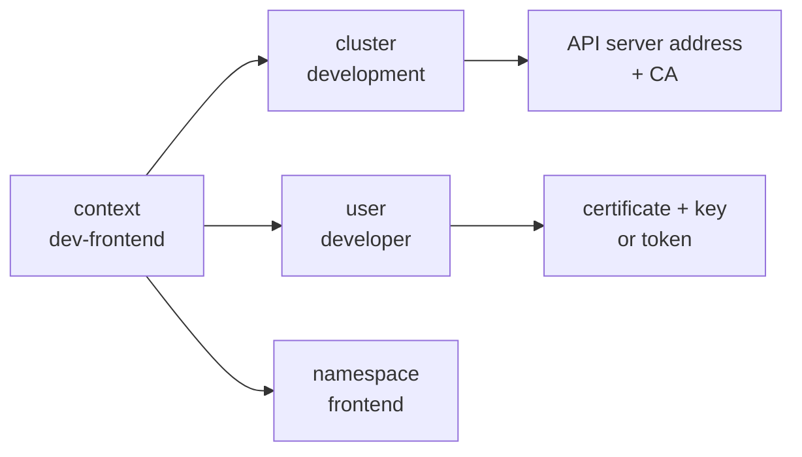

# Your kubeconfig Is a House Key

<!-- related-block -->
<div class="reading-time">8 min read</div>
<!-- related-block -->
<div class="related-strip">

**Read first:** [Kubernetes in Five Nouns, Explained Like You Just Inherited the Cluster](/fields/devops/kubernetes/kubernetes-in-five-nouns.md)  ·  **See also:** [Build a Two-Node Kubernetes Lab on Your Laptop (and Survive the DNS Pothole)](/fields/devops/kubernetes/build-a-two-node-k3s-lab.md), [k3s vs kubeadm: Furnished Flat or Empty Unit?](/fields/devops/kubernetes/k3s-vs-kubeadm.md), [RBAC: The Error Message Writes the Rule for You](/fields/devops/kubernetes/rbac-and-the-limited-viewer.md)

</div>


> **Part 12 of the Kubernetes series.** A file called `config` sits in your home directory and opens the whole cluster. By the end you'll know what's inside it, how `kubectl` picks which one to use, and how to hand out a smaller key.

- [The ticket](#the-ticket)
- [What's on the key ring](#whats-on-the-key-ring)
- [Which key does kubectl pick?](#which-key-does-kubectl-pick)
- [The key you can't take back](#the-key-you-cant-take-back)
- [Where the master key comes from](#where-the-master-key-comes-from)
- [Cutting a smaller key](#cutting-a-smaller-key)
- [Back to the ticket](#back-to-the-ticket)
- [References](#references)

---

## The ticket

A contractor, Mateo, is stuck. His pods won't schedule and he's blocked. To help, a well-meaning teammate attaches her `~/.kube/config` to the ticket: "just use mine, it works."

It does work. It also lets Mateo delete the production namespace, read every Secret, and run a pod on any node. The ticket system keeps attachments forever, and so does everyone with search access to it.

The file looked like boring config. It was the master key.

Why is that file so powerful?

---

## What's on the key ring

A kubeconfig is a small YAML file that "organizes information about clusters, users, namespaces, and authentication mechanisms." Back to the series' landlord picture: it's your key ring, with three kinds of entries.

| Entry | In the picture | What's inside |
| --- | --- | --- |
| `clusters` | Which building | The API server address and the CA certificate used to trust it |
| `users` | Which key | A client certificate and private key, a token, or a credential plugin |
| `contexts` | A key for a building, plus a room | A triple: cluster, user and namespace |

The docs give the example: a `dev-frontend` context says "use the credentials of the `developer` user to access the `frontend` namespace of the `development` cluster."



*A context is only a label that ties three things together. The user entry holds the part that opens the door.*

Certificate and key can be a file path or the data inline: add the `-data` suffix, for example `client-key-data`. The inline form is what makes one file copyable, and one file leakable.

> [!CAUTION]
> The Kubernetes docs say storing passwords in client config is risky and suggest a credential plugin that keeps them elsewhere.

☕ **Try it before you scroll.** You have a config for the lab and one for production. You run `kubectl delete namespace test`. Which cluster loses it? Hint: it isn't the one you were thinking about.

---

## Which key does kubectl pick?

The answer is the **current context**, and `kubectl` decides it in this order:

1. If you pass `--kubeconfig`, it uses only that file and does not merge.
2. Otherwise it reads the `KUBECONFIG` environment variable, a colon-separated list on Linux and Mac, and merges the files.
3. If that variable isn't set, it uses `$HOME/.kube/config`.

Merging has simple rules: the first file to set a value wins, and a later file never overrides it. Within the result, the `--context` flag beats `current-context`.

The commands you'll use daily:

```bash
kubectl config get-contexts           # list the keys on the ring
kubectl config current-context        # which one is active right now
kubectl config use-context lab        # switch
kubectl --context lab get nodes       # one-off, without switching
```

I haven't run these here; the `use-context` behaviour is from the docs. My recommendation: never leave production as your current context. Prefer `--context` for one-off commands on a cluster that matters, so a command run from muscle memory goes to the lab, not production.

There's one more trap in the same docs. A kubeconfig can make `kubectl` run code and read files, so "only use kubeconfig files from trusted sources". Treat a file someone sends you like a shell script: read it before you use it.

So a copied key works, and you can't easily make it stop. Why not?

---

## The key you can't take back

Kubernetes has no user objects. The authentication docs say "Kubernetes does not have objects which represent normal user accounts," so a user is whatever name a valid credential carries. For a client certificate, the username comes from the certificate's common name, and groups come from its organization fields. The docs' example: `/CN=alovelace/O=app1/O=app2` is the user `alovelace` in groups `app1` and `app2`.

Now the sentence that should change your habits. The docs for Kubernetes 1.37 say: "Kubernetes 1.37 does not support certificate _revocation_. Any certificate that is issued remains valid until it expires."

So a leaked certificate-based kubeconfig can't be cancelled. You wait for expiry, or you rotate the CA, which is a very bad afternoon. That's why the lifetime of a key matters more than anyone tells you when you create it.

| If the key leaks... | What actually helps |
| --- | --- |
| A certificate with a long life | Nothing quick. It stays valid until it expires |
| A certificate with a short life | It dies on its own, soon |
| A permission set that's narrow | The thief can do little, even while the key works |

Which is why the next question is where yours came from.

---

## Where the master key comes from

Every cluster has to hand someone the first, all-powerful key. The tools you met in [part 11](/fields/devops/kubernetes/k3s-vs-kubeadm.md) do it differently.

| | Admin kubeconfig | Notes from the docs |
| --- | --- | --- |
| k3s | `/etc/rancher/k3s/k3s.yaml` | Copy it to `~/.kube/config` on your machine and change `server` to your K3s server's address. K3s refreshes the certificates in it each time it starts, so an old copy can expire |
| kubeadm | `/etc/kubernetes/admin.conf` | `kubeadm init` tells you to copy it to `$HOME/.kube/config`. Client certificates kubeadm generates expire after 1 year by default |

kubeadm also writes a `super-admin.conf`, and the docs for an external CA say to delete or move it to a safe place. If you read that and thought "nobody has said that to me before", you're not alone.

> [!WARNING]
> Copying the admin file to a laptop turns the laptop into a cluster-admin. Do it on purpose, for your own machine, and then stop handing the file around. Treat `chmod 600` and an encrypted disk as the minimum.

The way out is not hiding the master key better. It's cutting smaller ones.

---

## Cutting a smaller key

For a person who needs temporary access, the Kubernetes certificate API can issue a client certificate with a lifetime you choose. A `CertificateSigningRequest` carries a required `signerName`, and since Kubernetes v1.22 an optional `expirationSeconds`, whose minimum is 600 (ten minutes). Someone with approval rights must approve the request, with `kubectl certificate approve`.

The flow, in order:

1. The person generates a private key and a CSR with the name and groups they need.
2. You submit it as a `CertificateSigningRequest` with a short `expirationSeconds`.
3. An approver approves it.
4. You hand back the signed certificate, never the private key.
5. They add it to their own kubeconfig with `kubectl config set-credentials` and `set-context`.

> [!IMPORTANT]
> I did not run this flow, and the CSR page I fetched was cut off before the user-certificate example. Use the "Kubernetes signers" section of that page for the exact manifest, and test it on the [k3s lab](/fields/devops/kubernetes/build-a-two-node-k3s-lab.md) before relying on it.

Two things the new key can't do by itself: it doesn't say what its owner is allowed to do. A freshly issued certificate for `mateo` proves who he is and nothing more. What he may do is a separate question, answered by roles and bindings. That is the next page.

---

## Back to the ticket

The teammate deletes the attachment, which doesn't recall it. Her certificate remains valid until it expires, because Kubernetes can't revoke it, and she's told that rotating it means asking for a new one. Mateo gets a certificate of his own with a short life, and a narrow role that fits his namespace.

The cost of the shortcut was a week of cleanup. The cost of the right way was fifteen minutes and an approval.

**Takeaway:** a kubeconfig is a key, not a setting; Kubernetes can't revoke a certificate, so give each person their own short-lived key instead of sharing yours.

**Challenge:** your certificate for `mateo` is signed and valid for an hour. Before RBAC grants it anything, what can he do on the cluster? The next page, on RBAC and the limited viewer, answers that.

---

## References

- [Organizing cluster access using kubeconfig files](https://kubernetes.io/docs/concepts/configuration/organize-cluster-access-kubeconfig/): contents, `KUBECONFIG`, merge rules, the trusted-source warning.
- [Configure access to multiple clusters](https://kubernetes.io/docs/tasks/access-application-cluster/configure-access-multiple-clusters/): `set-cluster`, `set-credentials`, `set-context`, `use-context`, inline `-data` fields.
- [Authenticating](https://kubernetes.io/docs/reference/access-authn-authz/authentication/): no user objects, certificate username and groups, no revocation.
- [Certificates and Certificate Signing Requests](https://kubernetes.io/docs/reference/access-authn-authz/certificate-signing-requests/): `signerName`, `expirationSeconds`, approval.
- [Creating a cluster with kubeadm](https://kubernetes.io/docs/setup/production-environment/tools/kubeadm/create-cluster-kubeadm/): copying `admin.conf` to `$HOME/.kube/config`.
- [Certificate management with kubeadm](https://kubernetes.io/docs/tasks/administer-cluster/kubeadm/kubeadm-certs/): the one-year client certificate default.
- [PKI certificates and requirements](https://kubernetes.io/docs/setup/best-practices/certificates/): where kubeadm keeps user account certificates.
- [K3s cluster access](https://docs.k3s.io/cluster-access): `/etc/rancher/k3s/k3s.yaml`, copying it off the server, certificate refresh on start.
