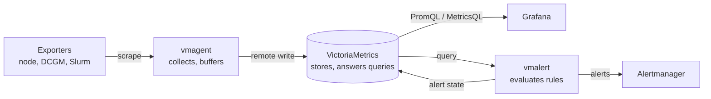

# The Prometheus That Ate the Head Node: Why VictoriaMetrics

<!-- related-block -->

9 min read

<!-- related-block -->

**See also:** [Booked Is Not Busy: GPU Allocation vs Utilization](/fields/devops/kubernetes/gpu-allocation-vs-utilization.md)  ·  **Read next:** [A Single Node You Can Trust: Installing VictoriaMetrics Properly](/fields/devops/victoriametrics/single-node-in-ten-minutes.md)

> **Part 1 of the [VictoriaMetrics series](/fields/devops/victoriametrics/README.md).** No commands yet, just the mental model. By the end you'll know what VictoriaMetrics is, which of its pieces you need, whether one box will do, and what it won't do for you.

- [The 02:40 page](#the-0240-page)
- [One binary that stores, scrapes and answers](#one-binary-that-stores-scrapes-and-answers)
- [The cast](#the-cast)
- [One box or a cluster?](#one-box-or-a-cluster)
- [What's free and what isn't](#whats-free-and-what-isnt)
- [What it's not for](#what-its-not-for)
- [Back to the head node](#back-to-the-head-node)
- [References](#references)

---

## The 02:40 page

Friday afternoon, someone turns on extra GPU metrics across the training partition. More labels per GPU, more series per node. Nobody thinks of it as a monitoring change. It's "just an exporter flag".

At 02:40 the Prometheus on the head node gets OOM-killed. systemd restarts it, it replays its write-ahead log, it eats the RAM again, it dies again. By morning there's a seven-hour hole in every dashboard, and the one night you needed GPU temperatures is the one night you don't have them.

The fix people reach for first is "give it more RAM". The fix that lasts is to ask a different question: does the thing collecting the metrics also have to be the thing storing them for months? That question is where VictoriaMetrics comes in.

> [!NOTE]
> The story is a composite, not a measured incident. Every number further down this page comes from the VictoriaMetrics documentation, and the docs' own performance numbers are labelled as the vendor's claims.

---

## One binary that stores, scrapes and answers

**VictoriaMetrics** is a time series database that speaks Prometheus. It accepts the same scrape config, answers the same query API on port `8428`, and Grafana talks to it as if it were Prometheus. Its query language, **MetricsQL**, is built to be backwards-compatible with PromQL, adds extra functions, and has a few deliberate differences (part 5 shows them on real data).

The single-node version is one executable with no external dependencies. All configuration is command-line flags, and all data lives in one directory set by `-storageDataPath`. Two flags matter on day one:

| Flag | Default | What it does |
| --- | --- | --- |
| `-storageDataPath` | `victoria-metrics-data` in the current directory | Where every byte of data goes |
| `-retentionPeriod` | `1M` (31 days); minimum `1d` | How long data is kept before deletion |

Here's the mental model. Prometheus is one process that does four jobs: discover targets, scrape them, store the samples, evaluate rules. VictoriaMetrics lets you split those jobs across small programs, so one job running out of room doesn't take the others with it.

*Collect at the edge, store in one place, alert from rules. Each arrow is a job Prometheus does inside one process.*

You don't have to split anything on day one. The single node can scrape targets itself with the same `prometheus.yml`. The split is there for when you need it.

---

## The cast

Every component ships in the official release tarballs. You'll meet most of them in this series.

| Component | What it does | When you need it |
| --- | --- | --- |
| **victoria-metrics** (single-node) | Stores samples, answers queries, can scrape targets itself | Always. This is the database |
| **vmagent** | Scrapes and accepts pushed metrics, relabels them, buffers to disk when storage is down | When collection and storage live on different hosts, or the link between them isn't perfect (part 3) |
| **vmalert** | Evaluates Prometheus-style alerting and recording rules against VictoriaMetrics | When you want alerts. It sends them to Alertmanager; it doesn't route them itself (part 5) |
| **vmalert-tool** | Unit-tests alert rules against fake series | Before every rule change (part 5) |
| **vmbackup / vmrestore** | Backs up from instant snapshots to S3, GCS, Azure or a local path; restores them | From the first day you'd be sad to lose the data (part 4) |
| **vmauth** | Auth proxy and load balancer in front of the other components | When anything outside a trusted network needs access |
| **vmctl** | Migrates data in from Prometheus, Thanos, InfluxDB, OpenTSDB and others | Moving history from an existing system |
| **vminsert / vmselect / vmstorage** | The cluster version: ingestion, querying and storage as separate scalable services | When one machine truly isn't enough (next section) |

Rule of thumb: **one job per program, and only the programs you need.** For most clusters that's the single node, vmagent, vmalert and vmbackup.

---

## One box or a cluster?

The docs are blunt about this: try single-node first, and move to the cluster version only when you hit its limits. Single-node avoids shipping data between processes over the network, so for moderate workloads it's the most efficient option.

How big is "moderate"? The capacity planning section lists a single node working in production, according to VictoriaMetrics' own case studies, at 1.5+ million samples per second ingested and 50+ million active time series. Treat those as the vendor's numbers, not a promise for your hardware, but they're far above what most HPC sites push.

| Question | Single-node | Cluster |
| --- | --- | --- |
| Moving parts | One process | Three services, each with replicas |
| Scales | Vertically: bigger box | Horizontally: more boxes |
| High availability | Two identical nodes, vmagent writing to both | Built into the design |
| Multitenancy | Not built in; emulated with a tenant label enforced by vmauth or Grafana | Native tenants |
| Upgrade path | Data format differs from the cluster's; moving needs re-ingestion | n/a |

The trade-off nobody mentions until it's too late is the last row. Single-node and cluster store data differently on disk, so you can't copy a single node's data into `vmstorage`. The docs say you can query both side by side while old data ages out, or re-ingest it.

**Recommendation:** start with one single node, sized with the [capacity planning](/fields/devops/victoriametrics/retention-disk-and-backups.md) method in part 4. Add a second identical node fed by vmagent when "metrics down" becomes an incident instead of an inconvenience. Reach for the cluster when one machine's RAM or disk can't hold your active series and retention, or when you need tenants. "It sounds more serious" isn't a reason.

---

## What's free and what isn't

VictoriaMetrics is Apache 2.0 licensed, and the community edition is the full database. Some features are Enterprise-only. These are the ones admins ask about most:

| Feature | Community | Enterprise | Community workaround |
| --- | --- | --- | --- |
| Single-node, cluster, vmagent, vmalert, vmbackup, vmrestore, vmauth | Yes | Yes | n/a |
| One retention for all data | Yes | Yes | n/a |
| Different retention per series (`-retentionFilter`) | No | Yes | Run one instance per retention, put vmauth in front |
| Downsampling old data (`-downsampling.period`) | No | Yes | Keep less raw data, or record aggregates with vmalert |
| Scheduled backups with rotation (vmbackupmanager) | No | Yes | vmbackup from a cron job or systemd timer (part 4) |
| Long-term support release lines | No | Yes | Track the latest release |

> [!NOTE]
> As of v1.156.0, the old `-license*` flags are deprecated and treated as `-eula`. Only matters if you run Enterprise binaries.

---

## What it's not for

Knowing what a tool won't do saves you from bolting it onto the wrong problem.

- **Logs.** VictoriaMetrics stores numbers over time, not text lines. The same company makes VictoriaLogs for that.
- **Traces.** Same story: a separate product, VictoriaTraces.
- **Routing and silencing alerts.** vmalert decides *that* an alert fires. Who gets paged, grouping and silences still belong to Alertmanager.
- **Per-event records.** "Which job ran on cn042 at 14:03" is a Slurm accounting question. Metrics tell you that cn042's GPU 3 was at 98% utilisation, not who put it there.
- **Being reachable from the internet.** The docs say all components must sit in a protected network, with vmauth or vmgateway in front of anything untrusted. Part 2 shows why that's not paranoia.

---

## Back to the head node

The fix for the 02:40 page isn't a bigger Prometheus. Each thing that went wrong that night has its own fix, and each part of this series builds one:

| What went wrong at 02:40 | What fixes it | Where |
| --- | --- | --- |
| Storing months of data shared a process and a box with collecting it | A dedicated single node, sized from a day-long test, with 50% RAM spare | [Part 2](/fields/devops/victoriametrics/single-node-in-ten-minutes.md), [part 4](/fields/devops/victoriametrics/retention-disk-and-backups.md) |
| While storage was down, nothing wrote the samples down | A vmagent per rack that queues on disk and catches up afterwards | [Part 3](/fields/devops/victoriametrics/vmagent-and-the-network-blip.md) |
| Nobody knew until morning | Alerts on the database's own health, evaluated from outside it, with tests that catch a broken rule | [Part 5](/fields/devops/victoriametrics/metricsql-and-vmalert.md) |
| A bad night could have been a lost disk | Hourly backups, and a restore you've actually run | [Part 4](/fields/devops/victoriametrics/retention-disk-and-backups.md) |

Run that Friday again with all four in place. The new GPU metrics push the series count up, and the storage box has headroom for it. If it hadn't, an alert would say so at 02:41, vmagent would hold the samples while someone fixed it, and the morning dashboards would have temperatures in them.

**Takeaway:** VictoriaMetrics is a Prometheus-compatible store you can split into collect, store and alert; start with one single node and only add moving parts when a real limit asks for them.

**Next:** [Part 2, A Single Node You Can Trust](/fields/devops/victoriametrics/single-node-in-ten-minutes.md), installs one and locks it down.

---

## References

- [VictoriaMetrics single-node docs](https://docs.victoriametrics.com/victoriametrics/single-server-victoriametrics/): prominent features, components, default flags and port, capacity planning, scalability and cluster version, retention filters, downsampling, security recommendations.
- [VictoriaMetrics Enterprise](https://docs.victoriametrics.com/victoriametrics/enterprise/): the list of Enterprise-only features.
- [LTS releases](https://docs.victoriametrics.com/victoriametrics/lts-releases/): long-term support lines are Enterprise-only.
- [Cluster version docs](https://docs.victoriametrics.com/victoriametrics/cluster-victoriametrics/): vminsert, vmselect, vmstorage and multitenancy.
- [vmalert docs](https://docs.victoriametrics.com/victoriametrics/vmalert/): relies on Alertmanager via `-notifier.url`.
- [MetricsQL](https://docs.victoriametrics.com/victoriametrics/metricsql/): compatibility with PromQL and the intentional differences.
- [VictoriaMetrics changelog 2026](https://docs.victoriametrics.com/victoriametrics/changelog/changelog_2026/): v1.156.0 release notes, including the `-license*` deprecation.
- [VictoriaMetrics LICENSE](https://github.com/VictoriaMetrics/VictoriaMetrics/blob/master/LICENSE): Apache License 2.0.
