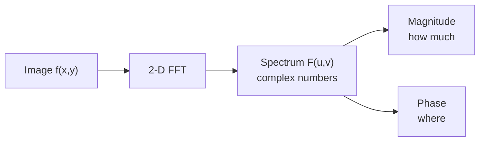

# The Fourier Transform for Images

> **Part 5 of the [Digital Image Processing series](/fields/digital-image-processing/README.md).** The same town, heard as a choir instead of seen as a grid. By the end you'll read the DFT formula as "how much of each wave is in this image", compute a small one by hand, and know why the convolution theorem makes the whole frequency domain worth the trouble.

## Table of Contents
- [The Fourier Transform for Images](#the-fourier-transform-for-images)
  - [Table of Contents](#table-of-contents)
  - [Two faces, swapped](#two-faces-swapped)
  - [A town as a choir](#a-town-as-a-choir)
  - [The 1-D DFT, slowly](#the-1-d-dft-slowly)
  - [Try it before you scroll](#try-it-before-you-scroll)
  - [A 4-point DFT by hand](#a-4-point-dft-by-hand)
  - [From one dimension to two](#from-one-dimension-to-two)
  - [Reading a spectrum picture](#reading-a-spectrum-picture)
  - [Magnitude tells how much, phase tells where](#magnitude-tells-how-much-phase-tells-where)
  - [The convolution theorem](#the-convolution-theorem)
  - [Back to the swapped faces](#back-to-the-swapped-faces)
    - [References](#references)

---

## Two faces, swapped

Take two photos: a face and a cityscape. Compute the Fourier transform of each. Now build a new image from the **magnitude of the face** and the **phase of the cityscape**. What do you see?

The cityscape. Not a face with a skyline pattern on it: the skyline, buildings and all, in odd colours of gray.

Spoiler for the end of the page: the thing that tells you *what's in the picture* is not the one you'd guess. To understand why, we need to know what these two numbers are.

---

## A town as a choir

Every image, however messy, can be written as a **sum of waves**: stripes of different thickness, direction and brightness. Thick, lazy stripes are **low frequencies** (overall shading). Thin, dense stripes are **high frequencies** (edges, texture, noise).

Pixel Town as a choir: each possible stripe pattern is a singer. The Fourier transform answers one question about every singer: **how loudly are they singing, and when do they come in?**

- The loudness is the **magnitude**.
- Their timing relative to the others is the **phase**.

That's it. Everything below is the formula for doing this carefully.

---

## The 1-D DFT, slowly

Start with one row of N pixels f(x). The **discrete Fourier transform** (DFT) is:

$$F(u) = \sum_{x=0}^{N-1} f(x)\, e^{-j 2\pi u x / N}, \qquad u = 0, 1, \dots, N-1$$

Read it as a recipe:

| Piece | Meaning |
|---|---|
| u | Which singer: how many full wave cycles fit across the row |
| e^(−j2πux/N) | A spinning arrow, the "test wave" of frequency u |
| f(x) · wave | How much the pixel agrees with that wave |
| ∑ over x | Add up the agreement: big if the row looks like that wave, near 0 if not |

By Euler's formula, e^(−jθ) = cos θ − j sin θ, so each test wave has a cosine part and a sine part. F(u) is a **complex number**: its length is the magnitude, its angle is the phase.

Two facts to pin to the wall:

- **F(0) is the sum of all pixels**, because at u = 0 the wave is just 1. Divide by N for the average brightness. This is the "DC term".
- For a **real** image, the transform is conjugate symmetric: F(N−u) = conj(F(u)). So half the spectrum is redundant.

---

## Try it before you scroll

☕ A row of four pixels: **1, 2, 3, 4**. What is F(0)? And what do you expect for the high-frequency terms of a steady ramp?

*Hint: F(0) is the plain sum.*

**Answer:** F(0) = 1 + 2 + 3 + 4 = **10**. The rest is next.

---

## A 4-point DFT by hand

For N = 4, the spinning arrow for step n at frequency u is (−j)^(u·n), because e^(−j2π/4) = −j. The powers of −j cycle through 1, −j, −1, j.

| u | Calculation | F(u) |
|---|---|---|
| 0 | 1 + 2 + 3 + 4 | **10** |
| 1 | 1·1 + 2·(−j) + 3·(−1) + 4·(j) = 1 − 2j − 3 + 4j | **−2 + 2j** |
| 2 | 1 − 2 + 3 − 4 | **−2** |
| 3 | 1·1 + 2·(j) + 3·(−1) + 4·(−j) = 1 + 2j − 3 − 4j | **−2 − 2j** |

Check the symmetry: F(3) is the conjugate of F(1) ✓.

What happened is intuitive: the big number (10) is the average level, and the ramp shows up as small leftover terms because it's not a pure wave. Magnitudes: |F(1)| = √8 ≈ 2.83, |F(2)| = 2.

```python
# Not executed - the same thing in NumPy (its forward FFT has no 1/N factor).
import numpy as np
print(np.fft.fft([1, 2, 3, 4]))   # expected by the hand calculation: [10.+0.j, -2.+2.j, -2.+0.j, -2.-2.j]
```

> [!NOTE]
> Where the 1/N (or 1/MN) factor sits differs between textbooks and libraries. NumPy leaves the forward transform unscaled and divides on the inverse; some books scale the forward one. Magnitudes differ by that factor, shapes don't.

---

## From one dimension to two

For an M × N image, the transform has two frequency axes, u (paired with x, running over M) and v (paired with y, running over N):

$$F(u,v) = \sum_{x=0}^{M-1}\sum_{y=0}^{N-1} f(x,y)\, e^{-j2\pi\left(\frac{ux}{M}+\frac{vy}{N}\right)}$$

Each (u, v) is a stripe pattern: u, v say how many cycles run in each direction, and so the **direction** of the stripes. The 2-D DFT is separable: do a 1-D DFT along every row, then along every column of the result. That's how it is computed fast. The **FFT** brings the cost from about (MN)² down to about MN·log(MN).

---

## Reading a spectrum picture

The standard picture shows |F(u,v)| as an image, and you need three tricks to read it:

| Trick | Why |
|---|---|
| **Shift** the origin to the centre | By default the DC term (0,0) is at the corner; the shift puts low frequencies in the middle, high ones outward |
| **Log scale** | The DC term is enormous compared with everything else; log(1 + \|F\|) (page 2) makes the rest visible |
| Read **direction**, not position | A bright dot at distance d from the centre means stripes of frequency d; the line from the centre points perpendicular to the stripes |

A photo of a vertical picket fence gives a bright horizontal row of dots through the centre: vertical stripes mean frequency changes along the horizontal axis.



*One transform, two pictures. Only one of them is the usual spectrum image.*

---

## Magnitude tells how much, phase tells where

Back to the faces. The magnitude says how much energy sits at each stripe pattern: the **texture and tone budget**. The phase says how those stripes line up with each other, and that **alignment is the structure**: where edges fall, where objects sit.

Wipe out the phase and every singer starts at a random time: the loudness is right, the song is noise. Keep the phase and use the wrong loudness: the melody survives. That's the result of Oppenheim and Lim's classic experiments on phase in images, and it explains the swapped faces.

Since the magnitude is the part everyone draws, most intuition about spectrum pictures is about the less important half.

---

## The convolution theorem

Here is the reason to bother. Sliding a kernel over an image (page 3) is convolution. In the frequency domain it becomes **plain multiplication**:

$$f * h \;\longleftrightarrow\; F\cdot H$$

The convolution of two signals has the DFT equal to the **product** of their DFTs, element by element. Read it two ways:

- **Speed:** a large kernel costs k² per pixel in the spatial domain; the FFT route costs about log(MN) per pixel no matter the kernel size. Beyond small kernels, multiplication wins.
- **Understanding:** every spatial filter has a frequency-domain description H(u,v) that says **which frequencies it lets through and how much**. The box blur keeps lows and kills highs. Sobel kills lows and passes highs. The Laplacian, as page 4 found, boosts highs.

One gotcha for later: the DFT treats the image as if it repeated forever, so the product corresponds to a **circular** convolution, which wraps around the borders. That bites on page 6.

---

## Back to the swapped faces

The cityscape won because the phase carries the **layout**, and layout is what we recognize. The face's magnitude only supplied the "which gray levels and textures", which is much harder to see.

You now have a dictionary: spatial position becomes frequency, smooth becomes low frequency, edges and noise become high frequency, and filtering becomes multiplication. If a kernel is a vote among neighbours, a frequency filter is a **volume knob for each singer**.

**Takeaway:** the DFT rewrites an image as waves; magnitude is how much, phase is where, and the convolution theorem turns filtering into multiplication.

**Next:** if we can multiply the choir by a mask, which masks work, and what goes wrong when we sample the town too coarsely? [Part 6: Frequency filtering and aliasing](/fields/digital-image-processing/frequency-filtering-and-aliasing.md).

### References

- R. C. Gonzalez and R. E. Woods, *Digital Image Processing*, 4th ed., Pearson, 2018: chapter 4, "Filtering in the Frequency Domain" (2-D DFT, properties, convolution theorem).
- A. V. Oppenheim and J. S. Lim, "The importance of phase in signals", *Proceedings of the IEEE*, 69(5), 529-541, 1981.
- NumPy documentation, [Discrete Fourier Transform (numpy.fft)](https://numpy.org/doc/stable/reference/routines.fft.html): normalization conventions, `fft2`, `fftshift`.
