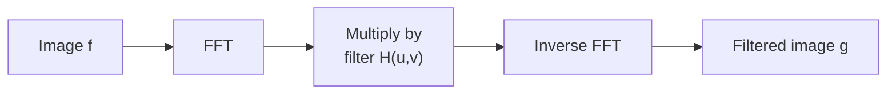

# Frequency Filtering and Aliasing

<!-- related-block -->

7 min read

<!-- related-block -->

**Read first:** [The Fourier Transform for Images](/fields/digital-image-processing/fourier-transform-for-images.md)  ·  **See also:** [Geometric Transforms and Interpolation](/fields/digital-image-processing/geometric-transforms-and-interpolation.md)  ·  **Read next:** [Noise and Restoration](/fields/digital-image-processing/noise-and-restoration.md)

> **Part 7 of the [Digital Image Processing series](/fields/digital-image-processing/README.md).** Give the choir a volume knob for every singer, then find out what happens when the town is too small to hear the fast ones. By the end you'll design a filter as a mask, explain ringing, and compute an alias by hand.

## Table of Contents
- [Frequency Filtering and Aliasing](#frequency-filtering-and-aliasing)
  - [Table of Contents](#table-of-contents)
  - [The shirt that shimmers](#the-shirt-that-shimmers)
  - [The recipe: transform, multiply, transform back](#the-recipe-transform-multiply-transform-back)
  - [Low-pass: three ways to turn the highs down](#low-pass-three-ways-to-turn-the-highs-down)
  - [Why the ideal filter rings](#why-the-ideal-filter-rings)
  - [High-pass and notch](#high-pass-and-notch)
  - [Try it before you scroll](#try-it-before-you-scroll)
  - [Sampling and the Nyquist rule](#sampling-and-the-nyquist-rule)
  - [Aliasing in practice](#aliasing-in-practice)
  - [Wraparound: the border gotcha](#wraparound-the-border-gotcha)
  - [Back to the shirt](#back-to-the-shirt)
    - [References](#references)

---

## The shirt that shimmers

A news anchor wears a fine striped shirt. On camera, the stripes crawl and shimmer in slow rainbow bands that aren't on the shirt at all. The producers have a name for it: moiré. The viewers have another name for it: "why is his shirt doing that?".

The shirt has stripes. The camera has a grid. When the stripes are finer than the grid can describe, the grid doesn't just miss them: it reports **different stripes that were never there**. Before we explain that, we need the tool that makes it obvious: filtering by frequency.

---

## The recipe: transform, multiply, transform back

Thanks to the convolution theorem, filtering in the frequency domain is a three-step recipe:

$$G(u,v) = H(u,v)\,F(u,v)$$

*H is a mask the same size as the spectrum. Values near 1 keep a frequency, values near 0 remove it.*

Let D(u,v) be the distance of a frequency from the centre of the (shifted) spectrum, and D₀ the **cutoff**. Everything below is a different way to design H.

---

## Low-pass: three ways to turn the highs down

A **low-pass** filter keeps low frequencies (smooth shading) and removes high ones (edges, texture, noise). It blurs.

| Filter | H(u,v) | Character |
|---|---|---|
| Ideal | 1 if D ≤ D₀, else 0 | Sharp cutoff, **rings** (next section) |
| Butterworth (order n) | 1 / (1 + (D/D₀)^(2n)) | Smooth cutoff; larger n is steeper and rings more |
| Gaussian | exp(−D² / (2·D₀²)) | Smoothest; **no ringing** |

The Gaussian has a bonus: its inverse transform is also a Gaussian. A Gaussian mask in frequency matches a Gaussian kernel in space, so it's the same blur as page 4, just designed from the other side.

> [!TIP]
> Recommendation: use the Gaussian unless you have a reason not to. It's the only one of the three with no artifacts. Pick the Ideal filter only to see the artifact once, for the lesson.

---

## Why the ideal filter rings

An ideal low-pass is a perfect circle of 1s with a hard wall. Its equivalent spatial kernel, via the inverse transform, is not a gentle blob. It's a **sinc**-like function: a central peak with endless decaying ripples around it.

Convolve a sharp edge with ripples and you get ripples next to the edge: faint bands that follow every edge, like the echo after a shout in a stairwell. It's the same overshoot and undershoot as page 5's sharpening, now caused by cutting frequencies too abruptly.

The rule: **a sharp edge in one domain becomes ripples in the other.** A softer cutoff means fewer ripples. That's why Gaussian wins.

---

## High-pass and notch

Turn the knob the other way and you get a **high-pass** filter: H_hp = 1 − H_lp. It removes smooth shading and keeps edges, which is another way to see the sharpening of page 5: unsharp masking is "the original plus some high-pass".

A **notch** filter removes one specific frequency, or a symmetric pair, and leaves everything else alone. It's the right tool for **periodic noise**, such as the regular line pattern from a scanner or a screen-captured halftone. In the spectrum that noise shows up as a few isolated bright dots, and you mask just those dots. No spatial kernel can do that as cleanly.

| Goal | Filter | Mask looks like |
|---|---|---|
| Blur, remove noise | Low-pass | Bright disc in the centre |
| Find edges, sharpen | High-pass | Dark disc in the centre |
| Remove a repeating pattern | Notch | Everything on except small holes at the bright dots |

---

## Try it before you scroll

☕ A signal contains a pure 9 Hz wave. You sample it **10 times per second**. When you look at the samples, what frequency do they appear to have?

*Hint: 10 samples per second can describe at most 5 Hz honestly.*

**Answer:** **1 Hz.** Keep reading for why.

---

## Sampling and the Nyquist rule

To capture a wave faithfully you must sample it more than **twice per cycle**. The **Nyquist–Shannon sampling theorem** says: if the highest frequency in the signal is f_max, you need

$$f_s > 2\, f_{\max}$$

samples per unit length (per second, or per millimetre across a scene) to be able to reconstruct it. Half the sampling rate, f_s / 2, is the **Nyquist frequency**: the fastest wave the grid can honestly describe.

Anything faster doesn't vanish. It **folds back** into the range the grid can see. A wave at frequency f above the Nyquist limit appears at |f − k·f_s| for the integer k that lands it inside the range. For our case: |9 − 10| = **1 Hz**.

That's **aliasing**: a fast wave pretending to be a slow one.

---

## Aliasing in practice

Back on the shirt. The stripes are too fine for the camera's pixel grid. The sensor reports a much coarser stripe pattern that isn't on the shirt: moiré.

The same effect appears in three places you've met:

| Where | What happens |
|---|---|
| Camera or scanner | Fine patterns (shirts, screens, brick, halftone) make moiré |
| Shrinking an image | Picking every second pixel drops fine detail into false jagged patterns |
| Wheel on video | The wheel appears to turn slowly or backward (temporal aliasing, same math) |

The **fix is applied before sampling**: remove the frequencies the grid can't carry, by blurring with a low-pass filter, then sample. Optical cameras use an anti-aliasing filter on the sensor for exactly this. In software, **blur, then downsample**. Shrinking without blurring first is the standard cause of "my thumbnails look crunchy". OpenCV's `INTER_AREA` option for `resize` exists for this reason, and its docs recommend it for shrinking.

Once aliasing has happened it can't be undone: the information about the true frequency is gone, and the 1 Hz you see could just as well have come from a real 1 Hz wave.

---

## Wraparound: the border gotcha

One trap from [page 6](/fields/digital-image-processing/fourier-transform-for-images.md): multiplying DFTs corresponds to **circular** convolution, as if the image repeated like wallpaper. Filter without care and the left edge's content bleeds in from the right edge.

The fix is to **pad** the image with zeros (to at least the image size plus the kernel size) before transforming, filter, and crop afterwards.

---

## Back to the shirt

The anchor's shirt had stripes finer than the Nyquist limit of the camera, so they folded down into slow bands: moiré. You can't fix it after the fact. You fix it before: change the shirt, move the camera, or blur optically.

And the choir picture holds: each singer is a frequency, the grid can only hear up to half its sampling rate, and any singer above that is mistaken for a lower one.

**Takeaway:** a frequency filter is a mask on the spectrum (Gaussian is the safe choice), and sampling below twice the highest frequency creates aliases that can't be undone.

**Next:** real images arrive damaged by noise and blur. Can you undo the damage by dividing it out? [Part 8: Noise and restoration](/fields/digital-image-processing/noise-and-restoration.md).

### References

- R. C. Gonzalez and R. E. Woods, *Digital Image Processing*, 4th ed., Pearson, 2018: chapter 4 (sampling and the Fourier transform of sampled functions, aliasing, lowpass, highpass and notch filters).
- C. E. Shannon, "Communication in the Presence of Noise", *Proceedings of the IRE*, 37(1), 10-21, 1949.
- OpenCV documentation, [Geometric Image Transformations](https://docs.opencv.org/4.x/da/d54/group__imgproc__transform.html): `resize` and `INTER_AREA`.
