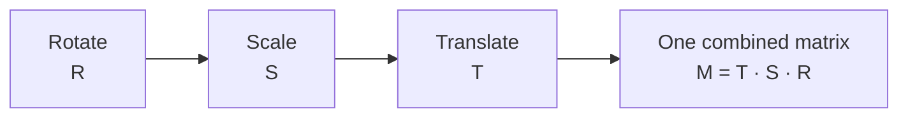

# Geometric Transforms and Interpolation

<!-- related-block -->
<div class="reading-time">7 min read</div>
<!-- related-block -->
<div class="related-strip">

**Read first:** [Images Are Just Matrices](/fields/digital-image-processing/images-are-just-matrices.md)  ·  **See also:** [Frequency Filtering and Aliasing](/fields/digital-image-processing/frequency-filtering-and-aliasing.md)

</div>


> **Part 2 of the [Digital Image Processing series](/fields/digital-image-processing/README.md).** Every rotation, zoom and shift moves citizens to squares that don't exist. By the end you'll write a transform as one matrix, explain why real code loops over the **output** instead of the input, and compute a bilinear interpolation on paper.

## Table of Contents
- [Geometric Transforms and Interpolation](#geometric-transforms-and-interpolation)
  - [Table of Contents](#table-of-contents)
  - [The jagged scan](#the-jagged-scan)
  - [Moving a citizen](#moving-a-citizen)
  - [One matrix for everything: homogeneous coordinates](#one-matrix-for-everything-homogeneous-coordinates)
  - [Order matters](#order-matters)
  - [Try it before you scroll](#try-it-before-you-scroll)
  - [Forward mapping leaves holes](#forward-mapping-leaves-holes)
  - [Interpolation: guessing between citizens](#interpolation-guessing-between-citizens)
  - [Bilinear, by hand](#bilinear-by-hand)
  - [Beyond affine](#beyond-affine)
  - [Back to the jagged scan](#back-to-the-jagged-scan)
    - [References](#references)

---

## The jagged scan

You rotate a scanned page by 3 degrees to straighten it. The text, once clean, now has staircase edges, and thin lines look broken.

Nothing was lost to noise or blur. The problem is arithmetic: a rotated citizen almost never lands exactly on a square, and something has to decide what number to write on the squares that are left.

---

## Moving a citizen

Each pixel at position (x, y) goes to a new position (x', y'). The basic moves:

| Transform | Formula | What it does |
|---|---|---|
| Translation | x' = x + tₓ, y' = y + t_y | Slides the image |
| Scaling | x' = sₓ·x, y' = s_y·y | Zooms in or out |
| Rotation by θ | x' = x·cos θ − y·sin θ, y' = x·sin θ + y·cos θ | Spins around the origin |
| Shear | x' = x + k·y | Slants, like italics |

The first three are fine as formulas but they don't compose nicely: translation **adds** while the rest **multiply**. That's awkward when you want to chain moves.

---

## One matrix for everything: homogeneous coordinates

The trick is to give each point an extra coordinate of 1, writing (x, y) as (x, y, 1). Now every move above, translation included, is a 3 × 3 matrix multiplication:

$$\begin{bmatrix}x'\\y'\\1\end{bmatrix}=\begin{bmatrix}a&b&t_x\\c&d&t_y\\0&0&1\end{bmatrix}\begin{bmatrix}x\\y\\1\end{bmatrix}$$

The 2 × 2 block (a, b, c, d) does rotation, scale and shear; the last column (tₓ, t_y) does translation. Together they are an **affine transform**: lines stay lines and parallel lines stay parallel. It has **6 free numbers**, so three matching point pairs pin it down.



*Chaining moves is multiplying matrices. The combined matrix then moves each pixel in a single step.*

---

## Order matters

Matrix multiplication isn't commutative, so the order of the moves changes the result. With the rightmost matrix applied first:

| Order | What happens |
|---|---|
| Rotate, then translate | The image spins about its own origin corner, then slides away |
| Translate, then rotate | The image slides first, then the whole thing swings around the origin like a pendulum, ending somewhere else |

To rotate an image about its **centre**, the recipe is: translate the centre to the origin, rotate, then translate back. In matrix form M = T(centre) · R(θ) · T(−centre).

> [!WARNING]
> Image y points **down** (page 1). A rotation matrix written for the usual math plot with y pointing up turns the image the opposite way on screen. If your picture rotates the wrong direction, flip the sign of θ. OpenCV's `getRotationMatrix2D` documents its own sign convention: check it, don't guess.

---

## Try it before you scroll

☕ Rotate the point (10, 0) by 45° about the origin. **Are the new coordinates whole numbers?**

*Hint: cos 45° ≈ 0.707.*

**Answer:** no. x' = 10·0.707 ≈ **7.07**, y' = 10·0.707 ≈ **7.07**. The citizen lands between squares, which is the whole problem.

---

## Forward mapping leaves holes

The obvious program loops over every **input** pixel, computes where it goes, and writes its value there. This is **forward mapping**, and it has two flaws:

- Several input pixels may land on one output square (it gets overwritten).
- Some output squares get no one at all, leaving **holes**. Scale up by 2 and three out of four output squares are empty.

The fix is to run the machine backwards. For each **output** pixel, use the **inverse** matrix to find where it came from in the input, and read the value there:

$$\begin{bmatrix}x\\y\\1\end{bmatrix}=M^{-1}\begin{bmatrix}x'\\y'\\1\end{bmatrix}$$

This is **inverse (backward) mapping**. Every output square is visited exactly once, so there are no holes. The source position will usually be fractional (7.07, say), and so we need a way to read a value "between" citizens.

---

## Interpolation: guessing between citizens

**Interpolation** estimates the image value at a fractional position from the nearest real pixels.

| Method | Uses | Result | Cost |
|---|---|---|---|
| Nearest neighbour | The 1 closest pixel | Blocky, jagged edges, but keeps original values exactly | Cheapest |
| Bilinear | The 4 surrounding pixels, weighted by distance | Smooth, slightly soft | Moderate |
| Bicubic | The 16 surrounding pixels (4 × 4), cubic weights | Sharper than bilinear, mild overshoot possible | Higher |

The jagged scan came from nearest neighbour (or from careless rounding). Bilinear is the sensible default; bicubic is worth it when you scale up and care about sharpness. Nearest neighbour stays the right choice for **label images** (class masks), where blending two class ids would produce a class that doesn't exist.

---

## Bilinear, by hand

Say the source position is a fraction a to the right and b downward of a square whose four corner pixels are:

```text
f00 (top-left)      f10 (top-right)
f01 (bottom-left)   f11 (bottom-right)
```

The bilinear formula weights each corner by how close you are to it:

$$f(a,b)=(1-a)(1-b)\,f_{00}+a(1-b)\,f_{10}+(1-a)\,b\,f_{01}+a\,b\,f_{11}$$

Take corners f00 = 10, f10 = 20, f01 = 30, f11 = 40.

| Position (a, b) | Working | Result |
|---|---|---|
| (0.5, 0.5) | average of the four: (10 + 20 + 30 + 40) / 4 | **25** |
| (0.25, 0.5) | 0.375·10 + 0.125·20 + 0.375·30 + 0.125·40 = 3.75 + 2.5 + 11.25 + 5 | **22.5** |
| (0, 0) | all weight on f00 | **10** |

At a grid point the answer is the original pixel; in between it slides smoothly. The same result comes from two steps of 1-D interpolation: along the top edge, along the bottom edge, then between those two.

---

## Beyond affine

An affine transform keeps parallel lines parallel. A **perspective (homography)** transform, a full 3 × 3 matrix with a free bottom row followed by a divide by the third coordinate, doesn't. It has **8 free numbers** (four point pairs) and models a flat surface seen from an angle: straightening a photographed document, say. The same inverse-map-and-interpolate loop applies.

**Shrinking** needs one more care, which [page 7](/fields/digital-image-processing/frequency-filtering-and-aliasing.md) explains in full: reduce the image by a large factor without blurring first and the result aliases. OpenCV's docs recommend `INTER_AREA` when shrinking.

---

## Back to the jagged scan

Rotating by 3 degrees maps nearly every pixel to a fractional position. With nearest neighbour you pick the closest square and the edge becomes a staircase. With bilinear you blend four neighbours: the edges smooth out, and a thin line gets slightly softer, which is the price.

The cleaner pipeline is inverse mapping with bilinear or bicubic, and only **one** resampling step. Rotating twice in a row compounds the blur, so combine the moves into a single matrix first.

**Takeaway:** one 3 × 3 matrix handles every affine move; always map output to input, and choose the interpolation to suit the data.

**Next:** so far we moved the citizens. What if we only change what their cards say, to rescue an image whose numbers are squeezed into a dark corner of the range? [Part 3: Intensity transforms and histograms](/fields/digital-image-processing/intensity-transforms-and-histograms.md).

### References

- R. C. Gonzalez and R. E. Woods, *Digital Image Processing*, 4th ed., Pearson, 2018: chapter 2 (geometric transformations, interpolation, homogeneous coordinates).
- OpenCV documentation, [Geometric Image Transformations](https://docs.opencv.org/4.x/da/d54/group__imgproc__transform.html): `warpAffine`, `warpPerspective`, `getRotationMatrix2D`, `resize` and interpolation flags.
