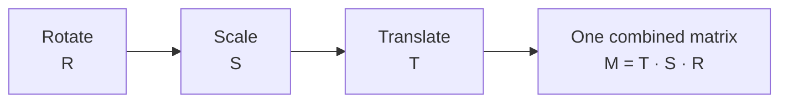

# The Jagged Scan: Geometric Transforms and Interpolation

> **Part 2 of the [Digital Image Processing series](/fields/digital-image-processing/README.md).** *Mira, Ravi and the records office are invented; the maths and numbers are real.*

On Thursday afternoon Mira will rotate a scanned ledger page by 3 degrees to straighten it. The text will come out with staircase edges and the thin ruled lines will break into dashes. Nothing will be wrong with the scanner, the file or the angle, which will make the next hour harder.

**By the end of this page you will be able to:**

- Write a rotation, zoom or shift as one matrix, and chain several into one.
- Explain which loop to run, over the input pixels or the output pixels, and why.
- Compute a bilinear interpolation on paper.
- Pick an interpolation for a photo and a different one for a class mask.
- Say what to do before you shrink an image by a large factor.

---

## The page that came out in stairs

14:10, the records office. A ledger page was scanned a little crooked, and the office wants it straight before it goes into the archive. Mira runs the team's `rotate` script with an angle of 3 degrees and opens the result.

The text, once clean, now has staircase edges. The thin ruled lines look broken, as if someone had drawn them with a dotted pen.

Her first reading is the obvious one: **a bad scan.** The noise must have been there all along and the rotation just made it visible.

---

## Three ways to make it worse

**Attempt 1: scan it again, bigger.** Ravi has the page rescanned at a higher resolution. Mira rotates it by the same 3 degrees. The staircase is back, just made of smaller stairs.

**Attempt 2: blur the stairs away.** She applies a blur to the rotated page. The stairs soften and so does the handwriting. The ruled lines are still broken, only fuzzier.

**Attempt 3: rotate it in smaller steps.** If one big turn is rough, three gentle ones must be smoother. She writes a loop that turns the page 1 degree at a time, three times, and queues it for the whole archive overnight. Ravi sees the job in the queue and cancels it before it starts: "Hold on. Let's find out what a rotation does to one pixel first."

So far:

- The scan is fine, and a bigger scan did not help.
- Blurring hides the damage without fixing it.
- Three small turns were about to be run on every page.

That leaves one question: **what does a rotation actually do to a single pixel?**

---

## Where does a rotated citizen land?

### Moving a citizen

Each pixel at position (x, y) goes to a new position (x', y'). The basic moves:

| Transform | Formula | What it does |
|---|---|---|
| Translation | x' = x + tₓ, y' = y + t_y | Slides the image |
| Scaling | x' = sₓ·x, y' = s_y·y | Zooms in or out |
| Rotation by θ | x' = x·cos θ − y·sin θ, y' = x·sin θ + y·cos θ | Spins around the origin |
| Shear | x' = x + k·y | Slants, like italics |

The first three are fine as formulas but they don't compose nicely: translation **adds** while the rest **multiply**. That's awkward when you want to chain moves.

### One matrix for everything: homogeneous coordinates

The trick is to give each point an extra coordinate of 1, writing (x, y) as (x, y, 1). Now every move above, translation included, is a 3 × 3 matrix multiplication:

$$\begin{bmatrix}x'\\y'\\1\end{bmatrix}=\begin{bmatrix}a&b&t_x\\c&d&t_y\\0&0&1\end{bmatrix}\begin{bmatrix}x\\y\\1\end{bmatrix}$$

The 2 × 2 block (a, b, c, d) does rotation, scale and shear; the last column (tₓ, t_y) does translation. Together they are an **affine transform**: lines stay lines and parallel lines stay parallel. It has **6 free numbers**, so three matching point pairs pin it down.



*Chaining moves is multiplying matrices. The combined matrix then moves each pixel in a single step.*

### Order matters

Matrix multiplication isn't commutative, so the order of the moves changes the result. With the rightmost matrix applied first:

| Order | What happens |
|---|---|
| Rotate, then translate | The image spins about its own origin corner, then slides away |
| Translate, then rotate | The image slides first, then the whole thing swings around the origin like a pendulum, ending somewhere else |

To rotate an image about its **centre**, the recipe is: translate the centre to the origin, rotate, then translate back. In matrix form M = T(centre) · R(θ) · T(−centre).

> [!WARNING]
> Image y points **down** (page 1). A rotation matrix written for the usual math plot with y pointing up turns the image the opposite way on screen. If your picture rotates the wrong direction, flip the sign of θ. OpenCV's `getRotationMatrix2D` documents its own sign convention: check it, don't guess.

### Try it before you scroll

☕ Rotate the point (10, 0) by 45° about the origin. **Are the new coordinates whole numbers?**

*Hint: cos 45° ≈ 0.707.*

**Answer:** no. x' = 10·0.707 ≈ **7.07**, y' = 10·0.707 ≈ **7.07**. The citizen lands between squares, which is the whole problem.

### Forward mapping leaves holes

The obvious program loops over every **input** pixel, computes where it goes, and writes its value there. This is **forward mapping**, and it has two flaws:

- Several input pixels may land on one output square (it gets overwritten).
- Some output squares get no one at all, leaving **holes**. Scale up by 2 and three out of four output squares are empty.

The fix is to run the machine backwards. For each **output** pixel, use the **inverse** matrix to find where it came from in the input, and read the value there:

$$\begin{bmatrix}x\\y\\1\end{bmatrix}=M^{-1}\begin{bmatrix}x'\\y'\\1\end{bmatrix}$$

This is **inverse (backward) mapping**. Every output square is visited exactly once, so there are no holes. The source position will usually be fractional (7.07, say), and so we need a way to read a value "between" citizens.

### Interpolation: guessing between citizens

**Interpolation** estimates the image value at a fractional position from the nearest real pixels.

| Method | Uses | Result | Cost |
|---|---|---|---|
| Nearest neighbour | The 1 closest pixel | Blocky, jagged edges, but keeps original values exactly | Cheapest |
| Bilinear | The 4 surrounding pixels, weighted by distance | Smooth, slightly soft | Moderate |
| Bicubic | The 16 surrounding pixels (4 × 4), cubic weights | Sharper than bilinear, mild overshoot possible | Higher |

The jagged scan came from nearest neighbour (or from careless rounding). Bilinear is the sensible default; bicubic is worth it when you scale up and care about sharpness. Nearest neighbour stays the right choice for **label images** (class masks), where blending two class ids would produce a class that doesn't exist.

### Bilinear, by hand

Say the source position is a fraction a to the right and b downward of a square whose four corner pixels are:

```text
f00 (top-left)      f10 (top-right)
f01 (bottom-left)   f11 (bottom-right)
```

The bilinear formula weights each corner by how close you are to it:

$$f(a,b)=(1-a)(1-b)\,f_{00}+a(1-b)\,f_{10}+(1-a)\,b\,f_{01}+a\,b\,f_{11}$$

Take corners f00 = 10, f10 = 20, f01 = 30, f11 = 40.

| Position (a, b) | Working | Result |
|---|---|---|
| (0.5, 0.5) | average of the four: (10 + 20 + 30 + 40) / 4 | **25** |
| (0.25, 0.5) | 0.375·10 + 0.125·20 + 0.375·30 + 0.125·40 = 3.75 + 2.5 + 11.25 + 5 | **22.5** |
| (0, 0) | all weight on f00 | **10** |

At a grid point the answer is the original pixel; in between it slides smoothly. The same result comes from two steps of 1-D interpolation: along the top edge, along the bottom edge, then between those two.

### Beyond affine

An affine transform keeps parallel lines parallel. A **perspective (homography)** transform, a full 3 × 3 matrix with a free bottom row followed by a divide by the third coordinate, doesn't. It has **8 free numbers** (four point pairs) and models a flat surface seen from an angle: straightening a photographed document, say. The same inverse-map-and-interpolate loop applies.

**Shrinking** needs one more care, which [page 7](/fields/digital-image-processing/frequency-filtering-and-aliasing.md) explains in full: reduce the image by a large factor without blurring first and the result aliases. OpenCV's docs recommend `INTER_AREA` when shrinking.

---

## Back to the jagged scan

Mira prints where one output pixel comes from in the input. The answer is a fraction, like 7.07 across and 7.07 down: the rotated citizen almost never lands on a square. Her script rounded it to the nearest square.

Rotating by 3 degrees maps nearly every pixel to a fractional position. With nearest neighbour you pick the closest square and the edge becomes a staircase. With bilinear you blend four neighbours: the edges smooth out, and a thin line gets slightly softer, which is the price.

The cleaner pipeline is inverse mapping with bilinear or bicubic, and only **one** resampling step. Rotating twice in a row compounds the blur, so combine the moves into a single matrix first.

She switches the script to inverse mapping with bilinear interpolation and one combined matrix. The text comes out clean and the ruled lines stay unbroken. She also deletes the three-step loop from the overnight queue, where it had been waiting.

The page was never badly scanned. It was just rotated by a program that rounded.

---

## Never again: how to move an image

| Situation | Do |
|---|---|
| Rotate, scale, shift or shear | Write one 3 × 3 matrix; chain moves by multiplying, rightmost applied first |
| Rotate about the centre | `M = T(centre) · R(θ) · T(−centre)` |
| Writing the loop | Loop over the **output** pixels and use the inverse matrix `M^-1` |
| Photos | Bilinear by default; bicubic when you scale up and care about sharpness |
| Label images (class masks) | Nearest neighbour, so no class id is invented |
| Several moves in a row | Combine them into one matrix: one resampling step, one dose of blur |
| Shrinking by a large factor | Blur first, or use `INTER_AREA` in OpenCV |
| Rotation goes the wrong way | y points down: flip the sign of θ, and read the library's own convention (`getRotationMatrix2D`) |

**Takeaway:** one 3 × 3 matrix handles every affine move; always map output to input, and choose the interpolation to suit the data.

**Next:** so far we moved the citizens. What if we only change what their cards say, to rescue an image whose numbers are squeezed into a dark corner of the range? [Part 3: Intensity transforms and histograms](/fields/digital-image-processing/intensity-transforms-and-histograms.md).

---

## 📜 The Scroll (keep this)

```text
Symptom:  Rotated text has stairs and dashed lines
Cause:    A rotated pixel lands between squares; nearest neighbour picks one
Check:    Print the source position of one output pixel: is it a fraction?
Do not:   Map input to output (holes); rotate in several steps (blur compounds)
Fix:      Inverse mapping, bilinear or bicubic, one combined matrix
Mask:     Class masks keep nearest neighbour
```


### References

- R. C. Gonzalez and R. E. Woods, *Digital Image Processing*, 4th ed., Pearson, 2018: chapter 2 (geometric transformations, interpolation, homogeneous coordinates).
- OpenCV documentation, [Geometric Image Transformations](https://docs.opencv.org/4.x/da/d54/group__imgproc__transform.html): `warpAffine`, `warpPerspective`, `getRotationMatrix2D`, `resize` and interpolation flags.
