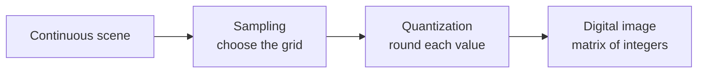

# The Scan That Opened Black: Images Are Just Matrices

> **Part 1 of the [Digital Image Processing series](/fields/digital-image-processing/README.md).** *Mira, Ravi and the radiology team are invented; the maths and numbers are real.*

At 09:40 Mira will open a medical scan that is, by every check she can run, perfectly fine. It will be black. She will spend a morning proving, with great care, that nothing is wrong with it, and every proof will be correct.

**By the end of this page you will be able to:**

- Explain what sampling and quantization throw away on purpose.
- Count the bytes in an uncompressed image.
- Predict what `250 + 10` does in NumPy and in OpenCV, and why it matters.
- Find the axis, type and range mistakes behind most "mystery" image bugs.
- Say why a file can be correct, a viewer can be correct, and the picture still look black.

---

## The scan that opened black

Mira is the newest engineer on a small imaging team. At 09:40 Dr. Okafor, a radiologist, sends her a scan and one line of instructions:

> "It's a 16-bit PNG. Open it in anything."

She opens it in the team's viewer. A black rectangle. She checks the file size: fine. She checks the dimensions: fine. She squints at the screen. Still black.

Her first reading is the obvious one: the file is broken.

It is not. The file is correct, and so is the viewer. They just disagree about what the number **4095** means. Hold that thought; the dig below shows what a pixel is, and the verdict comes back to it.

---

## Three fixes that sounded reasonable

| Tried | Saw |
|---|---|
| Download the file again | The checksum matches. Same black rectangle. |
| Convert it to 8 bits "so every viewer agrees" (Ravi's idea) | Every viewer now agrees: the same black rectangle, in fewer bits. |
| Batch-convert every scan to 8 bits and save over the originals, "so nobody else ever hits this" | Mira types the command and lets her finger hover over Enter. Ravi, walking past with a coffee, reads the screen and says one word: "Originals." She does not press Enter. |

The file is not corrupt and the viewer is not broken. Converting did not help, and overwriting the archive would have been a one-way trip.

Three clean checks, and still a black rectangle. If nothing is broken, what exactly is the viewer being asked to show?

---

## A town of numbers: what the file actually holds

### From a scene to a grid

Welcome to **Pixel Town**: a town on a perfect grid, one citizen per square, each holding a card with one number for how bright they are.

The real world is continuous. Light varies smoothly across space and has infinitely many intensities. A camera turns that into a town in two steps, and each step throws something away on purpose:



*Sampling decides where we look. Quantization decides how precisely we write down what we see.*

Mathematically, the result is a function f(x, y) that returns an integer for each grid position, which is the same thing as a matrix with M rows and N columns:

$$f = \begin{bmatrix} f(0,0) & f(0,1) & \cdots & f(0,N-1) \\ \vdots & & & \vdots \\ f(M-1,0) & f(M-1,1) & \cdots & f(M-1,N-1) \end{bmatrix}$$

That's the whole object. Every algorithm in this series is "do something to this matrix".

### Sampling: how many citizens?

**Sampling** picks the grid size. More squares means finer detail, up to the limit of the optics.

Too few squares and small things fall between citizens and vanish, or worse, turn into patterns that were never there. That second failure is called **aliasing**, and it deserves its own page ([page 7](/fields/digital-image-processing/frequency-filtering-and-aliasing.md)).

Spatial resolution is simply how many samples you take per unit of the scene. "12 megapixels" means roughly twelve million citizens. It says nothing about how good each card is, which brings us to the other half.

### Quantization: how many shades per card?

**Quantization** rounds each brightness into one of L allowed levels. With k bits per pixel:

$$L = 2^k$$

| Bits per pixel (k) | Levels (L) | Typical use |
|---|---|---|
| 1 | 2 | Scanned text, masks |
| 8 | 256 | Ordinary photos and screens, `uint8` |
| 12 | 4096 | Many medical and camera-raw sensors |
| 16 | 65,536 | Containers for deep sensors, `uint16` |

Use too few levels and smooth gradients break into visible steps called **false contouring**. Eight bits is enough for most screens; deeper data matters when you plan to stretch the contrast later.

### Counting bytes

Storage for an uncompressed grayscale image is just the number of squares times the bits on each card:

$$\text{bits} = M \times N \times k$$

A 1024 × 768 image at 8 bits: 1024 × 768 = 786,432 pixels, times 8 bits is 6,291,456 bits, which is **786,432 bytes** (768 KiB). A colour image with three channels (red, green, blue) triples that. Compression changes the file size, never the matrix once it is decoded.

### Rows, columns and the upside-down y

Two conventions trip up everyone at least once.

| | Math / textbook | Matrix / NumPy / OpenCV |
|---|---|---|
| First index | x (horizontal) | row (vertical) |
| Order | f(x, y) | `img[row, col]` = `img[y, x]` |
| Origin | Often top-left in DIP books | Top-left |
| y direction | Down the image | Down the image |

So `img[y, x]` is the pixel at column x, row y. If your result looks transposed, you swapped the two. And because y grows **downward**, a "counter-clockwise" rotation in the usual math formula looks clockwise on screen (we'll meet that again on [page 2](/fields/digital-image-processing/geometric-transforms-and-interpolation.md)).

> [!NOTE]
> OpenCV also stores colour channels in BGR order, not RGB. Show a BGR array with an RGB viewer and every face turns blue.

### Try it before you scroll

☕ In a `uint8` image, a pixel holds 250. Your code adds 10 to it. **What is the new value?**

*Hint: 8 bits can't hold 260.*

**Answer:** it depends on who does the adding, and that is the trap.

| Operation | 250 + 10 | 200 + 100 |
|---|---|---|
| NumPy `uint8` array addition | wraps modulo 256: **4** | wraps: **44** |
| OpenCV `cv2.add` | saturates at the ceiling: **255** | saturates: **255** |

A bright pixel becoming almost black is the classic "why is there a dark speckle where the sky was?" bug. NumPy wraps; OpenCV's `add` saturates (clips). Convert to a wider type first (`float32`) if you want arithmetic that behaves.

### Neighbours and distances

Almost every operation in later pages looks at a pixel **and the pixels around it**, so we need words for "around".

- **4-neighbours** of (x, y): the four squares that share an edge, up, down, left, right.
- **8-neighbours**: those four plus the four diagonals.

Distance between two pixels p = (x₁, y₁) and q = (x₂, y₂) depends on which moves you allow:

| Name | Formula | Moves allowed | Shape of "all points within r" |
|---|---|---|---|
| Euclidean | √((x₁−x₂)² + (y₁−y₂)²) | Straight line | Circle |
| City-block (D4) | \|x₁−x₂\| + \|y₁−y₂\| | 4-neighbour steps | Diamond |
| Chessboard (D8) | max(\|x₁−x₂\|, \|y₁−y₂\|) | 8-neighbour steps | Square |

The names come from taxis on a street grid versus a chess king. You'll meet D4 and D8 again whenever someone asks "which pixels are connected?".

---

## Back to the black rectangle

Mira reads the file header instead of trusting the viewer. The scan is stored in a **16-bit container** (values 0 to 65,535), but the sensor only produces **12 bits** (0 to 4095). The brightest possible pixel is 4095, and the viewer maps 65,535 to white:

$$\frac{4095}{65535} \approx 0.0625$$

The brightest pixel in the picture is shown at about **6%** of full brightness. To a human eye, that's a black rectangle with extra steps. The data is fine; it needs its contrast stretched, which is exactly what the next page does.

She stretches the contrast on a **copy** and the bones appear. The originals stay as they were, 12 bits and all. She tells Dr. Okafor the file was fine. Dr. Okafor says that is what the last three people said, too.

Mira had proved, correctly, that nothing was wrong. That was the whole problem.

---

## Never again: five questions before you trust a pixel

| Ask | Why |
|---|---|
| What is the bit depth, and what is the sensor's real maximum? | A 12-bit sensor in a 16-bit container tops out near 6% of white |
| What type is the array? | NumPy `uint8` wraps (`250 + 10` is 4, `200 + 100` is 44); OpenCV `cv2.add` saturates at 255 |
| Do I need arithmetic that behaves? | Convert to a wider type first, such as `float32` |
| Which axis is first? | `img[y, x]` is column x, row y; a transposed result means they were swapped |
| Which channel order? | OpenCV is BGR; show it in an RGB viewer and every face turns blue |

Never overwrite an original to fix a display problem: stretch a copy.

**Takeaway:** an image is a matrix of integers with a finite number of levels, and most "mystery" bugs are the wrong type, the wrong axis or the wrong range.

**Next:** every rotation, zoom and shift sends a citizen to a square that doesn't exist. What number do you write on the squares left behind? [Part 2: Geometric transforms and interpolation](/fields/digital-image-processing/geometric-transforms-and-interpolation.md).

---

## 📜 The Scroll (keep this)

```text
Symptom:  A correct file shows as a black rectangle
Cause:    12-bit data in a 16-bit container: 4095 / 65535 = 0.0625, about 6% of white
Check:    bits per pixel k, L = 2^k, the sensor's real maximum
Do not:   add uint8 pixels in NumPy and expect saturation; swap img[y, x]; overwrite originals
Fix:      stretch the contrast on a copy (next page)
Bytes:    M x N x k bits; 1024 x 768 at 8 bits = 786,432 bytes
```


### References

- R. C. Gonzalez and R. E. Woods, *Digital Image Processing*, 4th ed., Pearson, 2018: chapter 2, "Digital Image Fundamentals" (sampling, quantization, neighbours, distance measures).
- OpenCV documentation, [Arithmetic operations on images](https://docs.opencv.org/4.x/d0/d86/tutorial_py_image_arithmetics.html): `cv2.add` saturation versus NumPy modulo arithmetic.
- NumPy documentation, [Data types](https://numpy.org/doc/stable/user/basics.types.html): fixed-size integer overflow.
