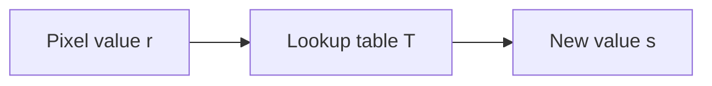

# The Unreadable X-ray: Intensity Transforms and Histograms

> **Part 3 of the [Digital Image Processing series](/fields/digital-image-processing/README.md).** *Mira, Ravi and the radiology team are invented; the maths and numbers are real.*

On Monday morning Mira will be asked to make a dark X-ray readable. She will find a fix that looks right on the first scan and will be one keystroke from applying it to every scan the hospital owns. Her fix will be reasonable. It will also be a guess.

**By the end of this page you will be able to:**

- Describe a pixel transform as a lookup table.
- Choose between negative, log and gamma on purpose.
- Read a histogram as a census of gray levels.
- Build histogram equalization by hand on a tiny image, and say why it is a cumulative sum in disguise.
- Name what equalization costs.

---

## The X-ray nobody can read

Dr. Okafor sends Mira the kind of scan from [page 1](/fields/digital-image-processing/images-are-just-matrices.md). Technically it is fine, but every value sits between 0 and about 60 out of 255. The bones are in there, one shade apart, and nobody can see the difference.

The radiologist's request is short: "Can you make this readable?"

Mira's first reading is the obvious one: the picture needs **more light**. In Pixel Town terms, every citizen is whispering.

---

## Three ways to turn up the volume

**Attempt 1: flip it.** A negative turns dark into bright. Mira applies one. The bones are now white-ish on a dark-ish background and still one shade apart. It looks different. It is no easier to read.

**Attempt 2: try a curve and eyeball it.** She tries a power law with a gamma below 1, then another, then a log. Each one lifts the picture a little. She settles on the one that looks best on this scan and moves on.

**Attempt 3: put it in the pipeline.** She hard-codes that gamma into the viewer's loading step, so that every scan the hospital sends gets "fixed" automatically. She has the pull request open. Ravi reads it and asks one question: "Did you look at what the other scans look like?"

She had not. This was the only one she had opened.

So far:

- Flipping and curve-fitting by eye made the scan look different, not clearly better.
- The chosen curve was tuned to a single image.
- It was about to run on every scan, dark ones and well-exposed ones alike.

That leaves one question: **which transform, and how much?** You would be guessing. There is a method that measures the image first.

---

## A lookup table, a census and a running total

### One citizen at a time

An **intensity transform** changes each pixel using only that pixel's own value. No neighbours involved:

$$s = T(r)$$

Here r is the input gray level, s the output, and T the transform. Because it depends only on r, you can precompute T for every possible value into a **lookup table** with just L entries. Applying it to a million pixels is then a million table reads.



*Same idea whether T is a formula or a table someone computed from the histogram.*

### The three workhorses

All three assume r is normalized to [0, 1] unless stated, and c is a scaling constant.

| Transform | Formula | What it does | Reach for it when |
|---|---|---|---|
| Negative | s = (L−1) − r | Flips dark and bright | Reading white-on-dark detail in a dark region |
| Log | s = c · log(1 + r) | Stretches darks, squashes brights | A huge range crushed into a few bright values (like a Fourier spectrum, page 6) |
| Power law (gamma) | s = c · r^γ | γ < 1 brightens darks; γ > 1 darkens | Contrast tuning, display correction |

A few things worth knowing:

- The **+1** in the log is there because log(0) is undefined. It also makes 0 map to 0.
- **Gamma** is the most flexible. At γ = 1 it does nothing; at γ = 0.5 it is a square root, which pulls a dark 0.25 up to 0.5. At γ = 2 that same 0.25 drops to 0.0625.
- Monitors historically behaved like r^γ with γ around 2.2, which is why "gamma correction" exists: to cancel it.

For the dark X-ray, a γ below 1 or a log would already help a lot. But which one, and how much? You'd be guessing. There's a method that **measures** the image first.

### The histogram: the town's census

The **histogram** counts how many citizens hold each card value:

$$h(r_k) = n_k \qquad p(r_k) = \frac{n_k}{MN}$$

Here n_k is the number of pixels with gray level r_k, and dividing by the total pixel count MN turns counts into probabilities. So the histogram is the town's census, and p is the chance that a random citizen holds card k.

A histogram throws away **where** pixels are and keeps only **how many**. Two completely different pictures can have the same histogram. Still, it tells you at a glance that your X-ray is a heap of bars squeezed against the left wall.

### Try it before you scroll

☕ A dark image has most pixels at low values. You want the output to use the **whole range evenly**. If you have to describe the transform T using the histogram, which running total of the histogram would you use?

*Hint: you want to send "the darkest 25% of citizens" to "the lowest quarter of the range".*

**Answer:** the cumulative sum. That's histogram equalization.

### Histogram equalization by hand

The rule is:

$$s_k = (L-1)\sum_{j=0}^{k} p(r_j)$$

Each old level k is sent to (L−1) times the **fraction of citizens at or below it**.

Let's do it on a tiny dark image: 8 × 8 = 64 pixels, 3 bits so L = 8 levels (0 to 7). The counts are chosen by me for the example:

| Level r | 0 | 1 | 2 | 3 | 4 | 5 | 6 | 7 |
|---|---|---|---|---|---|---|---|---|
| Count n | 24 | 16 | 10 | 6 | 4 | 2 | 2 | 0 |
| Cumulative count | 24 | 40 | 50 | 56 | 60 | 62 | 64 | 64 |
| 7 × cumulative / 64 | 2.63 | 4.38 | 5.47 | 6.13 | 6.56 | 6.78 | 7.00 | 7.00 |
| New level s (rounded) | 3 | 4 | 5 | 6 | 7 | 7 | 7 | 7 |

(Check: 7 × 24 / 64 = 2.625, which rounds to 3.)

New histogram: level 3 gets 24 pixels, level 4 gets 16, level 5 gets 10, level 6 gets 6, and level 7 gets 4 + 2 + 2 + 0 = 8. Total: 64, nobody lost.

The image spread from levels 0–6 to levels 3–7, and the dark crowd that used to sit at 0 now sits at 3. It's much better, but look closely: it's **not flat**.

```python
# Not executed - a sketch of the same lookup-table idea with NumPy.
import numpy as np

def equalize(img, levels=256):              # img: uint8 array
    hist = np.bincount(img.ravel(), minlength=levels)
    cdf = hist.cumsum() / img.size          # fraction of pixels <= each level
    lut = np.round((levels - 1) * cdf)      # the transform T as a table
    return lut[img].astype(np.uint8)        # apply: one table read per pixel
```

Libraries differ in small details. Some subtract the smallest nonzero cumulative value first so the darkest level maps to exactly 0, so check your library's docs before comparing outputs.

> ☕ **Try it live.** Edit the eight counts of the 8 × 8 bag and watch the table and the new histogram, then equalize a dark picture.

[Intensity transforms lab](/fields/digital-image-processing/labs/intensity-transforms.html#embed ':ignore')

### Why a cumulative sum flattens things

Here's the idea behind the formula. Treat gray levels as a continuous random variable r with density p(r). Define:

$$s = T(r) = \int_0^{r} p_r(w)\,dw$$

That integral is the cumulative distribution function (CDF) of r. A classic probability result says that pushing a random variable through its own CDF gives a **uniform** variable, which is a perfectly flat histogram. The "unfairness" of the original distribution is exactly what the CDF cancels.

In discrete images, there are only L levels to move pixels between, and many pixels share one level. They have to move **together**. That's why the table above merged levels 4, 5, 6 and 7 into one and why the output is only roughly flat.

### What equalization costs

Equalization is automatic, which is both its charm and its danger.

| Strength | Weakness |
|---|---|
| No parameters to tune | It follows the histogram even when you don't want it to |
| Reveals hidden detail in dark or washed-out images | Merges levels, so information is **lost** (table above) |
| Cheap: one cumulative sum and a lookup | Amplifies noise in large flat regions, where a tiny difference becomes a visible step |
| Works as a quick first look | Can make a well-exposed image look worse |

A common refinement applies equalization on small tiles with a limit on how much any bin can grow (CLAHE, "contrast-limited adaptive histogram equalization"), which tames the noise problem. It's available in OpenCV as `createCLAHE`.

---

## Back to the X-ray

Mira plots the histogram of the scan. It is a heap of bars squeezed against the left wall, which is what 0 to about 60 out of 255 looks like. She plots the histogram of another scan, and it spreads across the whole range. One gamma would have rescued the first and bleached the second.

The scan never needed a smarter algorithm, or more light. It needed the numbers **spread out**: tell every citizen to speak up, and to speak up in the right proportions.

Your scan lived between 0 and about 60. A gamma below 1 would lift it, and equalization would spread it automatically by sending "darkest 25% of citizens" to "lowest quarter of the range". Neither adds information. They only make the information that was already there **visible**.

She closes the pull request, and builds the lookup table from the scan's own cumulative sum instead. The bones separate. She tells Dr. Okafor it took a measurement and a running total.

That's the limit of one-citizen-at-a-time tools: they never look at neighbours. A noisy speck stays a noisy speck, only brighter. To deal with the speck we need citizens who talk to each other.

---

## Never again: measure before you transform

| Do | Because |
|---|---|
| Plot the histogram first: `h(r_k) = n_k` | It shows at a glance whether the image is squeezed |
| Think of the transform as a lookup table with L entries | Applying it to a million pixels is a million table reads |
| Pick by what you see | Negative for white-on-dark detail; log for a huge range crushed into a few bright values; gamma below 1 to brighten darks, above 1 to darken |
| Want no parameters? Equalize | `s_k = (L-1) · Σ p(r_j)`: a cumulative sum and a lookup |
| Expect the cost | Levels merge, so information is lost; noise in flat regions is amplified; a well-exposed image can look worse |
| Need to tame the noise problem | CLAHE: equalize small tiles with a limit on how much a bin may grow (`createCLAHE` in OpenCV) |

Never tune one image and run it on all of them.

**Takeaway:** an intensity transform is a lookup table; histogram equalization builds that table from the CDF, and it trades lost levels for visible contrast.

**Next:** what happens when each pixel's new value depends on its neighbours? [Part 4: Spatial filtering](/fields/digital-image-processing/spatial-filtering.md).

---

## 📜 The Scroll (keep this)

```text
Symptom:  Every value sits between 0 and ~60 of 255; bones one shade apart
Cause:    The values are squeezed into a corner of the range
Check:    Plot the histogram; look for bars against one wall
Do not:   Tune a curve on one scan and run it on all of them
Fix:      Equalize: s_k = (L-1) * cumulative share; level 0 -> 3 in the 8x8 example
Cost:     Merged levels, amplified noise in flat areas; CLAHE tames it
```


### References

- R. C. Gonzalez and R. E. Woods, *Digital Image Processing*, 4th ed., Pearson, 2018: chapter 3, "Intensity Transformations and Spatial Filtering" (negative, log, power-law, histogram processing).
- OpenCV documentation, [Histograms - 2: Histogram Equalization](https://docs.opencv.org/4.x/d5/daf/tutorial_py_histogram_equalization.html): `equalizeHist` and CLAHE.
