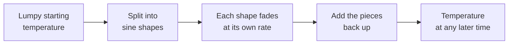

# Meet Fourier

<!-- related-block -->

7 min read

<!-- related-block -->

**See also:** [The Fourier Transform for Images](/fields/digital-image-processing/fourier-transform-for-images.md)

> **Interlude of the [Digital Image Processing series](/fields/digital-image-processing/README.md).** Read it before or after [Part 6](/fields/digital-image-processing/fourier-transform-for-images.md). The man behind the transform was an administrator who studied heat in his spare time, and his one big idea explains why blur, low-pass filters and the heat on your stove are the same thing.

## Table of Contents
- [Meet Fourier](#meet-fourier)
  - [Table of Contents](#table-of-contents)
  - [The prefect with a side project](#the-prefect-with-a-side-project)
  - [The timeline](#the-timeline)
  - [The question: how does heat spread?](#the-question-how-does-heat-spread)
  - [The trick: ask for sine shapes](#the-trick-ask-for-sine-shapes)
  - [Try it before you scroll](#try-it-before-you-scroll)
  - [Heat is a blur filter](#heat-is-a-blur-filter)
  - [Why he made life "complex"](#why-he-made-life-complex)
  - [One more thing he got ahead of everyone on](#one-more-thing-he-got-ahead-of-everyone-on)
  - [Back to the prefect](#back-to-the-prefect)
    - [References](#references)

---

## The prefect with a side project

Grenoble, early 1800s. The local prefect has a long to-do list: roads, marshland that needs draining, the paperwork of running a department of France. He is also, between meetings, trying to work out how a hot iron bar cools down.

That man is **Joseph Fourier**. He had already been to Egypt with Napoleon's expedition in 1798 as a scientific adviser, and had become secretary of the Institut d'Égypte there. Now he was a governor with a physics hobby, and the hobby was about to give every engineer a headache.

Why do you care in a course on images? Because his answer to "how does heat spread?" turned out to be the same answer as "what is in this image?".

---

## The timeline

| Year | What happened |
|---|---|
| 1798 | Joins Napoleon's expedition to Egypt as a scientific adviser; becomes secretary of the Institut d'Égypte |
| 1802 | Becomes prefect of the Isère department, based in Grenoble (Britannica gives his term as 1802 to 1814) |
| 21 Dec 1807 | Presents his memoir on the propagation of heat in solid bodies to the Paris Institute |
| 1812 | A later memoir on heat is submitted for the Académie des Sciences prize |
| 1822 | Publishes *Théorie analytique de la chaleur* (The Analytical Theory of Heat) |
| 1824, 1827 | Papers on the temperature of the Earth and of space |

Sources disagree by a year on when exactly he became prefect, so treat the table's dates as approximate where the sources differ.

---

## The question: how does heat spread?

Take a metal rod, heat one spot, and watch. The hot spot spreads out and flattens, and the rod ends up at an even temperature. Fourier wrote down the rule: how fast the temperature u at a point changes depends on how much that point **differs from the average of its neighbours**:

$$\frac{\partial u}{\partial t} = \alpha\,\frac{\partial^2 u}{\partial x^2}$$

The right side is the **second derivative**. You met it on [page 5](/fields/digital-image-processing/edges-and-sharpening.md): "how much I differ from my neighbours". The constant α says how well the material conducts. A bump hotter than its neighbours cools; a dip colder than its neighbours warms. Nothing mysterious, and also very hard to solve for a lumpy starting temperature.

---

## The trick: ask for sine shapes

Fourier's insight: don't solve the lumpy case. Solve the **nicest possible shapes** first, then add them up.

For a rod of length L with both ends held at temperature 0, a sine shape sin(nπx/L) is special: as time passes it **keeps its shape and just fades**:

$$u_n(x,t) = \sin\!\left(\frac{n\pi x}{L}\right)\, e^{-\alpha\,\frac{n^2\pi^2}{L^2}\,t}$$

Here n counts the wiggles: n = 1 is one gentle hump, n = 3 is three tighter humps. Each shape fades at its own rate, set by n².

Then the big claim: **any** starting temperature can be written as a sum of such sine shapes. Add up the fading pieces and you have the answer for the lumpy rod.

*Split the hard problem into easy pieces, solve each, put them back together. That's the whole method, and it's the DFT of page 6 in disguise.*

That last claim, that a wildly shaped function could be a sum of smooth waves, was hard to swallow in his day, and making it precise took mathematicians a long time afterwards. For us it's the foundation: it's why page 6 can say "every image is a sum of waves".

---

## Try it before you scroll

☕ Look at the decay rate, which grows with n². **Which dies first when the rod cools: the slow, one-hump wave (n = 1) or the fast, three-hump wave (n = 3)? And by how much?**

*Hint: compare 1² with 3².*

**Answer:** the three-hump wave dies first, and its decay rate is 3² / 1² = **9 times faster**. Fast wiggles fade the quickest.

---

## Heat is a blur filter

Read that answer again from Pixel Town's point of view. Heat flow makes sharp, fast-changing detail **disappear first** and leaves the smooth, slow shapes for last. That is exactly what a **low-pass filter** does ([page 7](/fields/digital-image-processing/frequency-filtering-and-aliasing.md)).

And it's more than an analogy. Let the "temperature" be the brightness of an image and let it diffuse for a while: you get a **Gaussian blur**, where the longer you wait, the wider the blur. The spread of the Gaussian kernel grows with the square root of time (its variance is 2αt in the standard setup).

| Heat on a rod | The same thing in an image |
|---|---|
| Temperature u(x, t) | Brightness f(x, y) |
| Hot spot spreads and flattens | Sharp detail blurs |
| Fast wiggles die first (rate grows with n²) | High frequencies are removed first |
| Wait longer | Bigger σ in the Gaussian blur |

So when you press "Gaussian blur", you are running Fourier's rod experiment on a photograph.

---

## Why he made life "complex"

Fourier wrote his series with sines and cosines. The tidier notation of page 6 packs them into one expression with a spinning arrow, e^(−jθ) = cos θ − j sin θ, which is just Euler's formula doing book-keeping.

The side effect is that the answer for each frequency is a **complex number**: a magnitude and a phase, as in the swapped-faces experiment of page 6. So yes, it's quite fair to say Fourier made your life complex. In the literal sense.

---

## One more thing he got ahead of everyone on

His heat equations didn't stop at rods. Fourier also asked what keeps the Earth warm, and in papers of 1824 and 1827 he argued that the atmosphere might act like an insulating cover that traps heat. That idea is widely recognized as an early proposal of what is now called the **greenhouse effect**. His numbers were off, and he wasn't necessarily the first to look at the question, but he put it into the language of heat flow.

Not bad for a man who also had roads to build.

---

## Back to the prefect

A prefect in Grenoble, trying to understand a cooling bar, found that you can break any shape into waves, let each wave live its own life, and put them back together. Two centuries later that same trick:

- finds the periodic noise in a scanner's output (page 7),
- explains why blur and low-pass are the same thing (page 4 and page 7),
- turns convolution into multiplication (page 6),
- and sits inside the compression that shrinks your photos.

**Takeaway:** Fourier's one idea, "split it into waves, handle each wave, add them back", is why the frequency domain exists.

**Next:** back to the main route. [Part 6: The Fourier transform for images](/fields/digital-image-processing/fourier-transform-for-images.md) shows what that idea looks like on a grid of pixels.

### References

- Encyclopaedia Britannica, [Joseph Fourier](https://www.britannica.com/biography/Joseph-Baron-Fourier): Egypt, prefecture of Isère, heat memoir, Fourier series.
- Linda Hall Library, [Joseph Fourier, Scientist of the Day](https://www.lindahall.org/about/news/scientist-of-the-day/joseph-fourier/): biography and the heat and climate work.
- J. Fourier, *Théorie analytique de la chaleur*, Paris, 1822: the heat equation and the series solution.
- J. Fourier, "Remarques générales sur les températures du globe terrestre et des espaces planétaires", *Annales de Chimie et de Physique*, 27, 1824.
- R. C. Gonzalez and R. E. Woods, *Digital Image Processing*, 4th ed., Pearson, 2018: chapter 4, "Filtering in the Frequency Domain".
