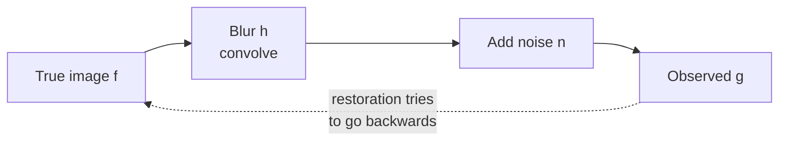

<!-- related-block -->
<nav class="crumbs" aria-label="Breadcrumb"><a href="#/fields/">Fields</a> / <a href="#/fields/digital-image-processing/">Digital Image Processing</a></nav>

# The Photo That Turned to Static: Noise and Restoration

<!-- related-block -->
<div class="reading-time">Intermediate · Concept · 9 min read · Updated 25 Nov 2026</div>
<!-- related-block -->
<div class="tag-chips"><a class="chip" href="#/.docs/generated/explore/tags/filtering">filtering</a> <a class="chip" href="#/.docs/generated/explore/tags/noise">noise</a></div>
<!-- related-block -->
<div class="lab-line">Interactive lab: <a href="#/fields/digital-image-processing/noise-and-restoration?id=try-it-the-photo-that-turned-to-static">The photo that turned to static</a></div>
<!-- related-block -->
<div class="related-strip">

**Read first:** [The Shirt That Shimmers: Frequency Filtering and Aliasing](/fields/digital-image-processing/frequency-filtering-and-aliasing.md)

</div>


> **Part 8 of the [Digital Image Processing series](/fields/digital-image-processing/README.md).** Real photos arrive blurred and noisy, and the obvious cure for the blur is also the fastest way to destroy the picture. *The traffic-camera team is invented; the maths and numbers are real.* By the end you can write the damage as an equation, match a filter to a noise, and see why dividing by a blur explodes.

```text
$ restore plate_0412.png --method inverse
reading blur kernel ........ ok
dividing ................... ok
result: static
```

---

## The plate that became static

A traffic camera shot a licence plate while the car was moving. The image is smeared in one direction. The team knows the blur, and a colleague said: "We know the blur. Divide it out. Easy."

You ran the program. The smear is gone, and so is the car, the road and the plate. The whole picture has been replaced by a coarse checkerboard of static.

Your first reading is the obvious one: **a bug in your division code.** You test the division on a small image with no noise, and it recovers the original exactly. The code is fine.

A correct inverse, applied to a real photo, produced noise. What was it dividing by? To find out, you have to write down exactly what the camera did to the plate.

---

## The damage, as an equation

Most restoration starts from one model. The true image f is blurred by something h (motion, defocus, atmosphere), then noise η is added:

$$g(x,y) = h(x,y) * f(x,y) + \eta(x,y)$$

By the convolution theorem from [page 6](/fields/digital-image-processing/fourier-transform-for-images.md), the same thing in the frequency domain is:

$$G(u,v) = H(u,v)\,F(u,v) + N(u,v)$$

Blur is a **multiplication** by H (usually a low-pass: it shrinks high frequencies). Noise is **added on top**. And you only have g.



*Going forward is easy and always loses something. Going backward is guesswork with a good model.*

Notice the second term. Before you divide anything, what kind of noise is it?

---

## A field guide to noise

Noise isn't one thing. Which type you have decides which tool to use.

| Type | Looks like | Where it comes from |
|---|---|---|
| Gaussian | Fine grain on every pixel, small random errors both ways | Sensor electronics, thermal noise, a dim scene turned up |
| Salt-and-pepper (impulse) | A few isolated pixels at pure black or white | Faulty sensor pixels, transmission bit errors |
| Poisson (shot) | Grain strongest where it's brightest, in absolute terms | Counting photons: light arrives in discrete packets |
| Uniform | Errors spread evenly over a range | Quantization-like rounding; mostly used in models |

Each has a statistical model, which is why this page lives next to statistics: the filters below come from asking "what is the best guess given how the noise behaves?".

You've met most of the tools already. This is the matching table:

| Noise | Reach for | Why |
|---|---|---|
| Gaussian | Mean or Gaussian blur (page 4) | Averaging independent, zero-mean errors cancels them |
| Salt-and-pepper | Median (page 4) | An outlier can't be the middle value |
| Periodic (stripes) | Notch filter (page 7) | The noise sits at a few isolated frequencies |
| Several frames of a still scene | Average the frames | Noise standard deviation falls by about √n for n independent frames |

> [!NOTE]
> The √n rule needs the noise to be independent and zero-mean across frames. If the camera has a fixed pattern (the same hot pixels each time), averaging doesn't remove it.

Smoothing noise also smooths edges, so the question is always how much detail you can afford to lose. But your colleague didn't suggest smoothing. They suggested *dividing*. Try the numbers before you read on.

☕ **Try it before you scroll.** Your blur H has a value of 0.01 at some frequency, and the noise N is about 1 there. If you "undo the blur" by dividing the observed G by H, **how much is the noise amplified at that frequency?** *Hint: divide 1 by 0.01.*

---

## Dividing by the blur

**Answer:** **100 times**. Here's why.

The naive plan: if G = H·F + N, divide by H.

$$\hat F(u,v) = \frac{G(u,v)}{H(u,v)} = F(u,v) + \frac{N(u,v)}{H(u,v)}$$

If there was no noise, you'd get F back exactly. But there is noise, and the second term is the problem. A blur is a low-pass, so H is **small** at high frequencies, sometimes almost zero. At such a frequency N/H is huge: with H = 0.01 and N ≈ 1, the noise term is about 100, vastly bigger than the signal there, which was crushed by the blur to begin with.

That's the static in the opening scene: the "restored" image is dominated by amplified noise at the very frequencies the blur had already destroyed. And where H is exactly zero, the division is undefined: that frequency is gone for good.

The honest summary: **you can't recover what the blur erased**, and trying to makes things much worse. So what do you do instead of giving up?

---

## Wiener: dividing with manners

The **Wiener filter** also inverts the blur, but it knows when to stop. Here's the version with a constant K, which stands for the noise-to-signal power ratio:

$$\hat F(u,v) = \left[\frac{H^{*}(u,v)}{|H(u,v)|^{2} + K}\right] G(u,v)$$

H* is the complex conjugate of H. Look at the two regimes:

- Where |H| is large compared to K, the bracket is about 1/H: the plain inverse. Good signal, so undo the blur.
- Where |H| is small, the bracket becomes about H*/K, which is small: the filter **stops trying** and lets that frequency go quiet.

Use the numbers from the quiz. H = 0.01 and K = 0.01 give a gain of 0.01 / (0.0001 + 0.01) = 0.01 / 0.0101 ≈ **0.99**, against 100 for the inverse filter. At that frequency the noise now stays at about its original size instead of exploding.

| | Inverse filter | Wiener (K = 0.01) |
|---|---|---|
| Gain applied at H = 0.01 | 1/H = 100 | ≈ 0.99 |
| Where H is exactly 0 | Undefined | 0 (gives up) |
| Needs to know | H | H and the noise-to-signal ratio K |

K is usually tuned by eye: too small and the noise creeps back, too big and the result stays blurry. That's the trade-off in one dial. And "by eye" raises the last question: how do you know a result is better?

---

## Scoring a restoration

When you have a clean reference, use the mean squared error and its logarithmic cousin, the **peak signal-to-noise ratio**:

$$\text{MSE} = \frac{1}{MN}\sum_{x,y}\big(f(x,y)-\hat f(x,y)\big)^2 \qquad \text{PSNR} = 10\log_{10}\!\frac{\text{MAX}^2}{\text{MSE}}$$

MAX is the largest possible pixel value (255 for 8 bits). Example: MSE = 100 gives 10·log₁₀(65025/100) = 10·log₁₀(650.25) ≈ **28.1 dB**. Higher is better, and every 3 dB is about half the mean squared error.

PSNR is easy to compute and only loosely matches how a human judges quality: a result can score well and still look smeared. Treat it as a sanity check, not a verdict.

Now back to the plate.

---

## Back to the static

You print the blur's strength at a high frequency: a tiny number. The noise there is not tiny. You divide one by the other and see what happened: you divided by a number that was nearly zero.

Your colleague's plan was correct on paper and murderous in practice. The blur had pushed the high frequencies close to zero, noise was hiding there too, and dividing by H made the noise a hundred times louder than the thing you wanted.

Wiener's fix is the same principle in every area of engineering: **don't trust a measurement more than it deserves**. Where the signal is strong, undo the damage. Where it's buried, stay quiet.

You switch to Wiener with a K tuned by eye, and read the plate.

### Try it: The photo that turned to static

> **What it shows:** Blur multiplies each frequency by H; noise is added on top. Dividing by a small H multiplies the noise too, and Wiener stops before that happens.  
> **Start with:** the preset *No noise: the inverse is exact* (Blur length 9, no noise: dividing the blur out returns the picture almost exactly: the score is above 99 dB, only rounding error).

[Restoration lab](/fields/digital-image-processing/labs/restoration.html#embed ':ignore')

---

## Never again: restoring a photo

| Do | Because |
|---|---|
| Write the damage first: `g = h * f + η`, in frequency `G = H F + N` | It shows what you can and cannot undo |
| Match the filter to the noise | Gaussian: mean or Gaussian blur; salt-and-pepper: median; periodic: notch; several frames of a still scene: average them |
| Never invert a blur without a safety | `N / H` explodes where `H` is small (H = 0.01, N ≈ 1: about 100 times) |
| Use Wiener and tune K by eye | Too small and the noise creeps back; too big and it stays blurry |
| Score with PSNR, but do not trust it alone | MSE = 100 gives about 28.1 dB; every 3 dB is about half the MSE; it only loosely matches the eye |
| Average frames only when the noise is independent and zero-mean | A fixed pattern (hot pixels) does not average out |

**Takeaway:** write the damage as G = HF + N, match the filter to the noise, and never invert a blur without a Wiener-style safety.

**Next:** all of these tools see the town at **one scale**. What if the useful structure lives at several sizes at once? [Part 9: Wavelets and multiresolution processing](/fields/digital-image-processing/wavelets-and-multiresolution-processing.md).

---

## 📜 The Scroll (keep this)

```text
Symptom:  "Un-blurred" photo is static
Cause:    F_hat = G/H = F + N/H: where H is tiny the noise is multiplied (H=0.01, N~1 -> ~100x)
Check:    How small is |H| at high frequencies? Is there noise at all?
Do not:   Invert a blur without a safety term
Fix:      Wiener: [H* / (|H|^2 + K)] G  (H=0.01, K=0.01 -> gain ~0.99); tune K by eye
Score:    PSNR = 10 log10(MAX^2 / MSE); MSE 100 -> ~28.1 dB
```


### References

- R. C. Gonzalez and R. E. Woods, *Digital Image Processing*, 4th ed., Pearson, 2018: chapter 5, "Image Restoration and Reconstruction" (noise models, mean and order-statistic filters, inverse and Wiener filtering).
- OpenCV documentation, [Image Denoising](https://docs.opencv.org/4.x/d5/d69/tutorial_py_non_local_means.html): practical denoising functions.

<!-- related-block -->
<div class="see-also">

**See also**

- [Pick and Check an Image-Processing Step](/fields/digital-image-processing/quick-guide.md) — A cheat sheet for parts 3, 4, 7, 8 and 9 - which transform or filter to pick, the number to check by hand, and five labs to try.
- [Wavelets and Multiresolution Processing](/fields/digital-image-processing/wavelets-and-multiresolution-processing.md) — Seeing an image at several scales at once - pyramids, a Haar wavelet transform by hand, the four 2D subbands, and why mostly-zero detail makes denoising and compression work.

</div>
<!-- related-block -->
<div class="mentioned-in">

**Mentioned in**

- [One Bad Pixel: Spatial Filtering](/fields/digital-image-processing/spatial-filtering.md) — Kernels, correlation versus convolution, padding and separability - blurring explained as a neighbourhood vote, with the mean and median compared on one noisy pixel.
- [Pick and Check an Image-Processing Step](/fields/digital-image-processing/quick-guide.md) — A cheat sheet for parts 3, 4, 7, 8 and 9 - which transform or filter to pick, the number to check by hand, and five labs to try.
- [The Shirt That Shimmers: Frequency Filtering and Aliasing](/fields/digital-image-processing/frequency-filtering-and-aliasing.md) — Low-pass, high-pass and notch filters as masks on the spectrum, why the ideal filter rings, and how sampling too coarsely creates moire - with the Nyquist rule worked on one number.
- [Wavelets and Multiresolution Processing](/fields/digital-image-processing/wavelets-and-multiresolution-processing.md) — Seeing an image at several scales at once - pyramids, a Haar wavelet transform by hand, the four 2D subbands, and why mostly-zero detail makes denoising and compression work.

</div>
