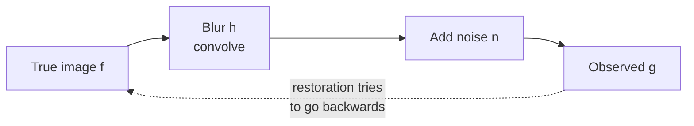

# Noise and Restoration

> **Part 7 of the [Digital Image Processing series](/fields/digital-image-processing/README.md).** Real photos arrive blurred and noisy, and the obvious cure for the blur is also the fastest way to destroy the picture. By the end you'll write the damage as an equation, pick a filter by noise type, and see why Wiener is inverse filtering with common sense added.

## Table of Contents
- [Noise and Restoration](#noise-and-restoration)
  - [Table of Contents](#table-of-contents)
  - [The photo that turned to static](#the-photo-that-turned-to-static)
  - [The damage, as an equation](#the-damage-as-an-equation)
  - [A field guide to noise](#a-field-guide-to-noise)
  - [Matching the filter to the noise](#matching-the-filter-to-the-noise)
  - [Try it before you scroll](#try-it-before-you-scroll)
  - [Inverse filtering: dividing by the blur](#inverse-filtering-dividing-by-the-blur)
  - [Wiener: dividing with manners](#wiener-dividing-with-manners)
  - [Scoring a restoration](#scoring-a-restoration)
  - [Back to the static](#back-to-the-static)
    - [References](#references)

---

## The photo that turned to static

A security camera shot a licence plate while the car was moving. The image is smeared in one direction. A colleague says: "We know the blur. Divide it out. Easy."

They run the program. The smear is gone, and so is the car, the road and the plate. The whole picture has been replaced by a coarse checkerboard of static.

They divided by a number that was nearly zero. That one sentence is the plot of this page.

---

## The damage, as an equation

Most restoration starts from one model. The true image f is blurred by something h (motion, defocus, atmosphere), then noise η is added:

$$g(x,y) = h(x,y) * f(x,y) + \eta(x,y)$$

By the convolution theorem from [page 5](/fields/digital-image-processing/fourier-transform-for-images.md), the same thing in the frequency domain is:

$$G(u,v) = H(u,v)\,F(u,v) + N(u,v)$$

Blur is a **multiplication** by H (usually a low-pass: it shrinks high frequencies). Noise is **added on top**. And you only have g.

*Going forward is easy and always loses something. Going backward is guesswork with a good model.*

---

## A field guide to noise

Noise isn't one thing. Which type you have decides which tool to use.

| Type | Looks like | Where it comes from |
|---|---|---|
| Gaussian | Fine grain on every pixel, small random errors both ways | Sensor electronics, thermal noise, a dim scene turned up |
| Salt-and-pepper (impulse) | A few isolated pixels at pure black or white | Faulty sensor pixels, transmission bit errors |
| Poisson (shot) | Grain strongest where it's brightest, in absolute terms | Counting photons: light arrives in discrete packets |
| Uniform | Errors spread evenly over a range | Quantization-like rounding; mostly used in models |

Each has a statistical model, which is why this page lives next to statistics: the filters below come from asking "what is the best guess given how the noise behaves?".

---

## Matching the filter to the noise

| Noise | Reach for | Why |
|---|---|---|
| Gaussian | Mean or Gaussian blur (page 3) | Averaging independent, zero-mean errors cancels them |
| Salt-and-pepper | Median (page 3) | An outlier can't be the middle value |
| Periodic (stripes) | Notch filter (page 6) | The noise sits at a few isolated frequencies |
| Several frames of a still scene | Average the frames | Noise standard deviation falls by about √n for n independent frames |

> [!NOTE]
> The √n rule needs the noise to be independent and zero-mean across frames. If the camera has a fixed pattern (the same hot pixels each time), averaging doesn't remove it.

Smoothing noise also smooths edges, so the question is always how much detail you can afford to lose.

---

## Try it before you scroll

☕ Your blur H has a value of 0.01 at some frequency, and the noise N is about 1 there. If you "undo the blur" by dividing the observed G by H, **how much is the noise amplified at that frequency?**

*Hint: divide 1 by 0.01.*

**Answer:** **100 times**. Read on.

---

## Inverse filtering: dividing by the blur

The naive plan: if G = H·F + N, divide by H.

$$\hat F(u,v) = \frac{G(u,v)}{H(u,v)} = F(u,v) + \frac{N(u,v)}{H(u,v)}$$

If there was no noise, you'd get F back exactly. But there is noise, and the second term is the problem. A blur is a low-pass, so H is **small** at high frequencies, sometimes almost zero. At such a frequency N/H is huge: with H = 0.01 and N ≈ 1, the noise term is about 100, vastly bigger than the signal there, which was crushed by the blur to begin with.

That's the static in the opening scene: the "restored" image is dominated by amplified noise at the very frequencies the blur had already destroyed. And where H is exactly zero, the division is undefined: that frequency is gone for good.

The honest summary: **you can't recover what the blur erased**, and trying to makes things much worse.

---

## Wiener: dividing with manners

The **Wiener filter** also inverts the blur, but it knows when to stop. Here's the version with a constant K, which stands for the noise-to-signal power ratio:

$$\hat F(u,v) = \left[\frac{H^{*}(u,v)}{|H(u,v)|^{2} + K}\right] G(u,v)$$

H* is the complex conjugate of H. Look at the two regimes:

- Where |H| is large compared to K, the bracket is about 1/H: the plain inverse. Good signal, so undo the blur.
- Where |H| is small, the bracket becomes about H*/K, which is small: the filter **stops trying** and lets that frequency go quiet.

Use the numbers from the quiz. H = 0.01 and K = 0.01 give a gain of 0.01 / (0.0001 + 0.01) = 0.01 / 0.0101 ≈ **0.99**, against 100 for the inverse filter. At that frequency the noise now stays at about its original size instead of exploding.

| | Inverse filter | Wiener (K = 0.01) |
|---|---|---|
| Gain applied at H = 0.01 | 1/H = 100 | ≈ 0.99 |
| Where H is exactly 0 | Undefined | 0 (gives up) |
| Needs to know | H | H and the noise-to-signal ratio K |

K is usually tuned by eye: too small and the noise creeps back, too big and the result stays blurry. That's the trade-off in one dial.

---

## Scoring a restoration

How do you know the result is better? When you have a clean reference, use the mean squared error and its logarithmic cousin, the **peak signal-to-noise ratio**:

$$\text{MSE} = \frac{1}{MN}\sum_{x,y}\big(f(x,y)-\hat f(x,y)\big)^2 \qquad \text{PSNR} = 10\log_{10}\!\frac{\text{MAX}^2}{\text{MSE}}$$

MAX is the largest possible pixel value (255 for 8 bits). Example: MSE = 100 gives 10·log₁₀(65025/100) = 10·log₁₀(650.25) ≈ **28.1 dB**. Higher is better, and every 3 dB is about half the mean squared error.

PSNR is easy to compute and only loosely matches how a human judges quality: a result can score well and still look smeared. Treat it as a sanity check, not a verdict.

---

## Back to the static

Your colleague's plan was correct on paper and murderous in practice. The blur had pushed the high frequencies close to zero, noise was hiding there too, and dividing by H made the noise a hundred times louder than the thing they wanted.

Wiener's fix is the same principle in every area of engineering: **don't trust a measurement more than it deserves**. Where the signal is strong, undo the damage. Where it's buried, stay quiet.

**Takeaway:** write the damage as G = HF + N, match the filter to the noise, and never invert a blur without a Wiener-style safety.

**Next:** so far the town stayed put. What if we move, rotate or stretch the whole map? [Part 8: Geometric transforms and interpolation](/fields/digital-image-processing/geometric-transforms-and-interpolation.md).

### References

- R. C. Gonzalez and R. E. Woods, *Digital Image Processing*, 4th ed., Pearson, 2018: chapter 5, "Image Restoration and Reconstruction" (noise models, mean and order-statistic filters, inverse and Wiener filtering).
- OpenCV documentation, [Image Denoising](https://docs.opencv.org/4.x/d5/d69/tutorial_py_non_local_means.html): practical denoising functions.
