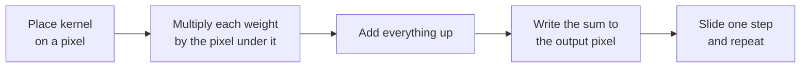

# Spatial Filtering

<!-- related-block -->
<div class="reading-time">7 min read</div>
<!-- related-block -->
<div class="related-strip">

**Read first:** [Intensity Transforms and Histograms](/fields/digital-image-processing/intensity-transforms-and-histograms.md)  ·  **Read next:** [Edges and Sharpening](/fields/digital-image-processing/edges-and-sharpening.md), [The Fourier Transform for Images](/fields/digital-image-processing/fourier-transform-for-images.md)

</div>


> **Part 4 of the [Digital Image Processing series](/fields/digital-image-processing/README.md).** Now the citizens talk to their neighbours. By the end you'll compute a filtered pixel by hand, know why convolution flips the kernel (and why CNN libraries quietly don't), and see why a Gaussian blur costs far less than it looks.

## Table of Contents
- [Spatial Filtering](#spatial-filtering)
  - [Table of Contents](#table-of-contents)
  - [One bad pixel](#one-bad-pixel)
  - [The neighbourhood vote](#the-neighbourhood-vote)
  - [Correlation and convolution](#correlation-and-convolution)
  - [Try it before you scroll](#try-it-before-you-scroll)
  - [Mean versus median](#mean-versus-median)
  - [The edge of the map](#the-edge-of-the-map)
  - [Gaussian blur and the separability trick](#gaussian-blur-and-the-separability-trick)
  - [The CNN connection](#the-cnn-connection)
  - [Back to the bad pixel](#back-to-the-bad-pixel)
    - [References](#references)

---

## One bad pixel

A scanner leaves a single white speck in the middle of a gray wall. Every neighbour says 10. One citizen shouts 90.

Your manager says: "Average it with the neighbours. Done." Another engineer says: "No, take the middle value. Done." Both are right about different kinds of noise, and the difference between them is the whole point of this page.

---

## The neighbourhood vote

A **spatial filter** computes each output pixel from a small window of input pixels around it. The window of weights is called a **kernel** (or mask, or filter), usually 3 × 3, 5 × 5, or another odd size so it has a centre.



*The whole algorithm. Every "filter" in the next three pages is a different kernel in this loop.*

With a kernel w of size (2a+1) × (2b+1), the output is:

$$g(x,y) = \sum_{s=-a}^{a}\sum_{t=-b}^{b} w(s,t)\, f(x+s,\, y+t)$$

That is a weighted vote: each neighbour gets a weight, and the sum is the result. For a **box** (mean) filter every weight is 1/9 in a 3 × 3 window, so the pixel becomes the plain average of itself and its eight neighbours.

> [!TIP]
> Weights that sum to **1** keep overall brightness. Weights that sum to **0** (edge detectors, page 5) give zero on flat regions and a response only where things change.

---

## Correlation and convolution

The formula above is technically **correlation**. True **convolution** flips the kernel by 180° (both axes) before sliding it:

$$g(x,y) = \sum_{s=-a}^{a}\sum_{t=-b}^{b} w(s,t)\, f(x-s,\, y-t)$$

Only the sign inside f changed, and that sign decides whether you read the kernel forwards or backwards.

If the kernel is symmetric (box, Gaussian, Laplacian), flipping changes nothing and the two are the same. They differ only for asymmetric kernels such as a Sobel edge detector, where the flip reverses the direction of the response.

Why does the flip exist at all? Because convolution has clean algebra: it is commutative and associative, and, as [page 6](/fields/digital-image-processing/fourier-transform-for-images.md) shows, it turns into plain multiplication in the frequency domain. Correlation is the "what matches this pattern?" operation and is what you reach for when you slide a template over a picture.

---

## Try it before you scroll

☕ You apply a 3 × 3 box filter (all weights 1/9) to the neighbourhood below. **What does the centre pixel become?**

```text
10  10  10
10  90  10
10  10  10
```

*Hint: eight 10s and one 90.*

**Answer:** (8 × 10 + 90) / 9 = 170 / 9 ≈ **18.9**. The speck dropped from 90 to 19, but it didn't disappear. It also **bled** into all eight neighbours: each of them now gets a share of that 90 in its own average. The wall has a smudge where the speck used to be.

---

## Mean versus median

The median filter takes the same nine values, sorts them, and picks the middle one:

```text
sorted: 10 10 10 10 10 10 10 10 90   ->   median = 10
```

The speck vanishes completely and nothing bleeds. A single outlier can never be the median of nine numbers unless five others agree with it.

| | Mean (box) | Median |
|---|---|---|
| Is it a kernel (weighted sum)? | Yes, linear | No, it sorts, so it is **nonlinear** |
| Good against | Gaussian-like noise spread over every pixel | Salt-and-pepper (isolated extreme pixels) |
| Side effect | Blurs edges | Preserves edges better, can erase thin lines |

So the manager and the other engineer were both right. They were treating different noise: Pixel Town's whisper campaign versus one loudmouth. More on telling them apart on [page 8](/fields/digital-image-processing/noise-and-restoration.md).

---

## The edge of the map

At the border, a 3 × 3 window hangs off the image. Something has to fill the missing neighbours. Common choices:

| Padding | Fills the outside with | Effect |
|---|---|---|
| Zero | 0 | Dark halo around the border |
| Replicate | The nearest edge pixel, repeated | Neutral, a bit smeary |
| Reflect | The image mirrored across the border | Smooth, the usual default |

With p pixels of padding on every side the output keeps the input size ("same"). With no padding ("valid") a k × k kernel shrinks an N-wide image to N − k + 1. OpenCV's `filter2D` uses a reflected border by default (`BORDER_REFLECT_101`).

---

## Gaussian blur and the separability trick

A box gives every neighbour the same vote. A **Gaussian** gives close neighbours more say:

$$G(x,y) = \frac{1}{2\pi\sigma^2}\, e^{-\frac{x^2+y^2}{2\sigma^2}}$$

The parameter σ sets how far the influence reaches. A bigger σ means a bigger, softer blur.

The cheap trick: the 2-D Gaussian is the **product of two 1-D Gaussians**, one in x and one in y. Any kernel that factors this way is **separable**: instead of one k × k pass you do a row pass then a column pass.

A small example is the binomial kernel, which approximates a Gaussian:

$$\frac{1}{4}\begin{bmatrix}1\\2\\1\end{bmatrix}\cdot\frac{1}{4}\begin{bmatrix}1&2&1\end{bmatrix}=\frac{1}{16}\begin{bmatrix}1&2&1\\2&4&2\\1&2&1\end{bmatrix}$$

The saving per output pixel:

| Kernel size k | 2-D multiplies (k²) | Separable (2k) |
|---|---|---|
| 3 | 9 | 6 |
| 5 | 25 | 10 |
| 11 | 121 | 22 |

The bigger the kernel, the bigger the win. That's why libraries blur with two 1-D passes.

---

## The CNN connection

A convolutional layer in a neural network is this exact loop with one change of attitude: **the kernel values are learned instead of designed**. Box, Gaussian and Sobel are hand-picked weights; a CNN lets training find its own.

One naming quirk: deep learning frameworks such as PyTorch compute **cross-correlation** (no flip) and call it convolution. PyTorch's `Conv2d` documentation says so. Since the weights are learned anyway, flipping them would change nothing, so nobody bothers. See [Deep Learning - Concepts - Convolution](/fields/deep-learning/concepts/convolution.md) for the network side of the story.

---

## Back to the bad pixel

The mean turned a loud speck into a quiet smudge. The median erased it. Neither knew what the speck *was*; each just applied a rule to nine numbers.

Notice also what both did to a real edge between a dark wall and a bright door: the mean blurred it, the median mostly kept it. A kernel that **averages** removes differences. What if we built a kernel that does the opposite and **celebrates** differences?

**Takeaway:** a filter is a sliding weighted vote; linear ones are kernels, the median is the nonlinear exception, and separable kernels make big blurs cheap.

**Next:** how do you find an edge by asking neighbours to disagree? [Part 5: Edges and sharpening](/fields/digital-image-processing/edges-and-sharpening.md).

### References

- R. C. Gonzalez and R. E. Woods, *Digital Image Processing*, 4th ed., Pearson, 2018: chapter 3 (spatial filtering, correlation and convolution, smoothing, order-statistic filters).
- OpenCV documentation, [Image Filtering](https://docs.opencv.org/4.x/d4/d86/group__imgproc__filter.html): `filter2D`, `GaussianBlur`, `medianBlur` and border types.
- PyTorch documentation, [torch.nn.Conv2d](https://pytorch.org/docs/stable/generated/torch.nn.Conv2d.html): the operation is cross-correlation.
