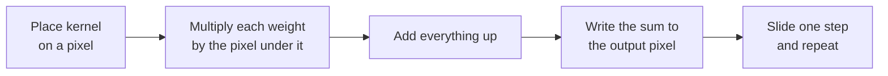

<!-- related-block -->
<nav class="crumbs" aria-label="Breadcrumb"><a href="#/fields/">Fields</a> / <a href="#/fields/digital-image-processing/">Digital Image Processing</a></nav>

# One Bad Pixel: Spatial Filtering

<!-- related-block -->
<div class="reading-time">Beginner · Concept · 11 min read · Updated 25 Nov 2026</div>
<!-- related-block -->
<div class="tag-chips"><a class="chip" href="#/.docs/generated/explore/tags/convolution">convolution</a> <a class="chip" href="#/.docs/generated/explore/tags/filtering">filtering</a> <a class="chip" href="#/.docs/generated/explore/tags/noise">noise</a></div>
<!-- related-block -->
<div class="lab-line">Interactive lab: <a href="#/fields/digital-image-processing/spatial-filtering?id=try-it-one-bad-pixel-average-it-or-sort-it">One bad pixel, average it or sort it?</a></div>
<!-- related-block -->
<div class="related-strip">

**Read first:** [The Unreadable X-ray: Intensity Transforms and Histograms](/fields/digital-image-processing/intensity-transforms-and-histograms.md)  ·  **Read next:** [The Sharpen Button That Made Things Worse: Edges and Sharpening](/fields/digital-image-processing/edges-and-sharpening.md), [The Fourier Transform for Images](/fields/digital-image-processing/fourier-transform-for-images.md)

</div>


> **Part 4 of the [Digital Image Processing series](/fields/digital-image-processing/README.md).** *Hana, Ines and the facilities team are invented; the maths and numbers are real.* One speck, two bosses and a folder of floor plans: by the end you can compute a filter by hand and pick the one that fits your noise.

Look at these nine numbers for a second.

```text
10  10  10
10  90  10
10  10  10
```

Eight neighbours say 10. One citizen shouts 90.

That is one speck of scanner noise on a photo of a gray wall, and it's your problem now. By lunchtime two people will tell you exactly how to remove it, and one of them is about to cost you half a folder. Let's find out which.

---

## One citizen shouts

Picture your Monday. You've just inherited the facilities survey, and the report goes out on Friday. The wall photo is perfect except for one white speck in the middle of a gray patch.

You remember [Pixel Town](/fields/digital-image-processing/images-are-just-matrices.md)? Every pixel is a citizen holding one number. This street has nine houses, and eight of them hold a 10. The ninth is shouting.

Hana, the manager, doesn't look up: "Average it with the neighbours. Done."

Ines, the other engineer, shakes her head: "No. Take the middle value. Done."

You nod at both, which is what you do on day two. Then you ask yourself the question neither of them answered: what does each of those actually *compute*? And before that: what is "the neighbours" to a computer?

---

## How a street takes a vote

A **spatial filter** computes each output pixel from a small window of input pixels around it. Think of it as a street poll: a citizen asks the houses next door what the number should be. The window of weights is called a **kernel** (or mask, or filter). It is usually 3 × 3, 5 × 5, or another odd size, so it has a house in the centre.



*The whole algorithm. Every "filter" in the next three pages is a different kernel in this loop.*

With a kernel w of size (2a+1) × (2b+1), the poll result is:

$$g(x,y) = \sum_{s=-a}^{a}\sum_{t=-b}^{b} w(s,t)\, f(x+s,\, y+t)$$

That is a weighted vote: each neighbour gets a weight, and the sum is the result. Hana's way is the **box** (mean) filter. Every weight is 1/9 in a 3 × 3 window, so the citizen becomes the plain average of itself and its eight neighbours. Everyone gets one equal vote, including the loudmouth.

> [!TIP]
> Weights that sum to **1** keep overall brightness. Weights that sum to **0** (edge detectors, page 5) give zero on flat regions and a response only where things change.

Now you try Hana's poll on the nine numbers at the top.

☕ **Try it before you scroll.** A 3 × 3 box filter (all weights 1/9) runs over that street. **What does the centre pixel become?** *Hint: eight 10s and one 90.*

---

## The smudge that moved in next door

**Answer:** (8 × 10 + 90) / 9 = 170 / 9 ≈ **18.9**.

The speck dropped from 90 to 19, but it didn't disappear. It also **bled** into all eight neighbours: each of them now gets a share of that 90 in its own average. The wall has a smudge where the speck used to be.

Hana shrugs: "Smudge is fine. Nobody zooms into a wall."

Ines answers with one sentence: "A mean can't ignore anybody. That's what a mean *is*." So what does a vote look like when it is allowed to ignore the loudest voice?

---

## Ines votes with a sort

The median filter takes the same nine values, sorts them, and picks the middle one:

```text
sorted: 10 10 10 10 10 10 10 10 90   ->   median = 10
```

The speck vanishes completely and nothing bleeds. A single outlier can never be the median of nine numbers unless five others agree with it. A loudmouth needs a conspiracy.

| | Mean (box) | Median |
|---|---|---|
| Is it a kernel (weighted sum)? | Yes, linear | No, it sorts, so it is **nonlinear** |
| Good against | Gaussian-like noise spread over every pixel | Salt-and-pepper (isolated extreme pixels) |
| Side effect | Blurs edges | Preserves edges better, can erase thin lines |

So the manager and the other engineer are both right. They are treating different noise: Pixel Town's whisper campaign versus one loudmouth. More on telling them apart on [page 8](/fields/digital-image-processing/noise-and-restoration.md).

Read the last cell of that table twice. *Can erase thin lines.* You file it under "later" and apply the median to the wall photo. The speck is gone. The wall is a wall again.

But the report has a strip along the photo's border that looks off. What is a window supposed to vote with when there are no houses on one side?

---

## The edge of the map

At the border, a 3 × 3 window hangs off the image. Something has to fill the missing neighbours. Common choices:

| Padding | Fills the outside with | Effect |
|---|---|---|
| Zero | 0 | Dark halo around the border |
| Replicate | The nearest edge pixel, repeated | Neutral, a bit smeary |
| Reflect | The image mirrored across the border | Smooth, the usual default |

Zero padding is the empty seat that always votes "black". That's your dark strip. Reflect pretends the street continues as a mirror image of itself.

With p pixels of padding on every side the output keeps the input size ("same"). With no padding ("valid") a k × k kernel shrinks an N-wide image to N − k + 1. OpenCV's `filter2D` uses a reflected border by default (`BORDER_REFLECT_101`).

You switch to reflect and the strip disappears. Then Hana asks for something bigger: a softer blur on the cover image. Easy, you think. Then the preview starts to crawl. Why?

---

## Letting the close neighbours shout louder

Hana wants the cover image softer, so the title text sits on a calm background. You enlarge the box to 11 × 11. The preview, which used to be instant, starts to crawl. A bigger window means more houses to ask per citizen, and every house still gets the same vote. It is also a crude blur: a citizen eleven doors away counts as much as the one next door.

Ines looks over: "Why would the far end of the street matter as much as the neighbour? Let the close ones shout louder."

That is a **Gaussian**: a box that gives close neighbours more say.

$$G(x,y) = \frac{1}{2\pi\sigma^2}\, e^{-\frac{x^2+y^2}{2\sigma^2}}$$

The parameter σ sets how far the influence reaches. A bigger σ means a bigger, softer blur, and a bigger window to compute it. So the crawl is still there. What fixes it is a property of this particular kernel.

The 2-D Gaussian is the **product of two 1-D Gaussians**, one in x and one in y. Any kernel that factors this way is **separable**. Instead of one k × k pass you do two passes:
- **Row pass:** every citizen asks only the neighbours left and right.
- **Column pass:** then only the neighbours up and down.

Try it on the smallest example, the binomial kernel, which approximates a Gaussian:

$$\frac{1}{4}\begin{bmatrix}1\\2\\1\end{bmatrix}\cdot\frac{1}{4}\begin{bmatrix}1&2&1\end{bmatrix}=\frac{1}{16}\begin{bmatrix}1&2&1\\2&4&2\\1&2&1\end{bmatrix}$$

A column times a row gives the whole 3 × 3. The poll shrinks from nine questions per citizen to six. Now count the saving per output pixel for the sizes you've been fighting with:

| Kernel size k | 2-D multiplies (k²) | Separable (2k) |
|---|---|---|
| 3 | 9 | 6 |
| 5 | 25 | 10 |
| 11 | 121 | 22 |

At 11 × 11 the cost goes from 121 to 22. The bigger the kernel, the bigger the win, and that's why libraries blur with two 1-D passes. The preview is instant again. You get to say "separable" in a meeting and, for once, nobody argues.

Then Ines asks a question that sounds like a trick: "Did your library flip the kernel?"

---

## Did anybody flip the street plan?

You have no idea. You pull the first formula back up, the one you've been using all day, and Ines says it out loud: that is technically **correlation**. True **convolution** flips the kernel by 180° (both axes) before sliding it:

$$g(x,y) = \sum_{s=-a}^{a}\sum_{t=-b}^{b} w(s,t)\, f(x-s,\, y-t)$$

Only the sign inside f changed, and that sign decides whether you read the kernel forwards or backwards. Draw your box on paper, turn the page upside down, and you get the same box. The Gaussian too. Nothing to flip.

If the kernel is symmetric (box, Gaussian, Laplacian), flipping changes nothing and the two are the same. They differ only for asymmetric kernels such as a Sobel edge detector, where the flip reverses the direction of the response. That's the day the question stops being a trick. Page 5 uses those kernels.

"So why does the flip exist at all?" you ask. Because convolution has clean algebra: it is commutative and associative, and, as [page 6](/fields/digital-image-processing/fourier-transform-for-images.md) shows, it turns into plain multiplication in the frequency domain. Correlation is the "what matches this pattern?" operation and is what you reach for when you slide a template over a picture. Two jobs, one loop, two names.

Ines adds the part that makes this page matter beyond one wall photo. The machine-learning team across the hall use the same loop all day. A convolutional layer in a neural network is this exact loop with one change of attitude: **the kernel values are learned instead of designed**. Box, Gaussian and Sobel are hand-picked weights; a CNN lets training find its own.

And they have the same naming quirk. Deep learning frameworks such as PyTorch compute **cross-correlation** (no flip) and call it convolution. PyTorch's `Conv2d` documentation says so. Since the weights are learned anyway, flipping them would change nothing, so nobody bothers. See [Deep Learning - Concepts - Convolution](/fields/deep-learning/concepts/convolution.md) for the network side of the story.

You close the laptop. The street votes are done, the border is mirrored, the blur is cheap and the naming is settled. It is Friday, 16:40, and the report is ready. What about the folder?

---

## Back to the bad pixel

Hana, impressed with the median, had already run it over the whole facilities folder. It includes 200 scanned floor plans.

A thin line can look to a median like a pixel that disagrees with its neighbours. Half of the plans have lost walls.

You restore them from the archive copy. You never touched the originals, which is the only reason this is a ten-minute story. The wall photo keeps its median. The floor plans keep their walls.

The manager and the other engineer were both right. They were just treating different noise.

### Try it: One bad pixel, average it or sort it?

> **What it shows:** A spatial filter lets each pixel ask its neighbours. A kernel takes a weighted vote; the median sorts and takes the middle.  
> **Start with:** the preset *The speck*: eight 10s and one 90, the mean smears it to 18.9 and the median erases it to 10.

[Spatial filters lab](/fields/digital-image-processing/labs/spatial-filters.html#embed ':ignore')

---

## Never again: which filter, which border

| Situation | Reach for |
|---|---|
| Gaussian-like noise on every pixel | A mean, or a Gaussian blur (it blurs edges) |
| Isolated extreme pixels (salt-and-pepper) | The median, which is nonlinear and keeps edges better |
| Thin lines you must keep | Not the median: it can erase them |
| A blur that must not change brightness | Weights that sum to 1 (a box is all `1/9` in 3 × 3) |
| Responding only where things change | Weights that sum to 0 (edge detectors, next page) |
| The border | Zero (dark halo), replicate (smeary), reflect (the usual default; OpenCV `filter2D` uses `BORDER_REFLECT_101`) |
| A big blur | A separable kernel: two 1-D passes (9, 25, 121 multiplies become 6, 10, 22) |

Keep the originals: a filter you run on a folder is a filter you may need to undo.

**Takeaway:** a filter is a sliding weighted vote; linear ones are kernels, the median is the nonlinear exception, and separable kernels make big blurs cheap.

**Next:** how do you find an edge by asking neighbours to disagree? [Part 5: Edges and sharpening](/fields/digital-image-processing/edges-and-sharpening.md).

---

## 📜 The Scroll (keep this)

```text
Symptom:  One loud pixel (90 among 10s)
Mean:     (8 x 10 + 90) / 9 = 18.9: smudge, and it bleeds into neighbours
Median:   sorted 10 10 10 10 10 10 10 10 90 -> 10: gone, nothing bleeds
Pick:     mean/Gaussian for Gaussian-like noise; median for salt-and-pepper
Do not:   median thin lines; forget the border rule
Cost:     separable kernels: k = 3, 5, 11 -> 6, 10, 22 multiplies
```

### References

- R. C. Gonzalez and R. E. Woods, *Digital Image Processing*, 4th ed., Pearson, 2018: chapter 3 (spatial filtering, correlation and convolution, smoothing, order-statistic filters).
- OpenCV documentation, [Image Filtering](https://docs.opencv.org/4.x/d4/d86/group__imgproc__filter.html): `filter2D`, `GaussianBlur`, `medianBlur` and border types.
- PyTorch documentation, [torch.nn.Conv2d](https://pytorch.org/docs/stable/generated/torch.nn.Conv2d.html): the operation is cross-correlation.

<!-- related-block -->
<div class="see-also">

**See also**

- [Pick and Check an Image-Processing Step](/fields/digital-image-processing/quick-guide.md) — A cheat sheet for parts 3, 4, 7, 8 and 9 - which transform or filter to pick, the number to check by hand, and five labs to try.

</div>
<!-- related-block -->
<div class="mentioned-in">

**Mentioned in**

- [Pick and Check an Image-Processing Step](/fields/digital-image-processing/quick-guide.md) — A cheat sheet for parts 3, 4, 7, 8 and 9 - which transform or filter to pick, the number to check by hand, and five labs to try.
- [The Sharpen Button That Made Things Worse: Edges and Sharpening](/fields/digital-image-processing/edges-and-sharpening.md) — Derivatives as differences between neighbours - gradient, Sobel, Laplacian and unsharp masking, plus a one-line example that shows exactly where sharpening halos come from.
- [The Unreadable X-ray: Intensity Transforms and Histograms](/fields/digital-image-processing/intensity-transforms-and-histograms.md) — Rescue a dark image with one formula - negatives, log, gamma and histogram equalization, with the CDF worked out by hand on a tiny image.

</div>
