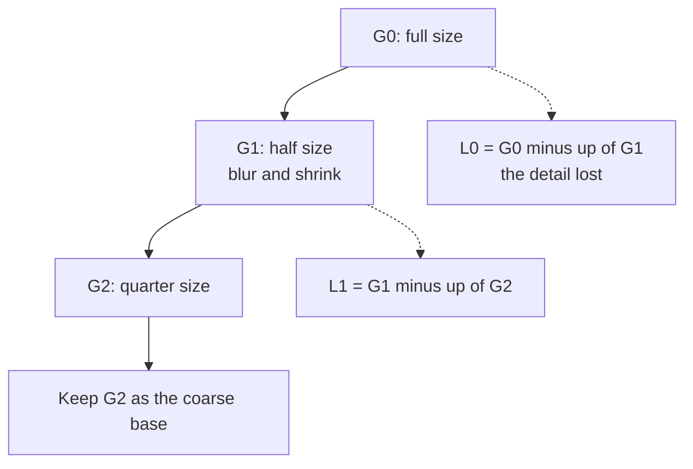

# Wavelets and Multiresolution Processing

<!-- related-block -->
<div class="reading-time">9 min read</div>
<!-- related-block -->
<div class="related-strip">

**Read first:** [The Fourier Transform for Images](/fields/digital-image-processing/fourier-transform-for-images.md)  ·  **See also:** [Noise and Restoration](/fields/digital-image-processing/noise-and-restoration.md)

</div>


> **Part 9 of the [Digital Image Processing series](/fields/digital-image-processing/README.md).** Fourier tells you which waves are in the town but not where they sing. Wavelets fix that by looking at the town at several zoom levels at once. By the end you'll build a Haar transform by hand, read the four subbands of a 2-D transform, and see why throwing away tiny coefficients is the secret of both denoising and JPEG 2000.

## Table of Contents
- [Wavelets and Multiresolution Processing](#wavelets-and-multiresolution-processing)
  - [Table of Contents](#table-of-contents)
  - [The scratch that is everywhere](#the-scratch-that-is-everywhere)
  - [A map with zoom levels](#a-map-with-zoom-levels)
  - [Image pyramids](#image-pyramids)
  - [Try it before you scroll](#try-it-before-you-scroll)
  - [The Haar wavelet by hand](#the-haar-wavelet-by-hand)
  - [From one row to a whole image](#from-one-row-to-a-whole-image)
  - [Why mostly-zero is a gift](#why-mostly-zero-is-a-gift)
  - [Where you meet wavelets](#where-you-meet-wavelets)
  - [Back to the scratch](#back-to-the-scratch)
    - [References](#references)

---

## The scratch that is everywhere

You compute the Fourier transform of a photo with one thin vertical scratch. You expect a tidy little feature in the spectrum. Instead, the scratch has smeared itself across **every frequency**, and nothing in the spectrum says where in the picture it was.

That's Fourier's blind spot. Each wave in [page 6](/fields/digital-image-processing/fourier-transform-for-images.md) stretches over the whole image, so the transform knows **how much** of each pattern there is and almost nothing about **where**. A scratch, a sharp edge or a blob of texture is local; the tool is global.

---

## A map with zoom levels

Think of Pixel Town as a **map app**. At the lowest zoom you see the whole country in a few blurry tiles. Zoom in and finer tiles appear, adding only the detail that the previous level couldn't show. A good map doesn't store the whole country at full detail; it stores the **rough picture**, plus **the extra detail at each level**.

That is the idea of **multiresolution processing**: represent the image as a coarse version and a stack of detail layers, each living at its own scale and each tied to a place. Two classic structures do it. We start with the easy one.

---

## Image pyramids

A **Gaussian pyramid** repeatedly blurs the image (page 4) and halves its width and height. Each level is a smaller, blurrier version of the one below.

The **Laplacian pyramid** stores what each shrink lost: the original at that level, minus the next level scaled back up:

$$L_i = G_i - \text{up}(G_{i+1})$$



*Keep the small top image and each layer of lost detail: that's enough to rebuild the original exactly.*

Rebuilding is the reverse: scale the coarse image up, add the detail layer, repeat. Nothing is lost, because the details are exactly what was subtracted. The cost is modest: each level has a quarter of the pixels of the one below, so the total is 1 + 1/4 + 1/16 + … = **4/3** of the original size.

Pyramids are the tool behind blending two photos without a visible seam (blend each level separately), and behind looking for an object at several sizes (shrink, search, shrink again).

---

## Try it before you scroll

☕ Take four pixels: **9, 7, 3, 5**. Replace each pair with its **average** and its **half-difference**. What do you get, and can you get the four numbers back?

*Hint: the pair (9, 7) gives an average of 8 and a half-difference of 1.*

**Answer:** coming up, and yes.

---

## The Haar wavelet by hand

The simplest wavelet transform is exactly the quiz. Take pairs, keep the average (the coarse picture) and the half-difference (the detail):

| Pair | Average | Half-difference |
|---|---|---|
| (9, 7) | (9 + 7) / 2 = **8** | (9 − 7) / 2 = **1** |
| (3, 5) | (3 + 5) / 2 = **4** | (3 − 5) / 2 = **−1** |

So [9, 7, 3, 5] becomes averages [8, 4] and details [1, −1].

To get the pair back: first = average + detail, second = average − detail. 8 + 1 = 9, 8 − 1 = 7 ✓, 4 + (−1) = 3, 4 − (−1) = 5 ✓. Nothing was lost.

Now do it again **on the averages** (that's the multiresolution step): the pair (8, 4) has average **6** and half-difference **2**. The full transform is:

```text
[9, 7, 3, 5]  ->  [6 | 2 | 1, -1]
                   |   |    |
                   |   |    +-- finest detail (pairs of pixels)
                   |   +------- coarser detail (between the two halves)
                   +----------- overall average
```

The same four numbers, rearranged by **scale**. The first is the average level of the whole row; the next says how the left half differs from the right; the last two say how each pair differs inside. That's the whole idea of a wavelet transform: **a coarse summary plus detail at every scale, each tied to a position**.

> [!NOTE]
> This is the unnormalized "average and half-difference" form for readability. The orthonormal Haar transform divides by √2 instead, so that it preserves energy. The structure is identical.

For a wavelet that's longer and smoother than Haar, the pairs become longer overlapping windows with carefully designed weights, but the recipe, a low-pass half and a high-pass half at each level, doesn't change.

---

## From one row to a whole image

For an image, do the one-level step along every **row**, then along every **column** of the result. The image splits into four quarter-size pieces called **subbands**:

| Subband | Built from | Holds |
|---|---|---|
| LL (approximation) | low-pass along rows, low-pass along columns | A half-size blurry copy of the image |
| Horizontal detail | high-pass in one direction, low-pass in the other | Edges running horizontally (changes up and down) |
| Vertical detail | the opposite combination | Edges running vertically |
| Diagonal detail (HH) | high-pass both ways | Corners, diagonals, and **a lot of the noise** |

The names (LH, HL and so on) are used in opposite ways by different books and libraries. PyWavelets, for one, returns the approximation and then horizontal, vertical and diagonal detail in that order, so check your tool.

Then repeat on the LL piece: **the same trick again** at half the size. Three levels give you one tiny approximation plus three sets of details at three scales. It's the pyramid idea again, but with details that take no extra space: a four-piece split holds exactly as many numbers as the original image.

---

## Why mostly-zero is a gift

Real images are mostly smooth, with edges here and there. In a wavelet transform:

- A **smooth region** has near-zero detail coefficients, because neighbouring pixels are alike (their half-difference is about 0).
- An **edge** produces a few large detail coefficients, **only at that location and at the scales that match it**.

So the transform of a typical image is a handful of large numbers and a sea of near-zeros. That sparsity is the point, and it gives two payoffs.

| Use | Idea |
|---|---|
| **Denoising** | Noise spreads thinly over every detail coefficient, while real edges concentrate in a few big ones. Shrink or zero every detail coefficient below a threshold, then invert. The edges survive; the noise mostly goes. Donoho and Johnstone's "wavelet shrinkage" made this principled. |
| **Compression** | Store only the large coefficients, coarsely quantized, and drop the small ones. JPEG 2000 does this with a wavelet transform; the older JPEG uses 8 × 8 block cosine transforms instead. |

Compare with [page 8](/fields/digital-image-processing/noise-and-restoration.md): a mean filter blurs the edges together with the noise because it can't tell them apart. A wavelet threshold can, because edges and noise **look different** in this domain.

Honest limits: thresholding too hard leaves ringing-like artifacts around edges and a patchy look, and a wavelet is chosen to suit the image type. And there's a trade-off you can't escape: you cannot know a position and a frequency both perfectly. Wavelets just pick a smarter compromise than Fourier's all-frequency, no-position extreme: short windows for fast changes, long windows for slow ones.

---

## Where you meet wavelets

| Where | Role |
|---|---|
| JPEG 2000 (ISO/IEC 15444-1) | Wavelet-based compression, with a lossless mode |
| Denoising | Threshold the detail subbands |
| Blending and zooming | Laplacian pyramids |
| Multi-scale detection | Search the pyramid for objects at several sizes |
| Feature extraction | Subband statistics as texture descriptors |

If you've studied CNNs, the pattern should sound familiar: early layers see fine detail and later, downsampled layers see coarse structure. That's a learned multiresolution analysis (see [Convolution in deep learning](/fields/deep-learning/concepts/convolution.md)).

---

## Back to the scratch

Fourier couldn't place the scratch because every one of its waves lives everywhere. In a wavelet transform the scratch shows up as a few large detail coefficients **at its own position and at the fine scales**, and nowhere else. That's the whole advantage: the transform answers "what" and "where" at once.

You've now gone from a grid of numbers to the frequency domain, to restoring and moving images, to seeing them at every scale. That's the whole starter map of the subject.

**Takeaway:** multiresolution keeps a coarse picture plus localized detail at each scale; the detail is mostly near-zero, which is why denoising and compression work.

**Challenge:** take the row [10, 10, 10, 50, 50, 50, 50, 50] and run one level of the average and half-difference transform by hand. Which detail coefficient is the only nonzero one, and what does its position tell you? (Check: the details should be [0, −20, 0, 0].) Then go back to Gonzalez and Woods, which should now read like a conversation instead of a wall.

### References

- R. C. Gonzalez and R. E. Woods, *Digital Image Processing*, 4th ed., Pearson, 2018: the chapter "Wavelet and Other Image Transforms" (the 3rd edition called it "Wavelets and Multiresolution Processing"; chapter numbers differ between listings, so look it up by title): pyramids, subband coding, the discrete wavelet transform.
- P. J. Burt and E. H. Adelson, "The Laplacian Pyramid as a Compact Image Code", *IEEE Transactions on Communications*, 31(4), 532-540, 1983.
- S. G. Mallat, "A Theory for Multiresolution Signal Decomposition: The Wavelet Representation", *IEEE Transactions on Pattern Analysis and Machine Intelligence*, 11(7), 674-693, 1989.
- D. L. Donoho and I. M. Johnstone, "Ideal spatial adaptation by wavelet shrinkage", *Biometrika*, 81(3), 425-455, 1994.
- PyWavelets documentation, [2D Discrete Wavelet Transform](https://pywavelets.readthedocs.io/en/latest/ref/2d-dwt-and-idwt.html): subband naming in `dwt2`.
