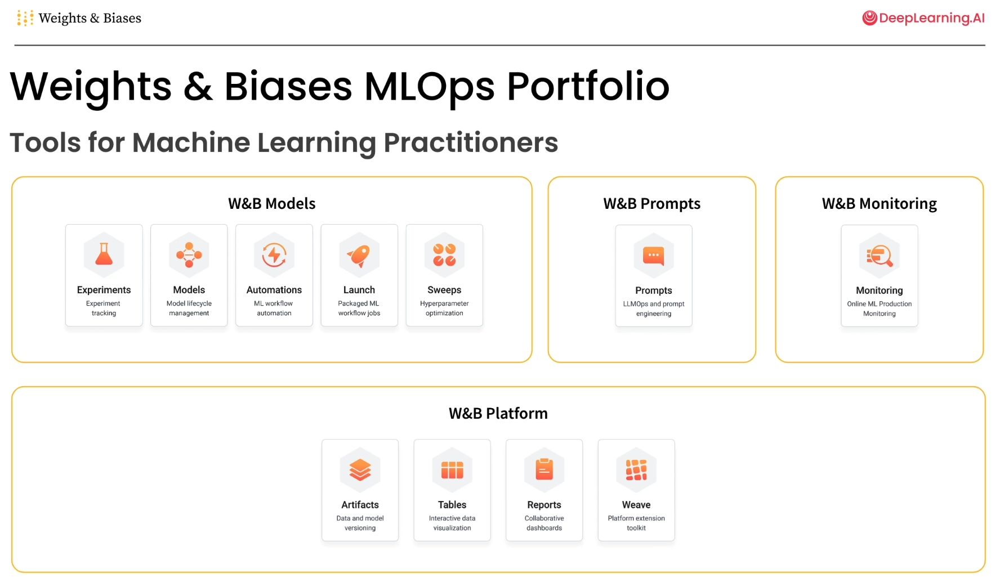
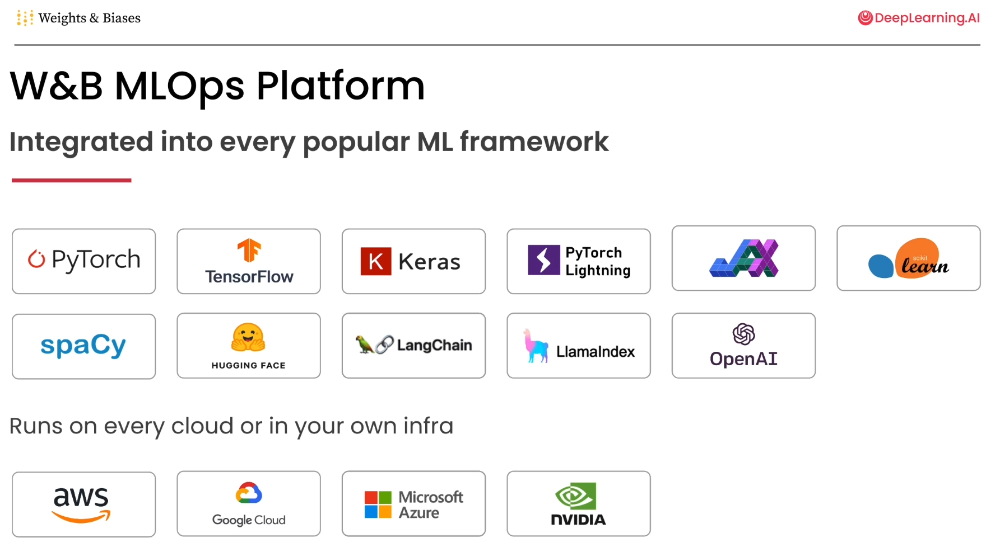
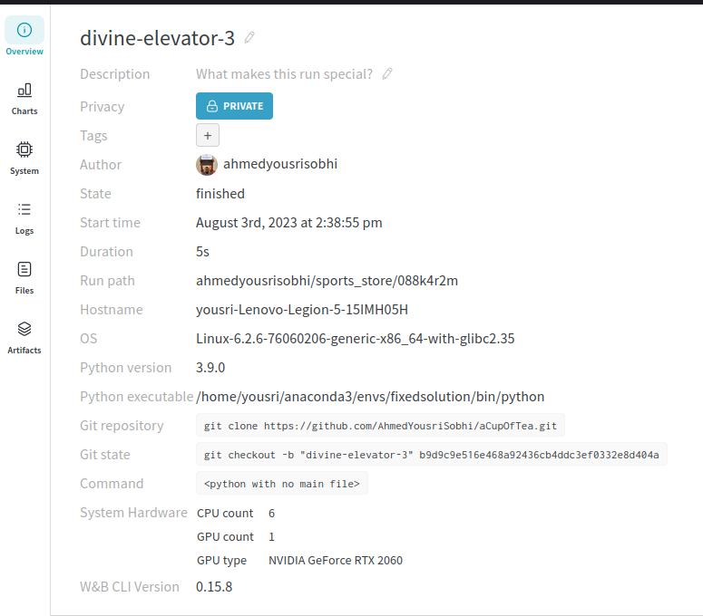
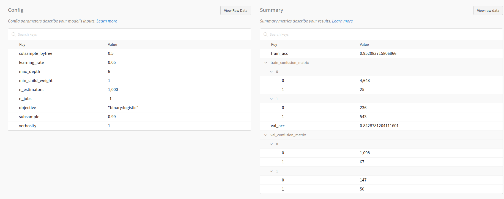
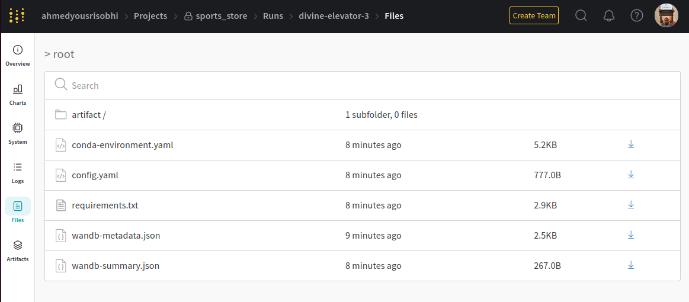

# Generative AI - Evaluation and Debugging Using Weights & Biases Tools

<!-- related-block -->
<div class="reading-time">3 min read</div>


## Table of Content
- [Generative AI - Evaluation and Debugging Using Weights \& Biases Tools](#generative-ai---evaluation-and-debugging-using-weights--biases-tools)
  - [Table of Content](#table-of-content)
  - [Motivation](#motivation)
  - [Topic Covered](#topic-covered)
  - [Instrument W\&B](#instrument-wb)
    - [Why use Weights \& Biases?](#why-use-weights--biases)
    - [Integrate with any Python script](#integrate-with-any-python-script)
    - [Overview](#overview)
    - [Overview - pick a run](#overview---pick-a-run)
  - [Credits](#credits)

## Motivation
We all have that case, when we train a model, tune the architecture, changing in the training dataset, then iterating more and more, then we decide to go back to last week model which had better performance, but what were the tuning parameters used, and even what was the dataset used for that training, did I saved them?

Many teams have a large difficulty to manage these process during training a model, and more complexity in bigger teams.

So In this article, we will cover tools and best practices to solve these problems.

Also all experimental projects are saved in our [https://wandb.ai/acupoftea/projects](https://wandb.ai/acupoftea/projects) page for public usage.

## Topic Covered
- Instrument W&B in an ML training pipeline.
- Training diffusion models.
- Evaluating diffusion models.
- Evaluating LLMs.
- Fine-Tuning LLMs.

Availalbe wide range of tools:


These tools could work with wide range of ML frameworks:


## Instrument W&B
### Why use Weights & Biases?
- Integrate quickly, track & version automatically.
- Visualize your data & uncover critical insights.
- Improve performance so you can evaluate and deploy with confidence.

### Integrate with any Python script
```python
# pip install wandb
import wandb

# 1. Organize your hyperparameters
config = {'learning_rate': 0.001}

# 2. Start wandb run
wandb.init(project='gpt5', config=config)

# Model Training here.

# 3. Log metrics over time to visualize performance
wandb.log({'loss':loss})

# 4. When working in notebook, finish
wandb.finish()
```

In some step, you will need an account for W&B to store the results of your experiments and use advanced W&B features. You can also continue to learn in anonymous mode.
```python
wandb.login(anonymous='allow')
```
Note: you can find your API key in your browser throught: [https://wandb.ai.authorize](https://wandb.ai.authorize)

### Overview
[Experimental Projects](https://wandb.ai/acupoftea/projects)

The idea during using this tool, is to just update the configuration for the model, then simply run again the training model process, the W&B tool will create a new run, save it, and compare it with other previous runs.

### Overview - pick a run



You can see that W&B catches the Git repository that you are in, and commits your works, so you can easily pull back to this stage where this run was made.


Even it saves the commit diff of files changes, also all the parameters and configuration used.

## Credits
- [DeepLearning.AI - Evaluating and Debugging Generative AI course](https://www.deeplearning.ai/short-courses/evaluating-debugging-generative-ai/)