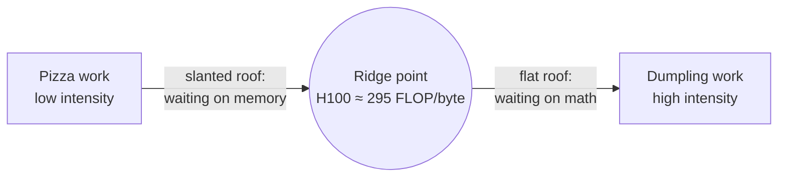

# Compute-Bound vs Memory-Bandwidth-Bound

<!-- related-block -->

9 min read

<!-- related-block -->

**Read next:** [LLM Inference on the Roofline](/fields/generative-ai/llm-inference-performance/llm-inference-on-the-roofline.md)

> **Part 1 of the [LLM Inference Performance series](/fields/generative-ai/llm-inference-performance/README.md).** A GPU has two speed limits, and your workload always hits one of them first. By the end of this page you'll know which one, using only a datasheet and one division, and you'll never again be surprised by an "upgrade" that didn't upgrade.

## Table of Contents
- [Compute-Bound vs Memory-Bandwidth-Bound](#compute-bound-vs-memory-bandwidth-bound)
  - [Table of Contents](#table-of-contents)
  - [The pizza place that hired the wrong person](#the-pizza-place-that-hired-the-wrong-person)
  - [One number about the recipe](#one-number-about-the-recipe)
  - [One number about the kitchen](#one-number-about-the-kitchen)
  - [Try it before you scroll](#try-it-before-you-scroll)
  - [The roofline: the whole idea in one picture](#the-roofline-the-whole-idea-in-one-picture)
  - [Two workloads, opposite fates](#two-workloads-opposite-fates)
  - [Plot twist: there are four walls, not two](#plot-twist-there-are-four-walls-not-two)
  - [The asterisk that doubles your mistake](#the-asterisk-that-doubles-your-mistake)
    - [What the roofline is not](#what-the-roofline-is-not)
    - [References](#references)

---

## The pizza place that hired the wrong person

A pizza place is losing customers. Orders take too long. The owner watches the kitchen for an evening and sees a chef who's clearly a genius: hands moving faster than you can follow, dough stretched in seconds.

So he hires a second genius chef.

Nothing improves. Not one minute.

Then he notices the walk-in fridge is at the far end of the building, and there's one teenager fetching every ingredient, one tray at a time. Both chefs spend most of the night standing still, arms crossed, waiting for mozzarella.

The kitchen was never short of chef. It was short of **fetching**.

Now swap the menu. Instead of pizza, the place sells hand-folded dumplings: one bag of ingredients becomes two hundred dumplings of fiddly work. Suddenly the teenager is sitting idle and the chefs are drowning. *That* kitchen needs another chef.

Same kitchen. Same staff. Different recipe, different bottleneck.

A GPU is that kitchen:

| Kitchen | GPU |
|---------|-----|
| Chefs | Tensor cores, the math units |
| Walk-in fridge | HBM, the memory stacked beside the chip |
| The teenager's speed | Memory bandwidth, in bytes per second |
| The recipe | Your workload |

The team in [the overview](/fields/generative-ai/llm-inference-performance/README.md) bought a kitchen with 3× faster chefs and a 1.6× faster teenager. Whether that was a good buy depends entirely on the recipe. So how do you read a recipe?

---

## One number about the recipe

Count two things: how much math the work needs, and how many bytes it has to fetch from memory. Divide.

$$\text{arithmetic intensity} = \frac{\text{FLOPs performed}}{\text{bytes moved to or from memory}}$$

A **FLOP** is one floating-point operation: one multiply, or one add. So intensity is **math per byte fetched**.

- **Low intensity** is the pizza: grab an ingredient, do a little with it, grab the next. Every byte gets used once and thrown away.
- **High intensity** is the dumplings: fetch once, then work on it for ages. Every byte gets reused many times while it sits in fast on-chip memory.

Here's the nice part: intensity belongs to the *work*, not to the GPU. You can compute it on paper before you've bought anything.

But a recipe's number means nothing until you know what the kitchen can handle. Where's the line between "too much chopping" and "too much fetching"?

---

## One number about the kitchen

Divide the chefs' top speed by the teenager's top speed:

$$\text{ridge point} = \frac{\text{peak FLOP/s}}{\text{peak memory bandwidth (bytes/s)}}$$

That's the **ridge point**: how much math you must do per byte just to keep the chefs busy. Below it, chefs wait. Above it, the fetcher waits.

| GPU | Dense BF16 compute | HBM bandwidth | Ridge point |
|-----|-------------------|---------------|-------------|
| A100 80GB SXM | 312 TFLOPS | 2,039 GB/s | ~153 FLOP/byte |
| H100 SXM | 989 TFLOPS | 3.35 TB/s | ~295 FLOP/byte |

The rule:

| Your work's intensity | You are | A faster chip helps? | More bandwidth helps? |
|-----------------------|---------|---------------------|----------------------|
| Below the ridge | **Memory-bandwidth-bound** | No | Yes |
| Above the ridge | **Compute-bound** | Yes | No |

Now look at the table again. A100 to H100: compute up about **3.2×**, bandwidth up about **1.6×**. The ridge point **doubled**.

That's the plot of the overview story in one line. NVIDIA hired a much faster chef and a somewhat faster teenager. Work that kept an A100 balanced leaves an H100's tensor cores waiting. **Every new GPU generation makes it harder to be compute-bound.** Remember that; it'll come back in every page of this series.

---

## Try it before you scroll

☕ Grab a pen. Two jobs. For each, guess: pizza or dumplings?

1. **Add two long lists of numbers**, element by element (`c = a + b`), in 32-bit floats.
2. **Multiply two big square matrices**, 4096 × 4096, in 16-bit floats.

Got your guesses? Scroll on.

---

## The roofline: the whole idea in one picture

Before the answers, the picture that makes them obvious. Put intensity on the x-axis and achievable speed (FLOP/s) on the y-axis, both on log scales. The GPU's limits draw a roof:

- On the left, a **slanted roof**: speed = intensity × bandwidth. You're waiting on the teenager. Want to go faster? Fetch less, or fetch faster.
- On the right, a **flat roof**: speed = peak compute. You're waiting on the chefs. Want to go faster? Faster or more chefs.
- They meet at the ridge point.

This is the **roofline model** (Williams, Waterman and Patterson, 2009), and its superpower is ruling things out. If your work sits on the slanted part, every optimization that adds math speed is guaranteed to do nothing. You can kill a bad proposal in one sentence.

Now, the answers.

---

## Two workloads, opposite fates

**Job 1: adding two lists.** Per element: read 4 bytes, read 4 bytes, write 4 bytes. One addition.

$$\frac{1 \text{ FLOP}}{12 \text{ bytes}} \approx 0.08 \text{ FLOP/byte}$$

That's thousands of times below the H100's ridge. Pure pizza. The tensor cores might as well not exist; this runs at exactly the speed of memory.

**Job 2: multiplying big matrices.** About 2N³ FLOPs. At best, three N×N matrices of 2 bytes each cross the memory boundary:

$$\frac{2N^3}{6N^2} = \frac{N}{3} \approx 1{,}365 \text{ FLOP/byte for } N = 4096$$

Way past the ridge. Pure dumplings. Each number fetched gets used thousands of times. This is the job tensor cores were invented for.

Same GPU, idle for one job and maxed out for the other. The only difference: **how many times each byte gets reused.**

Hold onto that phrase. In [part 2](/fields/generative-ai/llm-inference-performance/llm-inference-on-the-roofline.md) you'll find out that generating text with an LLM looks a lot more like Job 1 than Job 2, which is why the team in the overview got 1.6× and not 3×.

---

## Plot twist: there are four walls, not two

"Compute-bound or memory-bound" is the headline. In real debugging, you'll meet four walls:

| Wall | What's short | What you see | Usual fix |
|------|-------------|--------------|-----------|
| **Compute** | Math units | Tensor cores busy | Lower-precision math, more GPUs |
| **Memory bandwidth** | Bytes per second | Memory busy, tensor cores idle | Fetch fewer bytes: batching, quantization, fusion |
| **Memory capacity** | Bytes that *fit* | Out-of-memory, or a capped batch size | Shard across GPUs, quantize, waste less |
| **Overhead / latency** | Time between work | Nothing is busy | Fuse kernels, bigger batches, fewer sync points |

The trap: people say "memory-bound" for both the second and third walls. They're different problems. A 70B model that won't fit on one GPU is a **capacity** problem. Once it fits, its speed is a **bandwidth** problem. Tensor parallelism happens to fix both at once, which is exactly why they get blurred.

Separate them out loud in an interview and you'll sound like someone who's actually been paged about it.

---

## The asterisk that doubles your mistake

One last trap, hiding in plain sight.

The H100 datasheet lists BF16 Tensor Core performance as **1,979 TFLOPS**. Look closer: there's an asterisk. That number is **with sparsity**, a special 2:4 pattern where half the weights are zero. Ordinary models aren't like that. The dense number is half: **989 TFLOPS**. The A100 sheet does the same (624 with sparsity, 312 dense).

Use the headline number and your ridge point doubles. Every workload suddenly looks twice as bandwidth-bound as it really is, and your capacity plan is built on sand.

Here's what that misdiagnosis looks like. A team profiles a kernel at **400 FLOP/byte** on an H100.

| Ridge point computed from | Ridge | Verdict for 400 FLOP/byte | What the team does next |
|---------------------------|-------|---------------------------|-------------------------|
| Dense BF16, 989 TFLOPS ÷ 3.35 TB/s | ~295 | **Compute-bound** (correct) | Looks for faster math: FP8, better tensor-core use |
| Sparse BF16, 1,979 TFLOPS ÷ 3.35 TB/s | ~590 | "Bandwidth-bound" (wrong) | Spends a sprint cutting memory traffic, and nothing gets faster |

Everything between the real ridge and the inflated one gets misfiled. The team optimizes the wrong axis, exactly the mistake the roofline exists to prevent. The sparse number only becomes the right one once a model really is pruned to 2:4, which [part 5](/fields/generative-ai/llm-inference-performance/structured-sparsity.md) covers.

Also remember the datasheet bandwidth is a peak. Real kernels get a fraction of it, so real ceilings sit a bit lower than the ones you'll compute in this series.

### What the roofline is not

- **Not a prediction.** It's a ceiling. Real code lives under the roof, sometimes far under.
- **Not the whole memory story.** The simple version only counts trips to HBM. Clever kernels keep data on-chip and change the math; [part 4](/fields/generative-ai/llm-inference-performance/optimizations-on-the-roofline.md) shows how.
- **Not multi-GPU.** Talking between GPUs is a third roof. We'll hit it in part 3.

**Takeaway:** divide the work's FLOPs by its bytes; if that's below the GPU's ridge point (about 295 for an H100), you're short of fetching, not chefs, and no amount of TFLOPS will save you.

So where does an LLM sit on this roof? Here's a hint that should bother you: it's fast at *reading* your prompt and slow at *writing* the answer. Same model, same GPU. Why? That's [part 2](/fields/generative-ai/llm-inference-performance/llm-inference-on-the-roofline.md).

### References
- [NVIDIA H100 Tensor Core GPU datasheet](https://www.nvidia.com/en-us/data-center/h100/)
- [NVIDIA A100 Tensor Core GPU datasheet](https://www.nvidia.com/en-us/data-center/a100/)
- [Williams, Waterman, Patterson, "Roofline: An Insightful Visual Performance Model for Multicore Architectures", Communications of the ACM, 2009](https://doi.org/10.1145/1498765.1498785)
- [NVIDIA Nsight Compute: Profiling Guide (roofline charts)](https://docs.nvidia.com/nsight-compute/ProfilingGuide/index.html)