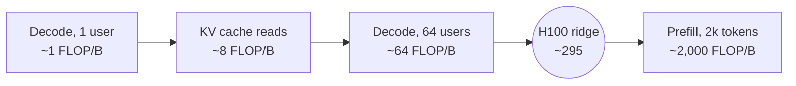

# LLM Inference on the Roofline

<!-- related-block -->

9 min read

<!-- related-block -->

**Read first:** [Compute-Bound vs Memory-Bandwidth-Bound](/fields/generative-ai/llm-inference-performance/compute-bound-vs-memory-bound.md)  ·  **Read next:** [Sizing a 70B Model with a Pencil](/fields/generative-ai/llm-inference-performance/sizing-a-70b-model.md)

> **Part 2 of the [LLM Inference Performance series](/fields/generative-ai/llm-inference-performance/README.md).** An LLM is two completely different workloads pretending to be one. By the end of this page you'll know which half is pizza and which is dumplings, why batching is the closest thing to free money in AI infrastructure, and the one piece of memory that batching can never fix.

## Table of Contents
- [LLM Inference on the Roofline](#llm-inference-on-the-roofline)
  - [Table of Contents](#table-of-contents)
  - [Two tickets in the support queue](#two-tickets-in-the-support-queue)
  - [The librarian who reads the whole library for one word](#the-librarian-who-reads-the-whole-library-for-one-word)
  - [Reading the prompt: the dumpling phase](#reading-the-prompt-the-dumpling-phase)
  - [Batching: the bus instead of the taxi](#batching-the-bus-instead-of-the-taxi)
  - [Try it before you scroll](#try-it-before-you-scroll)
  - [The KV cache: the luggage that doesn't share](#the-kv-cache-the-luggage-that-doesnt-share)
  - [The whole story on one roof](#the-whole-story-on-one-roof)
  - [What users actually feel](#what-users-actually-feel)
    - [References](#references)

---

## Two tickets in the support queue

Monday, two tickets land in the platform team's queue.

**Ticket 1:** *"I pasted a 40-page contract into the assistant. It took a noticeable pause before it started answering."*

**Ticket 2:** *"I asked a one-line question. It started instantly, but the answer dribbles out word by word."*

A junior engineer reads both and writes: "Model is slow, need more GPUs." Closes both.

They're wrong twice. These are two different bottlenecks, on opposite sides of the roofline from [part 1](/fields/generative-ai/llm-inference-performance/compute-bound-vs-memory-bound.md). More GPUs of the same kind might help one and do nothing for the other. To see why, watch what the model actually does with each request.

It does two jobs:

1. **Prefill**: read the whole prompt at once, and produce the first token of the answer.
2. **Decode**: write the rest of the answer **one token at a time**, each token depending on everything before it.

Same weights, same GPU. Opposite personalities.

---

## The librarian who reads the whole library for one word

Start with decode, because it's the strange one.

Imagine a librarian who answers questions one word at a time. To produce each word, she has to walk past **every shelf in the library** and glance at every book. Then she writes one word. Then she walks the whole library again for the next word.

That's decode. The "library" is the model's weights: billions of numbers. To produce one token, every one of them is read from HBM and used in one multiply and one add. For a model with *P* parameters stored in 16 bits (2 bytes):

$$\text{intensity} \approx \frac{2P \text{ FLOPs}}{2P \text{ bytes}} = 1 \text{ FLOP/byte}$$

**One.** The H100's ridge point is about 295. Generating text for one user sits roughly **300× below** the line where the tensor cores would be busy. It's the vector addition from part 1 wearing a trench coat.

Which gives the single most useful formula in LLM serving:

$$\text{max tokens/s (one user)} \approx \frac{\text{memory bandwidth}}{\text{model size in bytes}}$$

Look at what's missing: TFLOPS. Double the compute, keep the bandwidth, and one user's answer streams **no faster at all**. Now reread the overview's story. Answers streamed 1.6× faster after the upgrade. That's the bandwidth ratio. It had to be.

That's Ticket 2: the dribble. So why was Ticket 1, the giant prompt, a different problem?

---

## Reading the prompt: the dumpling phase

Prefill is the librarian on her best day. She walks past every shelf **once** and, on that single walk, handles all *T* words of your prompt together. Each weight fetched gets used *T* times:

$$\text{intensity} \approx \frac{2P \times T}{2P} = T \text{ FLOP/byte}$$

A 2,000-token prompt: about 2,000 FLOP/byte. Way past the ridge. **Prefill is compute-bound.** It finally uses the tensor cores the way they were built to be used.

So Ticket 1, the pause before a 40-page contract, is a *compute* problem, and Ticket 2 is a *bandwidth* problem. "LLM inference is memory-bound" is only half true. Decode is. Prefill isn't. Being able to say that crisply is one of the clearest signals of seniority in an inference interview.

Fine. Decode wastes the tensor cores. Can we give them something to do while the librarian walks?

---

## Batching: the bus instead of the taxi

Decode's problem is that every walk through the library serves one person. So stop doing that.

Run the next step for **B users at once**. The librarian walks past every shelf one time and writes the next word for all B answers on the way. Weights are read once and used B times:

$$\text{intensity of the weight reads} \approx B \text{ FLOP/byte}$$

It's a bus instead of a taxi. The road (bandwidth) is the same. The trip takes about as long. But it carries 64 people instead of one.

That's why batching is the closest thing to free money in serving: total throughput rises almost linearly with batch size while each user's streaming speed barely moves.

One catch with old-style batching: the bus waits until its *slowest* passenger arrives before leaving again. Short answers finish, their seats sit empty, and the bus keeps driving half-full. **Continuous batching** (also called in-flight or iteration-level batching) fixes that: at every single decode step, finished passengers get off and new ones get on. vLLM and other modern engines work this way.

So here's the obvious question. If batch B gives intensity B, and the ridge is 295... just batch 300 users and become compute-bound?

---

## Try it before you scroll

☕ Before reading on, think about it for ten seconds. Batching shares the **weights** across users. Is there anything the model reads at every step that **can't** be shared between users?

Hint: the model has to remember each conversation.

---

## The KV cache: the luggage that doesn't share

When the model writes word 500 of your answer, attention needs to look back at words 1 through 499. Recomputing all of that at every step would be absurd, so the model stores two vectors for every past token in every layer: a **key** and a **value**. That store is the **KV cache**.

Here's the catch. **Your KV cache is yours.** The bus can share the road (the weights), but every passenger brings their own luggage, and the luggage has to be carried at every stop. Each decode step reads every user's entire KV cache, and each byte of it serves exactly one user.

The size per token is set by the model's shape:

$$\text{KV bytes per token} = 2 \times \text{layers} \times \text{KV heads} \times \text{head dim} \times \text{bytes per value}$$

This luggage causes two separate problems.

**Problem 1: the bus fills up.** Every passenger's luggage takes memory, and it grows with every word they generate. Once memory is full, nobody else gets on. The KV cache, not the GPU's speed, often decides the maximum batch size. Wasting that memory is expensive, which is the problem PagedAttention solves in [part 4](/fields/generative-ai/llm-inference-performance/optimizations-on-the-roofline.md).

**Problem 2: luggage never gets cheaper to carry.** Since each cached byte serves one user, attention's intensity is fixed by the model's shape, not by the batch. If the model has *H_q* query heads sharing *H_kv* key/value heads:

$$\text{attention intensity} \approx \frac{H_q}{H_{kv}} \text{ FLOP/byte}$$

| Attention design | Query heads per KV head | Attention intensity |
|------------------|------------------------|---------------------|
| Classic multi-head attention | 1 | ~1 FLOP/byte |
| Grouped-query attention, Llama 2 70B (64 query, 8 KV) | 8 | ~8 FLOP/byte |

Single digits. At any batch size. At any context length. And the longer the conversations, the more of each step's bytes are luggage, so the whole step slides *further* from the ridge, not closer.

That's why model designers care about **grouped-query attention**: fewer KV heads means smaller luggage (more passengers fit) *and* more work per byte of luggage carried. Llama 2 adopted it for the 70B model for exactly this kind of inference scalability.

So: can you batch your way to compute-bound? With long conversations, no. You'll see the exact numbers in part 3.

---

## The whole story on one roof

| Work | Intensity (16-bit) | On the H100 roofline |
|------|-------------------|----------------------|
| Decode, 1 user | ~1 FLOP/byte | Far left: waiting on memory |
| Attention over the KV cache (GQA ×8) | ~8 FLOP/byte | Left, at any batch size |
| Decode, 64 users, weight reads | ~64 FLOP/byte | Left, much better |
| The H100 ridge point | ~295 FLOP/byte | The corner |
| Prefill, 2,000-token prompt | ~2,000 FLOP/byte | Right: waiting on math |

Everything left of the ridge is fixed with *bytes*: fetch fewer, share more, or get more bandwidth. Everything right of it is fixed with *math*.

---

## What users actually feel

Back to the two tickets. Serving engines report two latency numbers, and each one belongs to one phase:

| Metric | Means | Phase | Bound by |
|--------|-------|-------|----------|
| **TTFT**, time to first token | The pause before the answer starts | Prefill | Compute |
| **TPOT**, time per output token | How fast the answer streams | Decode | Memory bandwidth |

Ticket 1 is a TTFT complaint. Ticket 2 is a TPOT complaint. Different physics, different fixes.

This also explains three things that otherwise look like bugs:

- A huge prompt delays the start, but the answer then streams at normal speed.
- Adding users to a server barely slows anyone's streaming, until KV-cache memory fills up and new users start queuing.
- When someone pastes a giant document, *everyone else's* stream stutters for a moment: that compute-heavy prefill elbows its way in between their decode steps. Hold that thought; part 4 has a fix.

**Takeaway:** reading the prompt reuses every weight thousands of times and is compute-bound; writing the answer walks the whole library for each word and is bandwidth-bound; batching shares the walk, but every user's KV-cache luggage still has to be carried.

You now have every formula you need. So here's the challenge: an interviewer hands you a marker and says *"Llama 2 70B, eight H100s. How fast can it go?"* Can you answer in five minutes, from memory? That's [part 3](/fields/generative-ai/llm-inference-performance/sizing-a-70b-model.md).

### References
- [Touvron et al., "Llama 2: Open Foundation and Fine-Tuned Chat Models", arXiv:2307.09288 (grouped-query attention for 70B)](https://arxiv.org/abs/2307.09288)
- [Kwon et al., "Efficient Memory Management for Large Language Model Serving with PagedAttention", SOSP 2023, arXiv:2309.06180](https://arxiv.org/abs/2309.06180)
- [NVIDIA H100 Tensor Core GPU datasheet](https://www.nvidia.com/en-us/data-center/h100/)
- [Williams, Waterman, Patterson, "Roofline", CACM 2009](https://doi.org/10.1145/1498765.1498785)