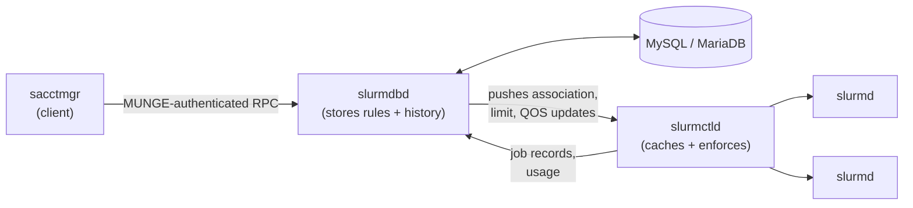

# Slurm Multi-Tenancy: Who Stores the Rules, Who Enforces Them

<!-- related-block -->
<div class="reading-time">9 min read</div>
<!-- related-block -->
<div class="related-strip">

**See also:** [Isolating GPU Workloads: Taints, Labels and the Device Plugin](/fields/devops/kubernetes/isolating-gpu-workloads.md), [Mixing GPU Types in Slurm - Overview](/fields/schedulers/slurm-mixed-gpus/README.md)

</div>


> **Part of the [schedulers](/fields/schedulers/intro.md) directory.** The [intro](/fields/schedulers/intro.md#the-slurm-architecture-at-a-glance) sketched Slurm's three daemons. This page zooms in on the part that makes a shared cluster fair: accounts, limits and usage history. By the end you'll know which daemon stores the rules, which one enforces them, what `sacctmgr` actually is, and the one missing line in `slurm.conf` that makes every limit you set do nothing.

## Table of Contents
- [Slurm Multi-Tenancy: Who Stores the Rules, Who Enforces Them](#slurm-multi-tenancy-who-stores-the-rules-who-enforces-them)
  - [Table of Contents](#table-of-contents)
  - [The limit that wasn't](#the-limit-that-wasnt)
  - [Four programs, four jobs](#four-programs-four-jobs)
  - [Correcting a common summary](#correcting-a-common-summary)
  - [Associations: the unit of fairness](#associations-the-unit-of-fairness)
  - [Limits: Grp versus Max](#limits-grp-versus-max)
  - [Try it before you scroll](#try-it-before-you-scroll)
  - [QOS and fairshare: the other two dials](#qos-and-fairshare-the-other-two-dials)
  - [Turning it on safely](#turning-it-on-safely)
  - [When slurmdbd goes down](#when-slurmdbd-goes-down)
    - [References](#references)

---

## The limit that wasn't

A university buys a GPU cluster. Three labs share it. The vision lab is promised at most 16 GPUs at a time.

The admin opens a terminal and runs:

```bash
sacctmgr modify account vision set GrpTRES=gres/gpu=16
```

`sacctmgr` says the change was made. The admin closes the ticket.

Two weeks later, the NLP lab's PI sends an angry email with a screenshot: the vision lab is running on 40 GPUs. The limit is right there in the database. `sacctmgr show assoc` displays it proudly. And Slurm is ignoring it completely.

Nothing is broken. Slurm's resource-limits docs say that to enforce scheduling policy you set `AccountingStorageEnforce` in `slurm.conf`, and its `limits` option is the one that enforces association limits. Leave it unset, the default, and the limits sit in the database doing nothing. The admin stored the rule. Nobody told the enforcer to read it.

That gap, between where rules are **stored** and where they're **enforced**, is the whole story of this page.

---

## Four programs, four jobs

| Program | Kind | Runs on | Its job |
|---------|------|---------|---------|
| **`slurmctld`** | Daemon (the controller) | Head node, plus an optional backup | Holds the live state of nodes, partitions and jobs; makes every scheduling decision; **enforces** limits when enforcement is turned on |
| **`slurmd`** | Daemon (the node agent) | Every compute node | Launches job steps, contains them with cgroups, reports back |
| **`slurmdbd`** | Daemon (the database front end) | A database host, often the head node or a dedicated server | **Stores** accounts, users, limits, QOS definitions and job history in MySQL/MariaDB; serves them to controllers and commands |
| **`sacctmgr`** | Command-line client | Anywhere with Slurm clients installed | Edits the accounting database **through** `slurmdbd` |

Plus the quiet fifth member: **MUNGE**, the authentication service. Slurm's resource-limits docs note that `slurmdbd` authenticates its traffic through a Slurm authentication plugin such as MUNGE, so a controller or command can't just claim to be someone else.

A useful way to picture it: `slurmdbd` is the **filing cabinet**, `slurmctld` is the **bouncer at the door**, and `sacctmgr` is the **pen** you write rules with. Writing a rule into the cabinet doesn't make the bouncer check it.

How the rules travel, per SchedMD's own architecture slides: `slurmdbd` sits between users and the database so nobody needs direct database access, and it **pushes updates out to `slurmctld`** on each cluster. The controller keeps its own working copy, which is why scheduling doesn't stop for a database round trip on every job.



---

## Correcting a common summary

You'll often see multi-tenancy summarized like this: *"accounting, resource limits and historical data are managed entirely by slurmdbd, while sacctmgr is merely a client."* Half right:

| Claim | Verdict |
|-------|---------|
| "`sacctmgr` is a command-line client of `slurmdbd`." | **Correct.** It reads and writes accounting data through the daemon. |
| "`slurmdbd` stores accounts, limits and history." | **Correct.** It's the system of record, backed by a database. |
| "Limits are managed **entirely** by `slurmdbd`." | **Wrong where it matters.** `slurmdbd` stores them; `slurmctld` enforces them, and only if `AccountingStorageEnforce` says so. |
| "Without `slurmdbd`, no accounting." | **Mostly true** for multi-tenant setups: Slurm's docs strongly recommend `slurmdbd` as the front end to the database for security and performance. |

The precise version: **`slurmdbd` remembers, `slurmctld` decides.**

---

## Associations: the unit of fairness

Every rule hangs off an **association**. The resource-limits docs define it as a 4-tuple: **cluster, account, user and (optionally) partition**. Accounting and scheduling policy are both configured per association.

Accounts nest, which is how organizations map onto the cluster:

```text
cluster: gpucluster
└── account: research              (GrpTRES=gres/gpu=96)
    ├── account: vision            (GrpTRES=gres/gpu=16)
    │   ├── user: alice
    │   └── user: bob              (MaxJobs=4)
    └── account: nlp               (GrpTRES=gres/gpu=48)
        └── user: carol
```

A user can belong to several accounts and choose one per job with `--account`. Each (cluster, account, user) combination is a separate association with its own limits and its own usage history.

A typical setup, using `sacctmgr`:

```bash
sacctmgr add account research Description="All research groups"
sacctmgr add account vision parent=research Description="Vision lab"
sacctmgr add user alice account=vision
sacctmgr modify account vision set GrpTRES=gres/gpu=16
```

These are standard `sacctmgr` operations from SchedMD's documentation; they weren't run on a live cluster for this page.

---

## Limits: Grp versus Max

Slurm tracks resources as **TRES** (trackable resources): CPUs, memory, nodes, GPUs as `gres/gpu`, and more. Limits come in two families, and mixing them up is the most common policy bug:

| Family | Meaning | Example | Use it for |
|--------|---------|---------|------------|
| **`Grp*`** | A ceiling on the **whole association and everything under it**, added up across all its running jobs | `GrpTRES=gres/gpu=16` on `vision`: the lab's jobs together can't hold more than 16 GPUs | Lab or team quotas |
| **`Max*`** | A ceiling on **each single job** (or each user, depending on the limit) | `MaxTRESPerJob=gres/gpu=8`: no single job above 8 GPUs | Stopping one job from swallowing the cluster |

Grp limits are budgets for a group. Max limits are size caps for individuals. A lab quota written as a Max limit lets the lab run as many 16-GPU jobs as it likes.

---

## Try it before you scroll

☕ The `vision` account has `GrpTRES=gres/gpu=16`. Alice submits two 8-GPU jobs; both run. Bob submits a 4-GPU job. `AccountingStorageEnforce=limits` is set. What happens to Bob's job?

It **pends**. The account's running jobs already hold 16 GPUs, its group ceiling. Bob's job waits until one of Alice's finishes, even if half the cluster is idle. That's the point of a group limit, and also its cost: quotas can leave GPUs idle. That trade-off is why many sites pair hard limits with fairshare, below.

---

## QOS and fairshare: the other two dials

Limits say **how much**. Two more mechanisms say **who goes first**.

**QOS (Quality of Service)** is a named policy a job runs under: priority boost, preemption rules, its own limits. A site might have `normal`, `high` for deadline work, and `scavenger` for preemptible jobs that soak up idle GPUs. With `qos` in `AccountingStorageEnforce`, every job must use a valid QOS, given explicitly or by default.

**Fairshare** adjusts priority by recent usage. An association that has consumed more than its share recently drops in priority; one that's been quiet rises. It's how a cluster stays fair *without* hard caps: heavy users aren't blocked, they just wait behind lighter ones. It needs usage history, which is exactly what the accounting database keeps.

| Dial | Answers | Blocks jobs? |
|------|---------|--------------|
| Grp/Max limits | "How much may you hold?" | Yes, hard |
| QOS | "Under which policy does this job run?" | Can, through its own limits |
| Fairshare | "Who goes next?" | No, it reorders |

The opinionated default for a shared GPU cluster: **fairshare for everyday fairness, Grp limits only for promises you've actually made** (like "the vision lab gets 16 GPUs"), and a preemptible QOS so idle GPUs don't stay idle.

---

## Turning it on safely

`AccountingStorageEnforce` takes a comma-separated list. From the `slurm.conf` man page and resource-limits docs:

| Option | Effect |
|--------|--------|
| `associations` | Jobs only run if the user and account exist in the database |
| `limits` | Enforces association limits; implies `associations` |
| `qos` | Jobs must use a valid QOS; implies `associations` |
| `safe` | Only starts jobs that can finish within their limits; implies `limits` and `associations` |
| `wckeys` | Requires a valid workload characterization key |

> [!WARNING]
> Turning on `associations` blocks every user who isn't in the accounting database. On an existing cluster, load every user and account with `sacctmgr` **first**, then enable enforcement. The `slurm.conf` man page also notes that changing `AccountingStorageEnforce` needs a `slurmctld` restart, not just `scontrol reconfigure`; check the man page for your version.

A safe rollout:

1. **Populate.** Create accounts and users with `sacctmgr`. Check with `sacctmgr show assoc format=account,user,grptres`.
2. **Enable `associations`** in a maintenance window. Watch for jobs rejected for invalid accounts; fix the gaps.
3. **Add `limits`** (and `qos` if you use it). Verify a test account actually pends at its limit.
4. **Keep the rollback ready:** remove the option and restart `slurmctld`.

---

## When slurmdbd goes down

The filing cabinet being locked shouldn't stop the bouncer. SchedMD's slides on the database daemon say `slurmctld` **caches data if `slurmdbd` isn't responding**, so the cluster keeps scheduling with the limits it already knows, and job records wait until the database comes back.

What you lose while it's down: **changes**. `sacctmgr` edits can't land, new users can't be added, and reports from `sacct` or `sreport` won't show the newest jobs. Treat `slurmdbd` as important but not critical-path, and monitor it so "a few minutes down" doesn't quietly become "a week of cached records."

**Takeaway:** `slurmdbd` remembers, `slurmctld` decides, and `sacctmgr` is just the pen, so a limit only exists once `AccountingStorageEnforce` tells the controller to read it.

For what happens when tenants ask for *different* hardware in one job, see [mixing GPU types in Slurm](/fields/schedulers/slurm-mixed-gpus/README.md).

### References
- [Slurm: Accounting and Resource Limits](https://slurm.schedmd.com/accounting.html)
- [Slurm: Resource Limits (associations, enforcement options)](https://slurm.schedmd.com/resource_limits.html)
- [Slurm `slurm.conf` man page, `AccountingStorageEnforce`](https://www.mankier.com/5/slurm.conf)
- [SchedMD, "Slurm Database Daemon" (Slurm User Group 2012 slides)](https://Slurm.schedmd.com/slurm_ug_2012/SUG_Oct2012_DBD.pdf)