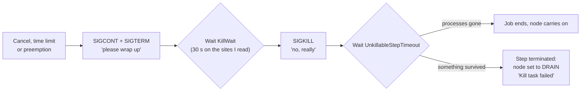

<!-- related-block -->
<nav class="crumbs" aria-label="Breadcrumb"><a href="#/fields/">Fields</a> / <a href="#/fields/schedulers/">Schedulers</a> / <a href="#/fields/schedulers/slurm-cluster-operations/">Slurm Cluster Operations</a></nav>

# Kill Task Failed: A Murder Mystery With No Body (and One Drained Node)

<!-- related-block -->
<div class="reading-time">Intermediate · Concept · 7 min read · Updated 13 Nov 2026</div>
<!-- related-block -->
<div class="tag-chips"><a class="chip" href="#/.docs/generated/explore/tags/hpc">hpc</a> <a class="chip" href="#/.docs/generated/explore/tags/slurm">slurm</a></div>


> **Part of the [schedulers](/fields/schedulers/slurm-intro.md) directory.** Option names and the kill sequence come from the Slurm documentation and from support tickets and mailing-list threads where SchedMD staff and site admins describe the behavior. Nothing here was run on a live cluster for this page. Scenarios are invented for illustration.

## The call comes in at 3 a.m.

You run `sinfo -R` and find a node that has been quietly drained overnight:

```
REASON               USER      TIMESTAMP           NODELIST
Kill task failed     root      2026-11-04T03:12:09 gpu-node-17
```

The job is gone. The queue moved on. `slurmctld` has nothing to say, because from its point of view nothing went wrong in the controller. The node has simply declared that it can no longer be trusted, and Slurm took it at its word.

Where did the job go? That is the mystery. The honest answer is that it may not have gone anywhere. One of its processes might still be on that node, alive, deaf and dangerous.

* * *

## How a job is supposed to die

Cancelling a job, hitting a time limit, or being preempted all end in the same sequence. SchedMD staff describe it in a support ticket, and the pieces line up like this:



Two timers, two different questions:

| Timer | Question it answers | Seen in practice |
|---|---|---|
| `KillWait` | How long do we wait between the polite request and `SIGKILL`? | 30 seconds on the clusters in the threads I read |
| `UnkillableStepTimeout` | After `SIGKILL`, how long before we decide a process is unkillable? | 60 seconds in older threads; one site on 25.05 shows 300 |

Defaults have moved between versions and many sites change them, so ask your own cluster:

```bash
scontrol show config | grep -Ei 'killwait|unkillable'
```

The `slurmstepd` log line you are looking for says the step was terminated "due to job not ending with signals". That is the node reporting, in a slightly Victorian tone, that it sent the signals and nothing happened.

* * *

## Suspect 1: the process that cannot hear you

`SIGKILL` cannot be caught, blocked or ignored. It can, however, be *postponed*. A process in uninterruptible sleep (state `D` in `ps`) is waiting for the kernel to finish something, usually I/O, and the kernel will not deliver a fatal signal until that wait ends.

The usual accomplice is a network or parallel filesystem having a bad night. Admins in the mailing-list threads blame laggy storage again and again, and one thread adds a useful detail: the I/O may complete *after* Slurm drained the node, leaving a perfectly clean machine wearing a drain flag.

One support ticket even includes the kernel's own confession in the node log, a line saying a task had been blocked for more than 362 seconds. That kind of message in `dmesg` or the journal is your best evidence that the suspect was stuck in a system call.

A few things this implies:

- **It is rarely the job's fault.** A user cancelling a healthy job on a sick filesystem is enough.
- **Mass cancels amplify it.** One thread describes a workflow tool that stops a run by cancelling many jobs at once, and nodes drain in batches, presumably because they all hit the same stalled mount at the same moment.
- **Not every case is storage.** One admin in the threads reports the same drain on a site with no Lustre at all. Treat "storage" as the leading suspect, not the only one.

> [!NOTE]
> Slurm's own reasoning, as one list reply puts it, is a heuristic: if a process could not be killed, something is wrong with the node, so keep new jobs away until a human looks.

* * *

## Suspect 2: the epilog with a temper

There is a second way to get a drained node after a job ends, and it looks similar from the outside. Slurm's Prolog and Epilog guide says that if the **Epilog exits with a non-zero code, the node is set to DRAIN**. A site epilog that checks for leftover [GPU](/references/glossary?id=gpu "Graphics Processing Unit") processes, full scratch space or stale mounts will drain a node the moment its check fails, which is its job.

So when you see a drained node after a job, check which story it is:

| Clue | Likely cause |
|---|---|
| Reason says "Kill task failed" | A step process survived `SIGKILL` for `UnkillableStepTimeout` seconds |
| `slurmd` log shows the epilog finishing with an error | Your epilog returned non-zero |
| `dmesg` shows hung-task warnings | The kernel was already unhappy before Slurm noticed |

The epilog also runs **outside** the job's cgroup, which matters if your check looks at device numbers. [The cgroups page](/fields/schedulers/slurm-inside-a-job/slurm-cgroups-in-practice.md) and the [GPU affinity page](/fields/schedulers/slurm-inside-a-job/slurm-gpu-affinity-socket-lie.md) explain how the same GPU can have different numbers inside and outside.

* * *

## Why raising the timeout is mostly a delay

The obvious fix is to raise `UnkillableStepTimeout`. SchedMD's own troubleshooting guide suggests it for nodes stuck in COMPLETING, so it is a legitimate tool. But admins report the limits of it:

- One admin who tried it says it mostly prolonged the time before the failure.
- A site with the timeout at 180 seconds still reports drains several times a day.
- Another thread has a user cancelling a job at 120 seconds and still getting a drained node.

The reasoning is simple. If the storage is down for ten minutes, a three-minute timeout drains the node and a nine-minute timeout does too, just later. A longer timeout helps only when the stall is shorter than the new value.

Also, the drained node does not undrain itself. A list reply is explicit that even when the job finally terminates, the node is **not** resumed. Somebody has to do that.

* * *

## The detective kit

`UnkillableStepProgram` runs a script of your choosing when a step is unkillable. Admins in the threads recommend it as a debugging tool, and it is the best thing you can do for your future self, because it captures the scene while the body is still warm.

A sketch of what such a script might gather. This is a suggestion, not a Slurm-provided script, so test it before relying on it:

```bash
#!/bin/bash
# UnkillableStepProgram sketch: record evidence, change nothing.
OUT=/var/log/slurm/unkillable.$(hostname).$(date +%s)
{
  echo "== job info =="; env | grep -E '^SLURM_' | sort
  echo "== processes in D state =="
  ps -eo pid,ppid,user,stat,wchan:32,etime,cmd | awk '$4 ~ /^D/'
  echo "== kernel hung-task messages =="
  dmesg -T | grep -i 'blocked for more than' | tail -20
  echo "== mounts that might be unhappy =="
  mount | grep -E 'nfs|lustre|beegfs|gpfs'
} > "$OUT" 2>&1
```

Set it in `slurm.conf`:

```
UnkillableStepProgram=/etc/slurm/unkillable.sh
```

Two more habits from the threads: check core-file locations around the timestamp in the reason, and keep a cron job that emails you the `Reason` of every newly drained node, so the 3 a.m. discovery becomes a 9 a.m. one.

* * *

## Releasing the node

First make sure the culprit is really gone. If it is, return the node to service:

```bash
# is anything still in D state?
ps -eo pid,user,stat,wchan:32,cmd | awk '$3 ~ /^D/'

# the node looks clean; put it back
scontrol update NodeName=gpu-node-17 State=RESUME
```

If processes are still stuck, resuming just feeds the next job to the same problem. At that point the options are fixing the filesystem path, rebooting the node (see the [reboot order page](/fields/schedulers/slurm-cluster-operations/slurm-reboot-order.md)), or both.

* * *

## Case closed: the short version

```
cancel -> SIGTERM -> [KillWait] -> SIGKILL -> [UnkillableStepTimeout] -> DRAIN
                                      ^
            a process in D state cannot receive it until the kernel lets go

Longer timeouts delay the verdict. They do not fix the storage.
UnkillableStepProgram is how you find out who the victim was.
A drained node stays drained until a human says otherwise.
```

The culprit is nearly always not the job, not Slurm, but a kernel call waiting on something that is not answering.

* * *

## References

- [SchedMD ticket 14265: job not ending with signals (KillWait and UnkillableStepTimeout)](https://support.schedmd.com/show_bug.cgi?id=14265)
- [SchedMD ticket 11103: unkillable step and the hung-task kernel message](https://support.schedmd.com/show_bug.cgi?id=11103)
- [SchedMD ticket 22425: how to update UnkillableStepTimeout](https://support.schedmd.com/show_bug.cgi?id=22425)
- [slurm-users: nodes going into drain because of "Kill task failed" (2020)](https://lists.schedmd.com/pipermail/slurm-users/2020-July/005820.html)
- [slurm-users: Kill task failed, UnkillableStepTimeout=120 (2020)](https://lists.schedmd.com/pipermail/slurm-users/2020-November/006433.html)
- [slurm-users: the I/O may complete after the drain (2025)](https://lists.schedmd.com/mailman3/hyperkitty/list/slurm-users@lists.schedmd.com/message/34FZZN2LUJL26TMZR5PJDB3LWFICP56G/)
- [Slurm: Prolog and Epilog Guide](https://slurm.schedmd.com/prolog_epilog.html) (epilog failure drains the node, as quoted in the 2020 thread)

<!-- related-block -->
<div class="see-also">

**See also**

- [Back From the Repair Shop: Is This Node Fit to Return to Service?](/fields/schedulers/slurm-smoke-tests/slurm-smoke-node-readiness.md) — Why idle does not mean a node is healthy, what Slurm does when hardware and slurm.conf disagree (and how config_overrides hides it), and a reservation fence for a probe job.
- [Draining a GPU Node With a Three-Day Run on It](/fields/devops/kubernetes/draining-a-gpu-node.md) — Why kubectl drain means the opposite of Slurm's drain, how the SIGTERM-to-SIGKILL clock works, five ways a long training run dies anyway, and a runbook that keeps the checkpoint.
- [Dying Politely: Preemption, Requeue and the Signals Your Training Job Ignores](/fields/schedulers/slurm-preemption/slurm-preemption-requeue-signals.md) — How Slurm preemption modes differ, what GraceTime and --signal send and to whom, why a bash trap never fires while the trainer runs, and a requeue-safe checkpoint wrapper that cannot loop.
- [Slurm cgroups in Practice: What Gets Constrained, and Where the Numbers Lie](/fields/schedulers/slurm-inside-a-job/slurm-cgroups-in-practice.md) — Which cgroup.conf switches actually fence a Slurm job, why every one of them defaults to off, how v1 and v2 differ, and why sacct's memory numbers are samples and not measurements.
- [Slurm Multi-Tenancy: Who Stores the Rules, Who Enforces Them](/fields/schedulers/slurm-accounting-multi-tenancy.md) — How slurmctld, slurmd, slurmdbd and sacctmgr split the work of multi-tenant accounting, why limits you set can silently do nothing, and how associations, TRES limits, QOS and fairshare fit together.
- [SlurmdSpoolDir Is Full: The Drain That Is Not About the Spool Directory](/fields/schedulers/slurm-cluster-operations/slurm-spool-dir-full.md) — Why slurmd drains node with reason "SlurmdSpoolDir is full", why culprit is filesystem underneath, what slurmd keeps in spool directory, a triage runbook, how to stop jobs from filling the disk.
- [slurmstepd: The Small Daemon That Actually Runs Your Job](/fields/schedulers/slurm-inside-a-job/slurm-slurmstepd.md) — slurmstepd (1/step/node) bridges slurmd's fork and task start. Jobs survive slurmd restarts via SlurmdSpoolDir sockets. Covers how to find, count, and read stepds on busy nodes.
- [When a GPU Falls Off the Bus: Health Checks That Drain the Node](/fields/schedulers/slurm-ai-clusters/gpu-health-checks.md) — A tested Slurm HealthCheckProgram that drains a node when a GPU disappears, the bug where it overwrote the admin's drain reason, what slurmd does on restart, and the per-GPU drain coming in 26.11.
- [Who Gets Told What: Every Signal Slurm Sends, and Who Actually Hears It](/fields/schedulers/slurm-preemption/slurm-signals-cheatsheet.md) — Which signals Slurm sends at preemption, GraceTime, --signal, time limits and scancel, whether the batch shell or the srun steps receive them, and how late they really arrive.
- [Your GPU Has Core Affinity. Slurm Has Socket Affinity. They Are Not Speaking.](/fields/schedulers/slurm-inside-a-job/slurm-gpu-affinity-socket-lie.md) — gres.conf Cores= schedules per socket, not core. Fix topology via l3cache_as_socket or numa_node_as_socket. Also covers four 1-GPU schemes and how MIG, MPS, and sharding isolate workloads.

</div>
<!-- related-block -->
<div class="mentioned-in">

**Mentioned in**

- [Draining a GPU Node With a Three-Day Run on It](/fields/devops/kubernetes/draining-a-gpu-node.md) — Why kubectl drain means the opposite of Slurm's drain, how the SIGTERM-to-SIGKILL clock works, five ways a long training run dies anyway, and a runbook that keeps the checkpoint.
- [slurmstepd: The Small Daemon That Actually Runs Your Job](/fields/schedulers/slurm-inside-a-job/slurm-slurmstepd.md) — slurmstepd (1/step/node) bridges slurmd's fork and task start. Jobs survive slurmd restarts via SlurmdSpoolDir sockets. Covers how to find, count, and read stepds on busy nodes.
- [The Changelog Nobody Reads: What Moved Between Slurm 23.11 and 26.05](/fields/schedulers/slurm-cluster-operations/slurm-version-changes.md) — A per-topic tour of what changed in Slurm between 23.11 and 26.05 for preemption, job_submit/lua, reservations, signals, accounting and cgroups, with the security-fix timeline and upgrade paths.
- [When a GPU Falls Off the Bus: Health Checks That Drain the Node](/fields/schedulers/slurm-ai-clusters/gpu-health-checks.md) — A tested Slurm HealthCheckProgram that drains a node when a GPU disappears, the bug where it overwrote the admin's drain reason, what slurmd does on restart, and the per-GPU drain coming in 26.11.

</div>
