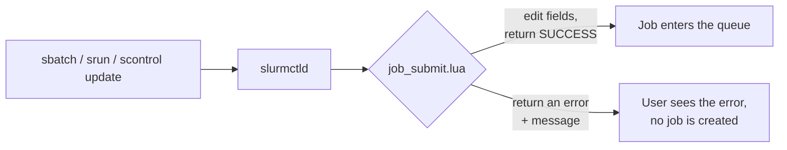

# The Receptionist Who Rewrites Your Badge: job_submit.lua

<!-- related-block -->
<div class="reading-time">11 min read</div>
<!-- related-block -->
<div class="related-strip">

**See also:** [Backfill Tuning: The Planner That Can Only See One Day Ahead](/fields/schedulers/slurm-backfill-tuning.md), [Calling Dibs on Nodes: Reservations, Maintenance Windows and the Job That Fit](/fields/schedulers/slurm-cluster-operations/slurm-reservations-and-maintenance.md), [Does the Rulebook Still Work? Smoke-Testing QOS, Submit Rules and Preemption](/fields/schedulers/slurm-smoke-tests/slurm-smoke-policy.md), [Dying Politely: Preemption, Requeue and the Signals Your Training Job Ignores](/fields/schedulers/slurm-preemption/slurm-preemption-requeue-signals.md), [Measure Twice, Reconfigure Once: Smoke-Testing a slurm.conf Change](/fields/schedulers/slurm-smoke-tests/slurm-smoke-config-change.md), [Slurm Multi-Tenancy: Who Stores the Rules, Who Enforces Them](/fields/schedulers/slurm-accounting-multi-tenancy.md), [The Changelog Nobody Reads: What Moved Between Slurm 23.11 and 26.05](/fields/schedulers/slurm-cluster-operations/slurm-version-changes.md), [The Cluster That Worked Perfectly and Remembered Nothing: a Two-Minute Slurm Smoke Test](/fields/schedulers/slurm-smoke-tests/slurm-smoke-control-plane.md), [The Guest List: Setting Up QOS Preemption Without Starting a War](/fields/schedulers/slurm-preemption/slurm-qos-preemption-setup.md), [Where Heterogeneous Jobs Shine](/fields/schedulers/slurm-mixed-gpus/where-hetjobs-shine.md)

</div>


> **Part of the [schedulers](/fields/schedulers/slurm-intro.md) directory.** Everything here was run on a two-node test cluster (Slurm 23.11.4, accounting on, both `slurmd` daemons on one Ubuntu 24.04 machine), including the failures. Names and stories are invented. Field names and return codes can differ between Slurm versions, so print what your version gives you (the probe in [What the script can see](#what-the-script-can-see)) before you build on it.

## Table of Contents

- [The Receptionist Who Rewrites Your Badge: job_submit.lua](#the-receptionist-who-rewrites-your-badge-job_submitlua)
  - [Table of Contents](#table-of-contents)
  - [The seven-day job nobody meant](#the-seven-day-job-nobody-meant)
  - [What the plugin is](#what-the-plugin-is)
  - [Turning it on](#turning-it-on)
  - [What the script can see](#what-the-script-can-see)
  - [What the script can say back](#what-the-script-can-say-back)
  - [Recipe 1: default the QOS and route "high"](#recipe-1-default-the-qos-and-route-high)
  - [Recipe 2: demand a time limit](#recipe-2-demand-a-time-limit)
  - [Recipe 3: make the victims requeueable](#recipe-3-make-the-victims-requeueable)
  - [Recipe 4: defuse user-exclusive jobs](#recipe-4-defuse-user-exclusive-jobs)
  - [The whole script](#the-whole-script)
  - [Breaking it on purpose](#breaking-it-on-purpose)
  - [Things the script is not](#things-the-script-is-not)
  - [Version notes](#version-notes)
  - [Back to the seven-day job](#back-to-the-seven-day-job)
  - [References](#references)

---

## The seven-day job nobody meant

On Monday morning the admin opens the queue and finds forty pending jobs, each one claiming a time limit of seven days. Nobody asked for seven days. The partition's `MaxTime` is seven days, and a job that does not say `--time` quietly inherits it.

To the scheduler, every one of those jobs is a boulder. The [backfill page](/fields/schedulers/slurm-backfill-tuning.md) explains the consequence: backfill plans from time limits, so a queue full of week-long boulders leaves no gaps for the short jobs that could have run in minutes. The admin could send an email that says "please always set `--time`". Nobody reads that email. What the cluster needs is a doorman who checks the badge on the way in.

Slurm has one. It is called the job submit plugin, and the version most people end up using is written in Lua.

---

## What the plugin is

The `job_submit/lua` plugin runs a script of yours **inside `slurmctld`, every time a job is submitted or modified**. The script receives the job as a table, `job_desc`, and may change it, accept it, or refuse it, all before the scheduler has seen the job.



Two functions make a script. Slurm calls them by name:

| Function | Called when | Typical use |
|---|---|---|
| `slurm_job_submit(job_desc, part_list, submit_uid)` | A job is submitted | Defaults, routing, rejecting |
| `slurm_job_modify(job_desc, job_rec, part_list, modify_uid)` | A job is changed with `scontrol update` | Applying the same rules, so nobody bypasses them |

This is the receptionist from the title. She sees every visitor, can write a different name on the badge, and can turn people away at the door. She does not decide who gets a seat (that is the scheduler), and she knows nothing about [preemption](/fields/schedulers/slurm-preemption/slurm-qos-preemption-setup.md). She only decides what the badge says.

---

## Turning it on

Two things, in this order:

1. **Put `job_submit.lua` in the same directory as the `slurm.conf` the controller runs with.** That is `/etc/slurm` on many sites and somewhere else on others. On the test cluster the controller was started with `SLURM_CONF=/opt/.../slurm.conf` and the script sat next to that file, with no copy in `/etc/slurm`. It loaded.
2. **Then add `JobSubmitPlugins=lua` to `slurm.conf`** and run `scontrol reconfigure`.

> [!WARNING]
> The order matters. With `JobSubmitPlugins=lua` set and the file missing, `slurmctld` refuses to start: the log says it is unable to stat `.../job_submit.lua`, and users see "Unable to contact slurm controller". Put the file there first, and check it with `luac -p job_submit.lua` if you have `luac`.

Confirm it loaded:

```bash
scontrol show config | grep JobSubmitPlugins
grep job_submit /var/log/slurm/slurmctld.log | tail -3
```

```text
JobSubmitPlugins        = lua
[2026-11-12T11:31:23.435] lua: job_submit.lua loaded
```

---

## What the script can see

The `job_desc` table holds what the user asked for. A field the user did not set is `nil`, or a "not set" number. To see what your version gives you, put a probe in the script and submit a few jobs:

```lua
function slurm_job_submit(job_desc, part_list, submit_uid)
    slurm.log_info("PROBE account=%s default_account=%s qos=%s time_limit=%s shared=%s",
        tostring(job_desc.account), tostring(job_desc.default_account),
        tostring(job_desc.qos), tostring(job_desc.time_limit), tostring(job_desc.shared))
    return slurm.SUCCESS
end
function slurm_job_modify(job_desc, job_rec, part_list, modify_uid)
    return slurm.SUCCESS
end
```

What the log showed for a plain `sbatch --hold` by a user whose default account is `physics`:

| Field | Value seen | What it means |
|---|---|---|
| `job_desc.account` | `nil` | The user did not pass `-A`. **Not** "the user has no account" |
| `job_desc.default_account` | `physics` | The user's default account. `nil` for a user with no account at all |
| `job_desc.qos` | `nil` | No `--qos` typed |
| `job_desc.time_limit` | `4294967294` (`slurm.NO_VAL`) | No `--time` typed |
| `job_desc.shared` | `65534` | Unset. `0` for `--exclusive`, `1` for `--oversubscribe`, `2` for `--exclusive=user` |

So "which account will this be charged to" is two lookups, `account` first and `default_account` as the fallback. Forgetting the fallback makes the script reject every user who relies on a default account.

---

## What the script can say back

The return value decides the fate of the job:

| Return | Effect |
|---|---|
| `slurm.SUCCESS` | Accept (with whatever edits the script made) |
| `slurm.ERROR` | Refuse with the generic "Unspecified error" |
| `slurm.ESLURM_INVALID_TIME_LIMIT`, `slurm.ESLURM_INVALID_QOS`, `slurm.ESLURM_INVALID_ACCOUNT`, `slurm.ESLURM_ACCESS_DENIED`, ... | Refuse with the standard Slurm message for that error |

And two logging calls, which go to different places:

| Call | Goes to |
|---|---|
| `slurm.log_info(fmt, ...)` | `slurmctld.log`, with a `lua:` prefix. For the admin |
| `slurm.log_user(text)` | The user's terminal, as `sbatch: error: <text>`. For the human at the door |

Together, a refusal that explains itself looks like this:

```text
$ sbatch --wrap='sleep 1'
sbatch: error: Please set --time, jobs without one are not accepted
sbatch: error: Batch job submission failed: Requested time limit is invalid (missing or exceeds some limit)
```

The first line is `log_user`; the second is the standard text for the error code the script returned. Without `log_user` the user would get only the second line and write to you.

---

## Recipe 1: default the QOS and route "high"

The most common job for the receptionist, and the reason this page exists next to the [QOS preemption setup](/fields/schedulers/slurm-preemption/slurm-qos-preemption-setup.md). A job with no QOS goes to `low`. A job that asks for plain `high` is renamed to the account's own tier, `high_<account>`.

```lua
if job_desc.qos == nil or job_desc.qos == "" then
    job_desc.qos = "low"
elseif job_desc.qos == "high" then
    job_desc.qos = "high_" .. acct      -- acct from account, else default_account
end
```

Users type one simple word. Behind it, every account has its own QOS, which means its own limits. I know of no plain-configuration way to map one typed name to a different QOS per account, which is why this is a script's job.

> [!NOTE]
> If you only need the *default*, no script is required: `sacctmgr modify user alice set DefaultQOS=low` made a job with no `--qos` come out as `low` in the test. Lua is for **rewriting** what the user typed.

---

## Recipe 2: demand a time limit

The cure for the opening story. A missing `--time` shows up as `slurm.NO_VAL`:

```lua
if job_desc.time_limit == slurm.NO_VAL then
    slurm.log_user("Please set --time, jobs without one are not accepted")
    return slurm.ESLURM_INVALID_TIME_LIMIT
end
```

The error text is the one shown earlier. If you would rather not be strict, the alternative is a `DefaultTime` on the partition, which is gentler but is also a guess about what each user meant.

---

## Recipe 3: make the victims requeueable

A job evicted under `PreemptMode=REQUEUE` is only requeued if it is requeueable. With `JobRequeue=0` on the cluster and no `--requeue` from the user, the test victim ended as `PREEMPTED` and was gone from the queue. When the script set `job_desc.requeue = 1`, `scontrol show job` showed `Requeue=1` and the same eviction ended with a second run waiting in the queue:

```lua
if job_desc.qos == "low" then
    job_desc.requeue = 1
end
```

```text
without it:   37|low|PREEMPTED                 (and no second run)
with it:      37|low|PREEMPTED
              37|low|PENDING                   (requeued)
```

If your cluster has `JobRequeue=1` (a common default), this recipe changes nothing and you can leave it out.

---

## Recipe 4: defuse user-exclusive jobs

The [preemption page](/fields/schedulers/slurm-preemption/slurm-preemption-requeue-signals.md#preemption-fine-print) notes that `--exclusive=user` and `--exclusive=mcs` stop a job from preempting or being preempted by other users' jobs, and suggests a submit plugin to disable them where you rely on preemption. In `job_desc.shared`, `--exclusive=user` is `2` and plain `--exclusive` is `0`:

```lua
if job_desc.shared == 2 then
    job_desc.shared = 0
    slurm.log_user("--exclusive=user changed to --exclusive")
end
```

Checking with `scontrol show job`: a held `--exclusive=user` job showed `OverSubscribe=USER` with a do-nothing script and `OverSubscribe=NO` with this rule.

> [!CAUTION]
> This silently changes what a user asked for. It is the right call only if your cluster depends on cross-user preemption, and the `log_user` line should say so, or you will receive a very confused email.

---

## The whole script

All four rules together, as run on the test cluster. Every branch was checked against a real controller: no `--time` is refused, no QOS becomes `low`, `--qos=high` becomes `high_physics` (also through the default account), `--exclusive=user` becomes `--exclusive`, a user with no account asking for `high` gets the message, `scontrol update QOS=high` is routed the same way, and any other QOS passes through.

```lua
-- job_submit.lua: lives next to slurm.conf and runs inside slurmctld

local EXCLUSIVE_USER = 2    -- value of job_desc.shared for --exclusive=user

-- "high" becomes "high_<account>"; false means we cannot tell the account
local function route_high(job_desc, acct)
    if acct == nil or acct == "" then
        return false
    end
    job_desc.qos = "high_" .. acct
    return true
end

function slurm_job_submit(job_desc, part_list, submit_uid)
    -- 1. Every job must say how long it needs (see the backfill page)
    if job_desc.time_limit == slurm.NO_VAL then
        slurm.log_user("Please set --time, jobs without one are not accepted")
        return slurm.ESLURM_INVALID_TIME_LIMIT
    end

    -- 2. Which account will this job be charged to?
    local acct = job_desc.account
    if acct == nil or acct == "" then
        acct = job_desc.default_account
    end

    -- 3. No QOS typed: the preemptible tier, and make it requeueable
    if job_desc.qos == nil or job_desc.qos == "" then
        job_desc.qos = "low"
        job_desc.requeue = 1
    elseif job_desc.qos == "high" then
        if not route_high(job_desc, acct) then
            slurm.log_user("--qos=high needs an account; add --account=<name>")
            return slurm.ESLURM_INVALID_ACCOUNT
        end
        slurm.log_info("job_submit.lua: uid=%u account=%s qos high -> %s",
                       submit_uid, acct, job_desc.qos)
    end

    -- 4. --exclusive=user blocks preemption; plain --exclusive does not
    if job_desc.shared == EXCLUSIVE_USER then
        job_desc.shared = 0
        slurm.log_user("--exclusive=user changed to --exclusive (user-exclusive blocks preemption here)")
    end

    return slurm.SUCCESS
end

function slurm_job_modify(job_desc, job_rec, part_list, modify_uid)
    local acct = job_desc.account or job_rec.account
    if job_desc.qos == "high" then
        if not route_high(job_desc, acct) then
            slurm.log_user("--qos=high needs an account")
            return slurm.ESLURM_INVALID_ACCOUNT
        end
    end
    return slurm.SUCCESS
end

slurm.log_info("job_submit.lua loaded")
```

---

## Breaking it on purpose

A script runs inside the controller, so a mistake in it is a mistake in the most important daemon you have. These are the failures the test cluster produced:

| What you do | What happens |
|---|---|
| Edit the script while `slurmctld` runs | The next submission picks it up and logs `job_submit.lua loaded` again. No reconfigure needed |
| Save a script with a **syntax error**, controller running | The log says `error: job_submit/lua: ... using previous script`. The controller keeps running on the last good version |
| **Restart** `slurmctld` with a broken script | `fatal: failed to initialize job_submit plugin`. The controller does not start, users see "Unable to contact slurm controller" |
| `scontrol reconfigure` with a broken script | `slurm_reconfigure error: Unspecified error` and the same `fatal` line in the log. In the test the controller stayed up and kept accepting jobs, but I did not check which script it was running |
| `JobSubmitPlugins=lua` and **no file** | `slurmctld` refuses to start (see [Turning it on](#turning-it-on)) |

The pattern is that a running controller forgives a bad edit, and a starting controller does not. That gives the rules:

- Edit in place, never restart the controller to "apply" a change.
- Run `luac -p` before saving, and keep the previous version next to it.
- Test with a throwaway account and a held job (`sbatch --hold`) before you announce anything.
- One small footnote: an edit saved in the same second as the previous load was not picked up on my first try. A pause of a couple of seconds fixed it, which matters only if you test by script.

---

## Things the script is not

- **It is not free.** It runs on every submission, in the controller. Keep it short, with no file reads, no network calls and no waiting.
- **It does not see jobs already in the queue.** Existing jobs keep what they had until someone modifies them, and then `slurm_job_modify` applies.
- **It is not one call per job for heterogeneous jobs.** Slurm's documentation notes that it runs separately for each component; see [where hetjobs shine](/fields/schedulers/slurm-mixed-gpus/where-hetjobs-shine.md).
- **It does not do preemption.** It labels jobs. The [QOS setup](/fields/schedulers/slurm-preemption/slurm-qos-preemption-setup.md) decides what the labels mean.

---

## Version notes

The script on this page was tested on Slurm 23.11.4. Later versions add: `curr_dependency` (24.05.2); `assoc_qos` and `slurm.get_qos_priority()` (24.11); a crash fix when reading `assoc_qos` for an association that does not exist (25.05.3); and, in 26.05, a stack trace in the log on runtime errors plus `core_spec` and `thread_spec` in `job_desc`. 26.05 also replaces `ExclusiveUser` and `ExclusiveTopo` in partition definitions with `Exclusive=[NO|NODE|USER|TOPO]`, which is worth knowing for Recipe 4. None of these were tested here. [Version changes 23.11 to 26.05](/fields/schedulers/slurm-cluster-operations/slurm-version-changes.md#job_submitlua) has the details.

---

## Back to the seven-day job

Replay Monday. A researcher submits without `--time`. In under a second she gets a line in her terminal: *Please set --time, jobs without one are not accepted*. She adds `--time=4:00:00`, submits again, and the job lands in the queue as a four-hour job, small enough for backfill to slot into a gap.

By the following Monday there are no boulders. Nobody was shamed in an email. The doorman just checks the badge, and the badge now says how long you intend to stay.

**Takeaway:** the Lua submit script is a receptionist inside `slurmctld`: it can read, rewrite or refuse every job at the door, a running controller forgives a broken edit but a restarting one does not, so put the file in place first and check its syntax before you save.

**Next:** [Who Gets Told What](/fields/schedulers/slurm-preemption/slurm-signals-cheatsheet.md) covers every signal Slurm sends to a job, and who actually receives it.

---

## References

- [Slurm: Job Submit Plugins](https://slurm.schedmd.com/job_submit_plugins.html)
- [Slurm: slurm.conf](https://slurm.schedmd.com/slurm.conf.html) (`JobSubmitPlugins`, `JobRequeue`, `DefaultTime`)
- [Slurm: Quality of Service (QOS)](https://slurm.schedmd.com/qos.html)
